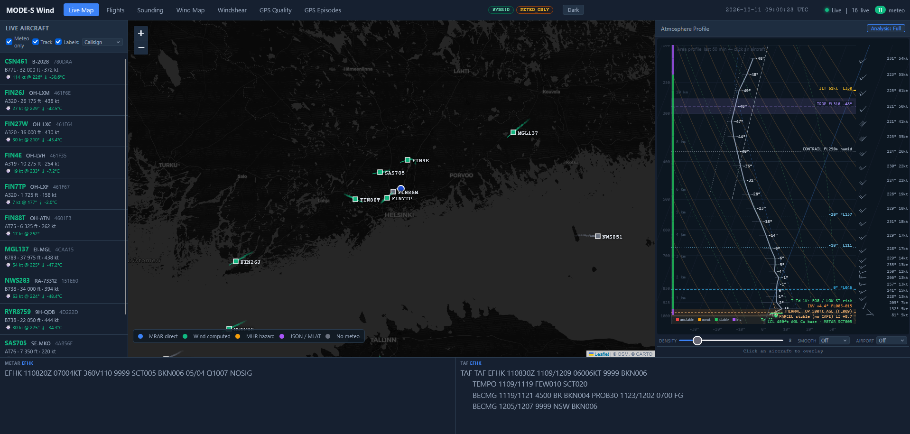
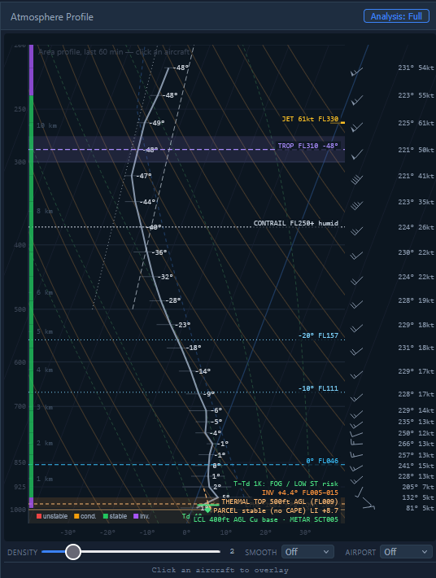
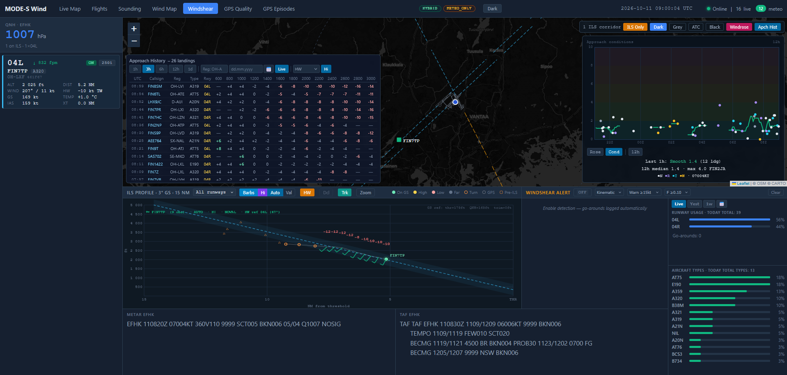
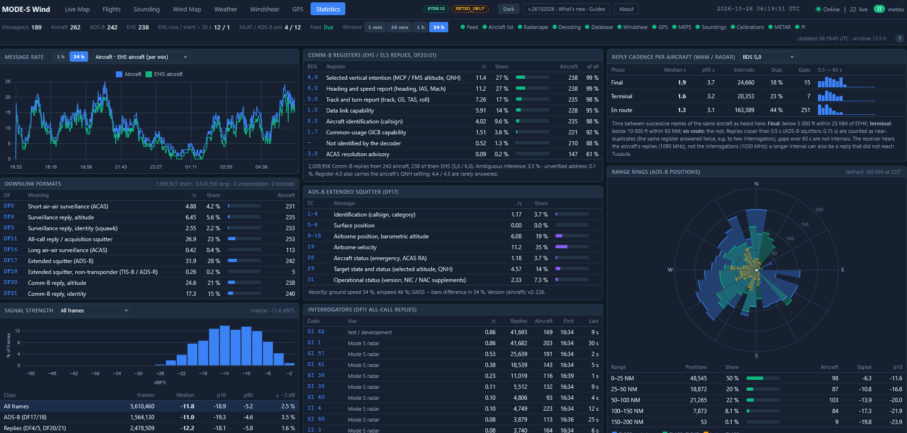

# MODE-S Wind

A Python-based system for collecting, decoding and visualising real-time meteorological data from aircraft using **MODE-S Enhanced Surveillance (EHS)** and **ADS-B** messages received by a [Jetvision Radarcape](https://www.jetvision.de/radarcape/) receiver.

Two complementary methods are used to extract meteorological data from aircraft transponder traffic. The primary method is direct decoding of **BDS 4,4 Meteorological Routine Air Report (MRAR)** messages, which carry onboard sensor readings for wind speed, wind direction, static air temperature, and humidity — but MRAR is optional equipment and relatively few aircraft in commercial service transmit it. The majority of observations are therefore derived indirectly from **MODE-S Enhanced Surveillance (EHS)** data: wind speed and direction are computed from the aircraft's air vector — magnetic heading (BDS 6,0, converted to true heading with the World Magnetic Model declination at the aircraft's position) and true airspeed (BDS 5,0, or derived from Mach / IAS in BDS 6,0) — and its ground vector (true track and groundspeed from BDS 5,0). These EHS-derived values are physically equivalent to sensor readings but are calculated rather than measured directly. The system handles both methods transparently, preferring direct MRAR data when available and falling back to EHS computation otherwise.

All decoded observations are stored in a local SQLite database and presented through a web dashboard with a live map, historical flight browser, Skew-T atmospheric sounding diagrams, a gridded historical wind map, a MEPS weather map (Weather page), an approach / windshear monitor with per-landing approach history and approach-conditions index, GPS-interference monitoring (hourly GPS Quality statistics and individual GPS degradation episodes), and receiver / Mode S statistics with system health indicators (Statistics page).

> **⚠ Note for test users:** GPS jamming is very common in the whole EFHK and Gulf of Finland area. Aircraft affected by it may broadcast degraded or no GPS-derived (ADS-B) positions, at times down to low altitudes on approach and departure, so position data should be interpreted with caution. The extent of the interference varies from day to day and over the day; it is monitored on the [GPS Quality](#gps-quality--gps) and [GPS Episodes](#gps-episodes--gps-episodes) pages (see also [GPS Jamming Note](#gps-jamming-note)).



> **Display note:** the web interface is optimised for **1920 × 1080** desktop resolution. On mobile phones the layout will adapt but the experience is limited. On tablets, horizontal (landscape) orientation gives significantly better results — an iPad in landscape mode works reasonably well.

---

## Features

- **Real-time live map** — ATC-style aircraft display with 1-minute position trails, colour-coded by meteo data source, with optional callsign or ICAO24 labels; optional weather overlay (MEPS rain / snow, cloud, fog, isobars or the FMI radar) and model / aircraft wind barbs at a level
- **Meteo data sources** decoded simultaneously:
  - BDS 4,4 MRAR — Meteorological Routine Air Report (direct temp, pressure, humidity, wind, turbulence from aircraft avionics)
  - BDS 4,5 MHR — Meteorological Hazard Report (icing, wind shear, microburst, turbulence levels; rare and often unreliable at EFHK, its temperature is not used — see [Data source priority](#data-source-priority))
  - BDS 5,0 + 6,0 computed wind — wind vector derived from true track, ground speed, magnetic heading and airspeed
  - BDS 5,0 + 6,0 **air temperature** — static air temperature from the true airspeed and the Mach number (available for about 85 % of the observations, see [Air temperature](#air-temperature-bds-50--60))
- **MLAT position support** — polls the Radarcape's JSON feed for multilateration-derived positions that remain accurate even when GPS jamming suppresses ADS-B position broadcasts
- **Skew-T atmospheric soundings** — area profile of all aircraft over the last 30 min – 3 h, an hourly profile archive kept indefinitely, and per-flight vertical profiles for climbing/descending flights (Sounding page, or directly from the Flights browser); the Jokioinen radiosonde (FMI open data) and the **MEPS** weather model (MET Norway open data) can be drawn for comparison, every sounding is verified against the area profile automatically (**Sonde check**) and every hour is compared with the model (**MEPS check**), from which a small correction of the fleet's warm bias at cruise levels is learnt; an **Indices** panel gives the stability indices and characteristic levels (CAPE, Lifted Index, LCL, freezing level, tropopause, lapse rates, wind shear …) of the shown profile next to those of the MEPS model and / or the sonde, with clear differences shaded
- **Mini atmosphere profile panel** — always-visible Skew-T profile in the live map sidebar; clicking any aircraft immediately loads its full historical wind and temperature profile from the database, then continues accumulating live updates on top. Profile persists across page navigation — navigating away and back restores the full picture instantly.
- **Weather page** — the MEPS weather model over Scandinavia and Finland with a time slider from the past 7 days to a 48 h forecast: isobars with highs and lows, rain and snow in radar-like colours, 10 m wind barbs and gusts, cloud cover
- **Historical flight browser** — searchable and paginated table of all recorded flights with meteo statistics, time-series charts, and a flight track map
- **Light / Dark theme toggle** — a **Dark / Light** button in the navbar switches all pages between the default dark theme and a blue-grey paper-toned light theme; preference is stored in `localStorage` and applied before first paint so there is no flash on page load; all canvas renderers (Skew-T diagrams, ILS profile, Wind Rose) redraw instantly with the new palette. In the dark theme the diagrams (Skew-T, ILS profile, Wind Rose and Approach Conditions chart) and the Windshear map overlays (Wind Rose / ACI, Approach History) use the same blue-grey as the panels (`--bg-1`)
- **About, What's new and User guides windows** — the navbar's version button opens the notes of the latest versions and the user guides (PDF); **About** tells who made the system, where the receiver is and how the measurements are made
- **Persistent UI preferences** — all toggles (Meteo only, Labels, label mode, aircraft list order, wind history density, theme) are remembered across browser sessions via localStorage; the Live Map, the Wind Map and the Weather page also remember their map view (centre and zoom), and a **⌂** button under the zoom buttons returns to the receiver at the default zoom (from 2026-10-28)
- **Configurable meteo source mode** — choose between EHS-only (pyModeS Beast decoding), JSON-only (Radarcape's own decoded values), or Hybrid priority for the live view (stored observations always come from pyModeS decoding); active mode shown as a read-only badge in the navbar on every page
- **Configurable storage mode** — store all observations or meteo-only to drastically reduce database size and SD-card write load; active mode shown in the navbar badge alongside source mode
- **Per-aircraft write throttle** — configurable minimum interval between successive database writes for the same aircraft, dramatically reducing write volume without meaningfully affecting sounding data quality
- **Gridded wind and temperature map** — select a flight level, altitude tolerance, time window (preset or custom historical range) and cell size (25 / 50 / 100 km square cells); per-aircraft-averaged wind barbs at each populated cell, colour-coded by wind speed, faded by the number of aircraft behind them, optional ΔT colouring (temperature difference from the layer mean: air masses and fronts), isotachs and streamlines from a smoothed field, the Jokioinen radiosonde at the level, the change since the previous period or the thermal wind to another level (warm / cold advection per cell), a time slider / animation over the last 24 hours, the MEPS model at the level and the Mode S − MEPS difference, and a vertical cross-section along a line; frozen and spoofed positions removed
- **QNH pressure-altitude correction** — for wind map layers below FL050, the query band is automatically shifted into pressure-altitude space using the METAR QNH of the period so that observations are binned to the correct MSL altitude. Raw pressure altitudes are kept intact in the database; correction is applied at query time only
- **Windshear approach monitoring page** — ATC-style real-time display of all aircraft established on ILS or RNP approach (RWY 04L, 04R, 22L, 22R, 15, 33), with flight strips, an ILS/RNP glideslope vertical profile canvas, server-side **windshear detection** (headwind ramps along the path and the change against the earlier landings and departures, with *WS advisory / WSA / MBA* alerts and a stored windshear report for every landing), a go-around detector, a wind rose (with an approach-conditions chart view, and an ACI + windshear view on one time axis) and a persistent **Approach History** of every landing — wind per 200 ft band, GNSS quality on final, and a provisional **Approach Conditions Index (ACI)** (roughness) from the aircraft's own bank-angle, airspeed and vertical-rate activity; see [Windshear](#windshear--windshear) below
- **GPS Quality monitoring page** — area-wide real-time and historical GPS degradation monitor covering all tracked aircraft at all altitudes; detects self-reported degradation (NACp accuracy and NIC integrity), position freeze, position gap and ADS-B position loss (MLAT covering a GPS dropout); renders a stacked bar chart (NACp / NIC / Freeze / Gap / ADS-B signal breakdown, with a `1d`–`6m` range selector), a 9-FL-band heatmap with its own `14d` / `1m` day-range selector, an `Events` / `% aircraft` mode, a `10 min` view of degraded aircraft, a Severity & Spoofing panel (`1d` / `7d` / `1m`), hover details and click-through to the GPS Episodes page, a FL band distribution doughnut chart with a summary stats panel over the same window, and a **distance zone selector** (All / 50 nm / 20 nm) that filters all views to aircraft within a chosen radius from the airport; see [GPS Quality](#gps-quality--gps) below
- **GPS Episodes page** — map, list and altitude-vs-distance view of individual GPS degradation episodes (one aircraft's continuous degraded period: where it started, where the aircraft recovered or was lost); see [GPS Episodes](#gps-episodes--gps-episodes) below. GPS Quality and GPS Episodes share one **GPS** link in the navbar, with a *Quality / Episodes* switch at the top left of both pages
- **Mobile view `/app`** — Skew-T (Area now / Area hour), Time–height, the live ILS approach (glideslope and an approach map), ACI · WS · ST (with the space–time diagram), the History of landings and departures with a search, and the Statistics (sections chosen in the menu) on a phone, one product at a time filling the screen, all choices in a ☰ menu; *Add to Home Screen* gives it an icon and opens it full screen; see [Mobile view](#mobile-view--app) below
- **Mode S & ADS-B Statistics page** — what the receiver hears, refreshed every 10 s: message rate (1 h / 24 h / 7 d), downlink formats, Comm-B registers, ADS-B type codes, the reply cadence per aircraft by flight phase (a view of the WAM / radar interrogation schedule), the active ground interrogators from the DF11 all-call replies, the **signal-strength histogram** and the **range rings** (coverage per bearing and altitude), the **Radarcape receiver's own status** (GPS lock and timestamp sync, GPS module temperature, uptime, position, receiver settings), the meteo yield and the Radarcape aircraft list, over 1 min / 10 min / 1 h / 24 h / 7 d, and **system health indicators** (green / amber / red for the feed, the aircraft list, the Radarcape receiver, decoding, the database and background jobs, windshear, GPS, MEPS, soundings, calibrations, METAR and the Raspberry Pi itself); counted in RAM, kept over restarts (one compressed row an hour in the database, 7 days); see [Statistics](#statistics--stats) below
- **Maintenance page** — administrator tool for database housekeeping accessible at `/maintenance`; protected by a separate credential file independent of the main web auth; provides manual and scheduled purge of flight/meteo data (approach history, GPS quality data and the GPS degradation episode log are only ever purged manually); see [Maintenance](#maintenance--maintenance) below
- **ICAO24 blocklist** — a configurable prefix list (`BLOCKED_ICAO_PREFIXES`) silently drops non-aircraft Mode-S emitters system-wide at both the Beast TCP and JSON/MLAT live\_state entry points; default entry `T40` filters Finnish Air Navigation Services WAM ground interrogator stations that would otherwise inflate GPS quality counts and traffic statistics
- **Registration blocklist** — a complementary prefix list (`BLOCKED_REG_PREFIXES`) silently drops aircraft by registration system-wide (registration from the Radarcape JSON feed, or from an optional `BaseStation.sqb` aircraft database when the feed has none — see [WAM ground station filtering](#wam-ground-station-filtering)); default entry `OH-H` filters Finnish helicopters whose continuous manoeuvring near EFHK produces unreliable computed wind and should not feed any meteo analysis
- **SQLite database** with WAL mode — safe for Raspberry Pi SD-card or USB SSD operation
- **HTTP Basic Auth** — simple credentials-based access control for local network deployment; separate web users (hashed passwords) managed on the Maintenance page


---

## Project status and data checks

MODE-S Wind is a research system that is still collecting data. The current database at EFHK starts on 24 September 2026; every few days a snapshot is checked against the Jokioinen radiosondes and the MEPS weather model, and the methods are tuned with what the data shows. The latest check (26 October 2026, after two days of moderate south-easterly wind with a 100-kt jet aloft; 945 000 stored observations, 3 672 landings and 3 434 departures with raw replies since 9 October, 15 new soundings since 22 October):

| Area | Status | Latest finding |
|---|---|---|
| Wind (heading-calibrated) | in use | hourly area wind within 2.4–3.1 kt (vector RMS) of MEPS at 925–400 hPa, 4–5 kt at 300–250 hPa and 7 kt at 200 hPa, with the model taken at the aircraft positions (before: 3–4 / 6–10 kt against the area mean); jet-core speeds a few kt above the model |
| Temperature (Mach/TAS) | in use, upper levels corrected | warm by about +0.7 K at 300–250 hPa against both the model and the sondes, steady through the front; the correction learnt from MEPS cut the 200–300 hPa error against the sondes from 1.27 to 0.96 K RMS (see *Upper-level temperature correction*) |
| Heights of the pressure surfaces (GNSS) | in use | within ±2 m of MEPS at 400–250 hPa and 2–7 m below at 500–850 hPa, hourly correlation 0.996–0.999 — the earlier "3–16 m below" was mostly where the aircraft fly in the height gradient (see *MEPS check*) |
| Windshear detection v2 | experimental | 9–26 Oct: no windshear / microburst alerts from the ramps in 3 672 landings; advisories at 10–12 kt now need to stand out from the other flights' profile (59 → 26), after the stable evening boundary layer of 25 Oct flagged a quarter of the landings; through the front of 23 Oct: a real persistent shear layer, no false alarms at the runway changes; the band comparison now uses the wind vector so departures fill the gaps between the arrival waves (it caught the 17 October wind change ten minutes before the first landing, and a 16 kt change at 1 800 ft during the night-time frontal passage) — the levels still need windier and convective weather; 26 Oct (strong turbulent southerly flow): 12 ramp alerts, one real shear layer (confirmed by 4 landings), most of the others single-aircraft eddies — now labelled *confirmed* / *isolated*; landings and departures differ by about 3 kt of headwind (±1.5 kt against MEPS, an airspeed effect of the flight phase) — from 27 Oct each flight is compared with its own phase (or the bias removed), which balanced the departure flags |
| Moisture indicator | trial, data collection continues | no skill so far: over 110 hours (22–26 Oct) the correlation with the MEPS layer humidity is 0.14 at 1 000–5 000 ft and negative above, while MEPS stays within about 10 points of the sondes — kept running (can be switched off with *RH*) and re-evaluated in other seasons; the offsets are now learnt from the MEPS model humidity (removes the bias, not the scatter); kept running and re-evaluated after more varied weather |

All measurements come from the aircraft alone. The MEPS model (MET Norway open data) is optional: it is drawn for comparison, checks the aircraft every hour, and is used to learn two small calibrations (the upper-level temperature correction and the moisture offsets). Without it these fall back to the last learnt values or the soundings, and the rest of the system works as before.

---

## Hardware Requirements

| Component | Requirement |
|-----------|-------------|
| MODE-S receiver | Jetvision Radarcape (Beast binary TCP output on port 10003, JSON feed on port 80) |
| Computer | Raspberry Pi 4 (2 GB RAM or more recommended) or any Linux machine |
| Storage | SD card works; USB SSD strongly recommended for long-term database growth |
| Network | Receiver and Raspberry Pi on same local network |

The system was developed and tested with a Radarcape receiver and Raspberry Pi 4 near EFHK (Helsinki-Vantaa Airport, Finland). Any receiver that outputs Beast binary format over TCP will work, though the JSON/MLAT feed integration is specific to the Radarcape.

A five-page A4 overview of the receiving station — the hardware with photos, the Mode S registers used, the formulas, calibration, storage, the pages, the windshear detection with the ongoing study, the two sites (the off-grid capable local station and the cloud server that serves the users) and, from 28 Oct 2026, the phone view `/app` (light-theme screens of the Skew-T, ILS approach, ACI + windshear and Statistics, the seven views, a QR code of the address) — is in [`doc/MODE_S_Wind_Receiving_Station_OH2GAX.pdf`](doc/MODE_S_Wind_Receiving_Station_OH2GAX.pdf) (also in the *User guides* tab).

---

## Software Architecture

```
Radarcape receiver (192.168.0.119)
        │
        ├─ HTTP /systemstatus.json ──► collector/radarcape_status.py
        │                                (receiver GPS / time / settings, every 60 s; RAM)
        │
        ├─ TCP :10003  Beast binary  ──► collector/receiver.py
        │                                      │  pyModeS decoding
        │                                      │  BDS 4,4 / 4,5 / 5,0 / 6,0
        │                                      │  CPR position decoding
        │                                      ▼
        └─ HTTP /aircraftlist.json ──► collector/radarcape_json.py
                                               │  MLAT positions
                                               │  Pre-decoded temp & wind
                                               ▼
                                     ┌─────────────────┐
                                     │  live_state dict │  (shared in-memory)
                                     └────────┬────────┘
                                              │
                             ┌────────────────┼──────────────────┬──────────────────┐
                             │                │                  │                  │
                       collector/      windshear sweep     gps sweep         wx poll        web/app.py
                       writer.py       daemon (3 s)         daemon (5 s)      thread (10 m)  Flask + SSE
                       (SQLite WAL)         │                    │                │           │
                             │       WindshearTracker    GpsQualityTracker   _wx_cache       ├─ /              Live map
                             │       (RAM; landings →    (RAM; hourly rows   (METAR/TAF)     ├─ /flights       History
                             │       approach_history)   + episode log)                      ├─ /sounding      Skew-T
                       data/modes_meteo.db                                                   ├─ /windmap       Wind map
                                                                                             ├─ /weather       Weather
                                                                                             ├─ /windshear     Approach
                                                                                             ├─ /gps           GPS Quality
                                                                                             ├─ /gps-episodes  GPS Episodes
                                                                                             ├─ /stats         Statistics
                                                                                             ├─ /app           Mobile view
                                                                                             └─ /maintenance   DB maintenance
```

Further background threads in `run.py`: **housekeeping** (see below), **autopurge** (daily flight / meteo purge when enabled on the Maintenance page) and **hourly_jobs** (hourly profile archive `profile_hours`, vorticity profile `kinematics_hours` and GNSS-height cells `gnss_hours` with the height calibration `gnss_cal` a few minutes after each hour, back-fill at startup, daily retention purges of `approach_series`, `departure_profiles`, `height_series` and (optional) `gnss_hours` — archived first when enabled — and the hourly save of the heading calibration `heading_cal`, the radiosonde verification `sonde_verification` and the upper-level temperature correction `t_correction`), **sondes** (radiosonde soundings from FMI open data) and **meps** (MEPS model profiles, Wind Map fields and Weather page maps from MET Norway every 3 h into `meps_hours`, `meps_ml_hours`, `meps_map_hours` and `meps_wx_hours`, see *MEPS check* and *Weather*) and **rc_status** (the Radarcape's own status page `systemstatus.json` every 60 s, `collector/radarcape_status.py`; off with `RADARCAPE_STATUS = False`) and **traffic** (the data transfer counters: network interface sampled every minute, one `traffic_hours` row per hour, `collector/traffic.py`). The **ws_sweep** thread also runs the departure climb-out capture (`collector/departures.py`). On the first start with the heading calibration a one-off **heading_cal_boot** thread learns the offsets from the stored observations; a one-off **shear_backfill** thread writes the windshear report of older landings that have stored raw replies and of the stored departures, and upgrades reports of an older version (a few seconds to about a minute on a Pi, updates in batches of 200). The BDS 5,0 / 6,0 replies decoded by `receiver.py` are also kept briefly per aircraft (last 16 of each) for the windshear tracker's approach-roughness capture.

A small **housekeeping thread** (`run.py`) runs every 60 s and removes aircraft from `live_state` that have not been seen for 10 minutes, prunes the BDS 5,0 / 6,0 pairing caches, and writes the Statistics page's completed hours to `msg_stats_hours`. Without it every aircraft ever received would stay in RAM for the life of the process. 10 minutes is longer than every consumer window (map/API 5 min, GPS sweep 60 s, windshear sweep 30 s), so nothing displayed or analysed is affected — an aircraft that reappears is simply re-created from its next message.

**Bounded memory for long uptimes:** besides `live_state` and the BDS caches, the other per-aircraft structures are also cleaned up: the database writer forgets flight sessions and write-throttle timestamps of inactive aircraft every 10 minutes; the windshear and GPS quality trackers drop aircraft that go stale; completed GPS quality hours keep only their counts (the per-aircraft sets are dropped when the hour ends, and the per-band detail is kept for the last 31 days); closed GPS episodes waiting for a failed database write are capped at 20 000; and the Live Map page forgets callsigns of aircraft that are no longer live. The message statistics (`collector/msg_stats.py`) keep per-minute records for one hour, the same merged per clock hour for 24 hours and a compact per-minute series for 24 hours, and forget per-aircraft reply times and positions after 10 minutes (a few MB for the hour, up to about 10–15 MB with the 24 hourly records in daytime traffic).

### Data source priority

When multiple sources are available for the same observation the `best_*` consolidated fields are populated in this order of preference:

1. **MRAR** (BDS 4,4) — highest quality, direct avionics measurement with Figure of Merit
2. **MHR** (BDS 4,5) — secondary hazard report (pressure only; its temperature is not used, see below)
3. **COMPUTED** — wind vector calculated from BDS 5,0 + 6,0 pair
4. **JSON** — temperature or wind injected from Radarcape's JSON feed (live view only, never stored)

Temperature (`best_temp`): **MRAR → Mach/TAS temperature** (→ JSON in the live view). At EFHK MRAR is practically never received. BDS 4,5 (MHR) temperatures are **not used** — not for `best_temp`, the area profiles, the Sounding page, the Live Map Skew-T or the hourly profile archive (`TEMP_SQL` in `collector/atmos.py`). Most BDS 4,5 replies at EFHK are other Comm-B registers misidentified as BDS 4,5: in 24 Sep – 10 Oct 2026 two thirds of their temperatures were more than 40 K from ISA (median ISA + 47 K, mostly FL340–400), and they widened the p10–p90 spread of the profile layers by up to 60 K. They made up only 0.5 % of the temperatures. The raw value is still stored in `mhr_temp`. Hourly profiles archived before this rule may still contain them (wide p10–p90 bars in some hours).

### Computed wind (BDS 5,0 + 6,0)

Wind = ground vector − air vector. The ground vector is the true track and groundspeed from BDS 5,0; the air vector is the true heading and true airspeed. A BDS 5,0 and a BDS 6,0 reply from the same aircraft at most `WIND_MAX_PAIR_AGE` (10 s) apart are paired, and the result is rejected while the aircraft banks more than `WIND_MAX_ROLL_DEG` or turns faster than `WIND_MAX_TRACK_RATE`.

**Fresh pairs only where the altitude matters** — the live view recomputes the wind with every message of the aircraft from the latest BDS 5,0 / 6,0 pair in memory (up to 60 s old), so the aircraft keeps its wind and temperature between its Comm-B replies. When these replies stop while ADS-B positions continue — typically low on final, below about 1 000 ft — that pair would be placed at the aircraft's current, lower altitude. Where the altitude matters, the wind and the Mach/TAS temperature are therefore only used when the older of the two replies is at most `WIND_MAX_AGE_SEC` (optional, default 6 s) old: stored observations (a stale pair is not stored; the next fresh one is), the Windshear page's ILS barbs, approach bands, wind rose buffer and detection, and the Live Map aircraft profile on the Skew-T. The live wind shown in the aircraft list, popups and flight strips keeps the latest value. On 10–11 Oct 2026, 28–33 % of the live approach winds at 400–600 ft were an exact copy of the band 200 ft above, measured higher up.

**True heading** — BDS 6,0 reports magnetic heading. The magnetic declination is taken from the **World Magnetic Model (WMM2025)** at the aircraft's own position via the `pygeomag` package (cached on a 0.5° grid, rebuilt daily so the ~0.15°/year drift is followed automatically). Within 150 NM of EFHK declination ranges from about 8.7° (west / south-west) to 12.6° (north-east); a single fixed value would be off by up to ~2°, which at 450 kt TAS is a ~16 kt wind error. `MAG_DECLINATION` is used only as a fallback — when the position is not yet known, `pygeomag` is not installed, or `USE_WMM_DECLINATION = False`. The value used is stored per observation (`mag_decl`). A missing `pygeomag` used to show only as one warning line at start-up; from 27 Oct 2026 it also turns the **Calibrations** health indicator of the Statistics page amber (*Magnetic declination model (pygeomag) missing — fixed … ° in use*), as does a WMM past its validity period (`collector/declination.py` `status()`).

**True airspeed** — taken from the best available source, stored per observation as `tas_source`:

| `tas_source` | Source | Notes |
|---|---|---|
| `BDS50` | TAS field of BDS 5,0 | Normal case — the same register that carries track and groundspeed; 2 kt resolution |
| `MACH` | Mach (BDS 6,0) × speed of sound | Temperature = ISA at the pressure altitude + the current ISA deviation for that altitude band. The deviation is estimated continuously from aircraft that report both TAS and Mach (Mach ≥ 0.40, at most one sample per aircraft per 20 s, absolute deviation ≤ 30 K) (their air-data computer's temperature: T = (TAS / Mach)² / (γ·R)), median of the last 30 min per 5 000 ft band; plain ISA when fewer than 5 samples exist. A 10 °C deviation left uncorrected would be ~2 % TAS error (~9 kt at cruise) |
| `IAS` | IAS (BDS 6,0) converted to TAS | Compressible-flow CAS → Mach → TAS at the ISA pressure for the altitude, same temperature as above. Requires a known altitude |

If none of these can be determined (e.g. no TAS and no altitude yet), no wind is computed. (IAS is never used directly as TAS: at altitude it is badly wrong, ≈200 kt too low at FL350.)

### Heading calibration (per airframe)

The system learns and corrects a **heading offset for each airframe** (`collector/heading_cal.py`). The declination is already correct (WMM2025, above), but the magnetic heading an aircraft reports in BDS 6,0 has its own small offset: most airliners convert their inertial true heading to magnetic heading with a magnetic-variation table stored in the avionics, and that table is often years old. Declination at Helsinki has grown from 7.0° (2005) to 10.5° (2026), so for example a 2015 table makes the reported heading about 2° too large once today's declination is added back. One degree at 450 kt is about 8 kt of wind error across the aircraft's heading.

The study behind this (the author's working paper *Mode S Upper-Air Profiles*, Oct 2026, Sect. 3.6, not in the repository) found offsets of +1.5° on average for 403 airframes (24 Sep – 10 Oct 2026), stable between two periods and grouped by aircraft type (E190 3.5°, CRJ900 / A220 2.1–2.3°, A320neo / A350 1.1–1.2°, B777-300ER ≈ 0°). Correcting them reduced the difference between the area-mean wind and the Jokioinen soundings from 11.5 to 9.1 kt RMS and halved the spread of single-aircraft winds. A replay of the stored data through the live learner (starting from nothing, using only past data) gave 11.1 → 8.9 kt.

**Learning** (continuous, in RAM): for each aircraft at most one sample every 30 s — true airspeed ≥ 100 kt, roll ≤ 5°, within `HEADING_CAL_RADIUS_KM` (default `SOUNDING_RADIUS_KM`) of the receiver. The aircraft's wind is compared with the mean (corrected) wind of the *other* aircraft in the same altitude layer during the last 60 minutes (at least 4 other airframes). A heading offset δ shows up as a wind error at right angles to the heading, proportional to the airspeed, so per airframe δ = −Σ V (r·n̂) / Σ V² (r = wind difference, n̂ = unit vector to the right of the heading; differences above 40 kt ignored). The sums fade with a half-life of `HEADING_CAL_HALFLIFE_DAYS` (30 days), so an avionics database update is followed within weeks; if three consecutive flights of an airframe disagree with its long-term value by more than 1.5°, it restarts from those flights.

**Applying** — true heading = magnetic heading + declination − δ, where δ is:

| `hdg_src` | Offset used | Shown in Live Map as |
|---|---|---|
| `A` | the airframe's own value, after data from ≥ `HEADING_CAL_MIN_FLIGHTS` (2) flights and ≥ 20 samples (about ±0.5°) | `+1.6° own` |
| `T` | otherwise the median of its aircraft type (≥ 3 calibrated airframes; type from the JSON feed or BaseStation.sqb) | `+2.1° type` |
| `F` | otherwise the median of all calibrated airframes (≥ 10) | `+1.6° fleet` |
| `D` | otherwise `HEADING_CAL_DEFAULT_DEG` (1.5°) | `+1.5° default` |
| `X` | airframe whose own offset exceeds `HEADING_CAL_EXCLUDE_DEG` (5°) — probably a different heading reference: its winds are **not used** (no best wind) | `excluded` |

The **raw wind is kept**: `observations.wind_spd / wind_dir` stay uncorrected, while `best_wind_spd / best_wind_dir` — used by everything (Live Map, area profiles, Sounding, Wind Map, Windshear and approach history, hourly profile archive) — are corrected. The offset applied and its source are stored per observation (`hdg_off`, `hdg_src`), so the raw and corrected winds can always be compared or recomputed. The approach-profile winds on final (`prof_json`) are corrected the same way; the crab angle and the raw approach series keep the reported heading. Observations stored before the calibration existed are not changed.

**Storage and start-up** — the learnt values are kept in the `heading_cal` table (one row per airframe, about 1–2 thousand rows), written **once an hour** (only the airframes that changed) and at shutdown, and loaded at startup. On the first start with an empty table the offsets are learnt once from the stored observations of the last `HEADING_CAL_BOOTSTRAP_DAYS` (30) days in a background thread (read only; about 30 s and up to ~70 MB of memory on a Raspberry Pi 4 for 30 days of data), so the correction is in use from the start. `/api/heading_cal` lists the mode, fleet and type medians and every airframe's offset.

**Config** (all optional, `getattr` defaults):

| Key | Default | |
|---|---|---|
| `HEADING_CAL_MODE` | `"apply"` | `"apply"` learn and correct · `"learn"` learn only (offset stored with a lower-case `hdg_src`, wind not corrected) · `"off"` disabled |
| `HEADING_CAL_DEFAULT_DEG` | `1.5` | offset before any airframe / type / fleet value exists |
| `HEADING_CAL_MIN_FLIGHTS` | `2` | flights with data before an airframe's own value is used |
| `HEADING_CAL_MIN_SAMPLES` | `20` | samples (faded) before an airframe's own value is used |
| `HEADING_CAL_EXCLUDE_DEG` | `5.0` | airframes with a larger own offset are excluded |
| `HEADING_CAL_HALFLIFE_DAYS` | `30` | fading half-life of the learnt sums |
| `HEADING_CAL_RADIUS_KM` | `SOUNDING_RADIUS_KM` | learning area around the receiver |
| `HEADING_CAL_SAMPLE_SEC` | `30` | at most one learning sample per aircraft per this many seconds |
| `HEADING_CAL_BOOTSTRAP_DAYS` | `30` | days of stored observations learnt from on the first start (0 = no bootstrap) |

The offsets are relative to the fleet as a whole (the shared part was confirmed against the radiosondes); the radiosonde comparison remains the long-term check. Airspeed (TAS) is not corrected — its per-airframe offsets were not repeatable.

### Air temperature (BDS 5,0 + 6,0)

Every observation with a wind pair also gets the **static air temperature** computed from the true airspeed (BDS 5,0, 2 kt resolution) and the Mach number (BDS 6,0, 0.004 resolution) reported by the same aircraft's air-data computer (`tm_temp` column, also `best_temp`):

> a = TAS / M,  T = a² / (γ·R)  →  T [K] = 288.15 · (TAS / (661.47 kt · M))²

MRAR temperatures are rare (on 8–9 Oct 2026 just 147 of 35 841 stored observations had one); with the Mach/TAS temperature about 85 % have a temperature. A single value scatters by about ±1.3 K at cruise (Mach 0.75–0.85) and ±3–4 K on approach (Mach 0.2–0.25), because the Mach step of 0.004 is a larger fraction of a small Mach number, so profiles use the (10 % trimmed) mean of many replies. Not computed below Mach 0.2 or more than 40 K from ISA. Checked against the Jokioinen radiosonde (8 Oct 2026 12 UTC, 850–260 hPa, two-hour mean over 150 km): mean difference +0.7 K, standard deviation 1.6 K. Older observations have no `tm_temp`, but the Sounding page computes it on the fly from their stored TAS and Mach (`collector/atmos.py`).

**Why there is no per-airframe temperature calibration** (unlike the [heading calibration](#heading-calibration-per-airframe)) — tested on 24 Sep – 19 Oct 2026 data (408 000 temperatures within 150 km, 396 airframes), comparing each airframe with the other aircraft of the same layer and hour:
- **Airframe biases are small**: about ±0.6 K between airframes, of which only about ±0.45 K repeats from one half of the period to the other; just 5 % of airframes are more than 1 K off, and the fleet as a whole has no common offset between airframes (+0.04 K).
- **They are not the main error**: a single airframe's temperature in a layer and hour scatters about ±2 K (±3.4 K at approach speeds) — almost all of it from the 0.004 Mach and 2 kt TAS steps, which the averaging of many replies removes.
- **The bias depends on the speed**: an airframe's offset at cruise says little about its offset at low speed (correlation 0.2), so a single offset per airframe would not even carry to the low levels.
- **The decisive test**: biases learnt from the first half of the period and applied to the second half reduced the scatter from 1.673 K to 1.658 K — **1 %**. The heading calibration, in comparison, cut the single-wind error from 14.7 to 9.3 kt, because heading offsets are large (typically 1.5°, 8–12 kt of wind) and share a common cause (outdated magnetic-variation tables); temperatures have no such cause.

A few airframes (mostly business jets) are repeatably 1–4 K off; in busy hours the trimmed mean removes them, and they matter only at night when one or two aircraft make up a layer. The remaining common offset against the radiosonde (about +0.3 K, see the Sounding page's Sonde check) cannot be found by comparing aircraft with each other at all — only an independent reference can, such as the radiosonde or, later, layer temperatures from the GNSS heights of pressure surfaces (see [GNSS height](#gnss-height-gnss--baro-difference)).

**A footnote — the vertical rates of the A220.** The ratio of an aircraft's inertial (BDS 6,0) to its barometric vertical rate should in principle follow the air temperature (dh/dH = Tv / T_ISA), a second, independent temperature source. Tested on 1 958 landings of 9–20 Oct 2026, it does not work for the fleet: the measured ratio did not follow the expected one at all (correlation −0.09) — most types blend the barometric altitude into their "inertial" vertical channel, so its long-term ratio to the baro rate carries no temperature signal. The one exception was the **Airbus A220 (BCS3)**: 55 landings, correlation +0.53 and a slope of 0.68 (95 % range 0.41–0.96), the only type that followed the temperature — possibly a GNSS-aided vertical channel. Not used (the GNSS heights of the pressure surfaces do the same job for all aircraft), but noted as a curiosity.

### GNSS height (GNSS − baro difference)

Aircraft report their barometric altitude as **pressure altitude** (referenced to 1013.25 hPa), so it tells which pressure surface they fly on; their ADS-B velocity messages (TC 19, about twice a second) also carry the **difference between the GNSS height and the barometric altitude** (25 ft steps, up to ±3 125 ft). Pressure altitude + this difference is the GNSS height of that pressure surface, and the difference itself is close to the surface's deviation from the standard atmosphere (D-value) — the quantity of a height chart: negative in cold air and troughs, positive in warm air and ridges. Each stored observation carries the aircraft's latest difference (`gmb_ft`, only when at most 5 s old; NULL when not sent or saturated) and its NACp (`nacp`, at most 30 s old), taken from the aircraft's ADS-B messages in memory — no extra database writes. Shown as the heights of the pressure surfaces and thickness temperatures on the Sounding page's Time–height section and as height contours with the geostrophic wind on the Wind Map (see *Heights of the pressure surfaces* below).

What the first days of data (19–21 Oct 2026) showed: the aircraft send the difference whenever their GNSS is healthy (96 % of the rows with NACp ≥ 8 carry it) and mostly stop when it is degraded, so jammed aircraft simply have none. Against the Jokioinen radiosonde the raw aircraft heights of the pressure surfaces lie about 24 m too high near the ground, about 0 m at FL250–FL330 and 6 m too low above: the GNSS height is ellipsoidal (about 18 m above mean sea level here, the geoid — removed separately since 22 Oct 2026, see *Geoid* below), and the rest follows the aircraft's speed — the static pressure error of the altimeter grows with Mach. Each airframe has its own offset of typically ±9 m, but only about 40 % of it repeated from one day to the next. A climb's height gain between two pressure altitudes gives the mean temperature of the layer to about ±0.5 K (FL100–FL300) or ±0.8 K (5 000 ft layers) — once the speed-dependent error is corrected (uncorrected, the layers came out 1–2 K too cold). Above about FL170 the slope of the pressure surface gave geostrophic winds within about 7–13 kt of the measured ones.

#### Heights of the pressure surfaces (calibration and products)

`collector/gnss_heights.py` turns the difference into the height of the pressure surface above mean sea level:

    z = (pressure altitude + GNSS − baro) × 0.3048 − N(lat, lon) − curve(altitude) − offset(airframe)

**Geoid.** The aircraft's GNSS height is measured from the WGS84 ellipsoid; `N` is the EGM96 geoid height at the aircraft's position (`collector/geoid.py`: a 5′ grid over 57.5–65.5° N, 16–34° E built into the file, about 12 kB, bilinear) — about 17.9 m at EFHK, 19.1 m at Jokioinen, 18.2 m at Tallinn and 14.9 m east of Kotka, falling by about 3 m per 100 km east of Helsinki. It is removed from every aircraft value (D-values, the Wind Map heights and geostrophic wind, thickness edges and the sonde comparison), so the calibration `curve` holds only the aircraft's pressure error. On 20–22 Oct 2026 data this moved the Wind Map geostrophic wind by about 1 kt and the layer thicknesses by 0.03–0.1 K — small, but it removes a false east–west slope of the pressure surfaces. Hours and sonde comparisons stored before the change are computed again once at start while their observations exist; older stored hours get the geoid at the receiver subtracted when read.

**Calibration (self-tuning).** After each Jokioinen sounding the hourly jobs compare every aircraft within 150 km of the balloon that passed a level within ±1 h of it (NACp ≥ 8, outside its GPS degradation episodes) with the sounding's measured height of that pressure surface — the balloon's position at each level is followed from the sounding's own winds as it drifts (tens of km by FL300), and keep the residuals per airframe and 5 000 ft band in `gnss_cal`. The correction is then fitted again from the last 30 days: `curve` per 5 000 ft band (linear between band centres; blended with a built-in default from the October 2026 data while a band has fewer than about 5 airframe cells, so it works from the first start and follows the data as they accumulate) and a small per-airframe `offset` (shrunk towards 0 until the airframe has been seen at several soundings). `/api/gnss/calibration` shows the current curve, the soundings and pairs used and the offsets, and the Sounding page's **Sonde check** lists them per band, per aircraft type and per airframe (see below). The optional `GNSS_CAL_SLOPE = True` also moves each aircraft's value from FL200 up to the balloon's position with the slope of the pressure surface seen by the aircraft of the band: on the first 6 soundings this halved the sounding-to-sounding scatter at FL250–FL350 (12–13 → 4–7 m), but it also removed most of the fall of the correction with altitude and made the independent thickness-temperature check worse (FL100–FL300 −0.6 → −0.9 K against Mach/TAS), so it is off until more soundings decide.

**Hourly products** (`gnss_hours`, stored raw so a new calibration also corrects the past): per hour and altitude layer the airframes' mean difference (→ **D-value**, the height of the surface minus its standard-atmosphere height, median of the airframes, moved to the layer centre), and per climb or descent the GNSS heights of the pressure surfaces at the edges of the 5 000 ft layers 0–40 000 ft, of 1 000–5 000 ft and of FL100–FL300, with whether it climbed or descended (hours stored by an older version are computed again once at start while their height series still exist) (→ **thickness temperature** Tv = g₀ ΔH / (R ln(p₁/p₂)), with H the geopotential height — the airframe offset cancels, and it does not use the Mach/TAS temperatures at all). Rows are written 4 h after the hour (an aircraft's visit is stored only when it has left), the newer hours are computed when the page asks; at the first start the hours since the logging began are back-filled. Shown on the Sounding page's Time–height section (**Height of the pressure surfaces**, **Height change 6 h**, **Thickness temperature check**) and on the Wind Map (**Heights**). These are new and will be tuned as data accumulate — in particular the calibration in stronger winds and the geostrophic wind of the Wind Map.

**Dense height series** — besides the throttled observations, every aircraft visit is recorded as a compact series in the `height_series` table (`collector/height_series.py`): a row whenever the pressure altitude of its ADS-B positions or the GNSS − baro difference steps by 25 ft, when its NACp changes or the difference stops, plus a position keyframe every 20 s (a value flickering between two neighbours in level flight is recorded at most every 10 s). Both quantities come in 25 ft steps, so the series is as exact as twice-a-second samples but small: about 2–4 kB per climb or descent, under 1 kB for a level overflight, one INSERT per visit (written once a minute). Visits with fewer than 10 rows with a difference are not stored. Research data for thin-layer thickness temperatures, the speed-dependent altimeter error and level-leg geostrophic winds; kept `HEIGHT_SERIES_DAYS` (default 30) days and purged daily (archived first when **Archive before purge** is on); `HEIGHT_SERIES = False` turns it off.

---

## Installation

### 1. Clone the repository

```bash
git clone https://github.com/oh2gax/mode_s_wind.git
cd mode_s_wind
```

### 2. Install Python dependencies

Python 3.11 or newer is required (pyModeS 3.x requires 3.11).

```bash
pip3 install flask pyModeS pygeomag --break-system-packages
```

Install them as the user that runs MODE-S Wind (the systemd service's `User=`), not with `sudo`: a service run by `oh2gax` with `/usr/bin/python3` does not see packages installed for root. Check with `/usr/bin/python3 -c "import pygeomag"` as that user.

Or inside a virtual environment:

```bash
python3 -m venv venv
source venv/bin/activate
pip install flask pyModeS pygeomag
```

> **Note:** pyModeS (by Junzi Sun) is installed from PyPI as a normal dependency — the repository does not include a copy of the library. MODE-S Wind requires pyModeS 3.x (`requirements.txt`: `pyModeS>=3.0.0`).

### 3. Configure the system

Edit `config.py` — all settings are in one place:

```python
class Config:
    # ── Radarcape connection ──────────────────────────────────────────────
    RADARCAPE_HOST = "192.168.0.119"   # change to your receiver's IP
    RADARCAPE_PORT = 10003             # Beast binary TCP port (Radarcape default)

    # ── Web interface ─────────────────────────────────────────────────────
    WEB_HOST = "0.0.0.0"
    WEB_PORT = 5010
    WEB_USER = "admin"                 # change before exposing to network
    WEB_PASS = "admin123"              # change before exposing to network

    # ── Database path ─────────────────────────────────────────────────────
    DB_PATH = "data/modes_meteo.db"    # relative to project root
    # For USB SSD: "/mnt/usb/modes_meteo.db"
    DB_WRITE_INTERVAL = 5.0            # seconds between batched observation writes
    FLIGHT_GAP_SEC = 1800.0            # contact gap (s) that starts a new flight session

    # ── ICAO24 blocklist ──────────────────────────────────────────────────
    BLOCKED_ICAO_PREFIXES = ("T40",)   # Finnish WAM ground interrogators — not aircraft
    BLOCKED_REG_PREFIXES  = ("OH-H",)  # Finnish helicopters — unreliable meteo, exclude everywhere
    # BASESTATION_DB_PATH = "data/BaseStation.sqb"  # optional: aircraft database for registrations
    #                                               # missing from the JSON feed (default: data/BaseStation.sqb, used if present)

    # ── Receiver location ─────────────────────────────────────────────────
    RECEIVER_LAT = 60.317              # decimal degrees N
    RECEIVER_LON = 24.963             # decimal degrees E

    # ── Magnetic declination ──────────────────────────────────────────────
    MAG_DECLINATION = 10.5            # degrees E — fallback only (see USE_WMM_DECLINATION)
    USE_WMM_DECLINATION = True        # position-based declination from WMM2025 (needs pygeomag)

    # ── Radarcape JSON / MLAT feed ────────────────────────────────────────
    RADARCAPE_JSON_URL = "http://192.168.0.119/aircraftlist.json"
    RADARCAPE_JSON_INTERVAL = 5.0     # not currently used — poller runs every 2 s (radarcape_json.py)

    # ── Sounding aggregation ──────────────────────────────────────────────
    SOUNDING_RADIUS_KM = 150.0        # area sounding + hourly profile archive: obs within this radius
    SOUNDING_WINDOW_MIN = 60          # default window of the "Area · now" sounding (minutes)
    # APPROACH_SERIES_DAYS = 90       # optional: days to keep the raw approach / departure series (approach_series, departure_series; 0 = never purge)
    # WRITE_ON_LAYER_CHANGE = True    # optional: also store a row when an aircraft enters a new sounding layer
    # ARCHIVE_DIR = "data/archive"    # optional: folder of the monthly archive files and snapshots
    # DEPARTURE_PROFILES = True       # optional: departure climb-out profile capture (departure_profiles)
    # DEPARTURE_PROFILE_DAYS = 90     # optional: days to keep departure_profiles (0 = never purge)
    # HEIGHT_SERIES = True            # optional: dense pressure-altitude / GNSS − baro series per visit (height_series)
    # HEIGHT_SERIES_DAYS = 30         # optional: days to keep height_series (0 = never purge)
    # KINEMATICS_RADIUS_KM = 200      # optional: radius of the hourly vorticity plane fits (kinematics_hours)
    # GNSS_HOURS_DAYS = 0             # optional: days to keep the hourly GNSS-height cells gnss_hours (0 = always)
    # GNSS_CAL_SLOPE = False          # optional: slope correction of the sonde pairing above FL200 (experimental)
    # SONDE_FETCH = True              # optional: fetch radiosonde soundings from FMI open data
    # SONDE_PLACE = "Jokioinen"       # optional: FMI sounding station
    # SONDE_KEEP_DAYS = 365           # optional: days to keep the files in data/soundings (0 = forever)
    # MEPS_FETCH = True               # optional: fetch MEPS model profiles (MET Norway open data) for the MEPS check
    # MEPS_MODEL_LEVELS = True        # optional: also fetch the model levels (dense MEPS profile on the Skew-T, about 50 MB a day)
    # MEPS_MAP = True                 # optional: also fetch the model maps for the Wind Map (about 8 MB a day)
    # MEPS_MAP_DAYS = 7               # optional: days of Wind Map model maps kept
    # MEPS_WX = True                  # optional: fetch the surface weather maps for the Weather page
    # MEPS_WX_KM = 3000               # optional: area of the weather maps (3000 = whole MEPS area; 800 = ± 800 km)
    # MEPS_WX_FORECAST_H = 48         # optional: forecast hours of the weather maps (6 … 66)
    # MEPS_WX_DAYS = 7                # optional: days of weather maps kept
    # MEPS_BACKFILL_DAYS = 3          # optional: days of model runs fetched at the first start
    # MEPS_URL = "https://thredds.met.no/thredds/dodsC/meps25epsarchive"   # optional: MEPS archive (OPeNDAP)
    # TEMP_CORRECTION = True          # optional: correct the upper-level warm bias of the Mach/TAS temperature with a correction learnt from MEPS
    # TEMP_CORRECTION_DAYS = 21       # optional: days of MEPS check differences the correction is learnt from
    # MOIST_MEPS_OFFSETS = True       # optional: learn the moisture-indicator offsets from the MEPS model humidity (else from the soundings)
    # WIND_MAX_AGE_SEC = 6.0          # optional: max age (s) of the older BDS 5,0 / 6,0 reply for a wind placed at an altitude
    # ANTENNA_LAT = 60.317            # optional: antenna position for the Statistics page range rings
    # ANTENNA_LON = 24.963            #           (fallback when the Radarcape's GPS position is not good; else RECEIVER_LAT / RECEIVER_LON)
    # RADARCAPE_STATUS = True         # optional: read the Radarcape's systemstatus.json every 60 s (Statistics page, health)
    # RADARCAPE_STATUS_URL = ""       # optional: another address for it, e.g. through a tunnel "http://127.0.0.1:8080/systemstatus.json"
    # WEB_BEHIND_PROXY = False        # optional: behind an HTTPS reverse proxy (nginx) — only with WEB_HOST = "127.0.0.1" (Running in the cloud)
    # MSG_STATS_SIGNAL = True         # optional: read the Beast signal byte for the Statistics page signal histogram
    # MSG_STATS_DAYS = 7              # optional: days of Statistics page history kept in msg_stats_hours
    # HEADING_CAL_MODE = "apply"      # optional: per-airframe heading calibration "apply" | "learn" | "off"
    #                                 # (other HEADING_CAL_* keys: see "Heading calibration" above)

    # ── Meteo source mode ─────────────────────────────────────────────────
    METEO_SOURCE_MODE = "HYBRID"      # "EHS" | "JSON" | "HYBRID"

    # ── Storage mode ──────────────────────────────────────────────────────
    STORAGE_MODE = "METEO_ONLY"       # "ALL" | "METEO_ONLY"

    # ── Airport ICAO ──────────────────────────────────────────────────────
    AIRPORT_ICAO = "EFHK"             # used for METAR/TAF display and QNH correction

    # ── Per-aircraft write throttle ───────────────────────────────────────
    WRITE_MIN_INTERVAL_SEC = 30.0     # 0 = disabled (store every observation)

    # ── Windshear / Approach monitoring ───────────────────────────────────
    WINDSHEAR_AIRPORT_LAT = 60.3172   # airport reference point (lat)
    WINDSHEAR_AIRPORT_LON = 24.9634   # airport reference point (lon)
    WINDSHEAR_RADIUS_NM = 15.0        # outer tracking radius (NM)
    WINDSHEAR_MAX_ALT_FT = 5000.0     # altitude gate (ft) — ignore aircraft above
    WINDSHEAR_CORRIDOR_HALF_WIDTH_NM = 1.5   # ILS corridor half-width (NM)
    WINDSHEAR_MAX_ILS_NM = 25.0       # max along-track range from threshold
    WINDSHEAR_THR_ELEVATION_FT = 179.0        # fallback threshold elevation (per-runway values in EFHK_RUNWAYS)
    WINDSHEAR_GS_OFFSET_FT = 0.0      # manual glideslope calibration trim (ft)
    WINDSHEAR_MAX_TRACK_DEV_DEG = 60.0        # max track deviation from approach hdg (°)
    WINDSHEAR_GA_MIN_DESCENT_POLLS = 8        # go-around detector: descending sweeps before "approaching"
    WINDSHEAR_GA_MIN_CLIMB_POLLS = 3          # consecutive climbing sweeps (3 s each) to confirm a go-around
    WINDSHEAR_GA_MIN_ALT_GAIN_FT = 50.0       # minimum real altitude gain during the climb
    WINDSHEAR_GA_CLIMB_FPM = 600.0            # climb rate that counts as go-around climb
    WINDSHEAR_GA_MAX_ALT_FT = 2200.0          # go-around detection ceiling (ft)
    WINDSHEAR_GA_FLASH_SEC = 60.0             # seconds the GO-AROUND flash stays on the strip

    # ── GPS Quality monitoring ────────────────────────────────────────────
    GPS_NACP_THRESHOLD = 6       # NACp ≤ this value is flagged as degraded
    GPS_FREEZE_POLLS   = 3       # consecutive same-position polls to flag freeze
    GPS_GAP_SEC        = 45.0    # seconds without position (EHS still active) → gap
    GPS_MIN_GS_KT      = 50.0    # minimum groundspeed for freeze detection
    GPS_SWEEP_SEC      = 5.0     # sweep interval for GPS quality thread
    GPS_MIN_ALT_FT     = 1000.0  # no degradation checks below this altitude (landing aircraft)
    GPS_NIC_THRESHOLD  = 6       # NIC ≤ this value (Rc ≥ 0.3 NM) is flagged as degraded integrity (optional, default 6)
    # GPS_EPISODE_RADIUS_NM = 100.0  # optional: radius (NM from the airport) for the degradation episode log (default 100)
    # GPS_EPISODE_EDGE_NM = 130.0    # optional: "lost" episodes ending this far out are shown as "Left coverage" (default 130)

    # ── Wind calculation quality gates (BDS 5,0 + 6,0) ────────────────────
    WIND_MAX_ROLL_DEG   = 5.0     # reject computed wind when bank angle exceeds this
    WIND_MAX_TRACK_RATE = 1.0     # °/s — reject while turning
    WIND_MAX_PAIR_AGE   = 10.0    # s — max time between the paired BDS 5,0 and 6,0 replies
    WIND_MAX_SPEED_KT   = 150.0   # sanity limit for computed wind speed
    MRAR_MIN_FOM        = 1       # minimum BDS 4,4 Figure of Merit accepted (0–4)

    # ── Maintenance page ──────────────────────────────────────────────────
    MAINTENANCE_AUTH_FILE = ""        # path to username:password file — page stays locked while empty
    # WEB_USERS_FILE = ""             # optional: web users file (default: webusers.txt next to MAINTENANCE_AUTH_FILE)
    # WEB_USER_EXPIRES = "2026-11-04" # optional: last day (UTC) the shared WEB_USER login works (the Maintenance page setting takes precedence)
```

> **Keep a note of your local edits.** `config.py` is part of the repository, so replacing it with a newer version (e.g. copying the updated file from GitHub to the Pi) resets any values you changed locally — such as `MAINTENANCE_AUTH_FILE`, `WEB_USER` / `WEB_PASS` or IP addresses. Re-apply them after updating `config.py`. Optional settings added later are read with safe defaults (e.g. `USE_WMM_DECLINATION`, `GPS_EPISODE_RADIUS_NM`, `APPROACH_SERIES_DAYS`, `HEADING_CAL_*`, `WRITE_ON_LAYER_CHANGE`, `ARCHIVE_DIR`, `DEPARTURE_PROFILE*`, `HEIGHT_SERIES*`, `KINEMATICS_RADIUS_KM`, `GNSS_HOURS_DAYS`, `GNSS_CAL_SLOPE`, `WIND_MAX_AGE_SEC`, `ANTENNA_LAT` / `ANTENNA_LON`, `RADARCAPE_STATUS`, `MSG_STATS_SIGNAL`, `MSG_STATS_DAYS`, `WEB_USER_EXPIRES`, `SONDE_*`, `MEPS_*`, `TEMP_CORRECTION*`, `MOIST_MEPS_OFFSETS`, `BASESTATION_DB_PATH`, `WEB_USERS_FILE`, `GPS_EPISODE_EDGE_NM`, `GPS_NIC_THRESHOLD` — most shown as commented lines in the block above; `ACCESS_*` and `LOG_*` are described under *Running in the background*), so an update of the code does not require updating `config.py` unless the change notes say so. The other settings in the block above — including the `WINDSHEAR_GA_*` go-around keys — must exist in `config.py`.

> **From 27 Oct 2026: keep your own values in `config_local.py` instead.** Any setting can be overridden in an optional file `config_local.py` next to `config.py` (gitignored, never committed) — then `config.py` stays exactly as in git and updates never reset your values. See [8. This machine's own settings](#8-this-machines-own-settings--config_localpy).

Key values to change for your installation:

- `RADARCAPE_HOST` and `RADARCAPE_JSON_URL` — IP address of your Radarcape on the local network (the JSON URL carries the address separately; the Beast feed and the status page `systemstatus.json` use `RADARCAPE_HOST`, the status page `RADARCAPE_STATUS_URL` when it is set)
- `RECEIVER_LAT` / `RECEIVER_LON` — your receiver's location (used for CPR position decoding and sounding radius)
- `ANTENNA_LAT` / `ANTENNA_LON` (optional) — the antenna's position, the **fallback** centre of the Statistics page range rings: the Radarcape's own GPS position from its status page comes first while it is good (live GPS fix, not a privacy-alias position, antenna OK, 3 or more satellites, status read within 15 min; from 26 Oct 2026), then these, and without them `RECEIVER_LAT` / `RECEIVER_LON`, which is often the map centre or the airport
- `RADARCAPE_STATUS` (optional, default `True`) — read the Radarcape's status page (`systemstatus.json`) once a minute for the Statistics page panel and health indicator
- `RADARCAPE_STATUS_URL` (optional, from 27 Oct 2026) — the status page's address when it is not `http://<RADARCAPE_HOST>/systemstatus.json`, e.g. through a tunnel on another port (`http://127.0.0.1:8080/systemstatus.json`, see *Running in the cloud*)
- `SITE_MOVED_URL`, `SITE_MOVED_HIDE_LAN`, `SITE_MOVED_REDIRECT` (optional, from 27 Oct 2026) — on an old server whose users should move to a new address: see *Pointing the users to the new server* under *Running in the cloud*
- `WEB_BEHIND_PROXY` (optional, default `False`, from 27 Oct 2026) — the web server runs behind an HTTPS reverse proxy on the same machine; the visitor's address is then taken from the proxy's `X-Forwarded-For` header (login protection, access log). Used only together with `WEB_HOST = "127.0.0.1"` (otherwise ignored with a warning), so that nobody can reach the server past the proxy and send that header themselves
- `MAG_DECLINATION` — magnetic declination at your receiver in degrees East. With `pygeomag` installed and `USE_WMM_DECLINATION = True` (default) the declination at each aircraft's own position is calculated automatically and this value is only a fallback (aircraft without a known position, or pygeomag missing — a warning is logged at startup). Find your value at [NOAA magnetic declination calculator](https://www.ngdc.noaa.gov/geomag/calculators/magcalc.shtml); WMM2025 is valid until 2030, after which it is extrapolated with a warning — upgrade pygeomag then
- `AIRPORT_ICAO` — ICAO code of your nearest airport (used for METAR/TAF display on the Live Map bottom strip and as the QNH source for Wind Map low-altitude corrections)
- `WEB_USER` / `WEB_PASS` — the built-in user of the web interface (further users: **Web Users** on the Maintenance page); when it has been shared with testers it can be phased out with an end date (see *Shared test login* under Maintenance). From 27 Oct 2026 this login is **off** when `WEB_PASS` is empty, and on a server behind a public reverse proxy (`WEB_BEHIND_PROXY = True`) also when `WEB_PASS` is a default one (`admin123`, `admin`, `password` or the same as `WEB_USER`) — `config.py` is public in git, so its default login must not open a server on the internet; the start-up log says *Built-in config.py login off*. The personal users and the maintenance user always work
- `MAINTENANCE_AUTH_FILE` — full path to the maintenance credential file (see [Maintenance](#maintenance--maintenance)); empty by default, which keeps the maintenance operations locked
- `METEO_SOURCE_MODE`, `STORAGE_MODE`, and `WRITE_MIN_INTERVAL_SEC` — see the [Operational Modes](#operational-modes) section below
- `WINDSHEAR_AIRPORT_LAT` / `WINDSHEAR_AIRPORT_LON` — reference point for the 15 NM outer tracking circle on the Windshear page (set to your monitoring airport coordinates)
- `WINDSHEAR_THR_ELEVATION_FT` — fallback threshold elevation (ft MSL), used only for a runway definition without its own `thr_elevation_ft`; the EFHK runways in `EFHK_RUNWAYS` carry their own values (179 ft, RWY 33 148 ft), which anchor the 3° glideslope on the ILS vertical profile
- `WINDSHEAR_GS_OFFSET_FT` — manual calibration trim for the glideslope line; adjust if aircraft you know to be on glideslope still appear consistently high or low after the threshold and QNH corrections are applied
- `WINDSHEAR_MAX_TRACK_DEV_DEG` — maximum allowed deviation in degrees between an aircraft's ADS-B ground track and the runway's approach heading; the default of 60° rejects departures on parallel runways (which fly ~180° off the approach heading) while accepting all legitimate approach aircraft including those still rolling out of a late vector intercept

### 4. Configure API keys

The Live Map, Wind Map and Windshear pages use **CARTO** raster basemaps (dark / light / no-labels tile styles). CARTO requires a free API key to serve tiles without an "API key required" watermark — get one at [carto.com/basemaps/apikey](https://carto.com/basemaps/apikey/) (free up to 5,000,000 tile requests/month).

API keys are kept out of the git repository in a local, gitignored file so you can commit and push freely without ever exposing your key:

```bash
cp api_keys.py.example api_keys.py
```

Then edit `api_keys.py` and fill in your key:

```python
CARTO_API_KEY = "your-carto-key-here"
```

`api_keys.py` is listed in `.gitignore` and will never be committed — `api_keys.py.example` is the safe-to-commit template documenting what needs to be filled in. `config.py` imports from `api_keys.py` at startup and falls back to an empty string with a console warning if the file is missing, so the app still starts (map tiles just show the watermark until the key is added). As more API keys are needed in the future, add them to both files following the same pattern.

### 5. Run

```bash
python3 run.py
```

The system will log startup information and the web interface address:

```
2025-05-11 12:00:00  INFO     modes.main           ============================================================
2025-05-11 12:00:00  INFO     modes.main           MODE-S Wind System starting
2025-05-11 12:00:00  INFO     modes.main             Database    : /home/pi/mode_s_wind/data/modes_meteo.db
2025-05-11 12:00:00  INFO     modes.main             Radarcape   : 192.168.0.119:10003
2025-05-11 12:00:00  INFO     modes.main             Web         : http://0.0.0.0:5010
2025-05-11 12:00:00  INFO     modes.main             Source mode : HYBRID
2025-05-11 12:00:00  INFO     modes.main             Storage mode: METEO_ONLY
```

Open `http://<raspberry-pi-ip>:5010` in a browser. You will be prompted for username and password.

### 6. Running in the background (optional)

```bash
mkdir -p logs
nohup python3 run.py > logs/modes_wind.log 2>&1 &
echo $! > run.pid          # save PID to stop later
```

`run.py` already writes its own log to `logs/modes_meteo.log`, so the redirected file contains the same lines (plus any uncaught error output); redirect to `/dev/null` instead if you do not want the duplicate.

The log `logs/modes_meteo.log` is rotated: at 10 MB it is renamed `modes_meteo.log.1` (older ones `.2`, `.3`) and 3 old files are kept, so the logs take at most about 40 MB. The web server's access lines (one per page request — the open pages poll every few seconds) are not logged; its warnings and errors are. Optional `config.py` keys: `LOG_MAX_MB` (default `10`), `LOG_BACKUPS` (default `3`), `LOG_HTTP_ACCESS` (default `False`; `True` logs every request again). The redirected `nohup` file above is not rotated.

**Access log.** Who uses the web interface and any misuse are written to a separate compact log, `logs/access.log` — one line per event rather than per request (the open pages poll every few seconds), typically a few kilobytes a day:

| Line | Meaning |
|---|---|
| `LOGIN` | A successful login from an address (first request of a session), with the user name, the first page and the browser; `new address` when this address has never logged in before (also a warning in the main log), `LAN` for the local network |
| `SESSION` | End of that session (no requests for 30 min): time span, number of requests, pages opened |
| `DENIED` | A request without credentials — internet scanners, link checkers. The browser's own first request before the login dialog is not listed when the same address logs in within 30 s |
| `BADPASS` | A wrong user name or password (the user name tried is shown, never the password) |
| `BLOCKED` | 10 *different* wrong logins (user name / password combinations, or wrong maintenance passwords) within 10 min from one address: it gets HTTP 429 for 15 min (not applied to local-network addresses); also a warning in the main log. The same wrong combination sent again — e.g. an open page still polling with an old or mistyped password — counts only once, so one stale browser tab cannot lock out everybody behind a shared company or mobile-operator address; guessing different passwords still triggers it. Only a salted digest of each attempt is kept, in memory. The block is held in memory: restarting the service lifts it |
| `PROBE` | A connection that is not HTTP at all, classified: TLS handshake (`https://` to the plain-HTTP port), SOCKS4 / SOCKS5 open-proxy test, Remote Desktop (RDP) probe, SSH, other malformed request |
| `ACTION` | A successful changing request — maintenance purge / delete / settings, Approach History clear |
| `MAINT-PW` | A wrong maintenance password |
| `ERROR` | A server error (HTTP 5xx) |
| `DAILY` | Summary of the day at local midnight: logins and their addresses, denied requests, wrong passwords, blocks, probes, actions |
| `START` | The web server started |

At most 20 lines per address and kind are written per clock hour; the rest are counted in one summary line (`… 190 more in the last hour not listed (e.g. /.env, /phpinfo.php …)`), so a path scanner costs a few lines. The log rotates at 1 MB with 5 old files. The addresses that have logged in are kept in `logs/access_known.json` (written only when a session starts). The startup log no longer prints the web password, and warns while `WEB_PASS` is still a default value. Optional `config.py` keys: `ACCESS_LOG` (default `True`), `ACCESS_SESSION_IDLE_MIN` (`30`), `ACCESS_LOG_PER_IP_HOUR` (`20`), `ACCESS_LOCKOUT_FAILS` (`10`; `0` = no blocking), `ACCESS_LOCKOUT_MIN` (`15`), `ACCESS_LOG_MAX_MB` (`1`), `ACCESS_LOG_BACKUPS` (`5`).

> **Exposing the web interface to the internet.** The interface uses HTTP Basic authentication over plain HTTP, so the password is sent readable with every request — anyone on the network path (public Wi-Fi, a company proxy) could see it. Use a password that is not used anywhere else, and preferably put an HTTPS reverse proxy (e.g. nginx or Caddy with a Let's Encrypt certificate; see [Running in the cloud](#running-in-the-cloud-aws-behind-https) for a complete nginx setup) or a VPN (WireGuard, Tailscale) in front instead of forwarding the port directly.

To stop:

```bash
kill $(cat run.pid)
```

### 7. Run as a systemd service (recommended for permanent deployment)

Create `/etc/systemd/system/modes-wind.service`:

```ini
[Unit]
Description=MODE-S Wind System
After=network.target

[Service]
Type=simple
User=pi
WorkingDirectory=/home/pi/mode_s_wind
ExecStart=/usr/bin/python3 run.py
Restart=on-failure
RestartSec=10

[Install]
WantedBy=multi-user.target
```

Enable and start:

```bash
sudo systemctl daemon-reload
sudo systemctl enable modes-wind
sudo systemctl start modes-wind
sudo systemctl status modes-wind
```

With a Python virtual environment (`venv/`), use its Python in `ExecStart` — `deploy/modes-wind.service` is a ready example (user `ubuntu`, `ExecStart=/home/ubuntu/mode_s_wind/venv/bin/python run.py`, `Restart=always`, `PYTHONUNBUFFERED=1` so that the log lines reach `journalctl -u modes-wind` at once).

### 8. This machine's own settings — `config_local.py`

From 27 Oct 2026 the settings in which one machine differs from the others go into an optional file **`config_local.py`** next to `config.py`, not into `config.py` itself:

```bash
cp config_local.py.example config_local.py
nano config_local.py        # keep only the lines this machine needs
```

Every UPPERCASE name in it replaces the setting of the same name in `config.py` (or adds an optional one), e.g.

```python
RADARCAPE_HOST = "192.168.1.50"
WEB_PORT = 8000
WEB_PASS = "…"              # passwords belong here, not in the public config.py
```

`config_local.py` is listed in `.gitignore`, so it is never committed and `git pull` never touches it; `config.py` stays exactly as in git on every machine. Without the file everything works as before. It is read once at start-up by `run.py` (`config_override.py`), before any other part of the system reads the settings; the log lists the names taken from it (`Local config: config_local.py (RADARCAPE_HOST, WEB_PORT)` — never the values). A mistake in the file (a Python syntax error) stops the start with the error message instead of running with wrong settings.

### 9. Updating with git — `update.sh`

On a machine installed with `git clone` (the cloud server, and the recommended way for a new home station), one command updates MODE-S Wind:

```bash
cd ~/mode_s_wind
bash update.sh              # show the new commits, ask, back up, update, restart, show the log
bash update.sh --check      # only show what an update would bring
bash update.sh --rollback   # back to the version before the last update
```

What it does, in this order:

1. `git fetch`, then lists the new commits and the files they change; it notes when the database code or the start-up changes (the first start may then migrate or recompute stored data).
2. Refuses when a tracked file has local edits — this machine's own settings belong in `config_local.py`; restore an edited file with `git checkout -- <file>`.
3. A consistent copy of the database to `data/archive/pre_update_<UTC time>.db` (the SQLite backup API, safe while MODE-S Wind runs; the newest 3 are kept, and it checks the free disk first). `--no-backup` skips it — on a Raspberry Pi this saves writing the whole database to the SD card.
4. `git merge --ff-only` — never mixes in local commits.
5. `pip install -r requirements.txt` when that file changed (with `venv/`).
6. Compiles the changed Python files; when one does not compile, it goes back to the previous version at once and restarts nothing.
7. `sudo systemctl restart modes-wind` (`--service NAME` or `MODES_SERVICE` for another name) and shows the first log lines, with a warning when error lines appear.

`-y` answers yes to the questions. The previous version and the backup are recorded in `data/archive/update_state.txt`; `--rollback` returns to that version and restarts, and prints — but does not run — the commands to restore the database copy (that would lose the data collected since the update, so it is left to you). Run it as the user that owns the folder (`ubuntu` on AWS).

---

## Running in the cloud (AWS) behind HTTPS

From 27 Oct 2026 MODE-S Wind also runs on a cloud server (AWS Lightsail, Ubuntu 24.04 LTS, 2 vCPU, 4 GB, 80 GB SSD) for public use, while the home station keeps running on its own — the off-grid station. Both get the same receiver data: the home station reads the Radarcape on the local network as before, and an outbound **reverse SSH tunnel** from the home station gives the cloud server the Radarcape's Beast port and web server on its own `127.0.0.1`. The cloud server runs an unchanged MODE-S Wind with its own database (started from a snapshot of the home database), behind **nginx** with a **Let's Encrypt** certificate.

```
Radarcape ──LAN── home station ══ reverse SSH tunnel (outbound) ══▶ cloud: 127.0.0.1:10003 (Beast)
                                                                      127.0.0.1:8080  (aircraft list, status)
browser ══ https (443) ══▶ nginx ──▶ 127.0.0.1:8000 MODE-S Wind ──┘
```

**Data volume.** The Beast stream is about 130 messages a second, roughly 10–30 GB a month; the aircraft list every 2 s adds about 40–80 GB — a small part of a 4 TB transfer allowance, and nothing for a fibre line. No port is opened at home, and the Radarcape is never reachable from the internet.

**Timing.** The decoder stamps each message with its arrival time (refined with the Radarcape's own clock within a burst), so the tunnel must deliver the stream live: SSH does. A relay that stored messages during a break and sent them later would give them wrong times.

**The two databases.** Each machine stores and learns on its own (heading calibration, temperature correction); they stay close but not identical. The home database remains the reference of the data checks and the windshear study.

### 1. The tunnel (home station → cloud)

On the **home station**, a key used only for the tunnel:

```bash
ssh-keygen -t ed25519 -f ~/.ssh/modes_tunnel -N "" -C "modes-tunnel"
cat ~/.ssh/modes_tunnel.pub
```

On the **cloud server**, a user that may do nothing but open the two forwards (paste the key after `ssh-ed25519` — the line must hold `ssh-ed25519` once):

```bash
sudo adduser --disabled-password --gecos "" tunnel
sudo mkdir -p /home/tunnel/.ssh
KEY='ssh-ed25519 AAAA… modes-tunnel'
echo "restrict,port-forwarding,permitlisten=\"127.0.0.1:10003\",permitlisten=\"127.0.0.1:8080\" $KEY" | sudo tee /home/tunnel/.ssh/authorized_keys
sudo chown -R tunnel:tunnel /home/tunnel/.ssh
sudo chmod 700 /home/tunnel/.ssh && sudo chmod 600 /home/tunnel/.ssh/authorized_keys
# drop a dead tunnel within ~45 s, so that a reconnect can take the ports again
printf 'Match User tunnel\n  ClientAliveInterval 15\n  ClientAliveCountMax 3\n' | sudo tee /etc/ssh/sshd_config.d/tunnel.conf
sudo systemctl reload ssh
```

Test from the home station (answer *yes* to the server's key once; `RADARCAPE_IP` is the receiver's address on the home network, `SERVER` the cloud server's name or IP — use the same form later in the service):

```bash
ssh -i ~/.ssh/modes_tunnel -N -o ExitOnForwardFailure=yes \
  -R 127.0.0.1:10003:RADARCAPE_IP:10003 -R 127.0.0.1:8080:RADARCAPE_IP:80 tunnel@SERVER
```

and on the cloud server: `timeout 3 nc 127.0.0.1 10003 | head -c 64 | xxd` shows Beast frames (`1a 32`, `1a 33`), `curl -s http://127.0.0.1:8080/aircraftlist.json | head -c 200` the aircraft list. Then make it permanent on the home station with `deploy/modes-tunnel.service` (fill in `USER`, `RADARCAPE_IP`, `SERVER`; `Restart=always` reconnects by itself, `StrictHostKeyChecking=yes` refuses a server whose key has changed).

### 2. Installing MODE-S Wind on the cloud server

```bash
sudo apt update && sudo apt install -y git python3-venv sqlite3
git clone https://github.com/oh2gax/mode_s_wind.git && cd mode_s_wind
python3 -m venv venv && venv/bin/pip install -r requirements.txt
cp config_local.py.example config_local.py      # the cloud settings: tunnel, 127.0.0.1:8000, proxy
```

Copy from the home station (not in git): a **consistent snapshot** of the database (Maintenance page snapshot, or `sqlite3 data/modes_meteo.db ".backup snap.db"`) as `data/modes_meteo.db` — before the first start, otherwise an empty database is created —, the folder `data/soundings/`, and `api_keys.py`, `webusers.txt` and `dbauth.txt` (then `chmod 600` them). Check the copy with `sqlite3 data/modes_meteo.db "pragma quick_check;"`. The cloud database lacks only the time between the snapshot and the first start.

Run once in the foreground (`venv/bin/python run.py`): the log shows `Local config: config_local.py (…)`, `Connected to Radarcape at 127.0.0.1:10003` and `Radarcape status reader started (http://127.0.0.1:8080/systemstatus.json …)`. Then install the service: `sudo cp deploy/modes-wind.service /etc/systemd/system/ && sudo systemctl daemon-reload && sudo systemctl enable --now modes-wind`. Updates later: `bash update.sh`.

### 3. HTTPS with nginx and Let's Encrypt

The domain's A record must point to the server's static IP first, and the Lightsail firewall must allow HTTP (80, for the certificate) and HTTPS (443).

```bash
sudo apt install -y nginx certbot python3-certbot-nginx
sudo cp deploy/nginx-mode-s-wind.conf /etc/nginx/sites-available/mode-s-wind
sudo sed -i 's/mode-s-wind.example.org/YOUR.DOMAIN/' /etc/nginx/sites-available/mode-s-wind
sudo ln -s /etc/nginx/sites-available/mode-s-wind /etc/nginx/sites-enabled/
sudo rm -f /etc/nginx/sites-enabled/default
sudo nginx -t && sudo systemctl reload nginx
sudo certbot --nginx -d YOUR.DOMAIN             # certificate, HTTPS server and http → https redirect
```

Certbot renews the certificate automatically (`systemctl list-timers | grep certbot`; test with `sudo certbot renew --dry-run`). nginx passes every request to `127.0.0.1:8000` and sets `X-Forwarded-For` to the visitor's address (set, not appended, so a visitor cannot add its own). With `WEB_HOST = "127.0.0.1"` and `WEB_BEHIND_PROXY = True` in `config_local.py`, MODE-S Wind is reachable only through nginx and the login protection, the *new address* warning and the access log see the real visitor addresses — without it every visitor would look like `127.0.0.1`, a local address, which the login lockout does not apply to. The Live Map's live stream works through nginx unchanged (it sends `X-Accel-Buffering: no` itself). When everything works, close the temporary direct port (e.g. 8000) in the Lightsail firewall and add HSTS (the commented `Strict-Transport-Security` line in `deploy/nginx-mode-s-wind.conf`, inside the HTTPS server block certbot wrote).

**Logins on the public server.** The built-in `config.py` login is off behind the proxy while `WEB_PASS` is a default one (see `WEB_USER` / `WEB_PASS` above); the personal users of the users file and the maintenance user work as at home — over HTTPS their passwords are encrypted. The Maintenance page is reachable with the maintenance login; to allow it only from certain addresses, add to the nginx server block e.g. `location /maintenance { allow 203.0.113.10; deny all; proxy_pass http://127.0.0.1:8000; … }` (and the same for `/api/maintenance/`).

### 4. Pointing the users to the new server

On the old server (here the home Raspberry Pi), a setting in its `config_local.py` makes every page and the mobile view show a notice with the new address (from 27 Oct 2026):

```python
SITE_MOVED_URL = "https://mode-s-wind.oh2gax.org"
# SITE_MOVED_HIDE_LAN = True     # default: no notice for visitors from the local network
# SITE_MOVED_REDIRECT = False    # True: visitors from outside are sent straight to the new server
```

- **Desktop pages** (`web/templates/_moved_notice.html`, included by `base.html`): a strip floating under the navbar — *MODE-S Wind has moved to …, please update your bookmark; on a phone …/app; log in there with your personal user name and password* — with **Open this page there** (the same page and query on the new server) and **×**, which hides it in that browser until the next day (`localStorage` `ms_moved_hide`). It floats over the page instead of pushing the layout down (the pages use the full window height) and stays below the What's new / About windows.
- **Mobile view `/app`**: the same notice under the top bar, with the new `/app` address and the hint to use *Add to Home Screen* again (the old home-screen icon keeps opening the old address).
- **`SITE_MOVED_HIDE_LAN`** (default `True`): visitors from the local network (private, loopback and link-local addresses) do not see it — the station's own use at home goes on undisturbed.
- **`SITE_MOVED_REDIRECT`** (default `False`): visitors from outside the local network get an HTTP 302 to the same page on the new server before any login; only pages — `/api/…`, `/static/…`, `/doc/…` and the web-app manifest answer as before, so pages left open keep working until they are reloaded. Behind a router that forwards the port with the visitor's own address (the usual port forward), the outside addresses are seen correctly.
- The new server does not set these, so it never shows the notice. Logins are separate on each server: users added on one are not known on the other (`webusers.txt`), and the built-in `config.py` login does not work on a server behind the proxy — give the moving users personal accounts on the new server first.

**Web server.** MODE-S Wind keeps Flask's built-in threaded server: the collector runs in the same process, so it must stay one process (an app server with several worker processes would start several collectors). nginx in front handles TLS, slow clients and the connections.

---

## Operational Modes

Three independent settings in `config.py` control how the system collects and stores data. The first two are displayed as read-only pill badges in the navbar on every page of the web interface so you always know which modes are active without opening any files.

Changing either setting requires editing `config.py` and restarting the service. The active configuration is also printed in the startup log.

---

### Meteo Source Mode (`METEO_SOURCE_MODE`)

Controls which data source provides the meteorological values (wind speed/direction, temperature, pressure) that appear in the live view (Live Map, aircraft list, popups). Stored observations, and everything computed from them, always come from pyModeS decoding of the Beast feed.

| Value | Behaviour |
|-------|-----------|
| `"HYBRID"` | **Default.** EHS data from the Beast feed has priority. The Radarcape JSON feed provides MLAT positions and fills in meteo values only for aircraft where pyModeS has not yet produced any EHS data. This preserves the full decode chain while also capturing aircraft that are only reachable via MLAT. |
| `"EHS"` | The JSON feed is used exclusively for MLAT positions. It never injects meteo values. All wind, temperature and pressure data comes from pyModeS decoding of BDS 4,4 / 4,5 / 5,0 / 6,0 registers received via the Beast TCP feed. Use this mode to work with fully transparent, self-decoded data. |
| `"JSON"` | The Radarcape's own decoded wind and temperature values from `aircraftlist.json` are always used and overwrite any EHS-derived values for the same aircraft on every poll cycle. Use this to compare the Radarcape's internal processing against the pyModeS decode chain, or to rely on the receiver hardware's own algorithms. |

**Tip:** If you are seeing mostly `COMPUTED` source tags (green symbols on the map), EHS decoding is working well. Switch to `"EHS"` mode to confirm that the JSON feed is not contributing anything and that all meteo originates from pyModeS. Switch to `"JSON"` mode to see what the Radarcape produces on its own and compare values.

---

### Storage Mode (`STORAGE_MODE`)

Controls which decoded observations are written to the SQLite database.

| Value | Behaviour |
|-------|-----------|
| `"METEO_ONLY"` | **Default.** Only observations that carry at least one decoded meteo value (`meteo_source ≠ NONE`) are written to disk. Position-only messages are used to update the live map in memory but are never persisted. This typically reduces database growth by 60–80% depending on what fraction of tracked aircraft are producing meteo data. Recommended for long-running deployments on SD card or when storage is limited. |
| `"ALL"` | Every decoded observation is stored — positions, motion data, and meteo — regardless of whether it carries any meteorological values. This gives the most complete flight tracks and motion history but grows the database quickly. At a busy location like EFHK, the database can accumulate several hundred megabytes per day. |

**Note:** In `METEO_ONLY` mode observations without meteo data are dropped before they reach the database, so a `flights` row is created only once at least one meteo observation of that contact is stored, and its observation count and altitude range cover the stored rows only. Flight track maps in the Flights browser will show only the positions where meteo was decoded rather than the full continuous path.

**SD card recommendation:** Even with `METEO_ONLY`, SQLite WAL mode generates frequent small writes which accelerate SD card wear. Moving the database to a USB SSD (update `DB_PATH` in `config.py`) is strongly recommended for any deployment intended to run continuously for more than a few days.

---

### Write Throttle (`WRITE_MIN_INTERVAL_SEC`)

Controls the minimum time gap (in seconds) between successive database writes for the same aircraft. This is the most effective single setting for controlling database growth during extended operation.

| Value | Behaviour |
|-------|-----------|
| `30.0` | **Default.** At most one observation stored per aircraft per 30 seconds. An aircraft cruising at FL350 for 20 minutes produces ~40 rows instead of potentially hundreds. During climbs and descents a typical jet ascends ~1 000 ft per 30-second interval, so consecutive stored observations naturally sample different altitude layers — sounding profile quality is essentially unaffected. |
| `60.0` | One observation per minute per aircraft. Halves the write volume again compared to 30 s. Suitable for very long-running deployments or slower storage media. Sounding resolution remains good since standard pressure levels are typically 1 000–2 000 ft apart. |
| `0` | Throttle disabled — every qualifying observation is stored immediately. Use only for short diagnostic sessions or when studying individual message rates. |

**Combined effect:** Running `METEO_ONLY` together with `WRITE_MIN_INTERVAL_SEC = 30.0` is the recommended configuration for continuous long-term operation. At a busy location like EFHK, testing has shown this reduces database growth from several hundred MB per hour (all observations, no throttle) to a much more manageable level while preserving all the data needed for sounding profiles and historical analysis.

**Layer-aware throttle (`WRITE_ON_LAYER_CHANGE`, default `True`)** — an observation with meteo data is also written before the interval has passed when the aircraft has entered a new sounding layer (1 000 ft below 10 000 ft, 2 000 ft above) since its last stored row, but not sooner than 5 s after it. A jet climbing at 3 000–4 000 fpm crosses a 1 000 ft layer in 15–20 s, so with a plain 30 s throttle its single-aircraft profile (Flights page sounding, aircraft overlay) skipped layers; now it gets a value in every layer. Level flight is unchanged; the cost is estimated at a few per cent more rows.

**How much does the interval matter?** Tested on 24 Sep – 10 Oct 2026 data: thinning the stored observations from 30 s to 60 s or 120 s per aircraft left the agreement of the 60-min area profile with the Jokioinen soundings practically unchanged (temperature SD 1.27 / 1.28 / 1.35 K, wind 11.5 / 11.7 / 11.8 kt RMS, also below 5 000 ft). The area profile already averages dozens of aircraft per layer; its accuracy is limited by the 150 km × 60 min averaging and per-aircraft biases, not by the number of replies. So **15 s would double the database for no measurable gain in the area profile**; low-level inversions are better seen in the **airport low-level profile** (Live Map, Airport selector), which uses every raw reply of landings and departures at 200 ft resolution.

**Tuning guide:**

- Start with `30.0` and monitor database growth over a few hours of peak traffic.
- If growth is still too fast, increase to `60.0`.
- Thin inversions near the airport: use the Live Map **Airport** profile rather than a shorter interval.
- Set to `0` temporarily if you want to capture a specific event at full resolution, then restore your normal value.

**Note:** the throttle applies to every observation regardless of source. Because computed wind is available on almost every message, a rare BDS 4,4 MRAR / BDS 4,5 MHR report arriving within the interval after a computed-wind row is not stored.

---

## Web Interface

### Status indicator

The top navigation bar always shows the connection status:

- 🟢 **Live** — SSE stream active (Live page only)
- 🟢 **Online** — web API responding (all other pages)
- 🔴 **Reconnecting…** — Live page: SSE connection lost, retrying automatically
- 🔴 **Error** — other pages: the `/api/stats` request failed (retried every 15 s)

The page links are Live Map, Flights, Sounding, Wind Map, Weather, Windshear, **GPS** (GPS Quality and GPS Episodes — one link from 25 Oct 2026, with a *Quality / Episodes* switch at the top left of both pages) and **Statistics**. The navbar also shows live aircraft counts: total aircraft visible and how many are currently providing meteo data, two read-only configuration badges (meteo source mode and storage mode) with, left of them, a small **NEW · Mobile: /app** notice of the [mobile view](#mobile-view--app) (from 26 Oct 2026; text only, no link — the address is for the phone; the tooltip explains it; the phone icon with *NEW* below 1 800 px and the icon alone below 1 500 px, so the navbar still fits at 1 280 px), a **live UTC clock** displaying the current date and time in `YYYY-MM-DD HH:MM:SS UTC` format (updated every second), and the **Dark / Light** theme toggle button which applies to all pages.

**Version and What's new:** next to the theme button the navbar shows the version of the system, **v.DDMMYYYY** — one version per day of development, named after the date and taken automatically from the newest version heading in `doc/whats_new.md` or `CHANGELOG.md`, whichever is newer (so `CHANGELOG.md` need not be copied to the device). Clicking it (**v.… · What's new · Guides**; on screens narrower than 1 700 px only the version) opens a window over the current page with two tabs: **What's new** — short notes for users of the last 10 versions (from `doc/whats_new.md`, updated with each delivery) — and **User guides** — the PDF user guides with a short description each, **Open PDF** (new browser tab) and **Download** (listed in `doc/guides.md`: title, file, version, date, pages and description). The window scrolls and closes with ×, Esc or a click outside it (`/api/whatsnew`). Only the PDFs listed in `doc/guides.md` are served (`/doc/<file>`, behind the same login).

**About:** the **About** button right of the version opens a window in the same style with the author (Otso Laakso / OH2GAX, Vantaa, Finland — email and LinkedIn), the receiver site (Radarcape receiver by Jetvision, with a link to jetvision.de; Tuusula, Finland, locator KP20MJ), the servers (from 28 Oct 2026: the AWS cloud server for the users and the Raspberry Pi 4 station at the receiver site, off-grid capable — with a short *One system, two sites* paragraph), a description written for meteorologists and scientists — *What is MODE-S Wind?* (the observing principle and the Mode S / ADS-B registers used), *How the observations are made* (wind, Mach/TAS temperature, GNSS heights of the pressure surfaces, verification figures), *Derived products* (soundings with their automatic analysis, the time–height fields such as temperature anomaly, lapse rate, vertical motion and vorticity, the Wind Map analyses, the airport boundary-layer profiles, the humidity trial), *Windshear detection v2* (with its references), *Why it is interesting* and *Special credits* (Siebren de Haan, KNMI, and Junzi Sun, TU Delft, with their key publications) — then the pages, and the copyright, license and GitHub link. It closes with ×, Esc or a click outside it. The content is plain HTML in `web/templates/_about.html` (edit the text there). On screens narrower than 1 400 px the button is a small **i** (tooltip *About*); to make room, the UTC clock drops its date below 1 550 px (was 1 400 px; the date stays in its tooltip), and below 1 300 px the navbar is a little more compact, so it fits at 1 280 px.

**Guide shortcuts:** a small **?** opens the matching user guide in a new tab — next to *Atmosphere Profile* on the Live Map and *Skew-T* on the Sounding page (Skew-T guide), after **Refresh** on the Sounding page (Sounding and Wind Map guide), at the end of the Wind Map controls (the same guide, opened at the Wind Map section; `open: windmap@30` in `doc/guides.md`), in the *Windshear Alert* header of the Windshear page after **ⓘ v2** (Windshear guide) and at the right end of the Statistics page's summary bar (Statistics guide). A small dot on the link means the system has a newer version than the one this browser last opened in the window; it disappears once the window has been opened (remembered per browser in `localStorage`).

**One browser tab per page:** the navigation links open each page in its own browser tab. If the page is already open in another tab, clicking its link switches to that tab without reloading it, so selections made there (runway, time window, filters, display modes) are kept; a page that is not open yet opens in a new tab. Clicking the link of the page shown in the current tab reloads it in place, as before. Ctrl-, Shift- or middle-click keep the browser's normal behaviour.

---

### Live Map  `/`

The main dashboard showing all currently tracked aircraft in real time, updated every 3 seconds via Server-Sent Events.

**Layout** — aircraft list (left, 270 px), map (centre) and the Atmosphere Profile (right), with METAR / TAF below. The Atmosphere Profile panel's width follows the window height (about 0.79 × the height left under the navigation bar and the 165 px strip) — about 590 px on a 1920 × 1080 screen, wider on tall screens — so the Skew-T keeps the same shape on large screens (at least 560 px, at most 45 % of the window width). On a tablet in portrait (window narrower than 1 100 px and taller than wide, e.g. a 10" iPad) the map is left out: the aircraft list and the Skew-T share the width, aircraft are selected from the list, and METAR / TAF stay below. Turning the tablet to landscape brings the map back.

**Map view** — the map opens where it was left: its centre and zoom are saved in the browser after every pan or zoom (`localStorage` `ms_liveMapView`; not while the map is hidden on a portrait tablet). The **⌂** button under the + / − zoom buttons goes back to the receiver at zoom 8, the view of a first visit; a missing or unreadable saved view also gives it (from 2026-10-28, `static/js/live_map.js`).

#### Aircraft symbols

Aircraft are drawn in an ATC-style display:

- **Filled square** — current position of the aircraft
- **Speed vector line** — short line extending from the square in the direction of travel (track)
- **Colour** — indicates the meteo data source:

| Colour | Source | Description |
|--------|--------|-------------|
| 🔵 Blue | MRAR | BDS 4,4 Meteorological Routine Air Report — direct avionics data |
| 🟢 Green | COMPUTED | Wind calculated from BDS 5,0 + BDS 6,0 pair |
| 🟡 Amber | MHR | BDS 4,5 Meteorological Hazard Report |
| 🟣 Purple | JSON | Temperature/wind injected from the Radarcape JSON feed (MLAT positions themselves are not marked by colour) |
| ⚫ Grey | NONE | Aircraft visible but no meteo data decoded yet |

**Wind vectors:** every aircraft with a wind reading also gets a short light-blue line pointing downwind (the direction the air moves; longer for stronger wind), so the wind field over the map is visible at a glance.

#### Trail dots

Each aircraft leaves a trail of fading dots showing its position over the past ~60 seconds. Older positions are more transparent; the trail gives an immediate sense of direction and speed without cluttering the map.

#### Left panel — Aircraft list

Lists all currently visible aircraft, by default by altitude with the lowest on top. The sort button at the right of the panel title steps through **Alt ↑** (lowest on top), **Alt ↓** (highest on top) and **A–Z** (by callsign); aircraft without an altitude are listed last, and the choice is remembered in the browser. Shows callsign, registration and ICAO24 code (e.g. `FIN7KM  OH-LKH  461E1B`), a small **▲ / ▼** at the right end of the row when the aircraft climbs / descends at least 300 fpm (hover: rate), aircraft type, altitude — below the 5 000 ft transition altitude the altitude on the METAR QNH (pressure altitude + 27 ft per hPa above 1013.25, e.g. `1,760 ft` for a reported 1,500 ft at QNH 1023; hover: QNH and pressure altitude; `ft PA` = pressure altitude when no METAR QNH is available), above it the flight level (`FL350`), the switch decided on the QNH altitude — vertical rate when at least 100 fpm (`+1,850 fpm`, `−960 fpm`), ground speed, and the current wind and temperature reading with the aircraft's heading correction if available (e.g. `45 kt @ 270° · -45.3°C · HC +1.6° own`; the source is `own` airframe value, `type`, `fleet` or `default`, `excluded` for airframes beyond the 5° limit, `(learn)` in learn mode — see [Heading calibration](#heading-calibration-per-airframe)). Registration and type come from the Radarcape JSON feed or the optional BaseStation.sqb; an aircraft without a callsign is listed under its registration (or ICAO24). Click any row to select that aircraft and open the detail strip. The list scrolls with the mouse wheel or touch but shows no scrollbar (a bar that changes with every update would flicker), and keeps its scroll position while it updates.

**Meteo only** checkbox — hides all aircraft that do not currently have any decoded meteo data. Defaults **on**; state persists across browser sessions.

#### Weather overlay

A **☂ Weather** button at the top right of the map opens a small panel (`static/js/live_wx.js`, drawn with the same code as the Weather page, `static/js/wx_layer.js`). The overlay lies in its own layer **under the aircraft**, so symbols, tracks and labels stay on top and clickable; all choices are remembered in the browser, and with the panel closed the button shows what is on (`☂ MEPS 12–13 UTC`, `☂ Radar 11:55 UTC`, `☂ Radar 11:55 + MEPS 12–13 UTC`).

- **Source** — *Off* (default), **MEPS model**, **FMI radar** or **Both**.
  - **MEPS model** (MET Norway, CC BY 4.0): the model's present hour — the rain and snow of the hour ending at the next full hour — from the newest stored run, on the 10 km grid; it covers the whole MEPS area including the Baltic states. Shows **Rain / snow**, **Low cloud** (grey), **Fog** (yellow) and **Isobars** (every 4 hPa with H / L), each a tick box. Refreshed at each full hour and when a newer run has been stored (index read every 5 min); without internet the stored forecast keeps it going (*old* is shown when no newer hours exist).
  - **FMI radar** (FMI open data, CC BY 4.0): the observed rain rate of the national radar composite, every 5 minutes (about 5–10 min after the scan), about 2 km — Finland and the nearby seas only, not the Baltic states. Rain only. Fetched on demand by the Pi (`web/api/radar.py`, at most every 5 minutes, shared by all viewers, nothing written to disk): the download service's newest composite (`fmi::radar::composite::rr`) at a quarter of its size, an uncompressed 16-bit GeoTIFF of about 0.8 MB in the Finnish grid ETRS-TM35FIN, read with plain Python; only the rainy cells (≥ 0.1 mm/h) and the radar coverage (runs of cells per row) go to the browser (about 50 kB). A dashed teal line marks the **edge of the radar coverage**: inside it no colour means dry, outside it the radar sees nothing.
  - **Both**: the FMI radar's rain inside the radar coverage and the MEPS model's rain and snow outside it (the model's rain is cut away along the dashed edge, so the two colours never overlap); inside the coverage the model's rain is drawn as **outlines** over the radar's colours instead — thin around the model's rain from 0.1 mm/h, thick from 1 mm/h (from 26 Oct 2026) — so the forecast can be compared with what the radar observes; with the model's **Low cloud**, **Fog** and **Isobars** as ticked — e.g. the radar over Finland and the Gulf of Finland, the model over Estonia and Sweden. Note the radar shows the rain rate of the moment, the model the rain of its hour. If the radar cannot be reached, the model's rain is shown everywhere until it can.
- **Wind** (from 25 Oct 2026) — wind barbs at a level, independent of the source (also with the radar or alone): *Off* (default), **10 m**, **FL50**, **FL100**, **FL200**, **FL300**, **FL340** or **FL390**; the **Barbs** row chooses whose wind: **MEPS model** (default) and / or **Mode S** (the aircraft), with the Mode S **period** (1 / 3 (default) / 6 / 12 / 24 h).
  - **10 m**: the model's 10 m wind of the present hour from the stored weather maps (the same as the Weather page, whole MEPS area, 20 km); the **Gusts** tick box adds the gust shading from 25 kt.
  - **FL…**: the wind at that flight level (pressure altitude, ISA: FL50 ≈ 843 hPa, FL100 ≈ 697, FL200 ≈ 466, FL300 ≈ 301, FL340 ≈ 250, FL390 ≈ 197 hPa), interpolated in log pressure between the stored model levels, from the hour nearest to now of the Wind Map's MEPS fields (`meps_map_hours`) — so only within **± 300 km of the receiver** (20 km grid). FL340 / FL390 show the jet core.
  - The barbs are thinned to about 50 px apart, drawn in a muted grey in their own layer above the weather and under the aircraft (so they are not mistaken for the winds measured by the aircraft); hovering a barb shows its wind, temperature (flight levels) or gust (10 m), the run and the position. Refreshed at each full hour and when a newer run is stored.
  - No extra load on the Pi: nothing more is downloaded or stored; a flight level is interpolated from one stored hour on request (a few ms, cached), `/api/meps/winds?fl=`. Needs `MEPS_MAP` (flight levels) / `MEPS_WX` (10 m), both on by default.
  - **Mode S** (flight levels only — there are no aircraft winds at 10 m): the winds measured by the aircraft at the level (± 1 000 ft) over the chosen period, averaged into **50 km cells exactly as on the Wind Map page** (`/api/windmap`: heading-calibrated winds, frozen and jumping positions removed, QNH correction below FL050). Drawn in the Wind Map colours by speed (< 15 / 15–30 / 30–50 / ≥ 50 kt), faint where only one or two aircraft are behind a cell, about 30 px apart at least (the best-covered cells first), in their own layer above the MEPS barbs. Hovering a cell's barb gives its wind, temperature, aircraft, observations and spread. With both ticked, the coloured aircraft barbs can be compared directly with the grey model barbs. Refreshed every 5 minutes and when the level or period changes; one database query of tens to a few hundred milliseconds on the Pi, as on the Wind Map page.
- **Opacity** — 10–100 % (default 60 %) of the weather and of the 10 m gust shading (the wind barbs are always drawn fully).
- The status line gives the run and hour and / or the time and age of the radar composite and of the model wind, and the legend the colours (rain 0.1 / 0.5 / 1 / 2 / 5 / 10 mm/h, snow violet, gusts). The button then reads e.g. `☂ Radar 11:55 UTC · Wind FL300 (MEPS + Mode S 3 h)`.

#### Map labels

**Labels checkbox** — toggles callsign, registration or ICAO24 labels next to each aircraft symbol on the map. Defaults **on**; state persists across browser sessions.

**Label mode selector** — choose between:
- **Callsign** — shows the flight's callsign (e.g. FIN3GJ). Once a callsign has been seen for an aircraft it is cached and will never revert to the ICAO24 code even if some subsequent messages do not include it.
- **Registration** — shows the aircraft's registration (e.g. OH-LKH) when known, otherwise the callsign or ICAO24 code.
- **ICAO24** — always shows the aircraft's ICAO 24-bit address (e.g. 461F52).

The selected label mode persists across browser sessions.

**Track checkbox** — when enabled, selecting an aircraft draws a dashed polyline on the map showing its flight path: the positions stored with its meteo observations of the current flight, continued with its live positions while it stays selected. The polyline is drawn in the aircraft's meteo-source colour. If the selected aircraft disappears from the map for a while (e.g. it loses its position under GPS jamming), it stays selected and the line stays on the map and continues when the aircraft reappears. The Track setting defaults **off** and persists across browser sessions via localStorage. The polyline is removed when the aircraft is deselected or the Track checkbox is turned off.

#### Bottom strip — METAR / TAF

The bottom strip under the aircraft list and the map always shows the current METAR and TAF for the configured airport (`AIRPORT_ICAO` in `config.py`, default EFHK). The data is fetched server-side from NOAA and refreshed automatically every 10 minutes. METAR (40 % of the width) and TAF (60 %; in windows narrower than 1 600 px one third / two thirds) are side by side; with an aircraft selected its detail box takes the first 330 px of the strip and METAR / TAF share the rest. In windows narrower than 1 600 px their text is slightly smaller (14 px). A long METAR or TAF first tightens its line spacing and shrinks its text (in 0.5 px steps, down to 12 px) to fit its box — refitted whenever the text or the box size changes (new message, aircraft selected or closed, window resized); only beyond that (about 9 TAF lines) it scrolls. The strip does not extend under the Atmosphere Profile panel, which uses the full height of the page (in tablet portrait mode, without the map, the strip spans the full width).


#### Clicking an aircraft

Clicking an aircraft symbol or list entry:

1. **Enlarges the symbol** on the map for easy tracking
2. **Opens the aircraft detail box** (330 px, three columns) on the left of the bottom strip:
   - Header: callsign, then registration · aircraft type · ICAO24 code (e.g. `FIN7KM  OH-LKH · E190 · 461E1B`) and the meteo source badge (MRAR / COMPUTED / MHR / JSON). The map popup of the aircraft shows the same identity line
   - Altitude, vertical rate (**fpm**), temperature
   - Ground speed, track, wind (direction / speed, e.g. `252° / 45 kt`)
   - **Hdg corr** — the heading correction used for this aircraft's wind (e.g. `+1.6° own`, `+2.1° type`, `+1.5° default`, `excluded`; see [Heading calibration](#heading-calibration-per-airframe)); the MRAR Figure of Merit (FOM) is shown in this cell instead when an MRAR reply is received
   - Pressure, humidity and turbulence (MRAR / MHR values, which practically no aircraft send) get their own cells only when present
3. **Overlays the aircraft's full wind profile** on the Atmosphere Profile panel (right side) — see below

Click the **✕** button to deselect and close the aircraft detail box. The METAR/TAF panel remains visible at all times.

#### Right panel — Atmosphere Profile

A permanently visible Skew-T Log-P diagram filling the full height of the right panel, which runs from the navigation bar to the bottom of the page (from 22 Oct 2026; before, the METAR/TAF strip ran under it). Its width follows the window height (about 590 px on a 1920 × 1080 screen — a little wider than before, room for the RH strip; at least 560 px, at most 45 % of the window). A user guide with screenshots — how to read the diagram, the upper-air parameters, where the data come from, all controls and analysis levels, the airport low-level profile, the METAR dewpoint and surface parcel (LCL, CAPE, Lifted Index), the data-quality indicator, the comparison profiles (Sonde, MEPS on the model's own levels, and the RH strip), the Sounding page and the limitations — is in [`doc/SkewT_User_Guide.pdf`](doc/SkewT_User_Guide.pdf). The canvas automatically sizes itself to the available space when the page loads and reflows whenever the browser window is resized, giving maximum vertical resolution for the profile. The diagram uses a log-pressure Y axis and a skewed temperature X axis, with the ISA (International Standard Atmosphere) reference temperature shown as a dashed blue line.

<p align="center"></p>

*Atmosphere Profile on the morning of 26 Oct 2026 (METAR 18012KT 10/07 BKN016) with the Jokioinen sounding, the MEPS model and the RH panel switched on, the airport profile as an overlay and **Analysis: Stability** of the MEPS profile: the stability bar at the left, two humid layers (`CLOUD 1,700ft–5,300ft` and `CLOUD FL160–FL271`), the inversion over the airport (`INV apt +3.5° 400–1000ft MSL`), the jet (91 kt at FL310) and the 0 / −10 / −20 °C levels; the header lines give the data quality, the airport traffic, and the differences area − sonde and area − MEPS.*

**Scales** — pressure (hPa) on the left, altitude markers (**1–12 km**, pressure altitude) just right of the pressure axis, and the temperature scale (−40 … +30 °C at the bottom of the skewed axis) below the plot. The panel is at least 560 px wide (wider on tall screens, see *Layout* above) and the temperature range is centred on the typical profile, so the curve stays clear of the wind barbs. The dashed blue line is the ISA reference.

**Adiabats** — faint **dry adiabats** (solid, brownish) and **moist (saturated) adiabats** (dashed, green), every 10 K, for reading stability: where the temperature line is steeper than a dry adiabat the layer is unstable; between the dry and moist adiabats it is conditionally unstable (stable for clear air, unstable once saturated); where it leans right (temperature rising with height) it is an inversion. They are fixed reference curves and need no humidity data (none is available from Mode S); the moist ones are computed by integrating the saturated pseudo-adiabatic lapse rate from 1000 hPa. Near the ground single-aircraft temperatures scatter ±3–4 K, so judge low-level stability from the area profile rather than one aircraft.

**Ground line** — a brown line at the airport's **station pressure**, computed from the current METAR QNH and the airport elevation (`WINDSHEAR_THR_ELEVATION_FT`, EFHK 179 ft; about QNH − 6.5 hPa), labelled e.g. `EFHK 980 hPa (QNH 986)`, with the area below it shaded and the METAR **surface temperature** as a diamond on the line. The aircraft data need no QNH correction — Mode S altitude is pressure altitude (1013.25 hPa reference), i.e. a direct measure of static pressure, so every point is already at its true pressure — but the km markers and FL are pressure altitude, not true height. The ground line shows where the surface lies: at low QNH the lowest layers are below ground (e.g. the 0–1000 ft layer at QNH 986), at high QNH the ground is below 1013 hPa. A **dashed line** in the area-profile colour joins the METAR temperature to the lowest aircraft layer above the ground, so a **surface inversion** (clear calm mornings: e.g. 20 Oct 2026 04 UTC −2 °C at the ground and +5 °C at 995 hPa, about 900 ft above it) or a steep, heated surface layer on sunny afternoons stands out; it joins two separate measurements — the real inversion is often much shallower (the Jokioinen sounding of the same morning had the whole +8 K within the lowest 80 m), and the **Airport** low-level profile resolves it in 200 ft bands when there is traffic. The METAR **dewpoint** is drawn as a green diamond on the same line (`Td 6°`). Hovering the line shows the METAR time, QNH, station pressure, temperature, dewpoint, spread T − Td, relative humidity, a quick cloud-base estimate (≈ 410 ft per K of spread), the lowest METAR cloud group, and the temperature difference to the lowest aircraft layer with its height above the ground (e.g. `+7.4 K — inversion`). The dewpoint is the only humidity value on the diagram — Mode S aircraft data carry none — so it is used for the surface parcel of Analysis *Full* (below) and for cross-checking, not drawn as a profile. Refreshed with the METAR every 10 minutes. On the Sounding page: **Area · now** with the current METAR, **Area · hour** with the METAR stored with that hour (hours stored before this existed have none), none for flights.

**Analysis button** — the **Analysis: Off** button at the right of the panel title runs an automatic analysis of the 60-min area profile. Click it (or scroll the mouse wheel over it) to step through the levels (Off → Levels → Stability → Turbulence → Advection → Full); the choice is remembered in the browser. Features are drawn across the plot with their labels at its right edge:

| Level | Adds |
|---|---|
| **Levels** | **Tropopause** (WMO lapse-rate definition: lowest level above 5 km where the lapse rate is ≤ 2 K/km and stays so over the next 2 km) as a violet band ± 1 000 ft, e.g. `TROP FL350 −56°` (`?` = little data above it); **0 °C level(s)** (dashed blue; a second crossing only for a real warm or cold layer of ≥ 1 K); **max wind** (`JET` when ≥ 60 kt) and a **low-level jet** below 5 000 ft (≥ 25 kt and ≥ 10 kt stronger than the air above), as a yellow tick at the right edge |
| **Stability** | (MEPS / Sonde analysis: **likely cloud layers**, RH ≥ 90 %, see *Analysis of* below); **−10 / −20 °C levels** (dotted; with 0 °C they bound the temperature range where icing is possible in cloud — humidity is unknown); **inversions** (orange shading, `INV +2.5° FL035–045`; only when the warming exceeds twice the uncertainty of the two layer means and is below the tropopause); a **stability strip** right of the pressure axis comparing each layer's lapse rate with the dry and moist adiabats — red unstable (> 9.8 K/km), amber conditionally unstable (between moist and dry), green stable, violet inversion — with a key at the bottom left |
| **Turbulence** | **Wind shear / turbulence risk** between adjacent layers: vertical shear (kt / 1 000 ft) and the bulk **Richardson number** Ri from the temperature and wind profile; `TURB` (red bar) for Ri < 0.5 with ≥ 4 kt / 1 000 ft, `SHEAR` (amber) for Ri < 1 or ≥ 8 kt / 1 000 ft. The shear must exceed twice the uncertainty of the two vector-mean winds |
| **Advection** | **Warm / cold air advection** (red / blue bar next to the shear bar, e.g. `WAA +0.7K/h 850–700`) for the layers 850–700, 700–500, 500–400, 400–300 and 300–250 hPa, from the turning of the wind with height (thermal wind): wind veering with height means warm advection, backing cold advection; the rate is −f/(R·ln(p₁/p₂))·(V₁ × V₂), in K per hour. Geostrophic flow is assumed, so the friction layer below 850 hPa is left out; shown only when both winds are ≥ 10 kt, the wind turns ≥ 10° and the change exceeds twice its uncertainty. **Contrail formation levels** (Schmidt–Appleman criterion, kerosene, propulsion efficiency 0.3): two faint threshold curves above 500 hPa — dashed for air saturated with respect to water, dotted for dry air (about −42 / −51 °C at 250 hPa) — and a label such as `CONTRAIL FL290+ humid / FL330+ dry`: above the first level contrails form if the air is humid enough, above the second at any humidity. Whether they persist (ice supersaturation) cannot be told without humidity data |
| **Full** | **Dry thermal top**: the METAR surface temperature at the station pressure (see *Ground line*) lifted along the dry adiabat (orange line) to where it is no longer warmer than the profile, labelled e.g. `THERMAL TOP 2200ft AGL (FL031)` — the top of dry thermals, i.e. the daytime mixing height. When the surface air is colder than the air just above it (night, morning inversion) it shows `THERMALS: none (stable surface layer)`; when it cannot be computed, `THERMAL TOP: n/a (…)` gives the reason (no METAR temperature, too few low-level temperatures, no area profile data, or surface air warmer than the whole profile). No superadiabatic surface excess is added, so on sunny afternoons the real top is often somewhat higher. **Surface parcel with the METAR dewpoint**: the **LCL** (lifting condensation level, Bolton 1980) where the dry adiabat from the temperature meets the mixing-ratio line from the dewpoint (green dotted) — the base of cumulus formed from surface air, labelled e.g. `LCL 2,100ft AGL · METAR FEW030` with the lowest METAR cloud group beside it for comparison, and `Cu base` when the dry thermals reach it; above the LCL the parcel follows the moist adiabat (orange dashed). Where it is warmer than the profile its area is shaded (**CAPE**), and the label gives `CAPE … CIN … J/kg`, the **Lifted Index** at 500 hPa and the **equilibrium level** `EL FL…` (≈ top of a convective cloud), or `PARCEL stable (no CAPE) LI +9.2`. A spread T − Td ≤ 1.5 K adds `FOG / LOW ST risk`. Hovering the LCL bar gives the details. Parcel and profile use the plain temperature (no virtual-temperature correction, no humidity aloft), so CAPE is a rough indication; at night the surface parcel is usually stable and the LCL is mainly a check against low cloud. A layered stratus or fog deck is not a surface-parcel cloud, so the METAR base then differs from the LCL |

The analysis uses temperature and wind (humidity only from the METAR dewpoint at the surface, for the parcel of *Full*; contrail persistence cannot be told), lightly smoothed (3 layers, weighted by √ replies) whatever the Smooth selector shows, with layer thickness from the hypsometric equation; layers need ≥ 3 replies. Checked against the Jokioinen soundings of 8–10 Oct 2026: tropopause within about 0.5 km, 0 °C level within about 0.6 km (worst at night and low down, where data are sparse). Bulk Ri over 1 000–2 000 ft layers smooths out thin shear layers, so `SHEAR` / `TURB` marks are indications, not forecasts. Browser only (`static/js/skewt_analysis.js`); nothing is stored.

**Analysis of** selector (from 24 Oct 2026; right of Airport, below the diagram — on the Live Map and the Sounding page, shared and remembered in the browser): which profile the analysis is computed from — **Mode S** (default: the aircraft profile with the METAR surface point, as above), **MEPS** (the MEPS model profile drawn on the diagram) or **Sonde** (the Jokioinen sounding drawn on the diagram). MEPS and the sonde are first averaged into the same layers as the aircraft profile (`skewtSondeLayers` of `static/js/skewt_indices.js`, the same as for the Sounding page's Indices panel), so the rules and their significance tests behave the same, and they use their own surface point — the lowest model level (about 12 m above the model ground, area mean) or the sonde's surface values — for the thermal top and the surface parcel of *Full*; the comparison of the LCL with the METAR cloud group is made only with Mode S. A tag under the profile labels at the top left says which profile is analysed (`ANALYSIS · MEPS 24.10. 12 UTC +4 h (forecast)`, `ANALYSIS · JOKIOINEN 24.10. 12 UTC`), and the LCL hover names the surface point used. Choosing MEPS or Sonde ticks that profile on (and switches the analysis on at *Levels* when it was off); when the chosen profile is not shown — tick box off, no sounding or no model data for the time, no network — the analysis falls back to Mode S and the tag says so (`ANALYSIS · Mode S (MEPS not shown)`). The airport low-level inversions always come from the airport profile. The MEPS model levels end at about 190 hPa and many FMI soundings early, so a tropopause or jet above them is not found there.

**Likely cloud layers** (MEPS and Sonde only, from Analysis *Stability* up): layers where the relative humidity is at least 90 % — with respect to water at 0 °C and above and to ice below (ice-saturated air is where cirrus and other ice cloud form) — are shaded light grey across the plot with a grey bar at the left, labelled e.g. `CLOUD 3,800ft–7,800ft RH 100%`, `CLOUD SFC–2,600ft RH 100%` (from the ground: fog or low stratus possible) or `CLOUD FL165–FL279 RH 100%` (heights pressure altitude, FL from 10 000 ft; `+` at the top of the data). Computed from the full-resolution model or sonde levels (`skewtCloudLayers` in `static/js/skewt_analysis.js`), base and top interpolated in log pressure, layers less than 1 000 ft apart joined and thinner than 100 ft dropped. A humidity threshold is an indication only: thin or broken cloud, a dry bias of the sonde sensor in cold air or the model's own cloud scheme can differ from the real sky — compare with the METAR, the Weather page cloud layers and satellite. The aircraft profile has no humidity, so there are no cloud layers for Mode S.

**Airport selector** — **Off** / **Overlay** / **Zoom** (right of Smooth): the **airport low-level profile** in amber — Mach/TAS temperature and wind per 200 ft band from 200 to 3 000 ft MSL, pooled from the landings (approach profile, `approach_history.prof_json`) and departures (climb-out profile, `departure_profiles`) of the last 60 minutes (`/api/lowlevel`). Each band is built from **every raw BDS 5,0 / 6,0 reply** on final or in the climb, not from the 30 s stored observations, so a busy hour gives some hundred replies per band — enough for low-level inversions that the 1 000 ft layers of the area profile smooth out. Dots: reply-weighted band temperature; thin bars: spread between flights (10–90 %).
- **Overlay** draws it on the normal diagram (it occupies roughly the bottom 1 000–900 hPa).
- **Zoom** changes the diagram to the surface … about 840 hPa (≈ 5 000 ft) with less skew, 25 hPa isobars, 5 °C isotherms, dense dry / moist adiabats and pressure-altitude marks every 1 000 ft; the airport temperatures are labelled and its winds replace the area winds in the barb column, the area profile is drawn for comparison.
- With **Analysis** at Stability or higher, significant airport inversions (same significance test as the area profile, with the spread between flights) are shaded amber and labelled `INV apt +1.2° 2600–3000ft MSL`, and a second, amber-framed stability strip shows the lapse rate of 600 ft slabs (a weighted fit of the 200 ft bands; single 200 ft steps are too noisy for a class of their own).
- Hover read-out: band (ft MSL and pressure altitude), number of landings / departures, temperature with the spread between flights, flights and replies, wind with its spread.
- Heights: the bands are MSL from the METAR QNH at the time of each flight and are plotted at their pressure altitude, like the area layers. Compared with the area profile at the same pressure altitude (within 50 km), the approach temperatures were 0.4 K colder on average over 23 hours on 9–10 Oct 2026 (single hours up to 1–2 K, part real, part representativeness); keep this in mind when comparing the two lines. Few flights → wide bars and no inversion marks; at night the profile is often empty. The choice is remembered in the browser.

**Smooth selector** — next to the Density slider: **Off** / **3 layers** / **5 layers** applies a vertical running mean (weights 1-2-1 or 1-2-3-2-1, each layer also weighted by √ of its number of replies) to the temperatures of the 60-min area profile, which makes lapse rates easier to compare with the adiabats. Display only: the hover read-out then shows the smoothed value and the layer's own value, and the 10–90 % bars stay unsmoothed. Strong smoothing also softens inversions and the tropopause. The aircraft overlay is not smoothed. The choice is remembered in the browser.

**Area profile** — the profile of all aircraft within `SOUNDING_RADIUS_KM` over the last 60 minutes (the same as the Sounding page's **Area · now**, refreshed every 5 minutes) is drawn in grey: temperature curve with its 10–90 % range bars and, when no aircraft is selected, its temperature values and wind barbs. With an aircraft selected it stays in the background as a reference.

**Why the range bars are wider low down** — the 10–90 % bars are much wider near the ground than at cruise level, and that is normal. The Mach/TAS temperature comes from two coarse values: Mach in steps of 0.004 and true airspeed in steps of 2 kt (see *Air temperature (BDS 5,0 + 6,0)* above). At cruise one step changes the temperature by about 2 K; at approach and climb speeds (Mach ≈ 0.25, 160 kt) it is roughly 7–9 K, so single low-level replies scatter widely. Typical daytime bar widths at EFHK (28 Sep – 11 Oct 2026): about 13–14 K at 0–1 000 ft, 12 K at 1 000–2 000 ft, 8–9 K at 2 000–4 000 ft and 5–6 K from 6 000 ft up; turbulent days widen them further. The mean line of a layer averages dozens of replies and is much steadier than the bars suggest — read the line, and use the bars as a measure of the scatter. More replies per layer make the mean steadier but do not narrow the bars.

**Data badge** — with the **Data quality** tick box at the right of the panel title ticked (default; the choice is remembered in the browser and shared with the Sounding page), the top-left corner of the diagram tells how much data the area profile rests on, e.g. `DATA GOOD · 66 aircraft · 1610 obs`: the number of distinct aircraft and observations in the window, coloured **GOOD** (green, ≥ 20 aircraft per hour of window), **FAIR** (amber, 8–19) or **LOW** (red, < 8). At EFHK a daytime hour has 25–70 aircraft within 150 km, about 20 per altitude band; around midnight UTC only 2–5, often a single aircraft per layer. Layers that rest on only **one or two aircraft** are marked with a small red ring and red value — single-aircraft values that can be off by several degrees or knots — and the key `○ = 1–2 aircraft` is added to the badge; the hover read-out gives the number of aircraft of every layer. The automatic analysis still runs on such layers, so features found in a LOW profile (inversions, shear, turbulence) deserve extra caution. Unticking **Data quality** hides the badge, the rings and the hover warning (the aircraft counts stay in the hover read-out).

**Sonde (radiosonde)** — the **Sonde** tick box in the panel title (off by default; remembered in the browser and shared with the Sounding page) adds the latest **Jokioinen radiosonde** (about 100 km north-west of EFHK) to the diagram for comparison: its temperature as a pink line, its **dewpoint** as a green dashed line — humidity aloft, which the aircraft do not report — and its winds as pink barbs along the right edge of the plot. The label below the top-left texts gives the launch time and the **age** of the sounding, e.g. `JOKIOINEN 12.10. 06 UTC · 4 h 35 min old`, and how much the area profile differs from it over the common layers, e.g. `Δ area−sonde: T +0.4 K (RMS 1.1) · wind 7 kt RMS · 18 layers`; the lines fade after 6 h and 12 h and the label turns amber after 12 h, so you can follow the live profile moving away from an ageing sounding. The hover read-out adds the sonde's temperature, dewpoint, relative humidity and wind at the same level. Many FMI open-data profiles stop early (00 UTC flights usually near 350 hPa); the label then adds `to 350 hPa`. Jokioinen is inland: at night it is often a few degrees colder near the ground than the airport area (a real difference, not an error of either). With no sounding in the last 36 h the label says so. The Live Map checks for a newer sounding (or a fuller copy of the shown one) every 2 minutes and whenever the page becomes visible again (browsers pause timers in background tabs); the server answers briefly while the shown copy is still current.

**RH (trial)** — the **RH** tick box in the panel title (off by default; remembered in the browser and shared with the Sounding page) adds a narrow **RH strip** between the diagram and the wind barbs, scaled 0–100 % (dotted lines at 40 and 70 %). It shows the trial **moisture indicator** of the Sounding page's Time–height section (see *Moisture (trial)* there): for 1 000–5 000, 5 000–10 000 and 10 000–15 000 ft a bar at the index (about the relative humidity, from the thickness of climbing and descending aircraft minus the Mach/TAS temperature, flights of the last 1–2 hours) coloured **dry** (brown, < 40 %), **moist** (green) or **humid** (blue, ≥ 70 %), with its ± range; faint when uncertain, a small arrow when above 100 %. On the Live Map (and in *Area · now* on the Sounding page and in `/app`) each layer is split in two (from 26 Oct 2026): the **upper, filled** bar is the hour in progress — it moves as new climbs and descents come in — and the **lower, outlined** bar the **last full hour**, steadier because its ± window of flights is complete on both sides (`moisture.prev` of `/api/sounding?moist=1`, computed at most every 10 minutes); the hover gives both. With **Sonde** on, the radiosonde's relative humidity (from its temperature and dewpoint) is drawn in the strip as a pink line, so the two can be compared directly; with **MEPS** on, the model's relative humidity over the same area (model levels) as a teal line — every hour, also between the soundings. Hover the strip for the index, its uncertainty, the number of flights, Tv − T before and after the offsets, the sonde's and the model's mean RH of the layer and their RH at the level. The area profile is then requested with `moist=1`. A first trial: the offsets are learnt every hour from the MEPS model humidity (or, without the model, from the soundings) — see *Moisture (trial)* on the Sounding page for what the first checks showed.

**MEPS (model)** — the **MEPS** tick box in the panel title (off by default; remembered in the browser and shared with the Sounding page) adds the **MEPS** weather model (the 2.5 km model FMI uses; MET Norway open data, CC BY 4.0) as the mean over the same area as the Mode S profile: its temperature as a teal line, its dewpoint as a teal dashed line and its winds as teal barbs in the right margin, just left of the Mode S barbs, which then move a little to the right towards their values (thinned so that they do not overlap; from 26 Oct 2026 — before, they stood inside the plot over the curves; with an aircraft shown the margin holds the aircraft's barbs, so the model's stay a little inside the sonde's). On a narrow diagram (a phone, or with the RH strip on) the labels at the top left — data badge, sonde, MEPS and analysis source — continue on a second line instead of running over the strip, the barbs and their values, and the isotherms are drawn only inside the plot (from 26 Oct 2026), on the model's own levels: 56 levels from about 12 m above the ground to about 190 hPa — 25 m apart near the ground, 100 m at 1 km, 230 m at 3 km, 350 m at 5.5 km and 600–700 m near 200 hPa — so the model line also shows its surface inversions and the shape of the tropopause, in the Airport zoom too. When the model levels of a time are missing it falls back to the 10 standard pressure levels 1000 … 200 hPa (straight lines between them; the label then says *10 std levels*). On the Live Map it is the model at the present time — the newest model hours, a forecast of up to +5 h, since each run appears about 2–3 h after its start; the label then says *(forecast)* — refreshed every 10 min; on the Sounding page the model at the time of the shown hour or flight. The label gives the run and lead time and the area profile minus the model (temperature bias / RMS, wind RMS); the hover read-out adds the model's temperature, dewpoint, relative humidity and wind at the level. *MEPS: no model data for this time* when nothing is stored for it (fetching off, MET Norway not reachable, or before the first runs arrived); when the time is past the newest stored model hour a second line says so, e.g. *newest model hour 02 UTC (run 25.10. 21 UTC) — newer runs not received yet* (from 26 Oct 2026; the profiles are kept for the first 5–6 hours of each run, so two missed runs leave a gap — the weather maps of the main runs reach further, which is why the Live Map ☂ panel can still show the hour). The Sounding page's index note says the same.

The soundings come from **FMI open data** (stored query `fmi::observations::weather::sounding::multipointcoverage`, CC BY 4.0): a background thread (`collector/sondes.py`) looks for each new sounding from the nominal hour of the 00, 06 and 12 UTC launches (launch is at about HH−30 min, so about 30 min after launch, with the balloon at about 10 km; the flight to burst height takes 1 h 45 min – 2 h), every 15 min until it appears (at most 8 h) — each look asks FMI only for the sounding that is due (a time window from 1 h before its nominal time to now), so while it has not appeared the answer is empty (under 1 kB) instead of the whole previous sounding (100–400 kB) — and then fetches it again every 15 min until it no longer grows (the same number of raw levels twice in a row and the last data at least 15 min old, at the latest 5 h after the nominal hour) — a profile published while the balloon is still climbing is shown early and completed as it grows; fills gaps of the last two days at start and fetches those two days again every 6 h, since FMI sometimes replaces an early, partial copy with a fuller one hours later. A copy is rewritten only when it has more levels, and the Sonde check then recomputes its rows. Each sounding is stored as one gzipped JSON file in `data/soundings/` (`jokioinen_YYYYMMDDHH.json.gz`, about 6 kB: the ascending part thinned to about every 3 hPa plus the turning points of the temperature and dewpoint curves) and kept `SONDE_KEEP_DAYS` (default 365) days — about 30 small HTTPS requests a day plus four 48-h re-checks (about 1–2 MB each), and one file write per sounding, or a few while one grows, nothing in the database. Optional `config.py` keys: `SONDE_FETCH` (default `True`), `SONDE_PLACE` (`"Jokioinen"`), `SONDE_KEEP_DAYS`, `SONDE_DIR`. The stored soundings are also verified against the area profile automatically — see the Sounding page's **Sonde check**.

**Quality check of the soundings** — FMI open-data profiles occasionally have a data gap after which the temperature is wrong (e.g. no data from 519 to 422 hPa, the temperature unchanged across the 1.5 km gap and the part above about 11 K too warm). A sounding is therefore cut at a gap of at least 25 hPa (or 500 m) when the air below it cools with height (≥ 5 K/km over the last ~800 m, so ≥ 5 K of cooling is expected across the gap), the temperature changes by less than 1.5 K across it, and the air above the gap again cools like the troposphere (≥ 4 K/km). Gaps at the tropopause, where the temperature is naturally flat, are kept. The check runs when a sounding is stored and when a stored file is read, so it also applies to files stored earlier; the file itself is not changed. A cut sounding shows `to 519 hPa (bad data above cut)` in the diagram label and `(cut)` in the Sounding page selector (hover for the reason), and its Sonde check rows are recomputed.

**Hover read-out** — moving the mouse over the diagram shows the nearest level: altitude (ft, FL, km), pressure, temperature and wind — for the selected aircraft's observations, otherwise (or above / below them) for the area profile, with its 10–90 % temperature range, wind spread, number of replies and number of aircraft (with a warning for layers from only one or two aircraft).

**When an aircraft is selected** the panel immediately loads the aircraft's full flight history from the database, then continues accumulating live updates:

- **Wind barbs** — drawn in the aircraft's colour for each stored altitude observation, labelled with direction and speed in the format **248° 24kt** (FROM direction, meteorological convention). Older history barbs are shown at 40% opacity.
- **Temperature curve** — a dot for each shown altitude observation, joined into a line, with the values (°C) next to them (thinned so they do not overlap). The temperature is available for most observations (Mach/TAS temperature, also computed for older stored observations); single values scatter by a few degrees, especially at low speed, so compare with the grey area profile.
- **Level indicator** — a dashed horizontal line showing the aircraft's current pressure level derived from barometric altitude via the ISA model. When temperature data is available a white-ringed coloured dot marks the point on the temperature curve; otherwise a small diamond appears on the pressure axis.

**Deselecting** — click an empty spot on the map, press **Esc**, close the aircraft's map popup (its ×) or use the ✕ in the aircraft detail panel to return the diagram to the area profile.

**Profile persistence** — the profile is pre-loaded from the database the first time you click an aircraft during a page session. Navigating to another page and returning, then clicking the same aircraft again, restores the complete historical profile instantly from the database rather than starting from scratch.

**Wind history density slider** — controls how densely history barbs are drawn. Each step equals a 400 ft minimum altitude gap between consecutive barbs:
- Position **1** (leftmost) — show a barb for nearly every 400 ft increment (dense, full detail)
- Position **8** (rightmost) — show barbs only every 3 200 ft (coarse, avoids overlap at high sample rates)
- Default is **2** (800 ft gap). The setting persists across browser sessions.

---

### Flights  `/flights`

Historical browser for all flights recorded in the database.

#### Filter bar

- **ICAO** — filter by ICAO24 address (partial match, e.g. `461F`)
- **Callsign** — filter by callsign (partial match, e.g. `FIN`)
- **Meteo only** — show only flights that have at least one meteo observation
- **Search** / **Reset** buttons
- Result count shown on the right

#### Flights table

| Column | Description |
|--------|-------------|
| ICAO | ICAO24 hex address |
| Callsign | Flight callsign if decoded |
| First seen (UTC) | Time the flight was first contacted |
| Last seen (UTC) | Time of last contact |
| Max alt | Highest altitude observed (ft) |
| Min alt | Lowest altitude observed (ft) |
| Obs | Total number of raw observations stored |
| Meteo obs | Number of observations with meteo data (highlighted if > 0) |
| Sounding | 🌡 Sounding button appears if the flight has meteo data AND an altitude range > 5 000 ft (suitable for a vertical profile) |

Flights are sorted newest first. Pagination at the bottom, 50 flights per page (buttons for the first 20 pages; use the filters to reach older flights).

#### Flight detail modal

Clicking a flight row opens a modal showing:

- **Flight track map** — the aircraft's recorded path, with meteo observation points colour-coded by source (blue = MRAR, green = COMPUTED, amber = MHR and JSON)
- **Four time-series charts** — altitude, temperature, wind speed, wind direction over the flight duration
- **Observation table** — the meteo observations of the flight (the last 200) with UTC time, altitude, ground speed, source badge, wind, temperature, and pressure

#### Sounding link

The 🌡 **Sounding** button (visible on flights with sufficient altitude range) opens the Sounding page pre-loaded with that flight's vertical profile.

---

### Sounding  `/sounding`

Skew-T style atmospheric soundings with the Mach/TAS temperature (see [Air temperature](#air-temperature-bds-50--60)). User guide with the physics behind each view and worked examples (Sounding and Wind Map pages): [`doc/Sounding_Page_User_Guide.pdf`](doc/Sounding_Page_User_Guide.pdf). Three sources, selected with the buttons at the top left (the choice is remembered in the browser):

- **Area · now** (default) — all aircraft within `SOUNDING_RADIUS_KM` (150 km) of the receiver over the last 30 min, 60 min (default, `SOUNDING_WINDOW_MIN`), 2 h or 3 h
- **Area · hour** — the **hourly profile archive** (`profile_hours`): one stored profile per completed UTC hour, kept indefinitely — also after the observations themselves have been purged. Pick a date and hour; the hour list shows the observations used
- **Flight** — profile of a single flight: select a flight from the dropdown (flights with meteo data and an altitude range > 5 000 ft, most recent first), then **Load Sounding**. The flight info banner shows callsign, ICAO24, time range, altitude range and observation count. The Flights page's 🌡 Sounding button opens this page with the flight pre-selected

Three more buttons replace the diagram: **Time–height** shows the hourly profiles side by side as a time–height section (see [Time–height section](#timeheight-section) below), **Sonde check** the automatic verification against the radiosonde (see [Sonde check](#sonde-check) below) and **MEPS check** the hourly comparison with the MEPS model (see [MEPS check](#meps-check) below).

All three use the same altitude layers — 1 000 ft deep below 10 000 ft, 2 000 ft above (to 46 000 ft) — at the standard-atmosphere pressure of the layer's pressure altitude (Mode S altitude is referenced to 1013.25 hPa, so this is the measured static pressure). Temperature is the 10 % trimmed mean of the replies in the layer, wind the vector mean.

#### Skew-T diagram

The Sounding page uses **the same Skew-T diagram as the Live Map *Atmosphere Profile*** (`static/js/skewt_chart.js`, shared by both pages; user guide: [`doc/SkewT_User_Guide.pdf`](doc/SkewT_User_Guide.pdf)), sized to the window: temperature profile with the 10–90 % bars, wind barbs with direction / speed labels on the right, dry and moist adiabats, hover read-out of each level, and the same controls — see the Live Map *Atmosphere Profile* above for how to read it:

- **Analysis** button (panel title; click or mouse wheel): Off / Levels / Stability / Turbulence / Advection / Full — the automatic analysis of the shown profile, or with **Analysis of** (below the diagram) of the MEPS model or the sonde
- **Data quality** tick box (panel title): the data badge with the aircraft count, red rings on 1–2-aircraft layers and the hover warning — area profiles only (Area · now, and Area · hour for hours archived with the aircraft count); flight profiles come from one aircraft and have no badge
- **Sonde** tick box (panel title): the Jokioinen radiosonde (see the Live Map *Atmosphere Profile*) — Area · now: the latest sounding; Area · hour and Flight: the newest sounding launched by the end of that hour or flight (at most 36 h older), with its age counted to the middle of the hour or flight. With the tick box on, a **sounding selector** next to it lists every stored sounding (`12.10. 12 UTC`, partial ones with their top, `· to 350 hPa`): **Auto** follows the rule above, or pick any sounding to compare with the shown profile (the age is then counted from that launch). The level table gets the sonde columns (below)
- **RH** tick box (panel title): the RH strip with the trial moisture indicator and the sonde's and MEPS relative humidity (see the Live Map *Atmosphere Profile*) — Area · now: the hour in progress (upper, filled bars) and the last full hour (lower, outlined bars); Area · hour: the same values as the Time–height *Moisture (trial)* field of that hour; Flight: no aircraft value (one flight is far too noisy)
- **Smooth**: Off / 3 layers / 5 layers vertical running mean of the temperature profile
- **Airport**: Off / Overlay / Zoom — the airport low-level profile (200 ft bands from the landings and departures) **of the shown period**: Area · now — the selected window; Area · hour — that hour; Flight — the flight's time ± 15 min (`/api/lowlevel?…&end=`)
- **Analysis of**: Mode S / MEPS / Sonde — the profile the analysis is computed from (see the Live Map *Atmosphere Profile*); MEPS and the sonde are those of the shown period (the model at that time, the selected sounding)

These settings are shared with the Live Map (remembered in the browser). The METAR ground line with temperature and dewpoint (and so the thermal top and surface parcel of Analysis *Full*) is drawn for **Area · now** (current METAR) and **Area · hour** (the METAR stored with the hourly profile); flights have none. The aircraft overlay of the Live Map does not apply here.

#### Indices panel

Between the diagram and the level table, the **Indices** panel lists stability indices and characteristic levels of the shown profile (**Mode S** column) and — following the **MEPS** and **Sonde** tick boxes above the diagram — of the MEPS model (**MEPS** column) and of the radiosonde shown in the diagram (**Jokioinen** column): Mode S + MEPS, Mode S + sonde or all three. All columns are computed by the same code (`static/js/skewt_indices.js`, built on the diagram's automatic analysis in `skewt_analysis.js`), so they compare directly. Hover a row label for the definition and a value for details (pressure, all inversions / turbulence layers, the reason when a value cannot be given). The ⟨ button hides the panel (a slim *Indices* tab brings it back; remembered in the browser); on narrow screens the level table moves below the diagram. With three columns the panel is a little wider on screens of 1 800 px and more, and compact (smaller text, row labels wrapping) below that.

| Group | Rows |
|-------|------|
| Surface & parcel | surface T / Td; LCL (cloud base of surface air, Bolton 1980); CCL and convective temperature (amber when the surface has reached it); dry thermal top; LFC; EL; CAPE; CIN (only with an LFC); Lifted Index (500 hPa); Showalter; K index; Total Totals; Vertical Totals (T850 − T500); precipitable water |
| Levels | 0 / −10 / −20 °C levels (with the number of further crossings); WMO tropopause; contrail formation levels (humid air / any humidity, Schmidt–Appleman) |
| Lapse rates & thickness | lapse rate 0–3 km above the ground, 850–500 and 700–500 hPa; 1000–500 hPa thickness; temperatures (sonde / MEPS: and dewpoints) at 850 / 700 / 500 hPa |
| Wind | bulk shear 0–1 / 0–3 / 0–6 km (from the lowest layer); max wind; low-level jet; lowest inversion; turbulence layers; strongest thermal advection |

- **Mode S**: the aircraft temperature and wind layers; the surface point is the METAR temperature / dewpoint (Area · now: current METAR; Area · hour: the METAR stored with the hour; a flight has none, so the surface-based values are left out). The aircraft report no humidity, so Showalter, K index, Total Totals and precipitable water come from the sonde and MEPS columns only; the parcel values (LCL, CAPE, LI …) use the METAR dewpoint at the surface only.
- **Sonde**: averaged into the same layers as the aircraft profile (1 000 ft below 10 000 ft, 2 000 ft above), with its own surface values (Jokioinen, about 100 km NW and inland) — the comparison shows measurement differences, not resolution. Values above the top of a partial sounding are left out.
- **MEPS**: the model profile drawn in the diagram (`/api/meps/profile`: the area mean over the same 150 km, on the model levels up to about 190 hPa, or the 10 pressure levels for older hours), averaged into the same layers like the sonde. Its surface point is the model's own lowest level (about 12 m above the model ground, area mean; its height from the model geopotential), not the METAR, and its dewpoints give the humidity indices aloft. The header gives the run hour and lead time and marks **fcst** when the shown time is more than 2 h into the run (always in Area · now: the newest model hours are a +3 … +5 h forecast); hover the header for the run, the number of model points and the levels used. Values above the model top are left out.
- **Shading** (from 24 Oct 2026): a MEPS or sonde value that differs clearly from the Mode S value gets a faint violet shading, and hovering any value shows the difference (e.g. *Mode S − MEPS: −1 300 ft*); the panel note counts the shaded values. Limits (`SKEWT_INDEX_DIFF` in `skewt_indices.js`): LCL / CCL / thermal top > 1 000 ft, LFC > 1 500 ft, EL > 3 000 ft, isotherm levels > 1 000 ft, tropopause and contrail levels > 2 000 ft (more than one 2 000 ft layer), surface T, T 850 / 700 / 500, Lifted Index, Showalter and Vertical Totals > 2 K, CAPE > 200 J/kg and CIN > 50 J/kg (both also > 30 %), K index > 5, Total Totals > 4, precipitable water > 3 mm, lapse rates > 1.5 K/km, thickness > 3 dam, shear / max wind / low-level jet > 10 kt; inversions, turbulence layers and advection are not compared. Shading is not an error flag: a front between the sites or different surface points give real differences, while a row shaded against both references usually points to a thin layer of the aircraft profile.
- Heights are hypsometric from the surface point (feet above the ground for the parcel levels, above mean sea level for the isotherms); without a surface point flight levels. Plain temperature throughout, no virtual-temperature correction. Temperatures are not interpolated, and lapse rates and the thickness not computed, across a data gap of more than one missing 2 000 ft layer; the panel note lists such gaps and a LOW data warning when few aircraft are behind the profile.
- Colours: amber / red for values that indicate instability or strong gradients (e.g. Lifted Index ≤ −1 / ≤ −5, CAPE ≥ 100 / ≥ 1000 J/kg, K index ≥ 26 / ≥ 31, Total Totals ≥ 44 / ≥ 50, lapse rate ≥ 7 / ≥ 9 K/km, 0–6 km shear ≥ 40 kt).
- Checked on the hourly profiles at the launch hours of the Jokioinen soundings of 11–12 Oct 2026 (five with enough aircraft data): lapse rates within 1 K/km, 1000–500 hPa thickness within 1 dam, Vertical Totals −0.3 … +2.7 (mean +1.1), −10 / −20 °C levels within 800 ft, tropopause within 2 000 ft; the 0 °C level was 300–2 000 ft higher from the aircraft (850 hPa up to 2 K warmer: the low-level air at Jokioinen, inland, was colder) and the max wind 3–27 kt stronger (as in the Sonde check).

#### Level data table

The table on the right shows each altitude layer — the highest (lowest pressure) on top and the lowest at the bottom, as in the diagram — with:

| Column | Description |
|--------|-------------|
| Press (hPa) | Standard-atmosphere pressure of the layer centre |
| Alt (ft) | Layer centre (pressure altitude) |
| Temp (°C) | Trimmed mean temperature (hover: 10–90 % range) |
| Wind (kt) | Vector-mean wind speed (hover: vector standard deviation) |
| Dir (°) | Vector-mean wind direction (FROM, meteorological convention) |
| Obs T / W | Replies used for temperature / wind |
| A/C | Distinct aircraft in the layer (red: only 1–2, a single-aircraft value); the line above the table also gives the total aircraft of the profile |
| Sonde T | Radiosonde temperature at the layer's pressure (interpolated in log pressure) — with the **Sonde** tick box on; `–` above the top of the sounding |
| ΔT | Layer temperature − sonde (K); amber when more than 2 K |
| Sonde wind | Radiosonde wind direction / speed (kt) at the layer |
| ΔV (kt) | Length of the vector difference layer wind − sonde wind; amber when more than 10 kt |

#### Time–height section

**Time–height** (button next to Flight) draws the hourly profile archive as a time–height cross-section: one column per UTC hour, one row per altitude layer (1 000 ft up to 10 000 ft, 2 000 ft above), time running to the right — the weather passing over the receiver at a glance. The hour in progress is added live from the observations (dashed frame). The height scale is stretched near the ground (square root of the pressure altitude, so the 1 000 ft layers below 5 000 ft stay readable); the left axis gives altitude / flight levels, the right axis the ISA pressure.

| Control | Options | Description |
|---------|---------|-------------|
| Length | 24 h / 48 h / 72 h / 7 days / 14 days | Hours shown |
| ending | date (empty) · **Now** | The section ends at the end of that UTC day; empty or **Now** = up to now |
| Colour field | Temperature anomaly / Temperature change 3 h / Wind speed / Lapse rate / Vertical motion / Vorticity / Height of the pressure surfaces / Height change 6 h / Thickness temperature check / Moisture (trial) | See below |
| Barbs | tick box | Wind barbs (every second column / layer as space allows), with a halo so they read on any colour |
| Isotherms | tick box | The lowest 0 °C (solid), −10 and −20 °C (dashed) crossing of each hour, joined across hours |
| Tropopause | tick box | The tropopause of each hour (magenta dashed `TP`): the lowest layer above 5 km where the lapse rate falls to ≤ 2 K/km and the mean lapse rate to every layer within the next 2 km stays ≤ 2 K/km (WMO), from the ±1 h smoothed layer temperatures — only where the aircraft data reach above it (usually up to about FL420, so a high tropopause is not found) |
| Max wind | tick box | The height of the strongest wind above 10 000 ft in each hour when it is ≥ 50 kt (yellow `Vmax`): the level of the jet core |
| Sonde | tick box | Each Jokioinen sounding as its own narrow column at its launch time (pink frame), averaged into the same layers and coloured by the same field (temperature anomaly, wind speed, lapse rate, height of the pressure surfaces or moisture); hover it for the sonde values against the aircraft column of that hour |
| PNG | button | Saves the picture (with a title line) as a PNG file |

- **Temperature anomaly** — each layer's temperature minus the mean of the same layer over the shown period (blue colder, red warmer, full at ±6 K). Warm and cold air masses stand out; a front or trough passes as a sloping boundary (often reaching the ground first and the upper levels later, or the reverse), the night inversion as a cold layer near the ground, a falling tropopause as warming at FL340–FL380.
- **Temperature change 3 h** — the temperature minus that of the same layer three hours earlier (full at ±4 K): warm and cold advection as it happens.
- **Wind speed** — 10 kt colour steps: jets, low-level jets and their descent, calm layers.
- **Lapse rate** — from the temperatures of the layers below and above (smoothed over ±1 h, since a single hour's Mach/TAS layer means scatter by about 1 K): violet inversion (< −1 K/km), blue very stable / stable, grey normal (5–7), orange steep (7–9), red dry-unstable (≥ 9). Night inversions, subsidence inversions and the stable stratosphere above the tropopause show as violet / blue bands.
- **Vertical motion** (FL050–FL200) — rising (green) or sinking (orange) air in cm/s, full colour at ±3 cm/s, by the *adiabatic method*: air that rises cools and air that sinks warms at the difference between the dry adiabatic and the actual lapse rate, so the part of the local temperature change that the wind does not bring in is vertical motion, w = (advection − ∂T/∂t) / (Γd − Γ). The advection comes from the turning of the wind between the layers two below and two above (thermal wind: veering = warm, backing = cold advection), ∂T/∂t from the temperatures 3 h before and after, Γ from the layers next to it — all from the ±1 h smoothed values (the hover shows the two terms). The newest hours use a shorter time difference and are drawn fainter; the hour in progress has none. Tested on 24 Sep – 20 Oct 2026: typically 2–3 cm/s, with about 0.6–1 cm/s of noise (two independent halves of the aircraft agreed with r = 0.65–0.83); rising air ahead of fronts, steady sinking of 0.5–2.5 cm/s under a high, rising air twice as often with broken cloud as in clear sky, and a correlation of −0.47 with the 6-hour QNH change (falling pressure, rising air). Not drawn below 5 000 ft (the daily heating cycle) or above FL200 (small Γd − Γ and strong shear); heating in cloud (condensation) is not included, so ascent in cloud is underestimated.
- **Vorticity** (about FL130–FL390) — the relative vorticity of the hour, the spin of the wind field over 200 km: purple cyclonic (anticlockwise, troughs, the cold side of a jet), gold anticyclonic (ridges, highs), full colour at ±15 ×10⁻⁵ s⁻¹ (the Earth's own spin f at 60° N is 12.7). For each layer every aircraft within `KINEMATICS_RADIUS_KM` (default 200 km) is averaged first, and a plane u, v = a + b·x + c·y is fitted to their winds; ζ = ∂v/∂x − ∂u/∂y, with its standard error from the fit (hover: value, ±error, fraction of f, aircraft). A layer needs at least 6 aircraft spread over the area in two directions — below about FL130 the traffic follows the airport's approach and departure paths and rarely qualifies; outliers beyond 3 × the RMS are left out. Faint: error > 4 or fewer than 10 aircraft. Tested on 24 Sep – 20 Oct 2026: RMS 7–10 with an error of about 2.3 and an hour-to-hour correlation of 0.65–0.83 — trough passages show as cyclonic columns (e.g. 18 Oct 03 UTC with the tropopause descent), ridges and highs as anticyclonic. The long-term mean came out anticyclonic at all levels (−2 … −4); climbing and descending aircraft alone gave different means, so 2–3 units of that are probably a sampling effect of the fit, not weather (radiosonde winds rule out a common heading error: the aircraft − sonde wind across the track was only +0.7 kt). Divergence is computed and stored too but not shown: it is mostly noise. Stored per hour in `kinematics_hours` by the hourly jobs (back-filled at the first start from the observations still in the database, kept indefinitely); the hour in progress is computed live.

- **Height of the pressure surfaces** — the D-value of each layer: how far the pressure surface lies above (red) or below (blue) its height in the standard atmosphere, full colour at ±300 m, from the aircraft's GNSS − baro difference with the calibration against the soundings (see [GNSS height](#gnss-height-gnss--baro-difference)); median of the airframes of the hour (faint: fewer than 3). Warm air columns and highs lift the surfaces, cold air and lows lower them, so the D-value grows with height in a warm high and turns negative aloft in a cold low. The hover gives the surface's height above mean sea level, the D-value, its 6-hour change and the spread between airframes. Night hours with GNSS jamming have few values (jammed aircraft stop sending the difference).
- **Height change 6 h** — the D-value minus that of the same layer 6 hours earlier (full at ±60 m): falling surfaces (blue) ahead of a trough or front, rising (red) behind it and in a building high. On 20 Oct 2026 the surfaces fell 20–40 m per 6 h while the METAR QNH fell from 1037 to 1032 hPa.
- **Thickness temperature check** — the mean virtual temperature of each 5 000 ft layer from the height gained by climbing and descending aircraft between its bottom and top pressure surfaces, minus the Mach/TAS temperature of the same layers (full at ±2 K; faint: one flight). Near 0 when both are right; moist air near the ground makes the thickness temperature a few tenths of a kelvin warmer (virtual temperature). The hover gives both temperatures, the number of flights and the bulk FL100–FL300 value. First test (20–21 Oct 2026): agreement within about ±0.5 K per 5 000 ft layer after the calibration.
- **Moisture (trial)** — an experimental humidity indicator for 1 000–5 000, 5 000–10 000 and 10 000–15 000 ft (`collector/moisture.py`). Aircraft report no humidity, but moist air is lighter: a moist layer is a little thicker than a dry one at the same temperature, so the thickness temperature (virtual temperature Tv, from the GNSS heights) minus the Mach/TAS temperature T is the moisture of the layer, Tv − T ≈ 0.608 · q · T (the principle of the ADS-B humidity study at Amsterdam Schiphol). The signal is small — in the Jokioinen soundings of October 2026 about 0.9 K in humid and 0.2 K in dry air at 1 000–5 000 ft, 0.6 / 0.2 K at 5 000–10 000 ft, 0.45 / 0.15 K at 10 000–15 000 ft and under 0.3 K above, which is why higher layers are not shown — while a single flight scatters by about 1 K (1.8 K below 5 000 ft, where the altimeter error changes with speed and flaps). Each hour therefore averages the climbs and descents of ±1 h (±2 h below 5 000 ft; trimmed mean, at least 6 / 12 flights), subtracts an offset per layer and for climbs and descents separately, learnt against the soundings of the last 30 days (aircraft of ±2 h around the balloon vs the sonde's own Tv − T from its temperature and dewpoint, shrunk towards 0 with 3 soundings, so it starts small and follows the data), and divides by the value saturated air of the same temperature would give. The result, the **index**, is about the relative humidity of the layer: **dry** (brown, < 40 %), **moist** (green, 40–70 %), **humid** (blue, ≥ 70 %); faint where its uncertainty exceeds ±40 %. The ± combines the scatter of the flights with a systematic part of 0.3 K that does not average out (the first comparison with four soundings, 22 Oct 2026, gave aircraft − sonde differences that changed by 0.2–0.45 K from one sounding to the next — partly the 95 km between Helsinki and Jokioinen — an RMS of about 37 % in the index and no gain yet from the learnt offsets), so the index is uncertain by about ±30–35 % at 1 000–10 000 ft and ±50 % at 10 000–15 000 ft: read it as a tendency. With **Sonde** on, each sounding shows the same index from its own humidity (and its mean RH in the hover). The hover gives the index, its uncertainty, the number of flights and Tv − T before and after the offsets. Only where aircraft climb and descend (within the sounding radius, mostly near EFHK and Tallinn) and mostly in daytime; it says *when* and *at which height* the area is humid, not where. First look (20–21 Oct 2026): it followed the moistening from the dry high (5 000–10 000 ft: Tv − T +0.2 K on 20 Oct → +1.1 K on 21 Oct) but read about twice the sonde's change.

  **Offsets from the MEPS model (from 24 Oct 2026).** Besides the 2–3 soundings a day, the offsets are now learnt from the MEPS model's humidity over the same area (model levels): every hour of the last 14 days with at least 4 climbs (or descents) in a layer gives a pair aircraft − model Tv − T — many more pairs, also at night. Where a layer and direction has at least 12 such hours the model offset (shrunk with 6 hours) replaces the sonde offset; without model data, or with `MOIST_MEPS_OFFSETS = False`, the soundings are used as before. The hovers say which (*offsets from N hours of the MEPS model humidity*).

  **Status after the front of 23–24 Oct 2026 — data collection continues.** Through the front (65 hours, humid and drier air) the index followed the model's layer humidity only at 1 000–5 000 ft, and weakly (correlation 0.4–0.5; RMS 34–38 points, often above 100 %); at 5 000–10 000 and 10 000–15 000 ft there was no agreement (correlation −0.1 to −0.3, RMS 57–77 points, values from −106 to +146 %). Against 6 soundings the error was about 30 / 50 / 60 points, while the MEPS model's own layer humidity was within 7–10 points of the sondes. The model-learnt offsets remove most of the bias (1–5k +11 → 0, 10–15k +13 → −6 points against the sondes, leaving out each sounding's own day) but cannot remove the scatter: the humidity signal (at most about 0.3 K of Tv − T) is smaller than the noise of the GNSS thickness and the Mach/TAS temperature in a few hours of flights. The dataset is still small (one weak front, few soundings), and the 1 000–5 000 ft agreement grew from 0.2–0.3 (22 Oct, hardly any humidity contrast) to 0.4–0.5 with the front — so the trial keeps running and will be re-evaluated after a few more weeks of varied weather. Until then, read the MEPS line in the RH strip as the humidity and the aircraft index as an experiment.

Faint cells rest on fewer than 3 replies. Pink ▼ at the top mark the Jokioinen radiosonde launches; the strip below the plot shows the aircraft per hour (red: < 8, LOW data — typically around midnight; amber: < 20). Hover a cell for the hour, layer, temperature with its anomaly and 3-hour change, lapse rate, wind and aircraft; **click a column** to open that hour on the Skew-T (**Area · hour**). The settings are remembered in the browser.

#### Sonde check

**Sonde check** (the button next to Time–height) shows how well the Mode S area profile agrees with the radiosonde, from the table `sonde_verification` that the hourly jobs fill automatically (`collector/sonde_verif.py`). Period buttons **7 d / 30 d / 90 d / 1 y** (remembered in the browser).

- **At launch** — every stored sounding is compared with the area profile of ±1 h around its launch (all aircraft within `SOUNDING_RADIUS_KM`, computed from the observations once the hour after the launch is over): temperature bias area − sonde and its standard deviation, wind vector RMS difference and speed bias. Tiles give the totals of the period, a table splits them by altitude band (0–5 000, 5–10 000, 10–20 000, 20–30 000 ft, above 30 000 ft) and a list shows each verified launch with the top of the sounding and the number of aircraft (red below 16, i.e. a LOW night profile; amber values: T RMS > 2 K, wind RMS > 15 kt).
- **By age of the sounding** — every archived hourly profile (`profile_hours`, once it is 3 h old) is compared with the newest sounding launched by the middle of that hour (+ 15 min, at most 24 h before). Two bar charts give the temperature and wind RMS difference by the age of the sounding (0–1, 1–2, 2–3, 3–4, 4–6, 6–8, 8–10, 10–12, 12–18, 18–24 h) with the at-launch value as a dashed line: how fast the atmosphere moves away from a sounding, and so what a live profile adds between the launches.

- **GNSS height calibration** — the correction of the aircraft GNSS heights of the pressure surfaces (see [GNSS height](#gnss-height-gnss--baro-difference)) per 5 000 ft band with the airframe cells behind it and the built-in default; **by aircraft type** the mean raw offset of the calibrated airframes of each type (e.g. 20–21 Oct 2026: A320 +12 m, A321 0 m, AT75 −7.5 m); and the **per-airframe altimeter offsets**: registration and type, the soundings the airframe was compared with, its raw mean offset after the band correction and the offset actually used (shrunk towards 0 until it has been seen at several soundings — only about 40 % of an airframe's offset repeated from one day to the next).

Layers count when they have ≥ 3 replies and lie within the sounding's range (FMI profiles may stop early). Jokioinen is about 100 km north-west and inland, so part of the difference is real (cooler nights near the ground), and the totals are pooled over layers (each row weighted by its layer count). Missing rows of the last 14 days are added at each run — soundings that arrive late, or a restart — so the table fills by itself; a few small inserts an hour. Rows made with an earlier version of a sounding (a fuller copy stored later, or a top cut by the quality check) have a different sounding top (`min_p`) and are deleted and computed again. Likewise, an hourly row compared with an older sounding because the one launched in that hour was stored only later (FMI late, or an extra launch found at start-up) is computed again with the right sounding.

#### MEPS check

**MEPS check** (the button next to Sonde check) compares the Mode S area profile with the **MEPS** weather model every hour — also at night and between the soundings — from the model profiles the background thread `meps` stores in `meps_hours` (`collector/meps.py`). Period buttons **3 d / 7 d / 14 d / 30 d** and a **≥ 8 aircraft** tick box (only hours with at least 8 aircraft behind the profile; both remembered in the browser).

- **Tiles** — hours compared (and how many of them against the model at the aircraft positions, below), temperature Mode S − MEPS over 925–200 hPa (mean and RMS; day 05–19 UTC / night), wind vector RMS (day / night), and the heights of the pressure surfaces from the aircraft GNSS heights (D-values, see *Heights of the pressure surfaces*) minus the model geopotential over 850–250 hPa.
- **By pressure level** — two bar charts (RMS as the bar, the mean difference as a dot: Mode S warmer / faster when positive) and a table per level: hours, temperature mean / SD / RMS, wind vector RMS and speed difference, height difference with its SD and the correlation of the hourly heights.
- **At the soundings: method or distance?** — at each Jokioinen sounding (925–200 hPa) the Mode S profile minus the sonde, minus MEPS over the same area, MEPS at Jokioinen minus the sonde (small by construction: the model takes the sounding in), and the model's own difference between the Helsinki area and Jokioinen; above the list how much of the Mode S − sonde difference that distance explains (in October 2026 about 40 % of the temperature and 60 % of the wind difference — the Sonde check overstates the Mode S errors).

How it works: every 3 h a new MEPS control run appears in MET Norway's open archive (thredds.met.no) about 2–3 h after its start. The thread fetches its forecast hours +0 … +5 in a 300 × 300 km box around the receiver every 10 km with two OPeNDAP requests read with plain Python: temperature, wind, geopotential and relative / specific humidity on the 10 standard pressure levels (about 1.4 MB; used by the MEPS check and for the heights) and — unless `MEPS_MODEL_LEVELS = False` — temperature, specific humidity and wind on the 56 lowest model (hybrid) levels with the surface pressure, forecast hours +0 … +6 (about 6 MB; they appear about 1 h after the pressure levels; the Skew-T profile; each level averaged on the level, its pressure the area mean of ap + b · surface pressure). An empty, cut or timed-out answer is tried three times. It averages the points within `SOUNDING_RADIUS_KM` (the same area as the Mode S profile; winds turned from the model grid to true north) and takes the model column at Jokioinen, and stores one row per valid hour. Each hour keeps the shortest lead: +0 … +2 from its own run are the verification values; the newest run's +3 … +5 are kept provisionally for the Skew-T (*forecast*) and replaced by the next run. The thread looks for new runs every 20 min, back-fills `MEPS_BACKFILL_DAYS` (3) days at the first start and retries runs not published yet. The Mode S layers (≥ 3 replies) are interpolated in log pressure to the model levels, and the model value of an hour is the mean of its start and end. The model is not the truth (about 0.3–0.5 K and 3–4 kt from the radiosonde), but it is there every hour and at the same place. When MET Norway cannot be reached nothing else is affected; the view says when no model data is stored.


**The model at the aircraft positions (from 26 Oct 2026).** The aircraft do not fill the 150 km area evenly: at FL250–FL400 their mean position was 25–40 km south and 45–60 km west of the receiver (19–26 Oct 2026). In a strong height gradient the model's area mean is then not what they flew through — at 300 hPa the model surface at the aircraft positions lay 12 m (7 days) and 26 m (24–26 Oct, a 100-kt jet) below its area mean, which was almost the whole "Mode S heights below MEPS" of the check. So each hour is compared with the model at the aircraft's own positions: the Weather-page model fields (`meps_map_hours`, 20 km grid, kept `MEPS_MAP_DAYS` = 7 days) give the model at the grid points the observations of that hour and level (± 1 000 ft) passed, weighted by their number, minus the model's mean over the area — added to the stored area profile (temperatures, winds and heights each with their own observations: Mach/TAS temperature, wind, GNSS height). Hours without those fields (older than 7 days, or fewer than 5 observations) keep the area mean; the tile says how many hours were matched. Effect, 7 days to 26 Oct 2026: heights 300 hPa −16.5 → +1.6 m (SD 15.4 → 9.9 m), 400 hPa −13.8 → +1.1 m, 500 hPa −11.9 → −2.1 m, 850 hPa −8.2 → −6.9 m; wind vector RMS 300 hPa 9.9 → 4.3 kt, 500 hPa 3.8 → 2.4 kt; temperatures change by under 0.1 K in the mean (SD 300 hPa 0.71 → 0.52 K). About 1–2 s more per check on a desktop. The upper-level temperature correction below still learns from the area mean (the sampling changes the temperature by only 0.0–0.1 K at 200–300 hPa).

#### Upper-level temperature correction (learnt from MEPS)

The Mach/TAS temperature of the fleet reads warm at cruise levels: Mode S − MEPS about **+0.7 K at 300–250 hPa** and +0.6 K at 200 hPa — steady over a month of data and through the front of 23–24 October 2026 — while MEPS agrees with the Jokioinen soundings there within ±0.1 K, and the soundings themselves show the same warm bias (Sonde check, above 30 000 ft). Below 400 hPa the difference stays within ±0.3 K and changes from day to day, so nothing is corrected there.

From 24 October 2026 a correction is learnt every hour (`collector/tcorr.py`, in the hourly jobs) from the MEPS check differences of the last `TEMP_CORRECTION_DAYS` (21) days — hours with at least 8 aircraft, the raw stored hourly profiles against the model — per level at 400, 300, 250 and 200 hPa, shrunk towards 0 with 24 hours and used from 24 hours on (table `t_correction`). It is added when the **Skew-T** (Live Map *Atmosphere Profile*, Sounding page *Area · now*, *Area · hour* and *Flight*) and the **Time–height** section are served: interpolated in log pressure between the levels, held above 200 hPa and faded out between 400 and 500 hPa (about FL240 → FL180), e.g. on 24 Oct 2026 −0.58 K at FL300, −0.5 K at FL370, −0.1 K at FL240. The Skew-T badge reads `· upper T corr.` and the hover gives the correction and the raw value; the Time–height hover notes it above FL180. Test before switching it on: learnt from 19–24 Oct with each sounding's own day left out, on 27 soundings of 12–24 Oct, the 200–300 hPa temperature error against the sondes fell from 1.27 to **0.96 K RMS** (bias from +0.8–0.9 to +0.1–0.3 K); 400–925 hPa unchanged.

Everything stored stays raw — the hourly profiles, the Wind Map, the moisture indicator and the thickness check use the raw Mach/TAS temperature, and the **MEPS check** and **Sonde check** compare raw values (the MEPS check table shows the correction per level in its own column; the Sonde check adds the band bias *with* the correction and a note). So the correction can always be learnt again and checked independently.

**Independent of the model when needed.** MODE-S Wind measures everything from the aircraft alone; the model is used only to learn this small calibration (and the moisture offsets). Without new model data (MET Norway unreachable, `MEPS_FETCH = False`) the last learnt values stay in use; with none learnt, or `TEMP_CORRECTION = False`, nothing is corrected and the profiles are the pure aircraft values.

---

### Wind Map  `/windmap`

User guide with screenshots and examples (Section 8 of the Sounding page guide): [`doc/Sounding_Page_User_Guide.pdf`](doc/Sounding_Page_User_Guide.pdf).

A gridded horizontal wind and temperature map built from the observations stored in the database: one wind barb per grid cell, averaged over the aircraft that crossed the cell in the chosen level band and period. It shows the horizontal structure that the area profile (one column within 150 km) averages away — where the jet core lies, how the wind changes across the region, and with **ΔT** the warm and cold air masses and frontal zones.

#### Controls

| Control | Options | Description |
|---------|---------|-------------|
| FL | 1 000 ft – 4 000 ft, FL050 – FL450 | Centre altitude. Low-altitude options (1 000–4 000 ft) are MSL altitudes (QNH corrected, see below); FL050 and above are flight levels |
| ± | 500 / 1 000 / 2 000 / 3 000 ft | Altitude band around the chosen level |
| Period | Last 1 h / 3 h / 6 h / 12 h / 24 h / Custom | Time window. **Custom** shows date+time pickers for any historical period in the database |
| Cell | 25 / 50 / 100 km | Square grid cells (the east–west size is scaled with latitude, so a cell is as wide as it is tall) |
| Min | 1 / 2 / 3 a/c | Show only cells with at least this many different aircraft |
| ΔT | tick box | Colour the cells by their temperature difference from the mean of the whole layer (see below) |
| GNSS ok only | tick box | Leave out the observations of aircraft while their GPS position was degraded (see *Positions* below) |
| Auto | tick box | Reload every 2 minutes (Last … periods), and at once when the page becomes visible again |
| Load | — | Runs the query (also Enter in the control strip). The page loads the map at once when opened |
| Isotachs | tick box | Lines of equal wind speed and the strongest analysed wind (see *Analysis* below) |
| Streamlines | tick box | Streamlines through the smoothed wind field |
| Isotherms | tick box | Lines of equal temperature at the level (dotted red, every 1 K, 2 K when the range exceeds 8 K) from the same smoothed field, with the band's temperatures moved to its centre |
| Heights | tick box | Experimental: height contours of the pressure surface and the geostrophic wind of the area (see *Heights* below) |
| Jet, ≥ 80 / 60 kt, Depth | tick box, speed, tick box | The jet-stream symbol of aviation charts along the axis of strongest wind; Depth also loads FL250–FL410 for its vertical extent (see *Jet stream* below) |
| Sonde | tick box | The Jokioinen radiosonde at the chosen level (see below) |
| MEPS | tick box (off by default) | The MEPS weather model at the level, averaged into the same cells: teal barbs (see *MEPS model at the level* below) |
| Compare | Off / Change since previous period / Other level (thermal wind) + level / Mode S − MEPS model | Purple arrows and cell tints comparing with the previous period of the same length, with another level, or with the MEPS model (see below) |
| ✎ Section | button | Vertical cross-section along a line: click A and B on the map (see *Cross-section* below) |
| ▶ and slider | 0 … −23 h | Moves the period back in whole hours from the chosen end (the label shows the new end); ▶ animates the last 24 hours, ■ stops (one frame about every second). On the first slider move or ▶ all 24 frames are loaded at once and kept in the browser, so dragging the slider and the animation show them without waiting; a thin strip under the slider marks the frames already loaded (the ones needed next are loaded first). With a *Last …* period 0 is *now* and the earlier positions end on whole hours (−1 = the last full hour), so the loaded frames stay valid while the clock runs; a changed setting or **Load** loads them again |

The settings (including a custom period) are remembered in the browser, and so is the map view: the map opens with the centre and zoom it was left at (`ms_windMapView`), and the **⌂** button under the zoom buttons goes back to the receiver at zoom 7, the first-visit view (from 2026-10-28, `static/js/windmap.js`). The status line (with the ΔT and Compare legends) floats over the bottom left of the map, so the control strips keep their height while it changes. It shows the number of aircraft and observations used, the cells shown, the positions removed, the period, the mean temperature of the layer with the lapse rate used, and for low layers the QNH used with its source.

#### Averaging and reliability

Within a cell, each aircraft's observations are averaged first (wind as U/V components, so 350° and 010° give 000°), then the aircraft means are averaged — one aircraft with 30 stored replies counts as much as one with 3. The barb's **opacity** shows how many different aircraft are behind it: faint = 1, medium = 2, full = 3 or more (a single airframe's error, e.g. a heading or temperature bias, is not averaged out in the faint ones). The popup gives the aircraft and observation counts, the **spread between aircraft** (vector RMS difference of the wind, SD of the temperature) and how many of the aircraft had degraded GNSS.

How many aircraft to expect (50 km cells, ±2 000 ft, October 2026, medians): at FL350 about 50 cells with data in 3 h, of which about 25 with ≥ 3 aircraft (17 at night), about 10 in 1 h; at FL150–250 about 9 such cells in 3 h (3–5 at night), mostly within about 100 km of Helsinki; at FL050 and below only the 3–4 cells around the airport — for the lowest levels the airport low-level profile of the Live Map is the better tool.

#### Wind barbs

Each cell is represented by a standard meteorological wind barb at the cell centre:

- **Staff** — points FROM the direction the wind is coming from (meteorological convention)
- **Pennant** — filled triangle = 50 kt
- **Full barb** — line = 10 kt
- **Half barb** — short line = 5 kt
- **Calm** — open circle when averaged speed rounds to 0 kt

**Colour** indicates averaged wind speed: green < 15 kt, blue 15–30 kt, amber 30–50 kt, red > 50 kt (darker shades in the Light theme). When the cells are wide enough on screen, a two-line label next to the barb shows `direction° speed kt` and `temperature° N ac` (number of aircraft); zoom in to see the labels at small cell sizes. Hovering shows a compact tooltip, clicking opens the popup. The map style follows the page's Light / Dark button.

#### Temperature and ΔT

A ± band of 2 000 ft spans about 8 K of normal cooling with height, more than the horizontal differences. Each temperature is therefore moved to the band centre with the lapse rate fitted to all temperatures of the band and period (least squares, limited to −3.5 … +1.5 K per 1 000 ft; an inversion inside the band gives a positive value; about −2 K / 1 000 ft when there are too few points). The labels and popups show these level temperatures. **ΔT** is the cell temperature minus the mean of all cells of the layer (weighted by aircraft): blue cells are colder, red cells warmer, full colour at ±3 K, fainter with fewer aircraft. Differences of 1 K or less are within the Mach/TAS temperature noise of single aircraft; look for coherent areas of several cells.

#### Positions

Under GNSS interference an aircraft's broadcast position can freeze (the last fix is repeated while the aircraft moves on) or jump to a false (spoofed) place — e.g. a fixed point about 60 km east-north-east of St Petersburg and its decoding twin over the Sea of Åland. The wind itself (BDS 5,0 / 6,0) is not affected, but it would be drawn in the wrong cell. Always removed: **frozen** positions (the same position as the aircraft's previous stored row ≥ 10 s earlier while moving) and **jumps** (each aircraft's rows are split where a step is impossible — more than 3 NM + 800 kt × time — and only its largest consistent part is kept). With **GNSS ok only** also every observation inside a GPS degradation episode of the aircraft (the GPS Episodes table, + 120 s) is left out. That is off by default: at cruise levels about two thirds of the observations fall inside an episode (the Gulf of Finland traffic), while most of those positions still move normally (inertial / hybrid navigation).

#### Analysis: isotachs and streamlines

For these layers the cell winds are smoothed onto a regular grid of points half a cell apart (a Barnes-type weighted average with a Gaussian weight of one cell length, each cell weighted by its number of aircraft, up to 10). A grid point is analysed only when a cell centre lies within ¾ of a cell, so the field is drawn only where there are data — never extrapolated over empty areas. **Isotachs** are dashed yellow lines every 10 kt (20 kt when the speeds span more than 60 kt) with their values; **▲ max** marks the strongest analysed wind (it may lie at the edge of the data, so it is not necessarily the jet core). **Streamlines** are traced through the smoothed field with a small arrow showing the flow direction. Both follow the **Min** aircraft filter. The isotachs show where the wind strengthens — a jet stream at cruise levels, or the narrow speed maximum of a low-level jet — and the streamlines its curvature (troughs, ridges, confluence).

#### Heights and geostrophic wind (experimental)

With **Heights**, each cell also gets the height of the pressure surface from the aircraft's GNSS − baro difference (the [GNSS height](#gnss-height-gnss--baro-difference) calibration, NACp ≥ 8, outside GPS degradation episodes, moved to the band centre with the band's temperature; median of the cell's aircraft, in the popup with its D-value). The heights are smoothed like the winds and drawn as teal **height contours** (metres above mean sea level, every 5, 10 or 20 m depending on the range), only near cells with heights. The wind blows along the contours with the lower heights on its left, faster where they are closer together.

A plane fitted to all aircraft heights of the band (one point per aircraft and cell, outliers beyond 3 × the RMS — at least 20 m — left out; at least 6 points spread over 30 km in both directions) gives the **geostrophic wind** of the area, Vg = (g / f) × the slope: a dashed teal arrow **Vg** at the centre of the points, next to the mean measured wind of the same aircraft (**V**, grey); the hover and the status line give both, the slope (m / 100 km), the ageostrophic difference and the residual. In a high the real wind is somewhat stronger than the geostrophic and in a low weaker (curved flow), and the difference also shows the acceleration into and out of jet streams. First test (20–21 Oct 2026, a weak high): at FL250–FL350 within about 10–20° and 2–10 kt of the measured winds, poorer at FL180 and below (traffic clustered near Helsinki). To be tuned with more data — especially in stronger flow.

#### Jet stream

With **Jet**, the jet stream is drawn like on aviation significant-weather (SIGWX) charts: a thick line along its **axis**, an **arrowhead** at the downstream end, **barb flags** on the line at the maximum (pennant 50 kt, flag 10 kt, half flag 5 kt) with the level and speed (e.g. `FL350 107 kt`), and double **change bars** across the line where the speed has dropped by 20 kt, 40 kt … from the maximum. The axis is found in the smoothed wind field (the same analysis as the isotachs): the mean direction of the points with at least the chosen speed (**≥ 80 kt** as on aviation charts, or **≥ 60 kt** for weaker jets) defines the flow; the field is cut into sections across the flow two grid steps (one cell) apart, and in each section the strongest point lies on the axis. The sections with at least the chosen speed around the overall maximum form the jet (a single empty section is bridged); the axis position is smoothed over three sections.

The line is **solid** where the speed falls off on both sides of the axis inside the data — the axis is really seen — and **dashed** where the strongest wind of the section lies at the edge of the data, so the real axis is probably beyond what the receiver sees; the label then adds `↑ stronger beyond?`. At cruise levels the data reach about 250–300 km from Helsinki, and a jet is often wider than that: in the 16–18 Oct 2026 jet (85–114 kt) the maximum lay at the edge of the data in almost every 3-hour period, so the direction, speed and passage of the jet are right but the axis position is often uncertain.

With **Depth**, FL250, FL290, FL330, FL370 and FL410 (±2 000 ft, same period and cells) are loaded as well, and the label adds the levels where the wind at the jet maximum is at least the chosen speed, as on the charts: `330/410` = from about FL330 to FL410 (the levels next to each other around the shown one; slower to load). The hover gives all of it with the speeds per level.

#### Cross-section along a line

**✎ Section** turns the map into drawing mode: click the start point **A** and the end point **B** (Esc cancels). A panel at the bottom of the map then shows a vertical cross-section along the line for the map's period: all observations within one cell size of the line (e.g. ±50 km with 50 km cells), at all levels, binned every half cell along the line and into the time–height altitude layers (1 000 ft up to 10 000 ft, 2 000 ft above; pressure altitude on a square-root scale, ISA pressure on the right), each aircraft averaged first, with the same position checks as the map (`/api/windmap/xsection`). The colour field: **temperature anomaly** (minus the layer's mean along the section, full at ±4 K — fronts slope through it), **wind speed**, **wind across the section** (red blowing from the left to the right when looking from A to B, blue the opposite, full at ±60 kt — a jet across the line is a red or blue core) or **height of the pressure surface** (D-value from the GNSS heights). Wind barbs, the 0 / −10 / −20 °C isotherms; faint cells rest on one aircraft; hover for the values. The section is reloaded with the map when the period changes; × closes it. Low levels have data only near the airport.

#### Radiosonde at the level

With **Sonde**, the newest Jokioinen sounding launched before the end of the period (at most 24 h old) is shown at its launch site as a pink barb with a square dot (the Skew-T sonde colour), interpolated in log-pressure to the level's ISA pressure (the band centre in pressure altitude). The label gives the launch hour, the speed and the temperature; the popup the values, the age of the sounding at the end of the period and the difference from the nearest Mode S cell (within one cell size). If the sounding stops below the level, a pink ring says so.

#### MEPS model at the level

With **MEPS** (off by default, remembered with the other settings) the MEPS weather model (MET Norway open data, CC BY 4.0; see *MEPS check*) is drawn at the chosen level for the same period, averaged into the same cells as the aircraft: cells without aircraft get a **teal barb with a square dot** and the label `125° 24kt / −54.3° MEPS` (tooltip and popup: the model wind and temperature, the number of model points and hours); in cells with aircraft a thin teal barb lies under the aircraft barb, and the cell's popup adds the model's wind and temperature and Mode S − MEPS (vector, speed and temperature difference). The model also covers the parts of the map no aircraft reach — e.g. where the jet axis is dashed. The status line names the runs and hours used (`MEPS 09/12 UTC runs (4 h) at 238 hPa`) or says that no model data is stored for the period.

How it works: besides the profiles the `meps` thread fetches for each run the forecast hours +0 … +5 of temperature, wind and geopotential on the pressure levels 1000 … 150 hPa in a ± 300 km box around the receiver every 20 km (31 × 31 points, one OPeNDAP request of about 1 MB), turns the winds to true north and stores each valid hour as compressed 16-bit arrays in `meps_map_hours` (about 50 kB per hour), keeping `MEPS_MAP_DAYS` (7) days (optional `MEPS_MAP = False` switches it off; the first start back-fills `MEPS_BACKFILL_DAYS`). For a map the model is taken at the pressure of the band centre (the flight level is a pressure altitude: FL350 = 238 hPa), interpolated in log pressure between the levels (between 700 and 500 hPa that is one 4.6 km step), each model hour weighted by the part of the period it covers, and the model points in each cell averaged (cells cut by the box edge are left out). Above about FL445 (150 hPa) there are no model levels. The decoded hours are kept in memory, so the 24 frames of the time slider cost only a fraction of a second more.

#### Compare: change since previous period, thermal wind, MEPS

- **Change since previous period** loads the previous period of the same length (e.g. 07–10 UTC for 10–13 UTC) and draws, in every cell with data in both, a purple arrow of the **vector change of the wind** (pointing in the direction of the change, longer for a larger change) with its size and the temperature change; the cells are tinted red where the level has warmed and blue where it has cooled (full at ±3 K) — the passage of a front or a trough shows as a band of cooling with a turn of the wind.
- **Other level (thermal wind)** loads the second level chosen next to it for the same period and draws in each common cell the **thermal wind** — the difference of the wind vectors from the lower to the upper level. It blows along the isotherms of the layer between the two levels with the cold air on its left. The cells are tinted by how the wind turns with height: **veering** (clockwise) = warm advection, red; **backing** = cold advection, blue (full at 30°, shown when both winds are at least 8 kt) — the same rule as the advection analysis of the Skew-T, now for every cell. The popup adds the turning angle and the lapse rate between the two levels. Mid levels (FL100–250) have cells mostly near Helsinki, so the thermal wind is usually available within about 100 km.

- **Mode S − MEPS model** compares each cell with aircraft with the MEPS model in the same cell (see above; works also with the MEPS tick box off): a purple arrow of the vector difference aircraft − model with its size and the temperature difference, the cell tinted red where the aircraft are warmer than the model and blue where colder (full at ± 3 K). Over the area the differences are typically 3–7 kt and a few tenths of a kelvin; a band of large arrows usually marks a front, trough or jet the model has slightly displaced in place or time, and at the jet levels the aircraft are on average about 0.7 K warmer (the warm bias of the Mach/TAS temperature).

While a comparison is shown, the ΔT colouring is switched off (the tint shows the comparison) and the barb labels of the compared cells are replaced by the arrow labels.

#### Interpreting the map

Observations are concentrated along the main flight routes visible from your receiver — approach / departure corridors and overfly routes; areas with no traffic have no barbs. A longer period and a wider band populate more cells but may mix different weather; a shorter period gives a snapshot closer to current conditions. For a specific weather event use the Custom period.

#### QNH correction for low-altitude layers

Aircraft transponders always broadcast pressure altitude referenced to the ICAO standard pressure of 1013.25 hPa, regardless of what QNH the pilot has set. Above the transition altitude (FL050 / 5 000 ft) this is correct by convention — pressure altitude IS the reference. Below FL050, however, the difference between pressure altitude and true MSL altitude can reach several hundred feet when QNH departs significantly from standard, which is common in Finnish winter conditions (QNH can be 980–990 hPa, causing 600–900 ft of offset).

When a low-altitude layer (1 000–4 000 ft) is selected, the query window is shifted into pressure-altitude space:

```
pressure_alt = msl_alt + (1013.25 − qnh_hpa) × 27.3
```

For example, if QNH is 998 hPa, a request for the 2 000 ft layer queries pressure altitudes between about 1 916 ft and 2 916 ft (correction (1013.25 − 998) × 27.3 ≈ +416 ft, ±500 ft tolerance), which correspond to aircraft actually flying at 1 500–2 500 ft MSL. The displayed layer name always shows the MSL altitude you selected. The QNH is the **QNH of the period**: for a period ending within the last hour the current METAR (fetched by the server's background weather thread every 10 minutes), for an older period the METAR QNH stored with the hourly profile archive (`profile_hours`) nearest to the middle of the period (within 3 h); 1013.25 hPa when neither is available. The status line shows which (`QNH 1014 hPa (METAR 17 07 UTC)`). Raw pressure altitudes are never modified in the database.

---

### Weather  `/weather`

A weather map of the **MEPS** model (MET Norway open data, CC BY 4.0) over the whole MEPS area — Scandinavia, Finland, the Baltic and part of the Norwegian Sea — with a time slider from the past into the forecast, to follow weather systems as they move (`web/templates/weather.html`, `static/js/weather.js`, `web/api/weather.py`). It is a model, not a radar: for the last hours the rain areas are usually close to reality, but a shower can be tens of kilometres and an hour off.

**Map view** — the map opens where it was left: its centre and zoom are saved in the browser after every pan or zoom (`localStorage` `ms_weatherMapView`); the **⌂** button under the + / − zoom buttons goes back to the receiver at zoom 5, the view of a first visit (from 2026-10-28, `static/js/weather.js`).

| Control | Options | Description |
|---|---|---|
| Pressure | tick box (on) | Sea-level pressure: isobars every 4 hPa (1000 hPa thicker) with labels, highs **H** (blue) and lows **L** (red) with their central pressure — an extreme of the smoothed field within about 250 km and at least 1 hPa beyond the ring around it |
| Rain / snow | tick box (on) | The precipitation of the hour ending at the shown time in mm of water per hour, radar-like: light blue 0.1, blue 0.5, green 1, yellow 2, red 5, pink 10 mm/h; violet shades where at least half of it is snow |
| Wind | tick box (off) | Barbs of the model's **10 m wind** in knots (half feather 5 kt, feather 10 kt, pennant 50 kt; a circle = calm), about 50 px apart at any zoom — every n-th grid point, so they stay in place while the map is moved |
| Gusts | tick box (off) | The model's **10 m wind gust**, shaded from 25 kt (Beaufort 6) — light yellow 25, orange 34 (gale), dark orange 41 (strong gale), red 48 (storm), crimson 56 (violent storm), purple 64 kt (hurricane force); on the 20 km grid each cell shows the strongest gust of its four 10 km points. Drawn under the rain, so turn Rain / snow off to see the gusts inside rain areas |
| Clouds | Off / Total / Low / Medium / High / Fog | The chosen cloud layer as grey shading, denser with more cover (fog in yellow); the hover read-out adds the cloud base |
| Past | 24 h / 3 days / 7 days | How far back the slider reaches |
| Forecast | none / 24 h / 48 h | How far ahead (the newest main model run) |
| Grid | 20 km / 10 km | Resolution sent to the browser: 20 km about 30 kB per hour (about 55 kB with the 10 m wind and gusts), 10 km (the stored resolution) about 3 × more |
| ▶, −1h, slider, +1h, ⟲ | — | ▶ animates hour by hour (about 0.4 s per hour), the slider moves through the hours (the strip under it shows what is loaded, forecast hours in purple), **−1h** / **+1h** step one hour back or forward (also the arrow keys on the slider; a step stops the animation), ⟲ returns to the present hour; the label gives the time (UTC) and *forecast +N h* |

Hovering the map shows the pressure, the 10 m wind (direction, kt and m/s) and gust when ticked, rain or snow, the chosen cloud layer and the cloud base (in ft, rounded to 100 ft, where the model has one) at the point; hours stored before 24 October 2026 have no wind (the status line says so) — after the update the runs of the last 30 hours are fetched once more to add it, so the past day and the forecast get the wind within about half an hour, and an open page reloads those hours by itself; the status line names the model run and lead time of the shown hour. Frames load in chunks of 12, the ones nearest the slider first, and stay in the browser while the grid is the same; the settings are remembered. The index of stored hours is reloaded every 10 minutes, so new model runs appear by themselves.

How it works: besides the profiles and the Wind Map fields, the `meps` thread fetches from each run's surface file (`meps_mbr000_sfc_…`) the sea-level pressure, the accumulated precipitation and snowfall, the total, low, medium and high cloud cover, fog, the cloud base, the 10 m wind (turned from the model grid to true north) and the 10 m gust (from 24 Oct 2026; hours stored without them are fetched again from the runs of the last 30 hours, `WX_REFILL_H` — once after the update, roughly 200 MB), every 10 km over the MEPS area (`MEPS_WX_KM`, default 3000 = the whole area; 800 gives a ± 800 km box around the receiver, about 2.5 × less data). The main runs (00 / 06 / 12 / 18 UTC) are fetched to `MEPS_WX_FORECAST_H` (48) hours ahead while they are the newest (about 80 MB per run for the whole area), the others to +6 h, and older runs (back-fill) to +3 h — so every past hour comes from a run at most 3 h older. Each run is requested in pieces of 12 hours (the hour before each piece comes along for the rain of its first hour), and every piece is stored and logged at once (`MEPS weather maps: run 23.10. 06 UTC +1…+12 h, 12 hour(s) stored (download … s, store … s)` in `logs/modes_meteo.log`), so the page fills while a long run is still coming. While fewer than 12 hours are stored the page looks for new ones every minute, later every 10 minutes. Each valid hour is stored once, from the shortest lead, as compressed 16-bit arrays in `meps_wx_hours` (about 250 kB per hour for the whole area) and kept `MEPS_WX_DAYS` (7) days; rain and snow of an hour are the differences of the accumulated amounts. The browser gets the hours it needs averaged to 20 km (or at 10 km) and draws everything itself — the Pi only reads, decompresses and averages (cached in memory). About 400 MB a day are downloaded for the whole area with the 48 h forecast. `MEPS_WX = False` switches it off. The page needs the internet only for the map tiles and the new model runs: without a connection it keeps showing the stored hours and the last forecast.

### Windshear  `/windshear`

A dedicated real-time approach monitoring page for tracking aircraft established on ILS final approach. Live tracking is held in RAM; the database receives one `approach_history` row (plus its `approach_series` raw-reply row) per completed landing, one `go_arounds` row per go-around, and the windshear report of each departure in `departure_profiles.shear_json`.

> **What the server keeps, and what the page keeps.** Windshear detection runs on the server whether or not the page is open, and its alert log (last 24 h) is shown again when the page is reopened. From 24 Oct 2026 the **wind barbs** of the ILS profile (Lo and Hi) and the NONE markers are also collected on the server for every aircraft on approach, so a newly opened page shows the whole approach so far of the aircraft currently on final; an aircraft's barbs still go about 30–45 s after it has landed. From 25 Oct 2026 the **go-arounds** of the last 24 h are also kept on the server (and in the `go_arounds` table), so a reopened page shows them too; only the **Clear** of the alert log is local to the browser tab.



#### Layout

The page is divided into seven main areas:

- **Left panel** — QNH display, approach traffic count summary, and ATC-style flight strips for all aircraft inside an ILS corridor. Strips extend the full height of the screen to maximise capacity during busy arrival sequences and are filtered to match the runway selected in the ILS profile dropdown.

- **Map (right top)** — Leaflet map showing all tracked aircraft with ATC-style callsign labels, ILS centreline overlays for all configured runways, and a 15 NM range circle centred on the airport. A map controls bar overlaid on the map provides: an aircraft count, an `ILS Only` filter that hides non-corridor traffic, four map theme buttons (`Dark` / `Grey` / `ATC` / `Black` — ATC and Black support overlay cycling through ILS-only, ILS+coastline, and ILS+coastline+water with repeated button presses), the `WR / ACI` toggle (Wind Rose / ACI / WS panel), and the `Apch Hist` toggle.

- **Wind Rose** — a compass rose panel overlaid on the top-right corner of the map, toggled by the `WR / ACI` button (enabled by default). Displays METAR surface wind as a cyan arrow and the MODE-S derived approach wind as a green arrow, both pointing in the downwind direction. The MODE-S wind is vector-averaged from low-altitude observations (≤ 2 000 ft) harvested from aircraft that have completed approaches in the last 30 minutes; observations recorded during grey (`meteo_source = NONE`) periods are excluded from the average, as are observations taken while a GPS position freeze is detected (same position-freeze gate as Approach History). Runway end labels are shown at the correct threshold positions. A numeric readout below the rose shows direction, speed, observation count, and age for each source.

- **Approach History** — a scrollable table panel overlaid on the top-left corner of the map, toggled by the `Apch Hist` button (open on the first visit, from 27 Oct 2026; then open or closed as last left, remembered in the browser, `ms_ws_aphist_open`). Logs each completed landing approach with columns: UTC time, callsign, registration, aircraft type, runway, and wind at altitude bands. The server records all 15 bands at 200 ft resolution (200, 400, 600 … 3 000 ft, ±100 ft tolerance per band) and persists every approach to a SQLite `approach_history` table so data survives server restarts and accumulates over weeks. **Callsigns are shown in amber-yellow when the aircraft performed one or more go-arounds before its final landing** — hovering the callsign cell shows a tooltip such as `2× go-around`; normal approaches remain in light blue (in the Light theme the callsign, runway and wind-component colours are darker shades of the same hues, as are the ILS profile dots and labels). **GPS-jammed aircraft are logged even when their position freezes at altitude:** if an aircraft's frozen altitude suppresses the descent-rate confirmation (preventing the tracker from reaching the `APPROACHING` state), the approach is still committed to history as long as a runway assignment was confirmed — band wind columns show `—` in this case but runway usage and aircraft-type statistics remain accurate. **Duplicate commit prevention:** a 5-minute per-ICAO cooldown (`COMMIT_COOLDOWN_SEC = 300`) suppresses a second history entry if the same aircraft commits again within 5 minutes of a previous commit; this prevents duplicate rows when an aircraft briefly loses ADS-B contact (causing a stale-prune and re-admission within seconds) while still correctly recording go-around second approaches, which always occur more than 5 minutes after the first landing. A **position-freeze gate** prevents GPS-jammed frozen-position sweeps from contaminating band data: if an aircraft's altitude has dropped more than 100 ft since its position last moved, while `dist_thr_nm` has not advanced by at least 0.05 NM, the position is considered frozen and no wind is written to any band for that sweep — the affected bands remain `—` rather than showing wind computed from a stale groundspeed vector. The reference point only moves when the position moves, so a freeze is flagged after roughly 8–10 s of descent on a stuck position (comparing consecutive 3-second sweeps would never reach 100 ft on a 3° glideslope); the tracker stays current through genuine `NONE` meteo gaps so it does not false-fire when EHS data recovers after a jamming window. **Band altitudes are MSL:** transponders report pressure altitude, so once the METAR QNH is known the server converts it with `(1013.25 − QNH) × 27 ft` before matching bands; the QNH used is stored with each record (`qnh_hpa`). Records without a METAR QNH have `qnh_hpa = NULL` and their bands are raw pressure altitude, so on days far from 1013 hPa they are shifted relative to the others. **Landings tracked through the threshold:** normally a landing is recorded when the receiver loses the aircraft on short final. If the aircraft is still tracked when it crosses the threshold, the crossing itself is detected (along-track distance to the threshold of the runway it was established on ≤ 0.2 NM); after 60 s without climbing (longer than the ground roll of a touch-and-go) the landing is committed with the threshold-crossing time and that runway. A climb of more than 200 ft after the crossing cancels it and counts as a go-around — a low go-around or touch-and-go (see [Go-around detector](#go-around-detector)). The panel height scales dynamically with the map container so the full available screen height is used. A **time filter row** (1h · 3h · 6h · 12h · 1d, default 3h) selects the displayed window; the server queries the DB directly for the selected period. To the right of the time buttons, a **date picker** (`dd.mm.yyyy` text field + 📅 calendar button) switches the panel into *date mode*: all approaches for that full UTC day are fetched from the DB and the time-window buttons are dimmed; a **Live** button (always visible, highlighted in blue during live mode) exits date mode and resumes the rolling-window view. The `dd.mm.yyyy` text field accepts typed digits with auto-inserted dots and always displays in that format regardless of OS locale; the 📅 button opens the native calendar for mouse users. The UTC column shows plain `HH:MM` for today's approaches and `D.M HH:MM` (e.g. `26.5 14:32`) for entries from a previous date, keeping multi-day views unambiguous. The title line shows the number of landings in the selected window or date directly after the title (e.g. `Approach History – 24 landings`), in the same small font. A **search** box (`Search`) to the left of the date field shows only the flights whose callsign, registration, aircraft type or ICAO address contains the typed text (from 28 Oct 2026; before only a registration prefix) — e.g. `OH-ATR` for one aircraft, `OH-A` for a whole series, `FIN7` for callsigns or `AT75` for a type; upper / lower case, spaces and the hyphen are ignored (`ohatr` works too) and `Esc` clears it — the same matching as the mobile view's History. The filter applies at once, stays active across the automatic refreshes and window / date changes, and the title then shows e.g. `Approach History – 3 of 24 landings`. All interactive controls sit on a single control row below the title. A **Lo / Hi** button selects the column count: Lo shows 8 columns (600 / 800 / 1 000 / 1 400 / 1 800 / 2 200 / 2 600 / 3 000 ft) for a compact overview; Hi shows 13 columns (600–3 000 ft at 200 ft steps) and the panel expands to fit them all without scrolling. The server captures all 15 bands down to 200 ft in the DB; the 200 and 400 ft display columns are simply not shown as no data is currently received at those altitudes at EFHK. A **display mode dropdown** to the right of the Live button selects what is shown in the altitude columns:

  - **Wind** — raw wind as `dir°/spd kt` (e.g. `310°/17`)
  - **HW** — headwind component in knots, sign indicates direction: `+12` = headwind (into the aircraft), `−5` = tailwind; colour-coded green (headwind) / red (tailwind) / amber (near-zero). Default mode.
  - **XW** — crosswind component in knots, signed the same way as the ILS profile XW labels: `-17` means 17 kt crosswind **from the left** of the aircraft on approach; `+8` means 8 kt crosswind **from the right**. The sign indicates the **source side** of the wind — where the wind is coming from — not the direction it blows across the runway. A left crosswind (`-`) pushes the aircraft to the right, requiring a left crab correction to maintain centreline. Colour-coded green (< 5 kt) / amber (5–9 kt) / red (≥ 10 kt).
  - **HW+XW** — both components in a two-line cell: headwind on top, crosswind below, separated by a hairline rule; each value is independently colour-coded.
  - **ACI** — the Approach Conditions Index instead of the wind bands (see [Approach roughness logging](#approach-roughness-logging) and [How the Approach Conditions Index (ACI) is calculated](#how-the-approach-conditions-index-aci-is-calculated)): the provisional **Index** (0–10, coloured badge + level *Smooth / Light / Choppy / Rough / Very rough*), the segment indices **Hi** (3 000–1 000 ft) and **Lo** (1 000–200 ft), and as `hi / lo` pairs the **Bank°**, **IAS** (kt) and **VS** (ft/min) fluctuation and the **Crab°** variation, the mean **Crab** angle (`+` = nose right of track, wind from the right) and the **METAR** wind at landing time. Hovering a row shows the full breakdown. `—` = not enough data (e.g. landings before the logging started, or contact lost before the aircraft was established). The panel widens to fit these columns; the Lo/Hi button is not used in this mode.
  - **WS** — the landing's **windshear report** (detection v2, see [Windshear detection](#windshear-detection)) instead of the wind bands, in seven columns: **Level** (`ADV` / `WSA` / `MBA` badge, `—` = none), **Loss** and **Gain** (strongest headwind ramp each way as `kt/km` — change and ramp length — coloured by the level of its 1-km equivalent when in the low-level zone; hover for the 1-km equivalent and heights), **F 1km** (horizontal F-factor over 1 km), **Band Δ** (the largest change of a 200-ft band against the landings and departures of the previous 45 min, e.g. `−27 @1200`), **Low** (lowest height followed, ft MSL) and **n** (replies used, with the noise ± kt). Hovering over a row shows the whole report. Landings without stored raw replies show `—`.
  There is no Clear button — data is persistent and the time filter or date picker controls what is visible.

- **ILS vertical profile (bottom left)** — a canvas rendering the 3° glideslope reference line for the selected runway from 0 to 15 NM, with all corridor aircraft plotted at their current distance and QNH-corrected altitude. Colour-coded zones show the glideslope tolerance band. An optional wind barb overlay accumulates per-aircraft barbs during the approach; barb display is selected by clicking a flight strip or using the `Auto` mode which always tracks the lowest aircraft on approach. Each barb is coloured by the `meteo_source` at the time it was captured. Observations from grey (NONE) periods are not stored as barbs; they leave a visible gap rather than a repeated stale position, marked by the NONE circles (see *NONE position markers*), so the canvas gives an honest picture of data quality throughout the approach.

- **Windshear Alert + Today's Statistics (bottom right)** — the right portion of the bottom row is split 55/45: the left side is the windshear alert log (server-side alerts of the last 24 h and the go-arounds, compact one-line entries with hover tooltip for full detail); the right side is a statistics panel showing today's runway usage and top aircraft types as percentage bars, refreshed every 5 minutes from the approach history database.

- **METAR / TAF strip** — displayed below the map and ILS profile in the right column, showing the latest decoded METAR and TAF for the configured airport. Does not overlap the flight strips panel.

#### ILS corridor detection

Aircraft are accepted into the display using precise geometric corridor matching combined with a track heading check. For each of the configured runway ILS centrelines, the system computes:

- **Cross-track offset** — perpendicular distance from the extended ILS centreline (signed: positive = right of centreline, negative = left)
- **Along-track distance** — projection along the centreline from the runway threshold (positive = aircraft is approaching, not yet at threshold)

An aircraft matches a runway only when all conditions hold:

```
|cross-track offset| ≤ WINDSHEAR_CORRIDOR_HALF_WIDTH_NM       (default 1.5 NM)
0 ≤ along-track distance ≤ WINDSHEAR_MAX_ILS_NM                (default 25 NM)
|track − approach_heading| ≤ max_track_dev                     (default 60°, RWY 33: 45°, when track available)
altitude ≥ (thr_elevation + dist_thr × GS_FT_PER_NM + QNH corr) − 1 000 ft   (glideslope floor)
```

The along-track gate excludes aircraft that have already passed through the threshold (negative along-track), such as aircraft that have landed and are rolling out. The track heading gate is the primary defence against **parallel-runway departures**: at EFHK, the two parallel runway pairs (04L/22R and 04R/22L) are only about 0.9 NM apart — well within the cross-track corridor — so a departure on 22L flying ~220° would otherwise pass the geometric gates for the 04L corridor (approaching its threshold from the north). The 60° track tolerance rejects it immediately since 220° is ~173° from the 04L approach heading of 047°. The same logic applies to all configured runways automatically.

**RWY 33 uses a tighter 45° heading gate** (vs the default 60°) because it is an RNP approach with no ILS localizer, making it more vulnerable to false detections from traffic vectored to RWY 22L/22R from the south. Such aircraft typically fly northward headings of ~010°–020° (47°–57° from RWY 33's 323° heading), which pass the 60° gate but are rejected by the 45° gate. The per-runway gate is set via a `max_track_dev` field in the runway definition; runways without this field use the global default.

**The glideslope floor** rejects any corridor match where the aircraft is more than 1 000 ft below the theoretical 3° glidepath at its current distance from the threshold. This is the primary filter for traffic overflying the RWY 33 approach area at 12–15 NM while being vectored to other runways: at those distances such traffic is typically 1 000–2 500 ft below the glidepath. Legitimate approach aircraft always clear this gate — even an aircraft 800 ft low of the glidepath has a 200 ft margin. The floor applies to all runways but has no practical effect on the five ILS runways under normal operations. Because transponders report pressure altitude, the expected glidepath altitude is shifted by the QNH correction `(1013.25 − QNH) × 27 ft` once the server has a METAR QNH (until then no correction is applied). Without it, on a high-pressure day (e.g. QNH 1045, where pressure altitude reads ~850 ft below true altitude) a legitimate approach only slightly low of the path was rejected; the server-side glideslope status (`gs_status`) uses the same correction.

The track check is skipped when track data is not available for an aircraft (rare at low altitude); those aircraft fall back to geometry-only and floor-only matching.

For airports with parallel runways (EFHK has 04L/04R and 22L/22R), an aircraft can fall inside both parallel corridors; the runway with the smallest absolute cross-track offset wins.

**Entry state gate** — an additional filter rejects departing aircraft that briefly pass all the geometric gates near the threshold. Any aircraft that enters the tracker for the first time while climbing faster than +200 fpm is silently discarded. Existing tracked aircraft are fully exempt from this check: a go-around aircraft begins climbing while already present in the tracker, so the gate never interferes with legitimate missed-approach detection.

Aircraft that are within the outer radius and altitude limits but outside any ILS corridor remain visible on the map (shown dimmed) but do not appear in the flight strips.

#### Flight strips

Each aircraft inside an ILS corridor gets an ATC-style flight strip in the left panel, sorted by distance from threshold (closest first); the strip list scrolls with the mouse wheel or touch without a visible scrollbar. The runway selector above the ILS profile canvas also filters the strips — selecting RWY 04L shows only 04L strips; selecting 04L & 04R shows both parallel approaches simultaneously.

The strip layout is fixed — every row is always rendered so the strip never shifts in height as data arrives:

- **Row 1** — Runway designator · vertical rate (fpm) · `AP` box (when engaged) · glideslope badge · squawk badge · WS badge
- **Row 2** — Callsign · **2nd APP / Nx APP** return-approach badge · aircraft type (all always shown; `—` when unknown)
- **Row 3** — Registration · ICAO24 hex code (both always shown)
- **Data grid** — two-column grid with labelled fields:

| Field | Description |
|-------|-------------|
| **RWY** | Large runway designator (04L, 22R, 15, etc.) |
| **↕ fpm** | Vertical rate — arrow up/down, colour-coded |
| **GS badge** | ON (green) / HIGH (amber) / LOW (red) / FAR (grey) — position relative to the 3° glideslope, computed client-side with full QNH correction applied (same correction as the ILS canvas) so strip badges always agree with the profile canvas |
| **Squawk badge** | SSR Mode-A transponder code decoded from Mode-S replies; grey pill for normal codes, red pill for emergency codes (7500 HIJACK, 7600 NORDO, 7700 MAYDAY) |
| **WS badge** | `ADV` (blue) / `WSA` (amber, pulsing) / `MBA` (red, pulsing) while the aircraft has an active windshear alert at or above the chosen alert level — see [Windshear detection](#windshear-detection) |
| **Alt** | Pressure altitude (ft) |
| **Dist** | Distance from runway threshold (NM) |
| **Wind** | Wind direction / speed decoded from EHS or JSON |
| **HW** | Headwind component along the runway heading (positive = headwind, negative = tailwind) |
| **Temp** | Temperature (°C) |
| **GS** | Groundspeed (kt) |
| **IAS** | Indicated Airspeed (kt) decoded from BDS 6,0 — shown when available, `—` otherwise |
| **XT** | Cross-track offset from centreline (NM) |

**Emergency squawk alarm** — when any tracked aircraft squawks 7500 (hijacking), 7600 (radio failure / NORDO), or 7700 (general emergency), a blinking red alarm banner appears at the top of the page, a ⚠ flash label blinks on the corresponding flight strip, and the squawk badge turns red. The alarm clears automatically if the code is no longer received. All tracked aircraft are scanned for emergency codes, not only those inside the ILS corridor.

Callsign stability — once a callsign has been decoded from either the ADS-B identification message (Beast feed) or the Radarcape JSON `fli` field, it is cached in the tracker and will never revert to the ICAO24 code even if some subsequent sweep cycles arrive without a callsign value.

#### ILS vertical profile

The canvas on the bottom left plots all corridor aircraft on a distance-vs-altitude graph:

- **X axis** — distance from threshold (0 NM at right = threshold, up to 15 NM at left)
- **Y axis** — pressure altitude (ft)
- **Dashed blue line** — 3° ILS glideslope reference, correctly positioned in pressure-altitude space
- **Blue shaded band** — ±300 ft glideslope tolerance zone
- **Coloured dots** — each aircraft, coloured by glideslope status (green = ON, amber = HIGH, red = LOW, grey = FAR)
- **History trails** — faint white line showing the aircraft's path over the past 10 minutes
- **Near-ground stale indicator** — when an aircraft is below 1 000 ft and no data has been received for more than 10 seconds (signal likely lost on short final), its dot fades to a dimmed blue and the label is removed. The dot remains at its last known position until the tracker removes it after the normal 30–45 second timeout
- **Labels** — callsign, or the ICAO24 code when no callsign is known (e.g. `FIN3GJ`), drawn on top of the wind barbs on a small background box above-right of the dot (above-left near the threshold; a label that would overlap another is moved up); the glideslope deviation is shown by the dot colour. A trailing **`*`** (e.g. `FIN64A*`) means the **autopilot is engaged**, as reported in the aircraft's ADS-B target-state message (TC 29). Only version-2 transponders report it, so no `*` means either autopilot off or not reported. The flight strip shows a framed **`AP`** box in its top row, left of the glideslope badge (hover: autopilot engaged, and whether approach mode is active); no box = autopilot off or not reported
- **Windshear zones** — blue / amber / red horizontal bands over the height range of an active windshear alert (ramp start and end, or the 200-ft band of a band alert), labelled e.g. `WSA 25kt▼`; shown for alerts at or above the chosen alert level

The glideslope line accounts for two corrections applied at render time so that aircraft on the correct slope land exactly on the line:

1. **Threshold elevation** — the glideslope starts at the runway threshold altitude above MSL (configurable via `WINDSHEAR_THR_ELEVATION_FT`; EFHK ≈ 179 ft), not at sea level. The canvas uses this single value for all runways; the server-side corridor logic uses the per-runway values in `EFHK_RUNWAYS` (RWY 33 threshold is 148 ft, so its line on the canvas sits ~31 ft high)
2. **QNH correction** — MODE-S transponders always broadcast pressure altitude (1013.25 hPa reference). The glideslope reference is shifted by `(1013.25 − QNH) × 27 ft` to convert between pressure altitude and geometric altitude. At a QNH of 1000 hPa, this correction is approximately +357 ft. The current QNH is sourced from the live METAR and applied automatically; when QNH changes (polled every 10 minutes) the canvas redraws immediately.

The small annotation at the top-right of the canvas shows the active corrections so you can verify they are being applied — for example: `GS ref: thr+179ft  QNH+223ft  trim+0ft`.

A **manual trim** (`WINDSHEAR_GS_OFFSET_FT`) is also available for residual calibration errors such as slightly inaccurate threshold coordinates. Positive values shift the line up; negative shift it down.

#### Runway selector

The dropdown above the ILS profile header lets you filter by runway. It acts simultaneously as both a profile filter (only the selected runway's aircraft are drawn on the canvas) and a strip filter (only matching strips appear in the left panel).

Available options: **All runways**, **04L & 04R** (both parallel approaches together), **22L & 22R**, and each runway individually (04L, 04R, 22L, 22R, 15, 33). The paired options are useful during dual-runway operations at EFHK where both parallel runways are in use simultaneously.

#### Wind barb overlay

The **Barbs** button, located in the ILS profile header immediately to the right of the runway selector, enables a wind barb layer drawn directly on top of the ILS glideslope canvas. On the first visit (from 27 Oct 2026) **Barbs**, **Hi**, **Auto** and **HW** are on; every change of Barbs / Hi / Auto / HW-XW / Dcl is remembered in the browser (`ms_ws_barb_prefs`, like Val and Trk) and restored on the next visit. The barbs are collected on the server (RAM only, no database writes; from 24 Oct 2026 — before, the page collected them itself while it was open), for every aircraft on approach whether or not a page is open, and sent with each aircraft in `/api/windshear/state`; a newly opened page therefore shows the whole approach so far.

**Enabling the layer:** click the Barbs button to toggle it on (it turns cyan). The server keeps wind observations for every aircraft inside the ILS corridor in two independent parallel buffers — one at standard (Lo) resolution and one at high (Hi) resolution (`barbs` / `barbs_hi` of each aircraft in the state API, with `none_hist` and `pre_hist` for the NONE markers; `BARB_*` constants in `collector/windshear.py`). Both run all the time, from the moment the aircraft enters the corridor, whichever resolution is displayed and whether or not the layer is on.

**Selecting an aircraft manually:** with Barbs enabled, click any flight strip in the left panel. The selected strip gains a cyan left border and the ILS canvas immediately draws that aircraft's accumulated wind barb history on top of the glideslope profile. Each barb is drawn at the exact (distance from threshold, pressure altitude) position where it was recorded; only winds from fresh Comm-B replies are recorded (older than `WIND_MAX_AGE_SEC` = measured higher up, see [Computed wind](#computed-wind-bds-50--60)), so low on final, where the radar replies often stop, the lowest barbs may be missing rather than repeated. A small `dir/spd` label appears above each barb showing the decoded wind direction and speed, and the aircraft callsign with total observation count is shown in the top-left corner of the canvas. Clicking the same strip again deselects it and clears the overlay.

**Auto barb mode:** the `Auto` segment attached to the Barbs button enables fully automatic aircraft selection. When active, the system selects the aircraft that is furthest along the approach (smallest distance from threshold — i.e. closest to the runway) and holds that selection until the aircraft goes stale and is removed from the display. At that point the next lowest aircraft is selected automatically, ensuring barbs are always visible as long as there is any approach traffic. The canvas corner label shows `· AUTO` when automatic selection is driving the display. Clicking any flight strip while Auto is active cancels automatic selection and pins the manually chosen aircraft instead — the Auto button deactivates to reflect this. Clicking the Auto segment again while Barbs is already off will enable both Barbs and Auto in a single click.

**Val (value labels):** the `Val` segment at the right end of the `Barbs · Hi · Auto · Val` group shows or hides the `dir/spd` label next to each barb. With Val off and no component mode active, only the barbs are drawn; with HW or XW active, only the component value (e.g. `+12`) is shown, placed just above the barb. Dcl is greyed out while Val is off since there is only one label to place. The corner label shows `· NOVAL` when values are hidden. The setting is remembered across page loads (`localStorage`) and is kept, greyed out, while Barbs is off.

**METAR surface wind at the threshold:** with Barbs on, the METAR wind is drawn as a cyan barb at the threshold (0 NM, threshold elevation), labelled e.g. `MET 050/9G19`; with HW or XW active the component for the same runway is added (`+9 HW`). It is the 10 m wind, the lowest true wind of the profile — aircraft winds usually end at 400–800 ft — so a change between the lowest aircraft barb and the surface (e.g. a wind veering 40° and dropping 6 kt) is visible. Refreshed with the METAR every 10 minutes.

**Barb convention:** barb staff points FROM the wind direction (standard meteorological convention). Pennant = 50 kt, full barb = 10 kt, half barb = 5 kt, open circle = calm. The barb colour matches the aircraft's meteo source colour (blue = MRAR, amber = MHR, green = COMPUTED, purple = JSON).

**HW / XW component annotation:** the button immediately to the right of the `Barbs · Hi · Auto · Val` split button cycles through three states on each click: **off → HW → XW → off**. The button label updates to show the active mode (`HW` or `XW`).

In **HW mode** (amber button) the headwind/tailwind component is shown at each barb: `+15` = headwind, `−8` = tailwind (knots implied, no unit shown), colour-coded **green** (headwind > 5 kt), **red** (tailwind < −5 kt), **amber** (near-zero). The component is computed as `wind_spd × cos(wind_dir − runway_heading)`.

In **XW mode** (orange button) the crosswind component is shown using the same `+`/`−` sign format as HW: `+8` = wind from the right of the centreline, `−3` = from the left. Colour-coded by magnitude — **teal** (< 5 kt, light), **amber** (5–9 kt, moderate), **red** (≥ 10 kt, strong) — matching the Approach History XW palette. Computed as `wind_spd × sin(wind_dir − runway_heading)`.

In both modes a second smaller label shows the raw `dir/spd` for reference (when `Val` is on). The corner label shows `· HW ref 04L (47°)` or `· XW ref 04L (47°)` to identify the mode and runway reference. The button is greyed out when Barbs are off and resets to off when Barbs are turned off.

**Dcl (declutter) label placement:** the `Dcl` button, immediately to the right of the HW/XW button, works for **both HW and XW modes** and becomes available as soon as either is active (and Val is on). When enabled, the component value moves below the barb and the raw `dir/spd` moves above it, using the barb staff as a visual separator — significantly reducing label overlap when barbs are dense. Near the top of the canvas both labels stack below the barb; near the bottom both stack above. The corner label shows `· DCL` to confirm the mode. Dcl resets automatically when the component mode is cycled back to off.

**Trk (trail) toggle:** the `Trk` button, immediately to the right of `Dcl`, shows or hides the faint position history trail drawn on the ILS glideslope canvas for each corridor aircraft. The trail is enabled by default (button is teal/active). Clicking it hides all trails without affecting barbs, NONE circles, or position dots — only the connecting line segments are suppressed. This is useful when wind barbs are dense and the trail adds visual clutter rather than clarity. The preference is saved to `localStorage` and restored on the next page load. The `Trk` button is fully independent of barb mode and can be toggled at any time. Note that the trail automatically breaks (shows a visible gap) at any position outage longer than ~10 seconds — both GPS freeze events (position stuck while altitude descends) and complete ADS-B dropouts produce a blank segment in the trail rather than a straight connecting line.

**Zoom toggle:** the `Zoom` button, immediately to the right of `Trk`, halves the horizontal range of the ILS glideslope canvas from 15 NM to 7.5 NM. With the same canvas width now covering only the inner half of the approach, each NM occupies twice as many pixels, giving wind barbs and their labels significantly more horizontal room. The button turns purple when active and the effect is immediate — the existing barb and trail history is redrawn at the new scale without waiting for a new poll. The distance grid steps at 2.5 NM intervals in zoomed mode (versus 5 NM at full range) so axis labels remain readable. Aircraft or barbs beyond 7.5 NM from the threshold simply fall outside the canvas and are not drawn; they are not discarded — the full 15 NM history is always buffered, so toggling back to the full view immediately restores them. Zoom pairs well with Hi-resolution barb mode: activating both gives the highest possible barb density in the critical low-altitude segment of the approach. The zoom state is not persisted across page loads and resets to the full 15 NM view on reload.

**Hi-resolution mode:** the `Hi` segment sits inside the `Barbs · Hi · Auto · Val` split button. Clicking it switches the canvas from the standard Lo buffer to the Hi buffer — a denser accumulation that stores a new observation whenever the aircraft has moved at least 150 ft in altitude or 0.2 NM along the track (versus 400 ft / 0.5 NM for Lo). The Hi buffer holds up to 100 observations per aircraft, enough to cover a full 15 NM approach at fine resolution. Because both buffers accumulate simultaneously, switching to Hi immediately shows the denser dataset already built up since the aircraft entered the corridor — there is no need to wait for a new approach. The Hi buffer is for research and visual inspection only; windshear detection runs on the server from the raw replies, so enabling it has no effect on alerts. The `Hi` button turns violet when active and the canvas corner label shows `· HI` to confirm the mode.

**Track lifetime:** only one aircraft's barbs are displayed at a time. Clicking a different flight strip immediately replaces the current overlay — no need to deselect first. When the selected aircraft lands and stops transmitting (typically 30–45 seconds after touchdown), its stored wind history is discarded and the overlay clears automatically. In Auto mode the next aircraft furthest along the approach is picked up on the same poll cycle, so the barb display stays continuous as long as there is approach traffic.

**NONE position markers:** in addition to coloured wind barbs, the canvas draws **small hollow circles** at every position where the selected aircraft's wind computation was suspended (`meteo_source === 'NONE'`). Circles are colour-coded by the reason for the suspension so the user can immediately distinguish normal maneuvering from a GPS problem:

- **Amber hollow circle (Turn)** — wind quality rejection: the aircraft has a valid, actively updating position but no wind could be computed — typically because the bank angle (> `WIND_MAX_ROLL_DEG`, 5°) or turn rate (> `WIND_MAX_TRACK_RATE`, 1°/s) exceeded the wind-calculation quality gates during a turn, or no fresh BDS 5,0 / 6,0 pair was available. Amber circles during localizer intercept or go-around turns are entirely expected and require no action.
- **Grey hollow circle (GPS)** — GPS-related suspension: either the position-freeze gate fired (`pos_frozen = True` — latitude/longitude is static while altitude descends, a GPS jamming signature), or no ADS-B position message is being received at all (GPS source dropped out). Grey circles on an established final approach are worth investigating.

Both corridor circle types persist alongside valid wind barbs once wind data recovers — they are not cleared when the aircraft transitions from NONE to valid meteo, so the full NONE history remains visible on the canvas for the duration of the approach. Circles are only removed after the aircraft has been absent from the feed for 45 seconds (browser-side; the server tracker itself drops an aircraft after 30 s), which means brief reception gaps caused by GPS jamming do not wipe the accumulated circle history. The canvas hint text includes a `(N pos-only)` count when NONE positions are accumulating but no valid wind data has arrived yet. The ILS profile legend shows amber **Turn** and grey **GPS** ring symbols for reference. The absence of any circles (no hollow rings at all alongside a gap in barbs) indicates that ADS-B position messages themselves have stopped arriving — a genuine position outage rather than a wind computation hold.

- **Small dashed amber circle (Pre-ILS)** — pre-corridor quality rejection: the aircraft is not yet inside the ILS corridor (cross-track or track deviation outside the corridor gates) but is producing `qc`-reason NONE data — the characteristic signature of a wide localizer intercept turn. These circles use a smaller radius (2 px vs 3 px) and a dashed stroke to distinguish them from established-approach circles. They are drawn using the `dist_nearest_thr_nm` field (distance to the closest runway threshold) as the X-axis position, giving an accurate placement even outside the corridor. Only `qc` events are shown pre-corridor — GPS-related NONE events outside the corridor are not visualised as they would be ambiguous. This prevents the common misreading where a wide turning arc before final looks identical to a GPS jamming gap.

Enable the barb layer during an active approach sequence to study how the wind profile evolves along the final approach path and correlate it with the glideslope position and any detected windshear zones.

#### Wind Rose

The `WR / ACI` button in the map controls bar toggles a compass rose panel that overlays the top-right corner of the Leaflet map. It is enabled by default. The rose compares two wind sources side by side:

**METAR surface wind (cyan arrow)** is parsed directly from the METAR string returned by `/api/wx` and is available immediately on page load, refreshed every 10 minutes alongside the METAR text. A variable-direction wind (VRB) is shown as a dotted cyan ring at the reported speed radius rather than a directional arrow.

**MODE-S approach wind (green arrow)** is derived from aircraft that have recently completed approaches. When a tracked aircraft disappears from the display (landed and gone stale after 30–45 s), the system automatically harvests any wind observations that were recorded below 2 000 ft and adds them to a 30-minute rolling buffer. The green arrow is the vector average of all observations currently in that buffer. Vector averaging (U/V decomposition) is used throughout so that direction wraparound near 360°/0° is handled correctly. The text readout below the compass shows the averaged direction and speed, total observation count, and how many minutes ago the most recent observation was recorded. The arrow and readout remain hidden until the first low-altitude observation has been collected.

The server maintains its own parallel rolling buffer (`_windrose_buffer`) using identical gate thresholds (400 ft / 0.5 NM minimum gap, 40 obs per aircraft, alt ≤ 2 000 ft, non-NONE meteo only). The buffer is retained for **6 hours** so that the Hist trend feature (see below) can populate all hourly buckets for a fresh browser session. Each observation in the buffer is assigned a unique timestamp (1-second spacing within the same landing batch, oldest first) so the client-side dedup set does not collapse multiple observations from the same aircraft into one. When the page is first loaded, `fetchWindroseObs()` pre-populates the client-side buffer with observations from the last 6 hours; the 30-minute window is only used for the main MODE-S averaged arrow, not for storage. The server buffer is re-fetched every **60 seconds** in the background so that aircraft landing mid-session are reflected in the Windrose within one minute; a seen-timestamp set prevents duplicate entries if the same observation appears in two consecutive fetches. Opening the Windrose panel (toggle ON) also triggers an immediate re-fetch so the panel always shows the freshest available data.

**Hist trend button** — a small **Hist** button below the canvas cycles through Off → 3h → 6h mode. When active, a colored dot is drawn on the compass ring perimeter at the bearing of each past hour's vector-averaged wind direction. Dot radius scales lightly with wind speed (3.5–7 px) so a calm bucket looks different from a strong one. Consecutive dots that have data are joined by a faint connecting line showing the direction drift path over time. Each hour bucket uses a distinct color: 0–1h amber, 1–2h orange, 2–3h rose, 3–4h purple, 4–5h violet, 5–6h slate. The dots are drawn on the compass ring perimeter and never overlap the center area where the METAR and MODE-S arrows are drawn, so live data remains fully readable with Hist active. An active range badge (e.g. `3h`) appears next to the button. Hovering the mouse over any dot shows a small tooltip (e.g. `0–1h: 270°/12kt`) in the dot's own color; hour buckets with no observations produce no dot and no tooltip entry.

The EFHK runway geometry is drawn on the compass as two plain crossing dashed lines: the 047°/227° line covers all four 04/22 runways (they share the same true heading), and the 152°/332° line covers RWY 15/33. Each end is labelled with the runway designator whose approach flies toward that compass direction — so the 047° (NE) end is labelled **22** and the 227° (SW) end is labelled **04**, because an aircraft landing on RWY 22 flies toward SW and its headwind comes from the NE. Speed-reference rings at 10, 20, and 30 kt are drawn inside the compass to give a visual sense of arrow scale; the full ring radius corresponds to 40 kt.

**Arrow convention:** both arrows point in the **downwind direction** — where the wind is blowing toward, not where it is coming from. This means the arrowhead always points toward the runway label that has a headwind. For example, wind from 050° produces an arrow pointing toward the SW/`04` end, instantly showing that RWY 04 approaches have the headwind. When both METAR and MODE-S arrows align with the same runway end, conditions are consistent; a divergence between the two arrows is a prompt to investigate further.

**Canvas timestamps** — the top-right corner of the compass canvas shows a UTC HH:MM timestamp alongside each source label: the cyan time is the METAR **issue time** parsed from the `DDHHMM Z` group in the raw METAR string (e.g. `281550Z` → `15:50`), and the green time is the timestamp of the **most recent MODE-S observation** currently in the 30-minute rolling buffer. Both use the same font and colour as the left-side dot labels. `--:--` is shown when no data is available for that source.

**METAR staleness colouring** — the METAR text in the weather strip below the map changes colour when the observation is getting old: **orange** at ≥ 60 minutes, **red** at ≥ 90 minutes, normal colour when fresh. Age is measured from the METAR issue time (same timestamp shown in the canvas corner), not from the browser's last fetch. The colour is re-evaluated every minute independently of the 10-minute fetch cycle so the transition happens on time.

**WR | ACI | WS view selector** (wind rose | Approach Conditions Index | windshear) — three buttons below the canvas switch the panel between the wind rose, the **approach-conditions chart** and (from 25 Oct 2026) the **WS view** (the choice is remembered in the browser; on the first visit, from 27 Oct 2026, the page opens on **ACI** with the **12 h** range). The wind rose keeps its 265 × 265 px size; in the ACI view the panel widens to the full width of the map controls bar above it (its left edge lines up with the `N ILS corridor` counter), giving the time axis more room. The ACI view plots the conditions index (0–10, see [How the Approach Conditions Index (ACI) is calculated](#how-the-approach-conditions-index-aci-is-calculated)) of every landing of the last **3 h**, **6 h**, **12 h** or **1 d** (the range button replaces Hist in this view and cycles `3h` → `6h` → `12h` → `1d`) as one dot per landing, coloured by aircraft class (`N` narrowbody, `R` regional jet, `T` turboprop, `W` widebody, `B` business jet), over faint level bands (Smooth → Very rough), with a green **running median** line (±30 min, at least 3 landings). Hovering a dot shows time, callsign, type, runway and index. The readout below gives the median of the last hour with its level and landing count, the median and maximum of the chart range, and the latest METAR wind. Data is re-fetched every 60 s while the ACI view is shown. A landing whose windshear report reached ADV or more has a **ring** around its dot in the level's colour (ADV blue, WSA amber, MBA red).

**WS view** (from 25 Oct 2026; third button, **WR | ACI | WS**) — the ACI chart and the windshear on **one time axis**, stacked: the upper part (about 56 %) is the ACI chart above (0–10, with the rings), the lower part a **windshear strip in knots of headwind change**, never on the ACI scale (the ACI is a roughness score, the windshear a headwind change — the two need not go together). Per **landing** the strongest headwind **ramp** along its own path, scaled to 1 km, as a stem from zero — **loss down, gain up** — coloured by its level when it lies in the low-level zone (grey otherwise), and its **band change** against all flights of the last 45 min as a filled diamond ◆; per **departure** its band change as a hollow diamond ◇; **go-arounds** as a ▲ on the time axis with a dotted line through both parts. Dashed lines mark ±10 kt (ADV), ±15 kt (WSA) and −30 kt (MBA, losses only), labelled on the loss side. The scale is ±20 kt, widened to ±40 / ±50 kt on a strong day. Hovering a stem, diamond or triangle gives the flight with its windshear report (and its ACI); the readout adds the alerts of the range (e.g. `WS 3h: 2 WSA 3 ADV · 25 ldg, 27 dep · 1 GA`) and the symbol legend. The range button (3 h … 1 d) applies to both parts. Where the map has room below the panel it grows by up to 95 px in this view (staying clear of the map attribution); on lower screens it keeps the ACI view's size (the ACI part is then shorter). Described with a figure from 17 Oct 2026 in the Windshear user guide (version 1.5). Data: the landings' reports come with the Approach History request, the departures' from the new `/api/windshear/departures`, the go-arounds from the page's state request — nothing new is computed or stored.

**ST view — space–time diagram** (from 27 Oct 2026; fourth button, **WR | ACI | WS | ST**, same range button 3 h / 6 h / 12 h / 1 d) — the headwind change of **every** 200-ft band (400–1 800 ft MSL) of every landing and departure against the flights of the previous 45 minutes, as a time–height picture: x = time, y = band. The windshear detection stores only each flight's largest band change; the diagram recomputes all of them from the stored band profiles exactly as the band comparison does (same references, phase correction and sign — `shear.band_changes()`, the per-band core of `band_anomaly()`; `web/api/spacetime.py`, `/api/windshear/spacetime?hours=`, about 0.05 s for 24 h on the snapshot of 27 Oct, cached until a new flight is stored, gzip-compressed, no database writes). Time cells of 5–30 min (at least ~6 px wide) show the **median** change of the flights in the cell: **blue** = less headwind than before, **red** = more, from 3 kt (smaller changes are the normal scatter and stay background) to full colour at 15 kt; a dot marks a cell with a flight at or beyond its advisory limit, a triangle above the plot a flight with a windshear level. A **front or a shear layer** shows as a coloured streak through successive flights (sloping when it descends); a turbulent eddy of one aircraft is damped by the others in its cell. The hover lists the flights of the cell with their change and wind. Example: the wind change of 17 Oct 2026 08:40–09:10 UTC is a blue-then-red stripe through every band; the turbulent 27 Oct has scattered single cells only.

The rose is intended to let you quickly judge whether the MODE-S wind profile measured during recent approaches matches the METAR surface observation — a useful sanity check for windshear monitoring and EHS data quality assessment.

#### Windshear Alert + Today's Statistics

The bottom-right area is split into two panels side by side (55 % / 45 %).

**Status line** (from 24 Oct 2026, under the Windshear Alert header across the whole panel) — one line on the server-side detection, e.g. `● running · 2 on final · refs 17 · today 45 ldg / 84 dep · ADV 1 WSA 2 · max 29 kt band`:

- the dot: **green** *running* (no aircraft is waiting for analysis), **amber** *no analysis for … min* when aircraft are in the ILS corridors but nothing has been analysed for over 2 minutes (worth a look at the server log), **grey** *waiting for traffic* when nothing has been analysed since the server started;
- the aircraft analysed now (landings on final, `dep` climb-outs, in the last 30 s);
- `refs` — the landings and departures of the last 45 minutes the band comparison can use; below 3 it is grey with *band check waiting* (typical at night);
- today's (UTC) landings and departures with a windshear report and the number of them at each report level (ADV / WSA, and MBA when there is one);
- the strongest value of the day, the larger of the strongest ramp (1-km equivalent) and the largest band change.

When the panel is narrow the optional parts (aircraft now, strongest value) are left out. Hovering the line gives the details: time of the last analysis, the analysed aircraft and the aircraft in the corridors, the reference flights, today's counts, the strongest ramp and band change with callsign and time, the median reply noise and lowest height followed of today's landings, the last alert and how long the server has been running. The day's numbers come from the stored reports when the server starts (and again after the back-fill), so a restart does not reset them; everything else is kept in RAM (no extra database writes).

**Left — Windshear Alert log:** the windshear alerts of the last 24 hours from the server (the server keeps up to 100 in RAM, so also those raised while the page was closed; the log shows the newest 50 entries, alerts and go-arounds together) and the go-arounds of the last 24 hours (from 25 Oct 2026 also those before the page was opened, and — from the `go_arounds` table — before a server restart), newest first. Each entry is a single line: time, level (`ADV` / `WSA` / `MBA`), runway, headwind change with ▼ loss / ▲ gain, ramp length (`1.2km`) or band (`@1200ft`), and callsign — e.g. `09:04:31 WSA 22L 25kt▼ @1200ft FIN2EZ`. Hovering over an entry shows the full description (heights, distances, 1-km equivalent, horizontal F-factor, reference landings). An alert that escalates (advisory → WSA) gets a new entry. **Clear** hides the entries shown so far in this browser; the server log is not changed. When the log is empty it says so and links the description of the retired v1 algorithms.

**Right — Today's Statistics:** shows two sections with a **Live / Yest / 1w** time range selector at the top. **Live** shows today's UTC data, **Yest** shows the previous UTC day, and **1w** aggregates the last 7 days. Both sections are refreshed every 5 minutes and also update immediately on range switch; the selected range persists across sessions. A 📅 **calendar button** placed after `1w` opens the native browser date picker — selecting any date switches both sections to show historical data for that specific UTC day. When a date is active, a compact blue badge showing the formatted date (e.g. `04 Jun 2026`) appears in the timerow with an inline `×` clear button; clicking `×` returns to the previously active Live/Yest/1w range. Clicking any range button also clears the date selection. Date mode is not persisted across sessions — the panel always opens on the last-used range. **Runway Usage** lists each runway with a percentage bar; the section label shows the total landing count for the selected range (e.g. "Total: 89"); tall enough to show all active runways without scrolling in most configurations, with a scrollbar available when all directions are in use. Below the runway bars a **go-around count line** (`Go-arounds: N`) shows the total number of go-around events within the active time window, computed client-side from the `go_arounds` field of each approach record; the label is shown in muted grey when the count is zero and in normal text colour when at least one go-around is present. **Aircraft Types** shows all distinct aircraft types sorted by approach count with percentage bars and a vertical scrollbar (from 25 Oct 2026 only whole rows: when the list is longer than its space, the scroll area is cut to a whole number of rows and scrolling snaps to the rows, so no half row is shown at the bottom; recomputed when the window is resized); the label shows the number of distinct types (e.g. "Total types: 23"); aircraft with no decoded type code are labelled `NIL`. Hovering over any row shows the exact count for that runway or type.

#### Go-around detector

The tracker continuously monitors each approach aircraft for a go-around (missed approach) using a server-side state machine. Detection requires no user action and runs regardless of the windshear alert level.

The state machine works in three stages:

1. **APPROACHING** — the aircraft is descending (vertical rate ≤ −200 fpm) inside the corridor. Descending polls are counted (a non-descending poll lowers the count by one). Only after a configurable number of descending poll cycles (default 8, configurable via `WINDSHEAR_GA_MIN_DESCENT_POLLS`) does the state advance to APPROACHING — this prevents go-around false triggers from aircraft that are still vectoring in and temporarily levelling.

2. **GO_AROUND detection** — from the APPROACHING state, two conditions must both be satisfied before a go-around is declared. First, the detector counts consecutive poll cycles where the aircraft's vertical rate is ≥ 600 fpm AND altitude is at or below 2 200 ft — a configurable number of consecutive climbing polls (default 3, `WINDSHEAR_GA_MIN_CLIMB_POLLS`) must be accumulated, equivalent to 9 seconds of sustained climb. Second, the actual pressure altitude must have risen by at least 50 ft since the climb started (`WINDSHEAR_GA_MIN_ALT_GAIN_FT`), guarding against barometric lag or vert_rate quantization where a high reported rate does not correspond to meaningful altitude change. If any poll during the window falls below the climb threshold both counters reset to zero. The climb rate and altitude ceiling are configurable via `WINDSHEAR_GA_CLIMB_FPM` and `WINDSHEAR_GA_MAX_ALT_FT`.

   **Climb-out at or after the threshold** — the corridor ends at the threshold, so a missed approach begun over the runway (a low go-around near the decision altitude, a low approach or a touch-and-go of training circuits) climbs outside it and cannot pass the climb gate above. These are caught by the threshold-crossing check (see *Landings tracked through the threshold* under Approach History): an aircraft that was APPROACHING, crossed the threshold of its runway and then climbs more than 200 ft above its crossing altitude before the landing is confirmed (60 s) is counted as a go-around on that runway. In the log they are marked `low`.

3. **Return approach tracking** — a go-around count is maintained per ICAO24 address on the server. An aircraft coming back for a second approach gets a **2nd APP** badge next to its callsign; a third approach shows **3x APP**, and so on. The count is cleared when the aircraft's landing is recorded, and forgotten 2 hours after the last go-around if the aircraft never came back to land (e.g. diverted), so a later visit of the same aircraft is not flagged as a return approach.

When a go-around fires:

- A blinking **✈ GO-AROUND** label appears on the flight strip (flashes for up to 60 seconds, configurable via `WINDSHEAR_GA_FLASH_SEC`)
- The event is appended to the **windshear event log** with a timestamp, runway, altitude at detection, and ordinal count (1st / 2nd / 3rd go-around of this flight); a climb-out at or after the threshold is marked `low` (`✈ GA 22L low`); the hover also gives the aircraft type and a windshear level active at that moment for the aircraft or its runway
- The server keeps the go-arounds of the last 24 h (at most 50) and writes each one to the **`go_arounds`** table (a few rows a day), so the log shows them also when the page is opened later or after a restart — and the table is a go-around history for the windshear validation (go-arounds after alerts)
- Go-around log entries are always recorded, also when the windshear alert banner is off

**Tuning the detector** — the default values work well at EFHK but may need adjustment depending on traffic mix and local procedures:

- **False positives** (aircraft flagged as go-around when they are not): increase `WINDSHEAR_GA_MIN_CLIMB_POLLS` (default 3) to require a longer sustained climb, or raise `WINDSHEAR_GA_MIN_ALT_GAIN_FT` (default 50 ft) to require more actual altitude change before the event fires — both are useful in gusty or turbulent conditions. You can also increase `WINDSHEAR_GA_MIN_DESCENT_POLLS` (default 8) to require a longer confirmed descent before the state machine arms, or raise `WINDSHEAR_GA_CLIMB_FPM` (default 600 fpm) to ignore shallower climbs from glideslope corrections or level-offs.
- **Missed go-arounds** (aircraft that go around but are not detected): check `WINDSHEAR_GA_MAX_ALT_FT`. If an aircraft initiates a go-around above the 2 200 ft ceiling — for example on a high-energy visual approach or after a late ATC instruction — it will not be detected. Raise the ceiling to 3 000 or 4 000 ft to capture earlier go-arounds, bearing in mind that this also increases the chance of triggering on climbing traffic that enters the corridor from below. Missed approaches begun over the runway are counted only when the receiver still tracks the aircraft at the threshold; if contact is lost on short final for more than 30 s, the approach is recorded as a landing.
- **Flash duration**: `WINDSHEAR_GA_FLASH_SEC` (default 60 s) controls how long the blinking label stays on the strip after detection. Increase it if you want the indication to persist longer during a busy sequence.

#### Map

The Leaflet map shows:

- **Approach centreline overlays** from `overlays/efhk_ils.geojson` — each runway's extended centreline drawn as a line on the map; ILS runways (04L, 04R, 22L, 22R, 15) are styled in blue (`#38bdf8`) with a short dash pattern; the RNP approach to RWY 33 is styled in amber (`#f59e0b`) with a longer dash pattern so the two approach types are immediately visually distinct; the Leaflet style callback routes on the `approach_type: "RNP"` property in the GeoJSON feature; the RWY 33 centreline uses the true geographic runway axis (153.1°T outbound / 333.1°T inbound) as published on the approach chart — not the magnetic heading
- **Airport layout overlay** from `overlays/efhk_apt.geojson` — taxiways and runway markings
- **15 NM range circle** centred on the configured airport reference point
- **Aircraft markers** with callsign labels; corridor aircraft are brighter and have a higher z-index than non-corridor traffic
- **Tooltips** showing callsign, matched runway, altitude, and distance from threshold

**Map themes** — four tile layer choices accessible via buttons in the map controls overlay: Dark (CartoDB dark), Grey (CartoDB light), ATC (flat `#cfcfcf` radar grey, no tile imagery), Black (pure black background, no labels). The map follows the page's **Light / Dark** button: switching the page to Light changes Dark → Grey and Black → ATC, switching to Dark the other way (the overlay level is kept), and a page opened in Light starts with Grey; the four buttons still choose any style by hand. The ILS profile, wind rose and conditions chart are redrawn with the new colours at once.

The **ATC** and **Black** themes support **overlay cycling** — clicking the active button a second time does not re-apply the theme but instead cycles through three overlay levels: ILS centrelines only → ILS + coastline (`efhk_coast.geojson`) → ILS + coastline + water polygons (`efhk_aqua.geojson`). The button label reflects the current level (ATC / ATC+C / ATC+CA and Black / Black+C / Black+CA). A further click wraps back to ILS only. Each theme remembers its overlay level independently, so switching between ATC and Black retains the previous level for each.

Overlay layers on ATC use muted navy/steel colours that contrast clearly against the grey radar background; on Black the same layers use deep blue tones against the dark canvas.

**ILS Only toggle** — filters the map to show only aircraft currently inside an ILS corridor, hiding all other tracked traffic. Defaults **on** and resets to on when the page is reloaded (not persisted).

**WR / ACI toggle** — shows the Wind Rose / ACI / WS panel (top-right of the map): the compass rose comparing METAR surface wind direction with low-altitude MODE-S wind observations from recent approach traffic, or the ACI / WS charts (see the view selector below).

**Approach History toggle** (`Apch Hist` button) — opens a floating table overlay (top-left of the map) that logs the wind profile for each completed approach; the title line shows the landing count for the selected time window or date. **Landings | Departures** (from 27 Oct 2026, at the right of the title, remembered in the browser): the departures view lists the stored climb-outs (`/api/windshear/departures?full=1`) with the same time window / date / search and the Wind / HW / XW / HW+XW band columns (wind of the climb-out per band, components along its runway direction or initial track), and in **WS** mode its windshear report: the level of the band comparison, the **trial** ramps along the climb (italic; their colour is the level they would have, e.g. `— (ADV trial)`), F, the band change, the lowest height followed and the replies; the hover explains it. ACI is for landings only. Every approach is persisted to the SQLite `approach_history` table and survives server restarts. The panel height scales dynamically with the map container. All controls sit on a single row: time-window buttons (1h · 3h · 6h · 12h · 1d, default 3h), a **search** box (`Search`; from 28 Oct 2026 the callsign, registration, aircraft type or ICAO address anywhere, e.g. `FIN7`, `OH-LX`, `AT75` — case, spaces and hyphens ignored; before only a registration prefix), a `dd.mm.yyyy` date picker + 📅 calendar button for querying a specific day, a **Live** button (blue when in live rolling-window mode), and — after a separator — a **display mode dropdown** and a **Lo/Hi** resolution button. Columns: UTC time, callsign, registration, aircraft type, runway, and wind at altitude bands; registration and type show `—` when not available. Lo shows 8 columns (600–3 000 ft); Hi shows 13 columns (600–3 000 ft at 200 ft steps). The display mode dropdown offers six options: **Wind** (raw `dir°/spd`), **HW** (headwind component, default), **XW** (crosswind component — `+` = from right, `-` = from left, colour-coded by magnitude), **HW+XW** (both in a two-line cell), **ACI** (approach-conditions index and its components per landing) and **WS** (the landing's windshear report). See the Layout section above for a full explanation of the crosswind sign convention. There is no Clear button — data is persistent and the time filter or date picker controls what is visible.

#### Windshear detection

Windshear detection (**v2**, from 24 October 2026) runs on the **server** for every aircraft on final approach and every departure, every sweep, whether or not anyone has the Windshear page open. The page only shows the result. It replaced the six browser algorithms of May – October 2026 (Pairwise, Gradient, Energy, Rate, Baseline, Kinematic), which were **retired** after a restudy on 3 084 stored landings showed that in benign weather they mostly reacted to the normal change of the wind with height (Energy reached *Warning* on 98 % of approaches, Gradient on 13 %). Their description, the replay results and the README text of 23 October 2026 are kept in [`doc/Windshear_Algorithms_v1_Legacy.pdf`](doc/Windshear_Algorithms_v1_Legacy.pdf) (also in the *User guides* tab), so earlier observations and screenshots can still be understood. Code: `collector/shear.py` (method) and `collector/windshear.py` (live alerts and the per-landing report). User guide — how the detection works and is calculated, its scientific basis with references, how the Windshear page shows the results, the cases of 17 and 23 October 2026 and the limitations: [`doc/Windshear_User_Guide.pdf`](doc/Windshear_User_Guide.pdf) (also the **?** in the *Windshear Alert* header). The development of the method — each change, the reason for it, the evidence from the stored data and the dated log of the database checks — is kept as a living study log for meteorologists and scientists: [`doc/EFHK_MODE_S_EHS_Windshear_Detection_Study.pdf`](doc/EFHK_MODE_S_EHS_Windshear_Detection_Study.pdf) (also in the *User guides* tab; updated whenever the method changes or the data are checked; version 1.3 of 28 Oct 2026 adds the first night of the departure trial ramps, a nocturnal low-level jet).

**Headwind from one register.** Each raw BDS 5,0 reply on final gives the headwind along the track directly as **TAS − GS**: both values come from the same register at the same instant, so no heading, magnetic declination, heading calibration or wind vector is involved (about 1 kt of noise, most of it the 2-kt quantisation of the register). With a crab angle β the value is larger by TAS·(1 − cos β), about 2 kt at 10°; it changes slowly and largely cancels in a ramp. Replies are dropped when the aircraft is banked more than 5°, when the register repeats its previous content, or when the value is more than 12 kt off the running median of ±7.5 s.

**Distance along the path, not altitude.** The distance flown is the reply's ground speed integrated over time — the reported positions are not used, so a GNSS position freeze does not affect it. Height is the barometric altitude (ft MSL) of the tracker's sweep. The headwinds are smoothed with a 400 m running mean on a 100 m grid.

**Ramps.** The detector looks for the largest headwind change ΔV between two points of the profile L = 400 … 4 000 m apart, in the direction of flight (a decrease = **loss**, the hazardous case; an increase = **gain**), and scales it to a **1-km equivalent** ΔV · (1 km / L)^⅓ — the scaling of the Hong Kong Observatory GLYGA "headwind ramp" alerts (Shun & Chan 2008). A sudden change counts more than the same change spread over kilometres, so the ordinary increase of the wind with height stays below the levels. A ramp must have data on at least 60 % of its length and must be at least 5 σ above the replies' own noise; a short ramp (≤ 600 m) also needs ≥ 3 replies at each end and must not bounce back by more than half over the next 400 m, so a single odd stretch of replies cannot raise it. Only ramps in the low-level zone count for alerts: below 1 600 ft above the threshold or within 5 NM of it.

**Change against the earlier flights (band comparison).** The aircraft's wind in each 200-ft band from 400 to 1 800 ft MSL (the vector mean of its heading-calibrated wind pairs in the band, the same values as the approach profile `prof_json`) is compared with the median wind of **all landings and departures of the previous 45 minutes, whatever their runway** (at least 3 of them), and the difference is taken as the headwind along the aircraft's own direction (+ = more headwind than before). This catches what a single aircraft cannot see — a front or gust front that changes the wind between flights while each approach on its own looks smooth. Corrupt bands (mean above 80 kt or a spread of the pairs above 15 kt) are left out; a landing's band needs at least 2 wind pairs.

**Landings with landings, departures with departures (from 27 Oct 2026, report version 5).** Against the MEPS model (area mean, model levels, 600–1 800 ft, 9–26 Oct 2026) the band winds of the landings read on average 1.45 kt *less* and those of the departures 1.38 kt *more* headwind along their own direction (9 439 / 6 789 bands, every runway direction, largest in steady flight) — an airspeed effect of the flight phase, not a real wind difference. Mixed, a departure started about 3 kt high against the landings (27 of the 36 departure advisories and alerts of 9–27 Oct were "more headwind"). So a flight is compared with the flights of its own phase when a band has at least `PHASE_MIN_REF` (5) of them, otherwise with all of them, each reference vector and the flight's own headwind first corrected by its phase's bias along its own direction (`PHASE_HW_BIAS`, `collector/shear.py`; the references carry their phase and direction, `shear.Ref`). The band in the report says which (`ph` `same` / `all`); the hover on the Windshear page names the references. Replay 9–27 Oct: mean departure change +1.6 → −0.3 kt, departure flags balanced (19 more / 16 less headwind instead of 27 / 9; 35 instead of 36), landing levels unchanged, the five departure advisories of 26–27 Oct → 2. The back-fill at startup recomputes the band comparison of all stored flights once (version 5).

**Turboprop departures: limits × 1.3 (from 27 Oct 2026, report version 6).** The band changes of the ATR 72 climb-outs scatter more than those of the jets — replay 13–27 Oct 2026 with every band (not only each flight's strongest): SD 3.2–3.8 kt at 1 200–1 800 ft against 2.7–2.9 kt for jet departures, although they have 3–7 wind pairs per band (slow climb; acceleration, flap retraction and the first turn there) — and with the same limits 2.9 % of the turboprop departures got a band advisory or alert, against 0.6 % of the jets. Per-type offsets exist but are small and repeatable (learnt 13–18 Oct, tested 19–27 Oct, r = 0.90; E190 +1.3, A220 +1.3, A330-300 −0.7…−1.4, ATR 72 −0.9 kt); removing them narrowed the jets' scatter by about a tenth but left the turboprop departures' flags almost unchanged (3.3 → 2.5 %), so they are not corrected. Instead, for the departure of a turboprop (`TURBOPROP_TYPES`: ATR 42/72, Dash 8, Saab 340/2000, Fokker 50, Do 328, Jetstream, Beech 1900 / King Air, PC-12, Caravan, L 410, Brasilia, Metro) the band limits are multiplied by `TP_DEP_SCALE` = 1.3 — advisory 13 kt, windshear alert 19.5 kt, also in the single-pair-band rule (`shear.band_scale()`, `band_anomaly(…, aircraft_type=…)`; the band in the report gets `thr` 13.0, the live alert `bthr`; the hovers of the alert log and the ACI + WS chart show the limits). Jets and all landings keep 10 / 15 kt. Replay 11–27 Oct: turboprop departures flagged 21 → 9 (ADV 18 → 8, WSA 3 → 1), jets 17 and all landings unchanged; of the three ATR departure advisories of 27 Oct two remain (−14.2 / −14.9 kt). The back-fill at startup recomputes all stored reports once (version 6, about 10 s for 7 600 flights).

**Departure ramps — trial (from 27 Oct 2026).** The headwind-ramp analysis of the landings is also run along each climb-out, as a **trial without alerts**: `collector/departures.py` keeps every BDS 5,0 / 6,0 reply of the climb (height interpolated to the reply time), the ADS-B velocity messages and one row per sweep (height, distance from the airport, position) and stores them in **`departure_series`** (same format as `approach_series`; the `sw` column `dthr` is the distance from the airport, NM). At the end of the climb `WindshearTracker._dep_trial_ramps()` runs `shear.analyze()` on the series — the low-level zone being the first 1 600 ft above the airport or 5 NM from it — and stores the result in the departure report as `trial` (`n`, `drop`, `noise`, `len`, `a`, `d`, `fh`, `fh_a`, `loss` / `gain` ramps, and `lvl` = the level they *would* have, advisories relative to the reference flights). It raises no alert and does not change the report's `lvl`. Open questions before it may alert: the effect of the acceleration (flap retraction, speed changes) on TAS − GS, and the few replies of a fast climb (about 15–25 in the zone against about 100 on final). Departures before 27 Oct 2026 have no series and no trial. Shown in the departures view of the Approach History (WS mode, italic).

Until the evening of 24 October 2026 the bands used TAS − GS (the headwind along the flight's own track, free of the heading); that limited the comparison to flights on the same runway direction. The data check of that day showed it did not work for departures: at Helsinki-Vantaa **55 % of the departures had no landing on their own runway direction in the previous 45 minutes** (the usual configuration is landing on 15 and departing from 22R), and only about a third of the climb-outs had enough TAS − GS replies inside the narrow track window. The wind vector works across runways and for practically every flight. The along-path ramps still use TAS − GS.

**Departures in the band comparison.** Helsinki-Vantaa works in waves, and during a departure wave there may be no landing for 20–30 minutes (9–23 October: 71 daytime gaps of more than 20 minutes without a landing, with 320 departures in them). Each climb-out is therefore compared in the same way and becomes a reference for the next 45 minutes:

- The departure runway comes from the first position and the initial climb track (track within 25° of a runway direction, first position within 1 NM of that runway's extended centreline); climb-outs of a go-around are not used.
- The bands are those of the climb-out profile (`collector/departures.py`, heading-calibrated wind pairs with ≤ 5° bank). A departure climbs 4–5 times faster than a 3° glide path, so a band may rest on a single wind pair; such a band gets a level only when a neighbouring band (± 200 ft) shows a change of at least 10 kt the same way.
- Departures give band alerts only (no ramps). In the banner, log and ILS profile they are marked *departure* / `dep` / `DEP`, e.g. `08:54:10 WSA 22R dep 25kt▼ @1200ft FIN863`.
- The result is stored with the climb-out profile (`departure_profiles.shear_json`); after a restart the climb-outs of the last 45 minutes are loaded again as references.

**Levels** (LLWAS-style names):

| Level | Badge | Ramp (1-km equivalent) | Band change | Colour |
|-------|-------|------------------------|-------------|--------|
| **WS advisory** | `ADV` | ≥ 12 kt, loss or gain; 10–12 kt only when also ≥ 10 kt beyond the other flights' profile (below) | ≥ 10 kt (headwind along the flight's direction); a turboprop's departure ≥ 13 kt | Blue |
| **Windshear alert** | `WSA` | ≥ 15 kt, loss or gain | ≥ 15 kt; a turboprop's departure ≥ 19.5 kt | Amber |
| **Microburst alert** | `MBA` | ≥ 30 kt **loss** | — | Red |

**Ramp advisories relative to the profile (from 26 Oct 2026).** In a stable evening boundary layer the wind increases steadily with height — on 25 Oct 2026 at 20–22:30 UTC (SE 15 kt at the ground) the landings on runway 15 met 20 kt of headwind at 400 ft and 35 kt at 1 800 ft, and 10 of 39 of them had a ramp of 10–14 kt per km and an advisory, while the band comparison saw nothing unusual. That is the normal profile, not windshear. So a ramp of 10–12 kt (1-km equivalent) is now an advisory only when it is also at least 10 kt beyond the change the other flights of the last 45 minutes had over the same heights (their median band winds, landings and departures of any runway, as headwind along this runway); from 12 kt (`RAMP_ADV_ABS`), or when there are no reference flights (a quiet night), the ramp alone decides as before, and windshear and microburst alerts are never relative. The report stores the reference change `exp` and the ramp beyond it `rel` with each ramp. Replay 9–26 Oct 2026 (3 672 landings): ramp advisories 59 → 26, no change to the alerts; the live analysis on final uses the same rule.

**Confirmed or isolated (from 27 Oct 2026).** A shear layer or a front is met by every aircraft that passes it, a turbulent eddy in a strong wind over land by one. Each ramp alert is therefore labelled by the other landings on the same runway direction (04L/R, 22L/R, 15, 33) within ±15 min (`CONFIRM_WINDOW_SEC`): **confirmed** when at least one of them had a ramp of the same sign (loss / gain) of at least 7 kt per 1 km (`CONFIRM_MIN_SC`) whose middle lies within ±300 ft (`CONFIRM_ALT_FT`) of this one's, **isolated** when none had (`collector/shear.py` `confirmation()`). Only a label — the level is not changed, since the first aircraft into a new shear is always alone at that moment. The live alert is compared with the landings before it (`cf` / `cfn` in `ws_events` / `ws_log`, also in the log line); the stored report gets `cf` at the landing and is checked again once the 15 minutes after it have passed (`WindshearTracker.confirm_pending()`, from the sweep every minute; the report is updated in `approach_history`, the matching alert-log entries get the final count and `cfin`). At startup, stored landings without a final confirmation get one in the back-fill thread (`_shear_confirm_backfill` in `run.py`, about 0.1 s for 4 000 landings). On the Windshear page the alert log and the Approach History *WS* view show `✓n` (seen by n nearby landings), `iso` or `iso?` (the following landings not yet known), with the explanation in the hover; the ACI + WS view and `/app` add it to the hover text. On 26 Oct 2026 (strong, turbulent southerly flow, ACI median 4.2): the shear layer at 1 150–1 350 ft on 22L at 13:08 UTC was confirmed by 4 landings; 7 of the 12 ramp alerts of the day were isolated. Of all 36 ramp-flagged landings since 9 Oct, 25 were confirmed and 11 isolated.

**Horizontal F-factor.** Each analysis also reports the largest horizontal F-factor over 1 km of path — the rate of headwind loss divided by g, i.e. (headwind loss in m/s) / (time to fly 1 km in s) / 9.81. The vertical (downdraft) term of the full F-factor cannot be observed from Mode-S data, so the value is a lower bound. As a guide from the NASA/FAA airborne windshear work, F around 0.1 averaged over 1 km is the hazard level of airborne windshear warning systems; on ordinary approaches the horizontal term is a few hundredths. The F-factor is shown in the alert tooltip and in the Approach History but does not set the level.

**Live alerts.** An event (ramp loss, ramp gain or band change of one aircraft) becomes an **alert** when it is found in 2 consecutive analyses (a new analysis runs whenever new replies have arrived, about every 3 s). An alert stays active for 10 minutes after it was last seen and is then removed; an alert that escalates (e.g. advisory → WSA) is logged again, and a stronger value at the same level updates the logged entry. The server keeps the alert log of the last 24 hours (up to 100 entries) in RAM and writes a short line to the log file for each new alert. `GET /api/windshear/state` returns the active alerts (`ws_events`) and the log (`ws_log`).

On the page, the **alert level** dropdown in the Windshear Alert header (`Banner off` / `ADV ≥10 kt` / `WSA ≥15 kt` / `MBA ≥30 kt`, default WSA, saved per browser) sets the minimum level that shows:

- the **alert banner** at the top of the page, e.g. `⚠ WINDSHEAR ALERT WSA · RWY 22L · 25 kt ▼LOSS · at 1200 ft vs the last 45 min [FIN2EZ]` (heading *MICROBURST ALERT* / *WINDSHEAR ALERT* / *WINDSHEAR ADVISORY*; several active alerts are listed side by side),
- the **WS badge** on the flight strip (`ADV` / `WSA` / `MBA`),
- the coloured band on the **ILS profile** over the height range of the alert.

The alert log always shows all levels. The **ⓘ v2** link in the header opens the legacy description of the retired algorithms.

**Windshear report of every landing.** When a landing is committed, the same analysis is run once over the whole final and stored with the landing (`approach_history.shear_json`): replies used and noise, the strongest loss and gain ramps with heights and distances, the horizontal F-factor, the band change against the previous 45 minutes and the overall level. It is shown in the Approach History with the **WS** display mode. Every departure gets its band comparison in `departure_profiles.shear_json`. At startup a background back-fill writes the report for older landings that still have their raw replies (`approach_series`, kept 90 days) and for the stored departures, and recomputes the band comparison of reports of an older version (version 3 = wind vector), oldest first, in small batches — about 6 400 flights in a few seconds on the snapshot of 24 Oct 2026.

**First results** (replay of 3 071 landings with raw replies, 9–23 October 2026, benign weather, highest METAR wind 17 kt): no ramp windshear alert, 37 ramp advisories (1.2 %), mostly real low-level wind-profile cases such as the night inversion of 11 October (+17 kt over 3 km between 1 800 and 1 200 ft in successive landings). The band comparison on the wind vector (9–24 October, 3 310 landings and 3 084 departures): landings 4 WSA (0.12 %) — the wind change of 17 October around 09:04 UTC on 22L, where three aircraft in a row had 25–32 kt less headwind at 1 000–1 200 ft than the flights before while the METAR hardly changed, and one on 18 October; departures 9 WSA and 21 advisories (1 %). The departure FIN863 on 22R showed the 17 October change at 08:54 — **ten minutes before the first landing** — and the departures that moved to runway 04 at 09:13–09:38 saw the reversed wind (+20 to +38 kt). During the frontal passage in the night of 24 October, with about one landing an hour, a departure at 04:42 UTC had 16 kt more headwind at 1 800 ft than the flights before. **Through the front of 23–24 October** (350 landings): 7 ramp advisories, all on 04L/R on 23 October 11:30–14:15 UTC in a persistent shear layer at 1 400–1 800 ft (about 8 kt of tailwind above it and 10 kt of headwind below, seen by every landing), no alerts, and no false alarms from the runway changes 04 → 15 → 22. The surface wind stayed at or below 12 kt and the front passed at night, so the levels still need checking in windier and convective weather.

**Limitations.** Only aircraft that answer BDS 5,0 interrogations are analysed; the detector sees the path of each aircraft, not the area around the runway, and no data is received below a few hundred feet at EFHK. Rapid changes over less than about 400 m are smoothed out. The band comparison rests on the heading-calibrated winds (about 3–4 kt of noise per band; a departure band often on one or two wind pairs) and on the flights of the last 45 minutes: a change that builds up slowly over an hour is absorbed by the reference. The alerts are an experimental research product of a passive receiver — not an operational windshear warning, and not for use in aircraft operations.


#### Stale aircraft removal

Aircraft that stop transmitting (e.g. because the receiver loses line-of-sight on short final) are removed from the display within approximately 30–45 seconds. The tracker's sweep thread checks `last_seen` timestamps against a 30-second window and the `prune_stale()` method removes any aircraft not updated within 30 seconds. This keeps the display clean during busy approach sequences where multiple aircraft land in quick succession.


#### Approach roughness logging

Every landing in Approach History also stores how "rough" the final approach was (`rough_json` column, `rough` in the API). On a windy, gusty day the aircraft's own Mode S data shows the pilots (or autopilot) working: larger bank-angle corrections, a wandering track, airspeed jumping around its normal deceleration and an uneven descent rate. These are the same moments that appear as amber **Turn** rings on the ILS profile — the computed wind is rejected when the bank angle exceeds 5° or the track changes faster than 1°/s — so the wind bands alone cannot show them.

**What is collected:** every raw BDS 5,0 (bank angle, track rate) and BDS 6,0 (indicated airspeed, magnetic heading, inertial / barometric vertical rate) reply received while the aircraft is **established on final** — in the ILS corridor, within 1 NM of the centreline, track within 20° of the runway heading, not in a go-around and before the threshold. The replies the wind calculation rejects are included, since they are the interesting ones. Replies that disagree with the aircraft's ADS-B track or groundspeed (a mis-identified Comm-B register) are dropped and counted. Two altitude segments are summarised separately: **`hi`** 3 000–1 000 ft MSL (usually autopilot) and **`lo`** 1 000–200 ft MSL (often hand-flown). The METAR surface wind and gust valid at landing time are stored with the record for comparison.

| Key (per segment) | Meaning |
|-------------------|---------|
| `n5` / `n6` | Number of BDS 5,0 / 6,0 replies used |
| `dur` | Seconds from the first to the last reply in the segment |
| `rr` | Bank-angle RMS (°) — near 0 on a calm stabilised approach |
| `rp90` / `rmax` | 90th percentile / largest absolute bank angle (°) |
| `r5` | Replies with bank angle over 5° (the wind calculation rejects these) |
| `tr` | Track-rate RMS (°/s); `t1` replies with track rate over 1°/s |
| `isd` / `imx` | IAS standard deviation / largest deviation (kt) about a straight-line fit over time — the normal deceleration is removed, what remains is gust response |
| `vsd` / `vm` | Vertical-rate standard deviation / mean (ft/min); `vs` = `i` inertial, `b` barometric (inertial preferred) |
| `cm` / `csd` | Crab angle (heading − track, °) mean / standard deviation; `+` = nose right of the track, i.e. wind from the right. Mean ≈ crosswind, standard deviation ≈ gusty crosswind |
| `rhp` / `ihp` / `vhp` | "High-pass" fluctuation of bank angle (°), IAS (kt) and vertical rate (ft/min): RMS about a ±7.5 s moving median, so slow changes — the end of the intercept turn, glideslope capture, flap-speed steps — are removed and the gust response of a few seconds remains (the very first records only have the plain statistics) |

Record-level keys: `bad` (replies dropped as inconsistent) and `metar` (`{"t": "DDHHMM", "dir": °, "spd": kt, "gst": kt or null, "var": "200V270" or null}`, plus `"tt"` / `"td"` air temperature / dewpoint °C, `"q"` QNH and `"cld"` lowest cloud group such as `"BKN008"` or `"CAVOK"`; omitted when no METAR has been received in the last 2 h). The JSON is about 300–450 bytes per landing (roughly 30 MB per year at EFHK traffic levels), written in the same insert as the landing itself.

**Autopilot, wind / temperature profile and raw series** — three records for later analysis, all written with the landing row (no extra commits):

- `rough_json` key **`ap`** — autopilot state from ADS-B TC 29 (version 2 transponders; others have no `ap`) on the sweeps while established: `n` / `on` sweeps with a known state / with the autopilot engaged, `n_lo` / `on_lo` the same below 1 000 ft MSL, `off_ft` the altitude where it was switched off (first on → off), `app` approach mode seen. Separates hand-flown and coupled segments — the aircraft's response to turbulence depends on who flies.
- **`prof_json`** column (`prof` in the API) — per 200-ft band of the final approach: `n` paired BDS 5,0 / 6,0 replies with the vector-mean wind `wd` / `ws` and its spread `sd` (kt) — instead of the single reading in `bands_json` —, the headwind component `hw` (TAS − GS, kt; `hn` replies) and the Mach/TAS temperature `t` (°C; `tn` pairs). Every landing is thus a small 3 000 → 200 ft sounding: low-level wind shear and the temperature lapse rate (stability) near the airport. About 0.5–1 kB per landing.
- **`approach_series`** table — the raw replies behind the statistics (BDS 5,0: roll, track rate, track, GS, TAS; BDS 6,0: IAS, heading, vertical rates, Mach; each 3-s sweep: altitude, distance, cross-track, position, autopilot; from 24 Oct 2026 also **`v19`**: every ADS-B airborne velocity message — ground speed (1 kt), track and vertical rate, about twice a second — received while established), zlib-compressed integer columns, about 2–3 kB per landing (about 1–2 kB more with `v19`). The ADS-B ground speed is collected for a later test of a denser windshear headwind: the Comm-B replies (BDS 5,0 / 6,0) come only when the ground interrogators ask, about every 2 s on final, whereas the aircraft broadcast their ground speed by themselves, so TAS from both registers against this ground speed could roughly double the headwind samples; nothing uses it yet. Lets new methods (spectra, EDR-type turbulence estimates, other filters) be applied to past landings. Kept **`APPROACH_SERIES_DAYS`** (default 90; about 50 MB) and purged daily; `collector/windshear.py` `WindshearTracker.decode_series()` decodes a row.

#### How the Approach Conditions Index (ACI) is calculated

From the roughness record the server computes one number per landing, **0 (smooth) to 10 (very rough)** — the *approach-conditions index* (provisional; `collector/approach_cond.py`). It is calculated when the data is requested (API field `cond`) and never stored, so a re-tune of the constants below re-scores all past landings. It is shown in the Approach History **ACI** mode and in the Windrose panel's **ACI** and **WS** views.

The idea: on a stabilised approach in calm air, airspeed, descent rate and bank angle are almost constant. Gusts and turbulence make them fluctuate *quickly* — within a few seconds — while the normal, slow changes of an approach (deceleration, glideslope capture, the end of the intercept turn) happen over tens of seconds. The index measures only the quick part.

**Step 1 — samples.** All BDS 5,0 (bank angle) and BDS 6,0 (indicated airspeed, inertial — or barometric — vertical rate) replies received while the aircraft is established on final, separately for the segments **hi** (3 000–1 000 ft MSL) and **lo** (1 000–200 ft MSL); see *What is collected* above. A segment is scored only if it has at least **8** replies. At EFHK an aircraft is interrogated roughly once per second, i.e. typically 60–120 replies in `hi` and 10–25 in `lo`.

**Step 2 — fluctuation ("high-pass" RMS).** For each quantity *x* with samples *xᵢ* at times *tᵢ*:

```
medianᵢ = median of all x_j with |t_j − t_i| ≤ 7.5 s        (moving median, 15 s window)
rᵢ      = xᵢ − medianᵢ                                        (quick part only)
value   = √( mean(rᵢ²) )                                      (RMS of the quick part)
```

This gives `ihp` (IAS, kt), `vhp` (vertical rate, ft/min) and `rhp` (bank angle, °). A median is used instead of a mean so that a single bad reply does not shift the reference. The very first landings recorded only have plain statistics (IAS deviation from a straight-line fit, plain standard deviations, bank RMS); for them fallback references are used.

**Step 3 — component score (0–10).** Each value is placed linearly between a *calm* and a *rough* reference and clipped:

```
score = clamp( 10 × (value − calm) / (rough − calm), 0, 10 )
```

| Component | Value | Calm → rough (fallback) | Weight |
|-----------|-------|-------------------------|--------|
| IAS fluctuation | `ihp` kt (`isd`) | 0.6 → 3.0 (1.2 → 6.0) | 45 % |
| Vertical-rate fluctuation | `vhp` ft/min (`vsd`) | 30 → 160 (60 → 300) | 30 % |
| Bank-angle fluctuation | `rhp` ° (`rr`) | 0.4 → 2.5 (0.6 → 4.0) | 25 % |
| Crab-angle variation | `csd` ° | — | shown only, not scored |

**Step 4 — segment score** = weighted mean of the available component scores: `(0.45·S_ias + 0.30·S_vr + 0.25·S_roll) / (sum of the weights used)`.

**Step 5 — landing score** = mean of the scored segments (`hi` and / or `lo`).

**Step 6 — aircraft class.** Lighter aircraft are moved more by the same air, so the landing score is divided by a class factor and clipped to 10:

```
index = min( 10, landing score / class factor )
```

| Class | Examples (ICAO type code) | Factor |
|-------|---------------------------|--------|
| T turboprop | AT75, AT76, DH8D, SF34 | 1.50 |
| B business jet | GLF6, C68A, FA7X, PC24 | 1.25 (estimate) |
| R regional jet | E190, E195, CRJ9, BCS3 | 1.15 |
| N narrowbody | A320, A321, B738, B38M | 1.00 |
| W widebody | A359, A333, B77W, B789 | 1.00 |

**Step 7 — level:** < 2 *Smooth*, 2–4 *Light*, 4–6 *Choppy*, 6–8 *Rough*, ≥ 8 *Very rough*. These are deliberately not the ICAO turbulence terms (light / moderate / severe), because the index is not a turbulence report.

**Worked example** (A320, METAR 27013KT):

| | `ihp` | score | `vhp` | score | `rhp` | score | segment |
|---|---|---|---|---|---|---|---|
| hi | 1.0 kt | (1.0−0.6)/2.4×10 = 1.7 | 87 fpm | (87−30)/130×10 = 4.4 | 1.61° | (1.61−0.4)/2.1×10 = 5.8 | 0.45·1.7 + 0.30·4.4 + 0.25·5.8 = **3.5** |
| lo | 1.5 kt | 3.8 | 37 fpm | 0.5 | 0.69° | 1.4 | **2.2** |

Landing score (3.5 + 2.2) / 2 = 2.85; narrowbody factor 1.0 → **index 2.9, Light**.

**Limitations.** The index describes how much the aircraft was moved and corrected on final — it mixes the air with the aircraft's response: autopilot vs hand flying (usually below 1 000 ft), approach speed, flap setting and aircraft size all play a part, and the class factors are a first approximation. It is most meaningful when compared over time and between landings of the same class and runway, not as an absolute turbulence measurement.

**Calibration:** on 236 landings with METAR winds of 6–20 kt, the high-pass IAS, vertical-rate and bank-angle values follow the surface wind (rank correlation ≈ 0.4–0.7, IAS strongest), whereas the plain statistics and the crab-angle variation do not — so the index uses the high-pass values and leaves the crab variation out. With the current scale the median index is about **1** at 0–8 kt, **3** at 9–12 kt and **4.3** at 13–16 kt (index vs METAR wind: rank correlation 0.70). The upper part of the scale still has to be confirmed on a gusty day.

**Class factors:** measured on 356 landings by comparing each landing's score with the median of all other landings within ±45 minutes (same weather). Relative to narrowbodies, turboprops scored 1.53, regional jets 1.20 and widebodies 1.02 — the same with ±30 or ±60 min windows. The factors are therefore 1.5 for turboprops and 1.0 for widebodies; the regional-jet factor was kept at 1.15. The business-jet factor is an estimate, as there are only a few such landings so far. The aircraft types also differ in *which* quantity moves most (turboprops mainly vertical rate, regional jets bank angle), so a single factor per class is an approximation.

---

### GPS Quality  `/gps`

An area-wide real-time and historical monitor for GPS signal quality degradation across all aircraft tracked by the receiver. The page auto-refreshes every 30 seconds.

Hourly summary data is persisted to the SQLite `gps_quality_hours` table (All zone) and `gps_quality_zone_hours` table (50 nm and 20 nm zones) so that the time-series chart and heatmap survive process restarts. Only completed hours are written to the database (up to 3 rows per hour rollover — one for All and one per distance zone, i.e. up to 72 rows per day), so the write load is negligible. On startup the tracker reloads the last **6 months** of history automatically (`MAX_BUCKETS` in `collector/gps_quality.py`) — the charts are immediately populated from stored data, covering the full range of the `6m` selector below. The current (incomplete) hour, including the sets of aircraft already counted, is checkpointed every 60 s to the `gps_quality_live` table; after a restart the tracker resumes that hour, so a restart loses at most the last minute of data. If the process was down across an hour boundary, the interrupted hour is saved from its checkpoint on the next start. This data is never auto-purged — it accumulates indefinitely unless manually cleared from the [Maintenance](#maintenance--maintenance) page's GPS Quality purge section, so the `3m`/`6m` selectors are only as useful as how much history you choose to retain there. The heatmap response is capped independently at the most recent 31 days regardless of the time-series window — this matches the heatmap panel's own `14d`/`1m` range selector (see *Layout* below), whose longest option is exactly 31 days.

**Per-band detail:** each hourly row (all three zones) also stores a `band_detail` JSON column with, per FL band, the number of distinct aircraft seen (`ac`), the number of distinct degraded aircraft (`deg`) and the signal mix (`sig`, event counts per signal). The existing `fl_bands` column only counts events, so a band with many events could not tell whether one aircraft or twenty were affected, nor which signals dominated; `band_detail` makes both visible per altitude layer. The JSON adds roughly 0.5–1 kB per hourly row; older rows without it have `NULL`. It is used by the heatmap's **% aircraft** mode and hover text (see *Layout* below) and can also be queried directly (e.g. with `json_extract` in SQLite).

**Degradation episode log:** in addition to the hourly counts, every continuous period of degradation of one aircraft is written as one row to the `gps_episodes` table (see [Database](#database)). An episode starts when an aircraft at or above `GPS_MIN_ALT_FT` raises any detection signal while it is within `GPS_EPISODE_RADIUS_NM` (optional config key, default 100 NM) of the airport; it is extended by every further degraded sweep, and clean gaps shorter than 120 s are merged into the same episode. It ends as `recovered` (120 s without any signal), `lost` (the aircraft disappeared from tracking while degraded — typical for an aircraft that loses its position completely) or `below_min_alt` (descended below `GPS_MIN_ALT_FT`, e.g. on final). Each row stores the start and end snapshot (position, altitude, track, vertical rate, groundspeed and distance from the airport; for the end also the age of the last position), the first clean position after the last degraded sweep (where the aircraft recovered), the altitude range, the lowest fresh NACp and NIC, the signals that occurred, and the callsign, type and registration. This answers questions the hourly buckets cannot, such as *at what altitude and distance did aircraft lose and recover GPS*, *how long did it last* and *in which direction were they flying*. Closed episodes are buffered in RAM and written in the same transaction as the 60-s current-hour checkpoint, so the log adds no extra database commits. The episodes still open are saved with the same checkpoint and once more when the server stops (SIGTERM / Ctrl+C): after a restart within 10 minutes they simply continue, so a restart does not cut an episode in two; after a longer stop they are written as ended at their last degraded sweep with end reason `shutdown`. Typical volume at EFHK is about 550–750 rows a day (October 2026; about 210 B per row with its index, about 4 MB per month). The log is **never auto-purged** — it is collected without a time limit and can be purged manually on the [Maintenance](#maintenance--maintenance) page. It is displayed on the [GPS Episodes](#gps-episodes--gps-episodes) page.

**Finer detail for later analysis:** three records, all written inside the existing hourly rows, checkpoint and episode rows — no extra database commits, only a few hundred bytes more per hourly row:

- **10-minute resolution** — `band_detail` gets `t10`: the hour split into six 10-minute slots, each with the distinct aircraft seen (`ac`), degraded (`deg`), severely degraded (`sev`) and with a spoofing indicator (`spf`), plus seen / degraded in FL050–250 (`mac` / `mdeg`). Stored per zone like the hourly row, so the 50 nm and 20 nm zones have their own slots. Shows when an episode started and ended within the hour (useful around the clock change and for daytime events).
- **Severity** — a degraded sweep is *severe* when the position is unusable: fresh NACp 0 (accuracy unknown or ≥ 10 NM), NIC 0 (no integrity) or no own ADS-B position at all (ADS-B loss / Gap). `band_detail` `sev` = distinct severe aircraft per FL band, `s0` = severe sweeps per band split into `nacp0` / `nic0` / `nopos`. Everything else (NACp / NIC 1–6, Freeze) is the milder rest — this separates "degraded accuracy" from "position lost".
- **Spoofing indicators** — jamming removes the GNSS position; spoofing replaces it with a false one, which NACp / NIC do not necessarily show. Four indicators are recorded (they are *not* detection signals: the counts, charts and episode definition above are unchanged):
  - `mlat_dis` — the aircraft's own ADS-B position disagrees with the Radarcape MLAT position (both at most 10 s old) by more than 2 NM plus the distance flown in the time difference, **on two consecutive comparisons** with new positions on both sides (a single MLAT or decoding outlier is ignored). MLAT positions exist mainly for aircraft whose ADS-B position is missing, so comparisons happen typically when the ADS-B position comes back; `cmp` counts the sweeps where a comparison was possible. The Radarcape MLAT network covers mainly higher altitudes (e.g. the Gulf of Finland, where traffic to and from Kaliningrad is often jammed); low near EFHK there is practically no MLAT, so this is a high-altitude check.
  - `gmb_sat` — the GNSS − barometric altitude difference reported in the airborne-velocity message (TC 19) is at its largest encodable value (more than ±3 137 ft).
  - `gmb_jump` — that difference changed by 500 ft or more between two reports at most 30 s apart (normally it changes only slowly with altitude and temperature); `gmb_n` counts the sweeps with a fresh value.
  - `pos_jump` — the own ADS-B position stepped further than the groundspeed allows (2 NM + 1.5 × groundspeed × time), confirmed by the next position, so a single decoding outlier is not counted.

  **Normal-quality flags** (from the evening of 9 Oct): an indicator raised while the aircraft reports *normal* GPS quality — fresh NACp above the threshold (≥ 7) and no degradation signal in that sweep — is the strong spoofing case: a false position the aircraft itself trusts. These are counted separately as `ok_<indicator>` per FL band, and each flagged-aircraft entry stores the NACp at the first flag (`nacp`) and the indicators raised with normal quality (`q`). Indicators raised during jamming (NACp 0) are more often the GNSS receiver re-acquiring after the outage.

  `band_detail` `spf` = counts per FL band, `spa` = distinct aircraft per band and, in the All zone, `spl` = the flagged aircraft of the hour (up to 100: ICAO, callsign, first time in the hour, altitude, distance and the largest disagreement / jump). Episode rows also store the indicators seen while the episode was open (including the 120-s recovery window, where a false "recovery" would show up), the largest ADS-B/MLAT distance, the number of MLAT comparisons, the GNSS − baro range and the number of severe sweeps. The thresholds are first estimates; the stored magnitudes allow re-evaluating them later. Shown on the GPS Quality page (10 min view, Severity & Spoofing panel, Severe 24h, see *Layout* below) and in the GPS Episodes detail popup; everything is also available with `json_extract`.

> **Why "GPS Quality" and not "GPS Jamming"?** The page detects and displays objective signal quality parameters — it does not assert a cause. True GPS jamming, spoofing, receiver failure, and genuine satellite outages can all produce the same observable signatures. The term "GPS Quality" is deliberately neutral.

#### Detection signals

The tracker watches every aircraft **heard by this receiver** (any Mode-S message on the Beast feed within the last 60 s) on each 5-second sweep and flags aircraft showing any of five degradation signals. Aircraft kept on the list only by the Radarcape JSON / MLAT network (beyond this antenna's reception) are not evaluated and not counted as traffic. **An "event" is one aircraft flagged in one 5-second sweep** — an aircraft that stays degraded for a minute produces about 12 events — so event counts measure degraded aircraft-time rather than separate incidents. One sweep can raise several signals at once (e.g. Freeze and ADS-B), which is why the per-signal counts can add up to more than the event total.

| Signal | Badge | Condition | Typical cause |
|--------|-------|-----------|---------------|
| **NACp** | Blue | Navigation Accuracy Category ≤ `GPS_NACP_THRESHOLD` (6: accuracy worse than ~0.1 NM), from a status message received within the last 30 s — TC=29, or TC=31 with ADS-B version ≥ 1 (the field is undefined in version 0) | Degraded **accuracy** reported by the aircraft avionics themselves |
| **NIC** | Rose | Navigation Integrity Category ≤ `GPS_NIC_THRESHOLD` (6: containment radius Rc ≥ 0.3 NM), from an airborne-position message received within the last 30 s. NIC is encoded in the position **type code** plus the NIC supplement bits (NIC-A from TC=31, NIC-B in the position message), interpreted per ADS-B version | Degraded **integrity** reported by the aircraft; reacts within about a second since every position message carries it — typically the onset / fringe of jamming while the GPS still produces a position |
| **Freeze** | Cyan | The aircraft's **own** ADS-B position messages keep arriving (latest within 10 s) but their coordinates are identical for ≥ 3 consecutive sweeps while groundspeed > 50 kt | GPS output stuck at the last fix although the transponder keeps broadcasting it |
| **Gap** | Purple | The aircraft is transmitting ADS-B extended squitters right now (any DF17 within 30 s), but no position update from **any** source — own ADS-B or MLAT — for ≥ 45 s during this visit | GPS has dropped out and MLAT is not covering the aircraft |
| **ADS-B** | Teal | Transmitting extended squitters right now, no **own** ADS-B position for ≥ 45 s during this visit (counted from its last own position, or from the start of the visit if none has arrived yet), while MLAT keeps updating its position | GPS has dropped out, MLAT covering — the most operationally relevant jamming signal at EFHK where MLAT coverage is strong; also catches aircraft already jammed when they come into range |

The signals use per-visit fields maintained in `live_state` by the collector: `last_rx_ts` (any message on our own Beast feed — the JSON poller never sets it), `last_es_ts` (any DF17 extended squitter), `first_seen` (start of the visit; an aircraft is re-created after 10 minutes of silence), `last_adsb_pos_ts` + `adsb_lat` / `adsb_lon` (the aircraft's own ADS-B position, kept separately because MLAT overwrites `lat` / `lon`), `last_pos_update_ts` (last position change from any source), and the self-reported quality values `nac_p` / `nic` / `nic_rc_m` / `nac_v` / `adsb_version`, each with its own timestamp. Freeze, Gap and ADS-B are mutually exclusive; NACp and NIC can coincide with any of them. Aircraft that stop all extended squitters are not flagged (that is not a GPS symptom), and nothing is inherited from an earlier visit of the same aircraft.

**Why several signals?** They cover different stages of GPS trouble: NACp / NIC — "my GPS knows it is degraded" (onset, fringe, partial jamming); ADS-B loss / Gap — "GPS gave up" (many transponders then stop sending positions); Freeze — "GPS output is stuck". Note that a *spoofed* position usually carries healthy-looking NACp / NIC, because the receiver believes the false signal.

**Counting-method versions:** every hourly row stores the counting method it was recorded with (`method` column), and the charts mark each change with a dashed amber line (`v2`, `v4` …); values on either side of a marker are not directly comparable.

| Version | From | Change |
|---|---|---|
| 1 | start of data | `live_state` was never pruned — an aircraft returning hours or days later carried its old ADS-B timestamp and position, flagging ADS-B loss (and sometimes Freeze) until a fresh position arrived, or for the whole visit if it was tracked only by MLAT. The effect grew with uptime: ADS-B loss events per aircraft-hour rose from ~50 just after a restart to ~100 after several weeks |
| 2 | 2026-09-25 11:00 UTC | `live_state` pruned after 10 minutes of silence — the stale-state inflation disappears |
| 3 | 2026-09-26 (deployment) | ADS-B loss counted per visit (requires current extended-squitter activity; also flags aircraft jammed on entry); current hour survives restarts |
| 4 | 2026-09-26 (deployment) | Only aircraft heard by this receiver are counted (traffic and signals); Freeze requires own ADS-B positions to keep arriving (a position that simply stopped updating is no longer Freeze); Gap = no position from any source (previously practically never triggered — it required an empty position, which `live_state` never has); new **NIC** signal; NACp version-aware and only while fresh. Out-of-range aircraft kept alive by the JSON list no longer produce Freeze / ADS-B events. **NACp in methods 1–3 was heavily under-counted:** a collector merge bug erased the stored NACp with the aircraft's next message (a fraction of a second later), so the 5-second sweep only saw it by chance. v4 stores NACp in its own field, and NACp events rose from 2–10 to 40–140 per aircraft-hour — jammed aircraft broadcast NACp 0 alongside losing their positions |

NACp comes from TC=29 (Target State & Status) and TC=31 (Aircraft Operational Status) messages, broadcast every few seconds by ADS-B version 1/2 transponders; NIC from the type code of every airborne-position message; NACv (velocity accuracy, shown in the live table only) from TC=19. ADS-B version 0 transponders do not report NACp (the field is ignored for them) — they can still be detected through NIC, Freeze, Gap and ADS-B loss.

**NIC scale reference (airborne):** 11 = Rc < 7.5 m · 10 = < 25 m · 9 = < 75 m · 8 = < 0.1 NM · 7 = < 0.2 NM · 6 = 0.3–0.6 NM · 5 = < 1 NM · 4 = < 2 NM · 3 = < 4 NM · 2 = < 8 NM · 1 = < 20 NM · 0 = unknown.

**NACp scale reference:**

| NACp | Horizontal accuracy | Interpretation |
|------|---------------------|----------------|
| 0 | Unknown | No position accuracy information available |
| 1 / 2 / 3 | < 10 / < 4 / < 2 NM | Very poor |
| 4 / 5 / 6 | < 1 / < 0.5 / < 0.3 NM | Degraded — flagged by the tracker (threshold ≤ 6) |
| 7 / 8 | < 0.1 / < 0.05 NM | Good (RNP-grade) |
| 9 / 10 / 11 | < 30 / < 10 / < 3 m | Excellent (typical healthy GNSS) |

#### Layout

The page has these panels:

**Time-series chart (left top)** — a stacked bar chart with five colour-coded segments per bar showing the per-signal event breakdown: **NACp** (amber), **NIC** (rose), **Freeze** (sky blue), **Gap** (violet), and **ADS-B** (teal). The total bar height equals the number of events in that period (degraded aircraft-sweeps). One sweep of a jammed aircraft often raises two signals at once (typically NACp + ADS-B loss), so the segments are scaled proportionally: their colours show each signal's share, and the bar is not inflated by double counting. Hovering a segment shows the real, unscaled count of that signal; the tooltip footer shows the events and the total number of signals raised. A grey **Aircraft** line (right Y-axis) shows traffic: in the hourly views the number of unique aircraft seen in that hour (in the selected zone); in the daily views the **average aircraft per hour** (sum of the hourly counts ÷ hours with data). A dashed yellow **Events / aircraft** line (own right axis) is a traffic-normalised degradation index — events ÷ aircraft-hours — so days with different traffic volume can be compared directly. Click a legend entry to hide or show a line. Dashed amber markers (`v2`, `v3`, `v4`) show where the counting method changed; hovering that bar explains the change. Historical hours recorded before per-signal tracking was introduced are shown as a neutral grey **Unknown** segment. The chart updates on each 30-second poll.

A **range selector** in the chart header controls how much history is displayed:

| Button | Granularity | Description |
|--------|-------------|-------------|
| `1d` | Hourly bars | Last 24 hours — default view |
| `2d` | Hourly bars | Last 48 hours; date prefix shown at midnight boundaries |
| `3d` | Hourly bars | Last 72 hours |
| `1w` | Hourly bars | Last 7 days — full hourly resolution, 7 day-boundary tick labels |
| `2w` | Daily bars  | Last 14 days aggregated per calendar day |
| `1m` | Daily bars  | Last 31 days aggregated per calendar day |
| `3m` | Daily bars  | Last 90 days aggregated per calendar day |
| `6m` | Daily bars  | Last 180 days aggregated per calendar day |

For the daily-aggregate views (`2w` / `1m` / `3m` / `6m`) the Aircraft line shows the **average aircraft per hour** of that day (not the busiest single hour, which at EFHK is almost always the 13 UTC traffic wave and would make a day still in progress look quiet). The selected range is remembered across browser sessions via `localStorage`. This selector is independent of the heatmap's own range selector described next — the two panels track different questions (event volume over time vs. which altitude layers are affected) and are capped differently server-side (see note above), so they intentionally do not share a control.

**`Events` / `10 min` view** — two buttons left of the range selector switch the chart. **Events** is the chart described above. **10 min** shows the number of **degraded aircraft per 10 minutes**, split into **Severe** (red — position unusable: NACp 0, NIC 0 or no own ADS-B position) and **Mild** (amber — the rest), the **% of FL050–250 traffic degraded** (blue line, right axis) and pink triangles for slots with an aircraft carrying a spoofing indicator. Hovering a slot also shows the aircraft seen in total and in FL050–250. The window follows the range selector up to 7 days (`2w` and longer show the last 7 days). Data from the 10-minute slots (see *Finer detail* above); periods recorded before these slots existed show nothing. Refreshed every 60 s; the choice is remembered in the browser.

**FL-band heatmap (left bottom)** — a colour-coded grid with **nine rows** (FL bands: FL010–030 / FL030–050 / FL050–080 / FL080–100 / FL100–150 / FL150–200 / FL200–250 / FL250–300 / FL300+) and one column per day. A `14d` / `1m` range selector in the panel header switches between the last 14 days and the last 31 days; both draw instantly from data already held in the browser (no new fetch). Cell colour ranges from near-background (no events) through blue, amber, and red to dark red (high activity), normalised independently per row so low-altitude bands remain readable even when high-altitude bands have far higher absolute counts. Days on either side of a counting-method change (dashed amber line) are scaled separately, because their counts are not comparable — otherwise, for example, old days with higher counts would make every newer day look pale. A side shorter than 3 days is merged with its neighbour, so the new side gets its own scale from its third day onward. The event count is printed inside non-zero cells; font size scales down automatically in the denser `1m` view so 4-digit counts stay legible in the narrower daily columns. This view is most useful for identifying which altitude layers are most affected on which days — low-level bands being consistently darker than high-level bands is a signature of ground-based jamming that affects climb/descent phases more than cruise. The FL050–100 band was split into FL050–080 and FL080–100 for finer resolution around the transition altitude; events recorded before the split remain tagged under the old combined band and will not appear in either new row. A dashed amber line at the left edge of a day marks a counting-method change.

**Heatmap mode `Events` / `% aircraft`** — two buttons next to the range selector (the choice is remembered in the browser). **Events** is the view described above. **% aircraft** shows in each cell the share of the aircraft seen in that FL band that had at least one degradation event, from the per-band detail (`band_detail`): distinct aircraft are counted per hour and summed over the day, so the figure is *degraded aircraft-hours ÷ aircraft-hours*. Unlike the event count it is not inflated by a few long-degraded aircraft or by a busy band, and all rows share one colour scale: 0 %, below 10 %, 10–25 %, 25–50 % and 50 % or more. Cells without per-band data (older days without `band_detail`, or no traffic) are drawn as empty outlines.

**Heatmap hover and click** — hovering any cell shows the day and band, the event count and — where per-band data exists — the degraded / seen aircraft (aircraft-hours, with the percentage) and the signal mix (share of NACp / NIC / Freeze / Gap / ADS-B events), and the severely degraded aircraft-hours where recorded. Clicking a cell opens the [GPS Episodes](#gps-episodes--gps-episodes) page in a new tab for that UTC day, filtered to that FL band (episodes whose altitude range overlaps the band, any duration).

**Live degraded aircraft table (right top)** — shows all aircraft currently flagged by any detection signal, sorted highest altitude first. Columns: callsign, ICAO24, FL band, altitude (ft), groundspeed (kt), NACp, NIC (hover for the containment radius Rc), NACv, and active flag badges. The table is sized to show 7 rows; additional entries are accessible via scrollbar. Refreshes every 30 seconds.

Aircraft whose position is currently **severe** (NACp 0, NIC 0 or no own position) are marked with a red callsign and a red bar at the left edge.

**FL Band Analysis panel (right middle)** — a doughnut chart showing how total degradation events are distributed across the nine FL bands, over the **same `14d` / `1m` window as the heatmap** (they share that selector, not the time-series chart's `1d`–`6m` selector, since both panels draw from the same server-side data which the server caps at the most recent 31 days regardless of the time-series range). FL band labels appear as a vertical list on the left side of the chart; hover tooltips show the event count and percentage for each segment. Below the chart a compact stats block shows: total events, most affected FL band (with count), worst single day (date and count), and a NACp / NIC / Freeze / Gap / ADS-B signal breakdown with counts and percentages. The donut reflects the **active zone** — switching the zone selector redraws it immediately using the newly fetched zone data; within a zone it is refreshed every **60 minutes** and intentionally not updated on every 30-second poll since these aggregates change slowly.

**Severity & Spoofing panel (right, below FL Band Analysis)** — with its own `1d` / `7d` / `1m` selector and the zone selector applied:
- **Severity** — degraded and severely degraded aircraft-hours (with the severe share) and the severe sweeps split into NACp 0 / NIC 0 / no own position
- **Spoofing indicators** — per indicator (ADS-B / MLAT mismatch, GNSS−baro at limit, GNSS−baro jump, position jump) the number of aircraft, how many of them were flagged while reporting **normal GPS** quality (yellow when non-zero — the strong spoofing case) and the sweeps / events, and how often the checks could be made at all (sweeps with an ADS-B vs MLAT comparison and with a GNSS − baro value) — a zero means more when the check was possible thousands of times. **`2+` independent indicators** counts the aircraft flagged by two or more *independent* checks in the same hour — ADS-B vs MLAT, GNSS − baro altitude (its two indicators come from the same value and count as one) and position jump. Agreeing checks are much stronger evidence of spoofing than one alone: in the first days most single large ADS-B / MLAT mismatches (80–200 NM, also at short range) were evidently MLAT outliers, while the 2+ cases showed e.g. a 25 NM position jump and a 24 NM MLAT mismatch at the same time
- **Flagged aircraft** — newest first: time (UTC), callsign (hover for ICAO24), flight level, distance and NACp when first flagged in that hour, indicator and its size (distance from MLAT, jump distance, GNSS − baro change or value). Rows flagged with normal GPS quality have a yellow bar at the left edge; rows with 2+ independent indicators have a pink `2+` badge, and the **`2+ only`** button in the list header shows only those (remembered in the browser). For the 50 nm / 20 nm zones the list is filtered by the distance at the first flag

The panel refreshes every 60 s.

**Summary bar** — across the top of the page: at the left the **Quality / Episodes** switch (the navbar has one **GPS** link for both pages); then total events in the last 24 hours, number of unique aircraft affected, **Severe 24h** (aircraft-hours with an unusable position), peak hour, current live degraded count, and the **zone selector** (see below).

**Signal key panel (right bottom)** — explains each detection signal with its threshold values, the severity classification and the spoofing indicators, and the full NACp scale for reference.

**Distance zone selector (summary bar)** — three buttons **All · 50 nm · 20 nm** filter every view on the page to aircraft within the selected radius from the airport. **All** (default) shows the full receiver coverage area with no distance limit. **50 nm** covers the terminal area and nearby overflights — typically the most relevant traffic for EFHK operations. **20 nm** covers approach and departure operations only, roughly matching the ILS corridor monitored on the Windshear page. Zone data is stored in a separate `gps_quality_zone_hours` DB table and begins accumulating from the moment the feature is first deployed; the All historical data is unaffected. For Position Gap events (no current ADS-B position) the aircraft's last-known position is used if it is no more than 2 minutes old, so that aircraft experiencing a complete GPS drop-out near the airport still count in the close-range zones. The selected zone is remembered across browser sessions.

#### WAM ground station filtering

The Finnish Air Navigation Services operate a network of Wide Area Multilateration (WAM) ground interrogator stations that transmit Mode-S replies detectable by the Radarcape. Their ICAO24 addresses begin with `T40`. These are fixed ground infrastructure — not aircraft — but without filtering they would be included in the "total aircraft seen" count every hour and could generate spurious Gap events (a WAM station never transmits ADS-B position, so it would immediately satisfy the Gap condition once seen). The system filters all `T40` prefixed addresses system-wide at both live\_state entry points (`BLOCKED_ICAO_PREFIXES` in `config.py`) so WAM stations never reach the GPS quality tracker or any other subsystem.

Finnish helicopters (`OH-H` registration prefix) are similarly excluded via `BLOCKED_REG_PREFIXES`. Their continuous manoeuvring near the airport produces unreliable BDS 5,0/6,0 computed wind unsuitable for meteo analysis. The registration filter is applied at the same two live\_state entry points, so helicopters are invisible to the GPS quality tracker, the windshear tracker, and the database writer alike.

**Registration source — JSON feed + optional BaseStation.sqb:** registrations (and aircraft types) normally come from the Radarcape JSON feed, which does not have them for every aircraft. When an aircraft has no registration from the JSON feed, it is looked up by ICAO24 address in an optional **BaseStation.sqb** aircraft database (the SQLite format of BaseStation / Virtual Radar Server; kept populated e.g. by the companion project [modes_logger](https://github.com/oh2gax/modes_logger)). Place the file at `data/BaseStation.sqb` (default) or set `BASESTATION_DB_PATH` in `config.py`. The file is opened read-only; lookups are cached per aircraft. If the file does not exist, only the JSON feed is used, as before. It is looked for again every 5 minutes and re-read when it changes, so it can be added or replaced (manually updated) while the server runs. A JSON-feed registration always takes precedence; registrations filled from the file are marked `reg_src = "BS"` in the live aircraft state. The file is gitignored (`data/*.sqb`).

#### Interpreting the data

The heatmap and time series together provide complementary views. The heatmap answers "which days and altitude layers had the most degradation?" — useful for spotting multi-day patterns and altitude-dependent effects. The time series answers "what time of day does degradation tend to peak?" — useful for identifying scheduled jamming exercises or dawn/dusk atmospheric effects.

At EFHK, GPS interference from the east tends to affect low-altitude bands (FL010–100) most heavily since the geometry between aircraft at low altitude and a ground-based jammer to the east is most favourable. High-altitude aircraft in cruise on the same routes may show weaker effects. The FL-band heatmap makes this altitude dependence immediately visible. The narrower low bands (FL010–030, FL030–050, FL050–080 and FL080–100) give extra resolution in the approach, initial climb and transition phase where jamming effects are most operationally significant. Aircraft below FL010 (1 000 ft) are excluded from all signal checks to avoid false positives from landing aircraft that disappear from reception on short final.

After the first restart, completed hourly buckets are restored from the database and the charts are populated immediately. On a brand-new installation the heatmap will be sparse for the first few hours; a meaningful pattern typically emerges after 12–24 hours of traffic.

---

### GPS Episodes  `/gps-episodes`

The detailed companion of the GPS Quality page: instead of hourly counts it shows the **individual degradation episodes** from the `gps_episodes` table (see *Degradation episode log* under [GPS Quality](#gps-quality--gps)) — which aircraft lost GPS quality, where it started, where the aircraft recovered or was lost, at what altitude and for how long. Opened from the **GPS** link in the navigation bar (shared with GPS Quality, from 25 Oct 2026) with the **Episodes** button of the Quality / Episodes switch at the left end of the top bar. The page loads data when the time selection changes and refreshes every 60 s in Live mode.

**Control bar:**
- **Window** `3h · 6h · 12h · 1d · 3d · 1w` (default 1d, remembered in the browser) — episodes that started within the rolling window; a **date** field (`dd.mm.yyyy`, typed or via the 📅 calendar) shows the episodes that started on one UTC day; **Live** returns to the rolling window. `/gps-episodes?date=YYYY-MM-DD` opens a day directly.
- Filters applied in the browser: **Min duration** (Any / ≥ 30 s / ≥ 1 min (default) / ≥ 5 min / ≥ 15 min — very short episodes are usually a single NIC or NACp blip), **Signal** (episodes in which that signal occurred), **End**, **Altitude** (episodes whose altitude range overlaps below FL100 / FL100–250 / above FL250) and **Spoofing** (Any / Any indicator / 2+ independent). `/gps-episodes?date=YYYY-MM-DD&fl=100-150` (as opened from the GPS Quality heatmap) selects that day and FL band, with the minimum duration set to Any.

**Map** — airport marker, dashed range rings at 20, 50 and 100 NM (the episode radius, `GPS_EPISODE_RADIUS_NM`) and a fainter ring at the receiver coverage edge (130 NM). Each episode is a line from the aircraft's position at the **start** (hollow circle) to its position at the **last degraded sweep** (filled circle), coloured by how it ended:

| Colour | End | Meaning |
|--------|-----|---------|
| green | Recovered | 120 s without any degradation signal; a dashed green line leads to the **recovery point** (first clean position) |
| red | Lost | the aircraft disappeared from tracking while degraded, inside receiver coverage — typically a complete loss of position |
| grey | Left coverage | "lost" at or beyond the coverage edge (end distance ≥ `GPS_EPISODE_EDGE_NM`, optional config key, default 130 NM) — the aircraft simply flew out of range while degraded, not necessarily a GPS loss |
| yellow | Below min alt | descended below `GPS_MIN_ALT_FT` while degraded (e.g. on final) |
| violet | Server stopped | the server was stopped for more than 10 minutes while the episode was open; it is shown as ended at its last degraded sweep |

Hovering a line shows callsign, type, start time, duration and end; clicking it selects the episode.

**Episode list** — newest first: start time (UTC; `D.M` prefix for earlier days), callsign, type, duration (min:s), signal chips (`NACp`, `NIC`, `FRZ` freeze, `GAP`, `LOSS` ADS-B loss — same colours as the GPS Quality charts), flight level at start, distance from the airport at start → end (an `*` marks episodes that started at the edge of the 100 NM radius, i.e. the aircraft was most likely already degraded when it entered it), end and the lowest NACp / NIC. The header line summarises the shown episodes (count, aircraft, recovered / lost / left coverage, median duration). Clicking a row highlights the episode on the map (others are dimmed), zooms to it if needed and opens a popup with all details: time span and sweeps, signals, NACp / NIC minimum, altitude range, start / end / recovery distance, altitude, track and vertical rate, and the age of the last position. Clicking the row again clears the selection.

The **detail popup** of an episode also shows the number of *severe* sweeps (position unusable) and the spoofing indicators with the largest ADS-B/MLAT distance, the number of MLAT comparisons and the GNSS − baro altitude range. In the list, a pink `SPF` chip after the signal chips marks an episode with a spoofing indicator and a filled `SPF 2+` chip one with indicators from two or more independent checks (see the Severity & Spoofing panel above).

**Altitude vs distance** — every shown episode's start (amber ▲), recovery point (green ●) and, for lost episodes, the last degraded position (red ✕), as altitude (ft) against distance from the airport (NM). If the interference source is beyond the radio horizon, start and recovery points should follow a line-of-sight pattern (aircraft lower down are affected only closer to the source). Clicking a point selects that episode.

> The defaults (minimum duration, coverage edge) and the views are based on the first episode data and may be tuned as more data is collected.

### Statistics  `/stats`

User guide with the Mode S / ADS-B background, every register, the signal strength, range rings and health indicators, and what can be analysed: [`doc/Statistics_User_Guide.pdf`](doc/Statistics_User_Guide.pdf) (version 1.8; also the **?** at the right end of the summary bar).



*The Statistics page over a 24 h window (26 Oct 2026, 06:19 UTC): aircraft and EHS aircraft per minute, downlink formats, signal strength, Comm-B registers, ADS-B type codes, interrogators, reply cadence and range rings, with the system health dots at the top right.*

What the receiver hears from the aircraft, as counted by the collector (`collector/msg_stats.py`, from 25 Oct 2026), in RAM. **Kept over restarts** (from 25 Oct 2026 evening): each closed clock hour is written as one compressed row to `msg_stats_hours` (about 2–8 kB, within a minute of the hour's end; kept `MSG_STATS_DAYS`, default 7, days), and at a clean stop (systemd restart, Ctrl+C) the hour in progress, the minute records, the 24 h and 10-s chart series, the interrogators' first / last times and the recent health changes are saved in one row (`msg_stats_state`, a few hundred kB) and read back at the start. The time the server was down is a break in the charts and is not counted in the rates; the health panel lists the restart. After a crash or a power cut only the hour in progress is lost. About 0.3–1 MB of writes a day. The page asks the server every 10 s (not while its browser tab is hidden). The **Window** buttons (*1 min* / *10 min* / *1 h* / *24 h* / *7 d*, remembered in the browser) choose the period of the tables, the signal histogram and the range rings; the rates are per second over that period. *24 h* (from 25 Oct 2026 evening) is the last 23 full clock hours plus the current one (since the history begins, if later); the time covered is shown at the right of the summary bar. *7 d* (from 26 Oct 2026) is the 24 h plus the stored hours of `msg_stats_hours` before it (the last 168 clock hours in all): they are read and merged once per clock hour, only while the page asks for the 7 d (about 1 s on a Pi 4 for 144 rows; the merged record, about 1–3 MB, is dropped after an hour without a 7 d request), and nothing more is written; hours without a row (server down or crashed) are left out of the rates. The Radarcape receiver panel, the system health and the aircraft list stay live in every window. Counting costs a few microseconds per message.

**System health** (from 25 Oct 2026 evening) — right of the Window buttons, a coloured dot per part of the system (on screens narrower than 1 600 px one chip: *Healthy 12/12*, *2 warnings* or *1 fault*). Green: working normally; amber: working but late, retrying, or on a fallback; red: stopped, failing or out of date; grey ring: switched off in `config.py`. Hover a dot for the reason; click the row (or the chip) for the detail panel — every indicator with its reason in plain words, a few details, how long it has been in that state, and the recent state changes (the last 50, kept over restarts; also logged). The details of errors stay in the server log.

| Indicator | Green | Amber / red |
|-----------|-------|-------------|
| **Feed** — Radarcape Beast feed | a message within 30 s | silent 30 s – 10 min / longer, or no messages since the start (from 26 Oct 2026; before 5 s / 60 s, which flagged the normal pauses of a quiet night) |
| **Aircraft list** — Radarcape JSON poller | a good list within 15 s | failing (the last good list under 5 min ago) / longer |
| **Radarcape** — the receiver's own status (from 26 Oct 2026) | GPS antenna OK, tracking, timestamps synchronised, 1PPS and GNSS module data present; GPS module below 70 °C; receiver settings as expected; status read within 5 min (details: temperature with its 24 h range, receiver uptime, time sources and NTP offset) | only 1–2 satellites, GPS time not yet UTC, GPS module ≥ 70 °C, system clock over 2 s from GPS time, receiver software restarted within the hour, a receiver setting differs (e.g. *FECoff*), legacy day-second count (*Daysec+1*), status not read for 5–15 min / antenna fault, no satellites tracked, timestamp clock not locked (*noSync*), 1PPS or GNSS module data missing, GPS module ≥ 85 °C, no answer since the start (after 3 min) or status not read for over 15 min. Grey with `RADARCAPE_STATUS = False` |
| **Decoding** — decoding and wind computation (last 10 min) | winds computed while EHS aircraft are heard, or few EHS aircraft | with 8 or more EHS aircraft and 200 or more BDS 5,0 / 6,0 replies: under 20 % of them give a wind; or over 30 % of the messages undecodable / 8 or more EHS aircraft and 100 or more replies but no winds (from 26 Oct 2026; at night 2–4 aircraft are interrogated too rarely for pairs, which gave false alarms) |
| **Database** — batch writes and background jobs | writes going through; hourly jobs, purge check and memory clean-up running | database busy (kept for retry), hourly jobs late (> 3 h) or a job failed / a write failed (observations lost), or nothing written for 10 min (red after 30 min) while winds are computed |
| **Windshear** — detection engine | the 3-s sweep ran within 30 s (details: aircraft on final, today's landings and departures analysed, reference flights) | sweep failing (red after 2 min) / no sweep for 30 s |
| **GPS** — GPS quality monitor | the sweep within 3 × `GPS_SWEEP_SEC` + 15 s | late / over 5 min |
| **MEPS** — model data (optional) | the newest stored run at most 9 h old, and a model profile hour within 1.5 h of now (what the Skew-T needs) | older, the fetch failing, or no profile for the current hour (*No model profile for the current hour — newest 02 UTC (run 21 UTC); newer runs not received*, from 26 Oct 2026) — never red: the system works without the model (stored values / fallbacks) |
| **Soundings** — Jokioinen | the newest sounding at most 15 h old | 15–30 h / older |
| **Calibrations** | the upper-level temperature correction learnt from MEPS within 3 h; magnetic declination from the World Magnetic Model; heading calibration in the details | the correction learnt earlier is in use (no new model data), or none learnt yet; the declination model (`pygeomag`) missing — the fixed `MAG_DECLINATION` in use — or past its validity period |
| **METAR** — METAR / QNH of `AIRPORT_ICAO` | the observation at most 75 min old | up to 3 h (QNH may be out of date) / older or none |
| **Pi** — Raspberry Pi (**Server** on any other computer, e.g. the cloud server: always the readings of the machine the server runs on, not the receiving station's Pi; the details start with the board model, or *this server's own readings*; from 28 Oct 2026, `IS_PI` from `/proc/device-tree/model` in `web/api/health.py`) | CPU below 72 °C (once amber, green again below 68 °C, from 26 Oct 2026 — a Pi running at 70 °C made the dot flip every minute), no under-voltage or throttling, memory, disk and load normal (details: temperature, power, free memory, server process, free disk, load, uptime) | CPU ≥ 72 °C, throttled, under-voltage or throttling has occurred since the server started, memory < 300 MB, disk < 2 GB, 5-min load over 90 % of the cores / CPU ≥ 80 °C, under-voltage now, memory < 100 MB, disk < 0.5 GB |

A background task of the server that has stopped (feed reader, aircraft list poller, Radarcape status reader, windshear or GPS sweep, hourly jobs, purge check, memory clean-up, sounding, MEPS or METAR fetcher) turns its indicator red: *… stopped — restart the server*. The background parts record a heartbeat per round in RAM (`collector/health.py`); the indicators are evaluated by `web/api/health.py` from these and from what the modules already keep — at most every 10 s on request (shared by all viewers) and every minute in the background, a few milliseconds each (the newest MEPS run, the temperature correction and the heading calibration summary cached for 60 s; the Pi readings from `/sys` and `/proc`, the throttling flags from the firmware file or `vcgencmd get_throttled`, cached 30 s). Nothing is written to the database.

**Summary bar** — messages per second (last 10 s), aircraft heard, ADS-B aircraft (DF17), **EHS** aircraft (answered BDS 5,0 or 6,0), **EHS now / silent > 30 s** (aircraft heard in the last 10 s whose last BDS 5,0 is under 30 s old / 30 s – 10 min old: not interrogated for Enhanced Surveillance at the moment, or their replies are not heard here), MLAT / ADS-B positions in the Radarcape aircraft list, and the **feed** state (live, or silent for how long; the hover gives the connection uptime and the number of (re)connections).

**Message rate** — chart of the messages per second over the last hour (every 10 s) or per minute over the last 24 h, or per 10 min over the last 7 days (the mean of the stored minutes, so in the same units; from 26 Oct 2026) — kept over restarts; the down time of a restart is a break in the line — with a choice of series: messages, the downlink formats DF4/5 · DF11 · DF17 · DF20/21, the registers BDS 5,0 · 6,0 · 4,0 · 2,0, aircraft and EHS aircraft, the median BDS 5,0 interval on final / in the terminal area / en route, and the number of interrogator codes heard.

**Data transfer** (from 27 Oct 2026) — the second tab of the same panel (*Message rate* | *Data transfer*, remembered in the browser): how many bytes the server moves (`collector/traffic.py`). A table gives for *now* (per second, the last full minute), *today* and *yesterday* (UTC), the *last 7 days*, the *month so far* (UTC) and *≈ whole month* (the month so far scaled to the whole month at the same rate, after the first counted hour) four columns: **From receiver** — the Radarcape's Beast stream (every byte the Beast parser consumed, counted in the wrapper of `collector/beast_sig.py`, also with `MSG_STATS_SIGNAL = False`), the aircraft list (`aircraftlist.json`, body + headers) and the status page (`systemstatus.json`); hover for the parts — **Served to users** — the response bodies and headers of every page and API request with a known length (`after_request` hook in `web/app.py`), plus the chunks of the Live Map's live stream — and **Interface ↓ / ↑** — the totals of the network interface of the default route (`/proc/net/dev`, sampled every minute; Linux only, else a dash): everything, including TCP/IP, TLS and tunnel overhead, the MEPS / sounding / METAR downloads and system updates, and on the station at the receiver site also the local network (the Radarcape's stream to the station and the tunnel on to the cloud) — the figure to compare with a provider's traffic meter. The chart (selector *Received and served by MODE-S Wind* — stacked bars: received from the receiver beside served — or *Network interface, in / out*) with **1 h** (per minute), **24 h** and **7 d** (per hour) and **30 d** (per day, UTC); hover for the value and its rate. Kept: the minutes of the last two hours in RAM, one row per UTC hour in `traffic_hours` (written when the hour ends, the hour in progress every 15 min and at shutdown, and continued after a restart; kept 400 days). API: `/api/traffic?range=1h|24h|7d|30d`.

**Downlink formats** — DF0 / 4 / 5 / 11 / 16 / 17 / 18 / 20 / 21 (and 19 / 24 when heard) with their meaning, rate, share and number of aircraft; short / long frames, undecodable and blocked messages in the header.

**Comm-B registers** (DF20/21) — the register of each reply as inferred by pyModeS (BDS 1,0, 1,7, 2,0, 3,0, 4,0, 4,4, 4,5, 5,0, 6,0, or not identified) with rate, share, aircraft and their share of all aircraft with Comm-B replies; the share of ambiguous inferences (the bits fit more than one register) and of replies whose address could not be verified.

**ADS-B extended squitter** (DF17) — type-code groups (identification, surface / airborne position, velocity, GNSS-height position, aircraft status, target state, operational status), the velocity subtypes (ground speed / airspeed), the share of velocity messages carrying the GNSS − baro height difference (needed by the heights of the pressure surfaces), and the ADS-B versions (aircraft per version, from TC 31).

**Reply cadence per aircraft (WAM / radar)** — for BDS 5,0 / 6,0 / 4,0 / 2,0, the DF4/5 surveillance replies and the ADS-B position / velocity squitters: the time between successive replies of the same aircraft, by flight phase — **final** (below 5 000 ft within 25 NM of the airport), **terminal** (below 10 000 ft within 60 NM), **en route** — as median, 90th percentile and a histogram from 0.5 to 60 s, with the near-duplicates (the same register again within 0.5 s, e.g. answered to two interrogators; for the ADS-B squitters, which come every 0.4–0.6 s by themselves, within 0.15 s) and the gaps over 60 s apart. It shows how often the ground system (Fintraffic's wide-area multilateration and the radars) asks each aircraft for its registers — the sample rate of the wind and windshear data. The receiver hears only the replies (1090 MHz), not the interrogations (1030 MHz), so a long interval can also be a reply that did not reach the antenna.

**Interrogators (DF11 all-call replies)** (second column, under the ADS-B extended squitter panel) — the CRC remainder of an all-call reply is the identifier of the interrogator that asked (II code 1–15, or SI code 1–63); 0 marks an acquisition squitter (spontaneous, no interrogator). The table lists the codes heard in the window with their **use** (ICAO EUR / MID practice, EUROCONTROL MICA: code value 1–13 operational Mode S radars, 0 — also SI 16 / 32 / 48 — multilateration, WAM and mobile interrogators, 14 test and development, 15 military), their reply rate, the aircraft that replied and when each was first and last heard; a remainder of 0 (*Squitter / II 0*) is either an acquisition squitter or a reply to II 0, which cannot be told apart, and WAM, which interrogates selectively, usually needs no code; codes heard earlier but not in the window are listed below it, and the reservation subfields of the surveillance and Comm-B replies (UM: IIS / IDS) are summed up. Which code belongs to which radar or WAM site is not published, but a code that disappears, or a new one, shows a change in the ground system. When the columns stand side by side, the panel ends level with the *Meteo yield* panel of the left column and the rest of the list and its notes scroll inside it (the column titles stay in view; from 26 Oct 2026).

**Radarcape receiver** (from 26 Oct 2026; third column, under the range rings) — the receiver's own status page (`http://<RADARCAPE_HOST>/systemstatus.json`, about 1.5 kB), read by the server once a minute (`collector/radarcape_status.py`) and kept in memory only:
- **GPS** — the eight GPS flags as chips (hover for the meaning): *AntOk* (antenna; *AntFail* = short or open circuit), *Track* (satellites tracked), *GoodSat* (3 or more satellites; *BadSat* 1–2), *TimeUTC* (GPS–UTC offset known), *Sync* (the internal clock locked to the GPS for nanosecond timestamps), *PpsOk* (1PPS pulse), *TsipUbxOk* (serial data from the GNSS module) and *TrueUTC*. Green as it should be; red a fault that spoils the timestamps (MLAT and the GPS quality monitor depend on them — think of the GPS antenna, its cable or the module); amber a minor condition
- **GPS module** — the temperature the Radarcape reports (of its GPS module), with the lowest and highest since the server started (up to 24 h, memory only). The module runs about 20 K above the air around it (Jetvision), so the panel also shows that estimate (≈ module − 20 °C); it is not the air temperature. The health limits 70 / 85 °C correspond to about 50 / 65 °C around the module
- **Time** — where the message timestamps and the system clock take their time (normally GPS), the NTP RMS offset of the system clock as reported (in microseconds), and the system clock minus GPS time
- **Uptime** — of the receiver software and of its operating system; a software restart seen while the server runs is shown
- **Position** — the receiver's GPS position and height, *live GPS fix* or a stored position; *centre of the range rings* while the position is good, otherwise (amber) *not used for the range rings* with the reason and which position is in use; with `ANTENNA_LAT` / `ANTENNA_LON` set, also the distance from that position
- **Settings** — the receiver (FPGA) settings MODE-S Wind relies on (Beast binary output, all downlink formats, CRC check, GPS timestamps, RTS handshake, error correction, Mode A/C off); a setting that differs is amber (e.g. *FECoff* drops about 15 % of the frames)
- **Versions** and **Feeders** — receiver software and FPGA version (hover: board and OS), the feeders installed on the receiver and whether its online services are on

The network details of the receiver (addresses, MLAT name, clients) are not read into the page. Off with `RADARCAPE_STATUS = False` in `config.py` (the panel then says so and the health dot is grey).

**Signal strength** (from 25 Oct 2026 evening) — the signal level of every frame from the Beast feed, i.e. the receiver's peak amplitude of the reply (the Beast signal byte 0–255, shown as dBFS = 20·log₁₀(byte / 255), as dump1090 and readsb do: 0 dBFS is the top of the receiver's range; the byte could go down to about −48 dBFS, but the receiver reports only replies above its detection threshold, about −26 dBFS for this Radarcape). It is not calibrated in dBm, but it is consistent for one receiver, so the shape and its changes over time are what count. A histogram in 2 dB steps (share of frames; the axis scales itself from 28 Oct 2026: from one bin below the weakest bin with at least 0.05 % of all frames up to 0 dBFS, the same range for every class, with the weakest level and the stray frames below the range not drawn named in the note — `SIG_MIN_SHARE` in `static/js/stats.js`) for all frames or one message class (ADS-B DF17/18, replies DF4/5/20/21, all-call DF11, ACAS DF0/16; the other classes are compared with *all frames* as a line), and a table per class with the median, the 10th and 90th percentiles and the share within 3 dB of the top (strong, possibly clipped frames — nearby aircraft and ground traffic; a growing share can mean an overloaded front end). The weak tail is the edge of the coverage. pyModeS drops the signal byte when it parses the feed, so `collector/beast_sig.py` reads it beside it: the pyModeS parser still produces the frames exactly as before, a light second scan of the same receive buffer takes the signal bytes of the same frames, and a burst whose frames do not match one for one gets no levels (the decoding never depends on it). A few microseconds per frame on a Raspberry Pi 4 (about half of pyModeS's own parsing); `MSG_STATS_SIGNAL = False` in `config.py` turns it off.

**Range rings** (from 25 Oct 2026 evening; in the third column under the reply cadence) — the coverage of the receiver from ADS-B airborne positions decoded from our own reception (DF17 TC 9–18 / 20–22, positions from pyModeS's CPR decoding): a polar plot with the farthest accepted position in each 10° bearing sector for three altitude bands (FL250 and above, FL100–FL245, below FL100), rings every 50 NM (every 100 NM when the farthest position is beyond 260 NM), centred on the antenna: the Radarcape's own GPS position from its status page while it is good (live GPS fix, not a privacy-alias position, antenna OK, 3 or more satellites, status read within 15 min; from 26 Oct 2026), else `ANTENNA_LAT` / `ANTENNA_LON`, else `RECEIVER_LAT` / `RECEIVER_LON` — the footnote names the source, the reason when the GPS position is not used, and the antenna height; hover a sector for the three ranges with the aircraft and altitude. A position counts only when it fits the aircraft's previous one (at most 2 NM + 0.35 NM/s apart), so a single bad decode cannot set a record, and positions beyond 400 NM are ignored. Below the plot, per range band (0–25 / 25–50 / 50–100 / 100–150 / 150–200 / 200–250 / 250–300 / 300+ NM): positions, share, aircraft, and the median and 10th percentile signal of those position messages (signal against distance). The header shows the farthest position of the window. The shape shows the radio horizon (higher aircraft are seen farther) and the shadows of terrain, trees and buildings near the antenna; a sector that shrinks at all levels points at the antenna or its cable.

**Meteo yield · Radarcape aircraft list** — per new BDS 5,0 / 6,0 reply: winds computed (and with a Mach/TAS temperature), partner reply too old (`WIND_MAX_AGE_SEC`), no wind (no partner within `WIND_MAX_PAIR_AGE`, or rejected by the roll / track-rate / speed checks); MRAR / MHR reports; from the JSON poller the list entries, MLAT and ADS-B positions, polls and errors, and the ground stations on the ICAO blocklist that the list contains (e.g. the `T40…` WAM stations).

---

### Mobile view  `/app`

A light version for phones (from 26 Oct 2026; `web/templates/app.html`, `static/js/app.js`, `static/css/app.css`): one product at a time filling the screen, a slim top bar with the **☰** menu at the left, the name of the view, the **current UTC time** (from 28 Oct 2026; hours and minutes over a small *UTC*, set on each minute change and when the page becomes visible again) and a theme button (from 28 Oct 2026; it replaced the Theme selector of the menu's *General* section): **Dark** (moon), **Light** (sun) or **Auto** (half-filled circle) — Auto follows the phone's own setting (`prefers-color-scheme`, also when it changes while the page is open, e.g. a phone that turns dark in the evening). The icon shows the setting in use, a tap steps Dark → Light → Auto → Dark with a short note under the button. Auto is `ms_app_theme_auto` = 1 and the default until a theme is chosen (no `ms_theme` stored); a chosen Light / Dark is kept in `ms_theme`, shared with the full site, which has no Auto and keeps its own Dark / Light button and a small system-health dot (the Statistics page's indicators) at the right. Everything is chosen in the menu, which slides in from the left and closes with ✕, Esc or a tap beside it. At its top the seven views are tiles (a tap switches the view and closes the menu); under them each product has a folding options section — the shown view's section is open, the others stay folded but reachable (e.g. the Skew-T options while ACI & WS is shown), plus *General*. Choices are tap buttons (chips) instead of drop-down lists, on/off settings are switches, and the stored hour of *Area hour* has ‹ › steppers for the date and the hour (over midnight to the neighbouring day). The menu scrolls on its own without moving the page behind it.

- **Skew-T · Area now** — the area profile of the last 30 min – 3 h with the METAR ground point, refreshed every 2 minutes; **Skew-T · Area hour** — a stored hourly profile (date and hour in the menu) with the METAR stored with it. The same diagram as the Live Map and the Sounding page (`skewt_chart.js`, drawn at the phone's full pixel density) with the same options in the menu: Window, **Analysis** (Off … Full), **Analysis of** (Mode S / MEPS / Sonde), **Airport profile** (Off / Overlay / Zoom), **Smoothing**, **Sonde**, **MEPS**, **RH**, **Data quality** — shared with the desktop pages of the same browser. In portrait the diagram takes the whole width and as much height as the screen allows; in landscape it keeps its shape (the page scrolls).
- **Time–height** — the Sounding page's section (`timeheight.js`) with its field, length (12 h – 14 days; 24 h by default on a phone), ending date, overlays and *Save picture* in the menu; refreshed every 10 minutes. Landscape gives the time axis more room.
- **ILS approach** — the Windshear page's ILS vertical profile (3° glideslope, threshold to 15 NM) live, redrawn every 5 s from `/api/windshear/state?lite=1` (only the aircraft in the approach corridors with the fields the view draws — their history as `ts`, `altitude`, `dist_thr` — and the active alerts; gzip-compressed, about 1–5 kB per update instead of 15–60 kB, so an hour on mobile data is roughly 1–4 MB) (`static/js/ils_profile.js`, a compact renderer for the phone with the same conventions; the Windshear page keeps its own drawing): the glideslope line and its ±300 ft band (threshold elevation + 318.5 ft/NM, QNH-corrected, with the `WINDSHEAR_GS_OFFSET_FT` trim), the aircraft in the approach corridors as dots coloured ON / HIGH / LOW with their callsigns and the trail of the last minute, the active windshear alerts as bands, the METAR surface wind as a barb at the threshold (its text in the top right corner), and the wind barbs of one aircraft (the server's `barbs` / `barbs_hi`, coloured by the meteo source) with its headwind or crosswind component, plus the points where no wind could be computed (amber: turning, grey: GPS freeze / gap). By default the barbs follow the lowest aircraft on the approach; a tap on an aircraft or its strip follows that one (*Auto* returns). Under the profile a line for the chosen aircraft and the strips of all aircraft on the approach (runway, callsign, autopilot, glideslope status, type, distance, altitude, vertical rate, wind and headwind / tailwind, windshear level), the top bar gives the count, QNH and active alerts. Menu: runway (All, 04L+R, 22L+R or one runway), range 15 / 7.5 NM, barbs Lo / Hi / Off, wind component Headwind / Crosswind / Off, windshear alerts shown (ADV + / WSA + / MBA / Off — the Windshear page's setting of the same browser) and trails. Portrait: the full width with the strips below; landscape: the profile across the screen. **Approach map** (from 28 Oct 2026): *Show* Profile / Map / **Both** (default) — the map above the profile (beside it in landscape; *Map*: the map larger, the strips below), as the Windshear page's map: Leaflet (loaded the first time the map is shown) with the CARTO Dark / Grey tiles of the theme, the ILS / RNP centrelines and airport layout (`/overlays/efhk_ils.geojson`, `efhk_apt.geojson`), the tracking radius (`WINDSHEAR_RADIUS_NM`) and the aircraft as small squares in the meteo-source colour (7 / 9 / 12 px: others / on the approach / selected, in a 24-px tap area) with callsign and altitude (bold sans-serif; in the light theme on a small white plate so they stay readable over the map tiles); the selected one (whose barbs are drawn) larger and framed, with runway and distance; 22R / 04R traffic labelled to the left, 22L / 04L to the right; trails of the last 2 min (*Trails*). A tap on an aircraft on the approach selects it, as on the profile. *Aircraft on the map*: **On the approach** (default) or *All tracked* (the other aircraft of the windshear tracker, dimmed). The view is remembered (`ms_app_ilsMapView`); ⌂ goes back to the airport at zoom 9. Settings `ms_app_ils_show`, `ms_app_ils_mapac`. Data: `/api/windshear/state?lite=1&map=1` adds `lat`, `lon`, `track` and `trail` (the last 2 min, every second point, 4 decimals) of the aircraft on the approach, `&near=1` the other tracked aircraft with only `icao`, `callsign`, `aircraft_type`, `altitude`, `meteo_source`, `lat`, `lon`, `track`, `last_seen` — well under 1 kB more per update gzipped; with *Profile* the request is unchanged.
- **ACI · WS · ST** — the Windshear page's approach-conditions and windshear chart (`static/js/ws_cond_chart.js`, from 26 Oct 2026 shared with the Windshear page) over 3 h, 6 h, 12 h or 1 day, ACI only, ACI + windshear or (from 28 Oct 2026) **Space–time** — the ST view's diagram (`drawSpaceTime`, `/api/windshear/spacetime`; on a canvas narrower than 520 px the key and the cell label shorten so they do not overlap; a tap on a cell lists its flights), the summary lines under it and, from 28 Oct 2026, the **flights of the chosen period** as a list, newest first — heading *Latest 15 of N flights (n landings · n departures) · last 3 h*, 15 rows and **Show all N**; it follows the mode: *ACI only* the landings, *ACI + windshear* landings (↓) and departures (↑) with time, flight, type, runway, ACI and windshear level, *Space–time* the diagram's flights with their largest band change and its height, or the flights of a tapped cell (change, wind; **All flights ×** back) — and **Landings in History ›** / **Departures in History ›**, which open the History view with the same period (`drawAciList`, `openHist` in `static/js/app.js`; the space–time cells carry their flights, `cell` in `drawSpaceTime`'s dots); refreshed every minute. Before, the list was always the 15 newest landings, whatever the period. The landings come from `/api/windshear/approach-history?lite=1` (from 28 Oct 2026; about a fifth of the bytes).
- **History** (from 28 Oct 2026) — the Windshear page's Approach History for a phone: the **landings** (`/api/windshear/approach-history?lite=1`) or **departures** (`/api/windshear/departures?full=1`) of 1 h – 1 day (default 3 h) or of one UTC date (calendar field, ‹ › day steppers, *Live* back to the range), newest first as cards. A sticky **search** field on top finds the callsign, registration, aircraft type or ICAO address anywhere (case, spaces and hyphens ignored; the desktop Approach History's search works the same from 28 Oct 2026) with the count beside it. Line 1 of a card: time (earlier days with D.M), callsign, type, runway (in a thin grey frame, the same for landings and departures; callsign and type have fixed minimum widths, so the runway frames line up from card to card) and chips — ACI value, windshear level, *trial* (a departure's trial ramps would give that level; no alert), GA. Line 2 by **Show**: Headwind / Crosswind (one cell per height band, the band heights in a sticky row under the search; the desktop's colours), Wind (arrow + speed), ACI (index, hi / lo segments, METAR) or Windshear (strongest ramp, band change, ✓n / iso). **Height bands** Lo · 8 / Hi · 13. A tap opens the card: all bands 200–3 000 ft with wind, HW and XW, the approach conditions and the windshear report in words (the desktop hover texts); the open cards stay open over the minute refresh (a chosen date is not refreshed). Settings remembered (`ms_app_hist_kind`, `_h`, `_show`, `_res`).
- **Statistics** (from 28 Oct 2026) — the Statistics page's panels for a phone, one under the other: a summary of six figures (message rate, aircraft, ADS-B, EHS, MLAT, feed age) and the sections chosen in the menu's *Statistics options* with switches — by default **Message rate** (with its *Data transfer* tab), **Downlink formats**, **Meteo yield** and **Range rings**, in that order; *Signal strength*, *Comm-B registers*, *ADS-B type codes*, *Reply cadence*, *Radarcape receiver*, *Interrogators* and *System health* can be switched on (remembered on the phone, `ms_app_stats_secs`). Window 10 min / 1 h / **24 h** (default) / 7 d (`ms_app_stats_win`). The panels are the desktop ones — the markup is in `web/templates/_stats_panels.html` (Jinja macros, also used by `stats.html`), the drawing in `static/js/stats.js` in its embedded mode — with each panel's explanation folded under *About this panel*, shorter downlink-format names, a range-ring table without the bar and p10 columns, and a tap on the range rings for the read-out. Chart.js and `stats.js` are loaded on the first visit only, and `/api/msgstats` is polled only while the view is shown, every 30 s instead of the desktop page's 10 s (one answer is about 55 kB compressed, so about 6.6 MB an hour on mobile data instead of 20; `POLL_MS`).

User guide: [`doc/Mobile_User_Guide.pdf`](doc/Mobile_User_Guide.pdf) (also linked in the menu's *General* section).

**About and User guides** (from 28 Oct 2026): the menu's *General* section has **About** — the same text as the desktop About window (`web/templates/_about_body.html`, shared by `_about.html` and `app.html`; on the phone the last line points to the guides in the menu) — and **User guides**, all the guides of `doc/guides.md` (from `/api/whatsnew`) with version, date, pages, size, a folding *Contents* and **Open PDF** / **Download**. Both open as a full-screen sheet over the view; × or the phone's Back closes it (a history entry is pushed while it is open; `static/js/app.js`, `.app-sheet` in `static/css/app.css`).

**What's new** (from 28 Oct 2026 evening): the third button of the *General* section opens the user notes of the newest versions (`doc/whats_new.md` via `/api/whatsnew`, the same as the desktop *What's new* window) in the same sheet — the newest version open with a *current* label, the older ones folded. A red dot on **☰** and on the button marks a version not yet read; opening *What's new* sets `ms_seen_version` (the key of the desktop window, so reading on either clears both in the same browser). `APP_VERSION` in `app.html`; `loadNews`, `newsDots`, `loadWn` (one `/api/whatsnew` request for the notes and the guides) in `static/js/app.js`; `.app-news*` in `static/css/app.css`.

Tap (or drag) over a diagram for the read-out the desktop pages show on hover; when a view is taller than the screen (e.g. ACI & WS with its list, or a Skew-T in landscape) an up-down drag scrolls the page also when it starts on the diagram; on the ACI & WS chart a tap shows the nearest landing, departure or go-around in the box under the chart, on the space–time diagram the flights of the cell. Only the view on the screen is refreshed, and nothing while the phone's screen is off or another app is in front; returning refreshes at once. The theme (Dark / Light) is in the menu with a link to the full site.

**Add to Home Screen** (the browser's menu; on an iPhone Safari's Share → *Add to Home Screen*) puts a MODE-S Wind icon on the phone; it opens `/app` full screen like an app. The login is the same as for the other pages (the phone remembers it like the browser); only the web-app manifest and the icon files are served without a login, as the phone fetches them on its own.

## Database

The SQLite database is stored at the path configured in `DB_PATH` (default: `data/modes_meteo.db`). It uses WAL journal mode for safe concurrent access.

### Tables

**`flights`** — one row per continuous contact session with an aircraft:

| Column | Description |
|--------|-------------|
| id | Auto-increment primary key |
| icao | ICAO24 hex address |
| callsign | Flight callsign (if decoded) |
| first_seen / last_seen | Unix timestamps (UTC) |
| first_lat / first_lon | Position of the first observation of the session (if known) |
| max_altitude / min_altitude | Altitude range observed (ft) |
| obs_count | Total raw observations stored |
| meteo_count | Observations with any meteo data |

**`gps_quality_hours`** — one row per completed UTC hour of GPS degradation monitoring:

| Column | Description |
|--------|-------------|
| ts | Unix timestamp of the hour start (UTC) — primary key |
| events | Total GPS degradation event count this hour |
| total | Unique aircraft seen this hour |
| degraded | Unique aircraft with at least one degradation event |
| fl_bands | JSON object mapping FL band labels to per-band event counts |
| nacp_events | Events flagged by the NACp signal this hour |
| freeze_events | Events flagged by the Freeze signal this hour |
| gap_events | Events flagged by the Gap signal this hour |
| adsb_loss_events | Events flagged by the ADS-B loss signal this hour (MLAT covering GPS dropout) |
| method | Counting-method version the hour was recorded with (1 – 4, see *Counting-method versions* under GPS Quality); existing rows were assigned 1 or 2 automatically by timestamp |
| nic_events | Events flagged by the NIC (integrity) signal this hour (0 before method 4) |
| band_detail | JSON per-band detail (`NULL` in older rows): `{"ac": {band: distinct aircraft seen}, "deg": {band: distinct degraded aircraft}, "sig": {band: {signal: events}}}`; bands below FL010 are not counted in `ac`; zero entries are omitted. Also `sev` / `s0` (severity), `spf` / `spa` / `spl` (spoofing indicators) and `t10` (10-minute slots) — see *Finer detail* under GPS Quality |

Written automatically when each hour rolls over (24 writes per day). Loaded on startup to restore up to 6 months of time-series history (the heatmap uses the most recent 31 days). Rows written before a per-signal column existed carry 0 in it and are displayed as grey "Unknown" bars in the chart until they age out.

**`gps_quality_zone_hours`** — same structure as `gps_quality_hours` but with an additional `zone` column and a composite `PRIMARY KEY (ts, zone)`; stores hourly buckets for the **50 nm** and **20 nm** distance zones separately from the All view:

| Column | Description |
|--------|-------------|
| ts | Unix timestamp of the hour start (UTC) |
| zone | Zone identifier: `'50nm'` or `'20nm'` |
| events | Total GPS degradation event count this hour within the zone |
| total | Unique aircraft seen this hour within the zone |
| degraded | Unique aircraft with at least one event within the zone |
| fl_bands | JSON object mapping FL band labels to per-band event counts |
| nacp_events | Events flagged by NACp within the zone |
| freeze_events | Events flagged by Freeze within the zone |
| gap_events | Events flagged by Gap within the zone |
| adsb_loss_events | Events flagged by ADS-B loss within the zone |

Written in parallel with `gps_quality_hours` on each hour rollover (up to 2 extra rows per hour — one per zone). Zone data begins accumulating from the first deployment of this feature; the `gps_quality_hours` table is not modified. Loaded on startup via a separate query per zone. Also has the `method`, `nic_events` and `band_detail` columns.

**`gps_quality_live`** — checkpoint of the hour in progress, one row per zone (`all`, `50nm`, `20nm`): `zone`, `ts` (hour start) and `data` (JSON bucket including the ICAO lists of aircraft seen / degraded). Rewritten every 60 s; read on startup to resume the current hour after a restart. An additional row `_episodes` holds the GPS degradation episodes open at the last checkpoint (JSON), so that they continue after a restart.

**`gps_episodes`** — GPS degradation episode log: one row per aircraft per continuous degraded period within `GPS_EPISODE_RADIUS_NM` (default 100 NM) of the airport; see *Degradation episode log* under [GPS Quality](#gps-quality--gps):

| Column | Description |
|--------|-------------|
| id | Auto-increment primary key |
| icao / callsign / registration / aircraft_type | Aircraft identity (last known value during the episode) |
| t_start / t_end | Unix timestamps (UTC) of the first and last degraded sweep |
| duration_s | `t_end − t_start` in seconds |
| sweeps | Number of degraded 5-s sweeps in the episode |
| signals | Comma-separated signals that occurred: `nacp`, `nic`, `freeze`, `gap`, `adsb_loss` |
| min_nacp / min_nic | Lowest fresh (≤ 30 s old) NACp and NIC during the episode, `NULL` if none received |
| min_alt / max_alt | Altitude range (ft, pressure altitude) during the degraded sweeps |
| start_lat / start_lon / start_alt / start_track / start_vrate / start_gs / start_dist_nm | Snapshot at the first degraded sweep (position as currently known, distance from the airport) |
| end_lat / end_lon / end_alt / end_track / end_vrate / end_gs / end_dist_nm / end_pos_age | Snapshot at the last degraded sweep; `end_pos_age` = age (s) of the position at that moment |
| rec_lat / rec_lon / rec_alt / rec_dist_nm | First clean sweep after the last degraded one (recovery point); `NULL` when the episode ended `lost` or `below_min_alt` without a clean sweep |
| end_reason | `recovered`, `lost`, `below_min_alt` or `shutdown` (server stopped > 10 min while the episode was open) |
| method | GPS counting-method version (4) |
| severe_sweeps | Degraded sweeps with an unusable position (NACp 0, NIC 0 or no own ADS-B position); `NULL` in older rows |
| spoof | Spoofing indicators seen while the episode was open, e.g. `mlat_dis,gmb_jump` (`mlat_dis`, `gmb_sat`, `gmb_jump`, `pos_jump`; see *Finer detail* under GPS Quality); `NULL` = none |
| max_mlat_nm | Largest flagged distance between the own ADS-B and the MLAT position (NM) |
| mlat_cmp | Sweeps in which the own ADS-B position could be compared with an MLAT position |
| gmb_min / gmb_max | Range of the GNSS − barometric altitude difference (ft, TC 19) while the episode was open |

Unique index on `(icao, t_start)`, index on `t_start`. Never auto-purged; manual purge on the Maintenance page.

**`approach_history`** — one row per completed landing approach (persisted by `WindshearTracker` via callback hook in `run.py`):

| Column | Description |
|--------|-------------|
| id | Auto-increment primary key |
| ts | Unix timestamp (UTC) of the landing: contact-lost (stale-out) moment, or the threshold-crossing time when the aircraft was tracked through the threshold |
| date_utc | `"YYYY-MM-DD"` — used for date-based filtering |
| time_utc | `"HH:MM"` — display time |
| icao | ICAO24 hex address |
| callsign | Flight callsign |
| registration | Aircraft registration (if known) |
| aircraft_type | Aircraft type code (if known) |
| runway | Runway designator, e.g. `"22L"` |
| rwy_heading | Runway approach heading (°) |
| bands_json | JSON object keyed by altitude ft MSL (as string; see `qnh_hpa`); value is `{"dir": int, "spd": float}` or `null` when no fresh wind was captured at that level (see `WIND_MAX_AGE_SEC`); e.g. `{"200": {"dir": 270, "spd": 15}, "400": null, …}` |
| go_arounds | Integer count of go-arounds performed by this aircraft before the final landing; 0 for normal straight-in approaches |
| qnh_hpa | METAR QNH (hPa) used to convert the band altitudes from pressure altitude to MSL; `NULL` when no METAR QNH was available (bands are then raw pressure altitude) |
| gnss_json | GNSS quality during the approach (`NULL` in older rows or when nothing was captured). `bands`: per altitude band (same keys and ±100 ft tolerance as `bands_json`) `{"nacp": lowest fresh NACp, "nic": lowest fresh NIC, "pa": largest age (s) of the aircraft's own ADS-B position, "fz": 1 if the position-freeze gate fired, "n": sweeps}`; `n` / `deg_n`: in-corridor sweeps / degraded sweeps; `first_deg`, `last_deg`, `rec`: `{"alt": ft MSL, "dist": NM to threshold}` of the first and last degraded sweep and of the first clean sweep after degradation. A sweep counts as degraded when NACp ≤ 6, NIC ≤ 6, the position freeze gate fired, or the aircraft is sending extended squitters but its own ADS-B position is ≥ 10 s old. Note that at the lowest altitudes `pa` also grows when the aircraft drops below the receiver's line of sight, so a large `pa` alone is not proof of jamming |
| rough_json | Approach roughness on the established final (`NULL` in older rows): per segment `hi` (3 000–1 000 ft MSL) and `lo` (1 000–200 ft MSL) bank-angle, track-rate, IAS, vertical-rate and crab-angle statistics from all raw BDS 5,0 / 6,0 replies, plus the METAR at landing time and the autopilot state `ap`; see [Approach roughness logging](#approach-roughness-logging) |
| prof_json | Wind / temperature profile of the final approach per 200-ft band (`NULL` in older rows): averaged wind with sample count and spread, headwind component (TAS − GS) and Mach/TAS temperature; see [Approach roughness logging](#approach-roughness-logging) |
| shear_json | Windshear report of the landing (detection v2, `NULL` when there were too few raw replies): `n` replies used, `drop` dropped, `noise` (kt), `len` path length (m), `a` / `d` highest / lowest height (ft MSL) and distance (NM) followed, `loss` / `gain` strongest ramp each way `{dv, sc (1-km equivalent), L (m), a1, a2, d1, d2, zone, exp, rel}` (`exp` the reference flights' change over the same heights, `rel` the ramp beyond it, from version 4), `cf` the confirmation of a ramp alert by the landings on the same runway direction within ±15 min `{k loss/gain, b confirming landings before, nb landings before, a / na the same after (null until known), fin}` (from 27 Oct 2026, only for reports with a zone ramp of ≥ 10 kt per 1 km), `fh` / `fh_a` horizontal F-factor over 1 km and its height, `bd` cleaned 200-ft band headwinds (TAS − GS), `band` the band change of the wind (as headwind along the runway) against all landings and departures of the previous 45 min `{b, a, ref, n (reference flights), np (wind pairs of the band), dv (vector change kt), lvl}`, `lvl` overall level (`none` / `adv` / `wsa` / `mba`), `v` = 5 (4 = band comparison of all flights mixed, before 27 Oct 2026; 3 = ramp advisories without the reference profile, before 26 Oct 2026; 2 = band comparison on TAS − GS, before the evening of 24 Oct 2026). Filled for older landings from `approach_series`, and upgraded from older versions, by a back-fill at startup. About 0.35 kB |

Indexed on `ts`, `date_utc`, and `runway`. Data volume: about 2 kB per landing with all JSON columns (bands ~0.4 kB, rough ~0.4 kB, GNSS ~0.6 kB, profile ~0.6 kB — measured 9 Oct 2026; windshear report ~0.35 kB from 24 Oct 2026), i.e. roughly 0.5 MB per day or 150–200 MB per year at EFHK traffic (about 230 landings per day); never auto-purged (manual purge on the Maintenance page). Older rows without the JSON columns are much smaller (bands only). Loaded on server startup to pre-populate the RAM approach list for immediate display in fresh browser sessions.

**`maintenance_config`** — key/value store for maintenance page settings:

| Column | Description |
|--------|-------------|
| key | Setting name (primary key) |
| value | Setting value as text |

Used keys: `autopurge_flight_enabled` (`'0'`/`'1'`), `autopurge_flight_days` (integer as text), `autopurge_last_run` (Unix timestamp as text); `archive_enabled` (`'0'`/`'1'`, Archive before purge), `archive_last_run`, `archive_last_rows`, `archive_last_error` (written by `database/archive.py`). Written by the maintenance API; read by the autopurge thread and the archive code.

**`observations`** — decoded observations, subject to `STORAGE_MODE` and the write throttle:

- Position: `lat`, `lon`, `altitude` (ft)
- Motion: `groundspeed` (kt), `track` (°), `vert_rate` (ft/min)
- `flight_id` (→ `flights.id`), `icao`, `ts`
- MRAR: `mrar_wind_spd/dir/temp/pressure/humidity/turbulence/fom`
- MHR: `mhr_temp/pressure/turbulence/wind_shear/icing/microburst/radio_height`
- Computed wind: `wind_spd/dir/qual`, `tas_source` (`BDS50` / `MACH` / `IAS`, see [Computed wind](#computed-wind-bds-50--60)), `mag_decl` (declination used, °E)
- Raw BDS 5,0 / 6,0 inputs (stored for re-processing): `bds50_true_track`, `bds50_groundspeed`, `bds50_true_airspeed`, `bds50_roll`, `bds60_mag_heading`, `bds60_ias`, `bds60_mach`
- Consolidated best values: `best_wind_spd/dir/temp/pressure`, `meteo_source`
- `tm_temp` — static air temperature from BDS 5,0 TAS and BDS 6,0 Mach (°C; see [Air temperature](#air-temperature-bds-50--60))
- `gmb_ft`, `nacp` — GNSS − barometric altitude difference (ft, from the ADS-B velocity message) and the NACp at the time of the observation, `NULL` when not available; used for the heights of the pressure surfaces (see [GNSS height](#gnss-height-gnss--baro-difference))
- `hdg_off`, `hdg_src` — heading calibration: offset (°) subtracted from the true heading for `best_wind_*` and its source (`A` own airframe, `T` type median, `F` fleet median, `D` default, `X` excluded — no best wind; lower case = learn mode, not applied). `wind_spd / wind_dir` are the raw, uncorrected wind. See [Heading calibration](#heading-calibration-per-airframe)

**`heading_cal`** — per-airframe heading offsets learnt from the data: `icao` (primary key), `typ` (ICAO aircraft type), `s`, `w`, `n` (faded least-squares sums and sample count; offset = −s/w), `t` (time the sums were last faded to), `flights` (completed flights with data), `last_ts`, `delta` (current offset, °), `updated`. One row per airframe (about 1–2 thousand rows), written once an hour for the airframes that changed and at shutdown; rows of airframes unseen for 8 half-lives (240 days) are deleted.

**`departure_profiles`** — climb-out profile of each departure (`collector/departures.py`): `ts` (end of capture), `t_start`, `icao`, `callsign`, `registration`, `aircraft_type`, `qnh_hpa`, `track` (initial climb track), `lat` / `lon` (first position), `ga` (1 = climb-out of a go-around: the aircraft was established on an approach, descending in an ILS corridor, or had crossed the threshold of its approach without a confirmed landing — low go-around or touch-and-go — when its climb began), `prof_json` (same format as `approach_history.prof_json`: per 200 ft band from 200 to 3 000 ft MSL `n` / `ws` / `wd` / `sd` wind pairs and vector mean, `t` / `tn` Mach/TAS temperature trimmed mean and replies). A departure is followed from within 6 NM of the airport, below 1 500 ft MSL, climbing ≥ 300 fpm, until it is above 3 300 ft, 25 NM away, descending or not updated for 60 s; every raw BDS 6,0 reply is paired with the nearest BDS 5,0 reply (≤ 2 s), its altitude interpolated between the 3-s sweeps (a climbing jet moves 150 ft in 3 s); temperature always, wind only with ≤ 5° bank and with the heading calibration applied. Committed when ≥ 3 bands have a temperature or a wind (turboprops report no Mach, so their climbs give winds only); one INSERT per departure, about 0.5–1 kB. Departures give fewer replies per band than approaches (they climb 4–5 times faster than a 3° glide path) and turn earlier (fewer wind pairs pass the bank gate); temperature is not affected by turns. Kept `DEPARTURE_PROFILE_DAYS` (default 90) days, purged daily (archived first when **Archive before purge** is on). `shear_json` (from 24 Oct 2026; `NULL` for go-arounds): windshear band comparison of the climb-out — `rwy`, `hdg` runway and its direction (`null` when the climb is not on a runway axis), `band` `{b band ft, a headwind change kt, ref the references' headwind kt, n reference flights, np wind pairs of the band, dv vector change kt, lvl}` (`null` without references), `lvl`, `v` = 6 (5: band by phase, 6: turboprop limits — the band then has `thr`), the band with `ph` (`same` = compared with departures only, `all` = all flights with the phase bias removed), from 27 Oct 2026 `trial` = the trial headwind ramps along the climb (see *Departure ramps — trial*; no alert) (about 0.15–0.5 kB); filled for the stored departures by the back-fill at startup. The raw reply series of the climb is in `departure_series`. `DEPARTURE_PROFILES = False` turns the capture off.

**`profile_hours`** — hourly atmospheric profile archive: one row per completed UTC hour (`ts` = hour start) with the area profile of all aircraft within `SOUNDING_RADIUS_KM` of the receiver, `data` = `{"r": radius km, "n": observations used, "a": distinct aircraft, "lv": [[alt_lo, temp, temp_p10, temp_p90, temp_count, wind_dir, wind_spd, wind_sd, wind_count, ac_count], …]}` per altitude layer (1 000 ft to 10 000 ft, 2 000 ft above), and `"m": {"z": "DDHHMM", "q": QNH, "tt": °C, "td": °C, "cld": "BKN014"}` — the latest METAR of that hour (observation time within the hour or up to 20 min after; back-filled hours have none), for the Sounding page's ground line, dewpoint and parcel analysis. Computed a few minutes after each hour change from the observations (one read query and one insert; at startup missing hours of the last 31 days are back-filled from the observations still in the database), so the profiles survive the observation autopurge. About 0.4–1.2 kB per row, 24 rows per day; never purged. Shown on the Sounding page (**Area · hour**).

**`kinematics_hours`** — hourly vorticity / divergence profile (`collector/kinematics.py`): `ts` (hour start), `data` = `{"r": radius km, "lv": [[alt_lo, vort, div, se_vort, se_div, aircraft], …]}` in 10⁻⁵ s⁻¹, only layers with at least 6 aircraft spread in two directions (an hour without any has `"lv": []`). Computed by the hourly jobs from plane fits of the aircraft winds within `KINEMATICS_RADIUS_KM` (default 200 km); at startup missing hours of the last 31 days are back-filled. About 0.3 kB per row; never purged. Shown on the Sounding page's Time–height section (**Vorticity**).

**`gnss_cal`** — calibration of the GNSS heights of the pressure surfaces (`collector/gnss_heights.py`): `key` `sonde:YYYYMMDDHH` = the aircraft − sonde residuals of one sounding (`data` = `{"n": pairs, "c": [[icao, band, residual m, replies], …]}`, a few kB), `key` `current` = the fitted correction (`curve` per 5 000 ft band, airframe offsets `b`, `soundings`, `pairs`). Updated by the hourly jobs after each sounding; the correction uses the last 30 days.

**`gnss_hours`** — hourly raw GNSS-height cells: `ts` (hour start), `data` = zlib-compressed JSON `{"d": [[layer bottom, icao, mean GNSS − baro ft, mean altitude ft, replies], …], "tk": [[lo ft, hi ft, icao, height m at lo, height m at hi, mid time, +1 climb / −1 descent], …], "v": 3, "g": 1}` (the EGM96 geoid removed at each position, otherwise uncorrected — the current calibration is applied when read). Written 4 h after the hour, about 1–2 kB per row; kept `GNSS_HOURS_DAYS` days (default 0 = always).

**`sonde_verification`** — automatic comparison of the area profile with the radiosonde (`collector/sonde_verif.py`, shown under **Sonde check** on the Sounding page): `kind` (`launch` — area profile ±1 h around a sounding's launch; `hour` — an archived hourly profile vs the newest earlier sounding), `ts` (launch time / hour start, unique per kind), `sonde_key` (YYYYMMDDHH), `age_h` (profile middle − launch, h), `min_p` (top of the sounding, hPa), `aircraft`, `obs`, `n_t` / `t_bias` / `t_rms` (temperature layers, area − sonde, K), `n_w` / `w_rms` / `ws_bias` (wind layers, vector RMS difference and speed bias, kt) and `bands` (JSON, the same per altitude band). Written by the hourly jobs (3 launch rows and up to 24 hour rows a day, about 0.3 kB each); never purged.

**`meps_hours`** — MEPS model profiles (`collector/meps.py`, MET Norway open data, CC BY 4.0; shown under **MEPS check** and with the Skew-T **MEPS** tick box): `ts` (valid time, UTC hour), `run` (run start), `lead` (hours after it; +0 … +2 verification values, +3 … +5 provisional), `data` = JSON `{"p": [200 … 1000 hPa], "n": model points, "rad": km, "a": {"t": °C, "u": kt, "v": kt, "z": gpm, "rh": %, "q": g/kg}` (mean over the sounding radius), `"j": {…}` (the model column at Jokioinen)}. About 0.9 kB per hour (8 MB a year); never purged.

**`t_correction`** — the upper-level temperature correction learnt from the MEPS check (`collector/tcorr.py`, from 24 Oct 2026): `ts` (time of learning), `data` = JSON `{"ts", "days", "src": "meps", "n": {hPa: hours}, "bias": {hPa: Mode S − MEPS K}, "corr": {hPa: K added — 400, 300, 250, 200 hPa}}`. One row per hour, kept 90 days (about 0.3 kB per row); the newest row is applied. Created by the module when missing.

**`meps_ml_hours`** — MEPS on the model's own levels (`collector/meps.py`; the Skew-T **MEPS** profile; `MEPS_MODEL_LEVELS`): `ts`, `run`, `lead` as in `meps_hours` (+0 … +6), `data` = JSON `{"n": model points, "rad": km, "ps": [area, Jokioinen] surface pressure hPa, "a": {"p": hPa, "t": °C, "u": kt, "v": kt, "q": g/kg}` per model level from the top (56 levels, about 190 hPa … 12 m above the ground; area mean on the level, `p` = ap + b · mean surface pressure), `"j": {…}` (Jokioinen)}. About 3.3 kB per hour (29 MB a year); never purged.

**`meps_map_hours`** — MEPS model maps for the Wind Map (`collector/meps.py`; **MEPS** tick box and *Mode S − MEPS model*; `MEPS_MAP`): `ts`, `run`, `lead` as in `meps_hours`, `meta` = JSON `{"p": [150 … 1000 hPa], "x": [x0, dx, nx], "y": [y0, dy, ny]}` (the 31 × 31 points of the ± 300 km box in the model's Lambert projection, m), `data` = zlib-compressed little-endian int16 arrays `[t °C × 100, u kt × 10, v kt × 10 (true north), z gpm][level][point]` (−32768 = missing). About 50 kB per hour; rows older than `MEPS_MAP_DAYS` (7) are deleted at each fetch.

**`meps_wx_hours`** — MEPS surface maps for the Weather page (`collector/meps.py` kind `wx`, `web/api/weather.py`; `MEPS_WX`): `ts` (valid hour; rain and snow are those of the hour ending then), `run`, `lead` (the shortest stored), `meta` = JSON `{"x": [x0, dx, nx], "y": [y0, dy, ny], "f": ["p", "r", "s", "c", "l", "m", "h", "f", "b", "u", "v", "g"]}` (10 km grid in the model's Lambert projection, m), `data` = zlib-compressed little-endian int16 planes in the order of `f`: sea-level pressure (hPa − 1000) × 10, rain and snow of the hour (mm × 100), total, low, medium and high cloud and fog (%, in 5 % steps), cloud base (m, in 50 m steps; missing where there is none), 10 m wind towards east / north and 10 m gust (kt, in 2 kt steps), −32768 = missing (rows of the first version have only `p r s c l`, rows before 24 Oct 2026 no `u v g`). About 250 kB per hour for the whole MEPS area; rows older than `MEPS_WX_DAYS` (7) are deleted at each fetch.

**`height_series`** — dense pressure-altitude / GNSS − baro series per aircraft visit (`collector/height_series.py`): `ts` / `t_end` (first / last row), `icao`, `callsign`, `n` (rows), `n_gmb` (rows with a difference), `alt_min` / `alt_max` (ft pressure altitude), `data` = zlib-compressed JSON of integer columns `t` (0.1 s), `alt` (ft), `gmb` (ft), `lat` / `lon` (1e-4°), `nacp`, delta-coded except NACp; decoded by `height_series.decode()`. Rows older than `HEIGHT_SERIES_DAYS` (default 30) are deleted daily.

**`traffic_hours`** — data transfer counters of the Statistics page (from 27 Oct 2026, `collector/traffic.py`): `ts` (UTC hour), bytes of `beast`, `json` (aircraft list), `status` (receiver status page), `web` (served to the users), `rx` / `tx` (network interface); one row per hour, the hour in progress rewritten every 15 min; kept 400 days (purged daily).

**`msg_stats_hours`** — Statistics page history (from 25 Oct 2026, `collector/msg_stats.py`): `ts` (clock hour, UTC), `data` = zlib-compressed JSON with the hour's record — counters, interval and signal histograms, aircraft sets (for the distinct counts), the range-ring sectors — and its per-minute chart series; about 2–8 kB per hour, one INSERT an hour (also read by the 7 d window, see above) (housekeeping thread). Kept `MSG_STATS_DAYS` (default 7) days, older rows deleted at each write; shown in the Maintenance page's Database Statistics with a **Clear** button (the counts in memory stay). **`msg_stats_state`** — one row (`k` = `state`, `saved`, `data`) written at a clean stop and read back and deleted at the next start.

**`go_arounds`** — one row per go-around detected by the windshear tracker (from 25 Oct 2026): `ts` (time confirmed), `icao`, `callsign`, `aircraft_type`, `runway`, `alt_ft` (altitude when confirmed), `count` (go-around number of this flight), `low` (1 = climb-out at / after the threshold: low go-around or touch-and-go), `ws` (highest windshear level active at that moment for the aircraft or its runway: `none` / `adv` / `wsa` / `mba`). The last 24 h are loaded at startup for the Windshear page's log. A few rows a day (~0.1 kB each); never auto-purged — deleted with the approach history (Maintenance purges, Approach History *Clear*).

**`departure_series`** (from 27 Oct 2026) — raw reply series of each climb-out: `ts`, `icao`, `runway` (same `ts` / `icao` as the `departure_profiles` row) and `data` in the format of `approach_series` (BDS 5,0 / 6,0 replies with the height interpolated to the reply time, ADS-B velocity `v19`, the sweeps; `sw.dthr` = distance from the airport NM). About 1–3 kB per departure, for the trial departure ramps; kept `APPROACH_SERIES_DAYS` like the approach series (archived first when **Archive before purge** is on).

**`approach_series`** — raw reply series on final per landing: `ts`, `icao`, `runway` (same as the `approach_history` row) and `data` = zlib-compressed JSON of integer columns (BDS 5,0 / 6,0 replies, the 3-s sweeps and, from 24 Oct 2026, the ADS-B velocity messages `v19`; layout in `WindshearTracker.SERIES_COLS`, decoded by `WindshearTracker.decode_series()`). About 2–3 kB per landing; rows older than `APPROACH_SERIES_DAYS` (default 90) are deleted daily, and with the approach history purges. See [Approach roughness logging](#approach-roughness-logging).

### Direct database queries

The database can be queried while the system is running (WAL mode allows concurrent reads):

```bash
sqlite3 data/modes_meteo.db
```

Useful queries:

```sql
-- Meteo observation counts by source
SELECT meteo_source, COUNT(*) FROM observations GROUP BY meteo_source;

-- Which true-airspeed source computed winds used (last 7 days)
SELECT tas_source, COUNT(*) FROM observations
WHERE meteo_source = 'COMPUTED' AND ts > unixepoch('now','-7 days')
GROUP BY tas_source;

-- Recent temperature readings
SELECT datetime(ts,'unixepoch'), icao, altitude, best_temp, best_wind_spd, best_wind_dir
FROM observations
WHERE meteo_source != 'NONE' AND ts > unixepoch('now','-1 hour')
ORDER BY ts DESC LIMIT 20;

-- Flights with most meteo data
SELECT icao, callsign, meteo_count, max_altitude, min_altitude,
       datetime(first_seen,'unixepoch') AS first, datetime(last_seen,'unixepoch') AS last
FROM flights ORDER BY meteo_count DESC LIMIT 20;

-- All approaches today
SELECT time_utc, callsign, registration, aircraft_type, runway
FROM approach_history
WHERE date_utc = date('now')
ORDER BY ts DESC;

-- Wind at 800 ft and 1000 ft for RWY 22L over the last 7 days
SELECT time_utc, callsign,
       json_extract(bands_json, '$.800.dir')  AS dir_800,
       json_extract(bands_json, '$.800.spd')  AS spd_800,
       json_extract(bands_json, '$.1000.dir') AS dir_1000,
       json_extract(bands_json, '$.1000.spd') AS spd_1000
FROM approach_history
WHERE runway = '22L'
  AND ts > unixepoch('now', '-7 days')
ORDER BY ts DESC;

-- Approach count by runway today
SELECT runway, COUNT(*) AS approaches
FROM approach_history
WHERE date_utc = date('now')
GROUP BY runway
ORDER BY approaches DESC;
```

---

## GPS Jamming Note

The EFHK (Helsinki-Vantaa) area is periodically affected by GPS jamming originating from the east (Russian Federation). This disrupts ADS-B position broadcasts from aircraft that rely on GPS, causing them to disappear from the map or appear stationary.

The system mitigates this in two ways:

1. **MLAT positions from the Radarcape JSON feed** — the Radarcape calculates aircraft positions via Multilateration (MLAT), which uses precise timing of Mode-S replies at multiple ground stations and does not depend on GPS. These positions are merged into the live display automatically (the aircraft keeps its meteo-source colour — MLAT positions are not marked separately; purple means meteo values from the JSON feed).

2. **Single-frame CPR decoding** — for aircraft that are transmitting CPR position data but whose messages are being rejected by the bootstrap mechanism, the system uses `airborne_position_with_ref()` to decode position from a single frame using the receiver's known location as a reference (valid within 180 NM). It applies to airborne-position type codes only, and is used whenever the decoder withheld the position — also when an older or MLAT position is already known for the aircraft.

The interference itself is monitored on the [GPS Quality](#gps-quality--gps) page (hourly statistics per altitude band) and the [GPS Episodes](#gps-episodes--gps-episodes) page (where individual aircraft lost and regained GPS), and GNSS quality on final approach is stored with every landing in Approach History (`gnss_json`).

---

## Project Structure

```
mode_s_wind/
├── README.md                  # This document
├── CHANGELOG.md               # Dated record of all changes
├── LICENSE                    # GNU GPL v3
├── CITATION.cff               # How to cite / credit the project (GitHub "Cite this repository")
├── config.py                  # All configuration settings
├── config_local.py            # This machine's own settings (optional, gitignored — not committed)
├── config_local.py.example    # Template for config_local.py (the cloud-server case)
├── config_override.py         # Reads config_local.py into Config at start-up
├── api_keys.py                # Local API keys (gitignored — not committed)
├── api_keys.py.example        # Template for api_keys.py (safe to commit)
├── run.py                     # Main entry point; starts collector, JSON poller, Radarcape status, windshear / GPS sweeps,
│                              # housekeeping, hourly-jobs, radiosonde, MEPS and autopurge threads, then Flask
├── requirements.txt           # Python dependencies (pyModeS, flask, pygeomag)
├── install.sh                 # Raspberry Pi install script (venv + dependencies)
├── update.sh                  # Update from GitHub: backup, git pull, checks, restart, rollback
├── deploy/                    # Examples for the cloud server: nginx-mode-s-wind.conf (HTTPS proxy),
│                              # modes-wind.service (venv), modes-tunnel.service (home → cloud tunnel)
├── tools/
│   └── archive_query.py       # Combine monthly archive files + running DB into one analysis DB / CSV query
├── database/
│   ├── db.py                  # SQLite connection management + schema migrations
│   ├── maintenance.py         # Purge / statistics / autopurge logic for the Maintenance page
│   ├── archive.py             # Monthly archive files before purge, snapshots (VACUUM INTO, gzip), downloads
│   └── schema.sql             # Database schema
├── collector/
│   ├── receiver.py            # Beast TCP connection + EHS decoder (NACp / NIC, BDS 5,0/6,0 pairing + raw reply buffer)
│   ├── radarcape_json.py      # Radarcape JSON/MLAT poller
│   ├── radarcape_status.py    # The Radarcape's own status (systemstatus.json, every 60 s, RAM only)
│   ├── msg_stats.py           # Mode S / ADS-B message statistics for the Statistics page (RAM; hourly rows kept over restarts)
│   ├── traffic.py             # Data transfer counters for the Statistics page: Beast, aircraft list, status, web served, network interface (traffic_hours)
│   ├── beast_sig.py           # Beast signal-level byte beside pyModeS's parser (Statistics page signal histogram)
│   ├── health.py              # Heartbeats of the background parts for the system health indicators (RAM only)
│   ├── aircraft_db.py         # Optional BaseStation.sqb registration / type lookup (cached, read-only)
│   ├── writer.py              # Batched SQLite writer (storage mode, write throttle, flight sessions)
│   ├── wind_calc.py           # BDS 5,0 + 6,0 computed wind, TAS sources, ISA-deviation estimate
│   ├── atmos.py               # Mach/TAS air temperature, altitude-layer profiles, hourly profile archive
│   ├── declination.py         # Position-based magnetic declination (WMM2025 via pygeomag)
│   ├── heading_cal.py         # Per-airframe heading offset learning and wind correction
│   ├── departures.py          # Departure climb-out profile capture (200 ft bands, raw replies, windshear band comparison of the climb-out)
│   ├── sondes.py              # Radiosonde soundings from FMI open data (fetch, store in data/soundings)
│   ├── meps.py                # MEPS model profiles from MET Norway (OPeNDAP, plain Python), MEPS check
│   ├── sonde_verif.py         # Automatic verification of the area profile against the radiosonde (Sonde check)
│   ├── height_series.py       # Dense pressure-altitude / GNSS − baro series per aircraft visit
│   ├── kinematics.py          # Hourly vorticity / divergence from plane fits of the aircraft winds
│   ├── gnss_heights.py        # Heights of the pressure surfaces: sonde calibration, D-values, thickness temperatures
│   ├── moisture.py            # Trial moisture indicator (thickness Tv − Mach/TAS T, offsets from the MEPS model or the soundings)
│   ├── tcorr.py               # Upper-level temperature correction learnt from the MEPS check (applied when served)
│   ├── geoid.py               # EGM96 geoid height over southern Finland (built-in 5′ grid)
│   ├── windshear.py           # Approach tracker: ILS corridor, go-arounds, live windshear alerts, approach history capture (wind bands, GNSS quality, roughness, autopilot, band profile, raw series, windshear report)
│   ├── shear.py               # Windshear detection v2: TAS − GS headwind ramps along the path, F-factor, band wind change vs all flights of 45 min
│   ├── approach_cond.py       # Provisional approach-conditions index (roughness → 0–10)
│   ├── gps_quality.py         # Area-wide GPS quality monitor: hourly buckets (RAM + DB), degradation episode log
│   └── filter.py              # Observation quality filters
├── web/
│   ├── app.py                 # Flask app + all API routes
│   ├── access_log.py          # Compact access / misuse log (logs/access.log), login lockout
│   ├── users.py               # Web users: built-in, maintenance and users-file logins (hashed), Maintenance page management
│   ├── shared_login.py        # Phasing out the shared built-in login: end date, notice, usage counts
│   ├── whats_new.py           # Version v.DDMMYYYY (newest of doc/whats_new.md, CHANGELOG.md), What's new notes, user guides
│   ├── api/
│   │   ├── sounding.py        # Sounding aggregation logic (area, hourly archive, single flight)
│   │   ├── lowlevel.py        # Airport low-level profile (landings + departures, 200 ft bands)
│   │   ├── windmap.py         # Gridded wind map aggregation logic, cross-section along a line
│   │   ├── weather.py         # Weather page: stored MEPS surface maps → frames for the browser
│   │   ├── radar.py           # FMI radar composite (rain rate) on demand for the Live Map overlay
│   │   ├── spacetime.py       # Windshear page ST view: headwind change of every band of every flight
│   │   └── health.py          # System health indicators of the Statistics page
│   └── templates/
│       ├── base.html          # Navbar, status indicator, config badges
│       ├── _about.html        # The About window (author, receiver site, MODE-S Wind in a nutshell), included by base.html
│       ├── _contact.html      # The author's contact rows (About window and the shared-login notices)
│       ├── _shared_notice.html # Notice window of the shared test login (grace period)
│       ├── _moved_notice.html # "MODE-S Wind has moved" notice of an old server (SITE_MOVED_URL), pages and /app
│       ├── shared_ended.html  # Page shown to the shared test login after its end date
│       ├── live.html          # Live map page
│       ├── flights.html       # Flights browser page
│       ├── sounding.html      # Skew-T sounding page
│       ├── windmap.html       # Gridded wind map page
│       ├── weather.html       # Weather page (MEPS surface maps)
│       ├── windshear.html     # Approach monitoring + windshear page
│       ├── gps_quality.html   # GPS quality monitoring page
│       ├── gps_episodes.html  # GPS degradation episode map / list / scatter page
│       ├── stats.html         # Mode S & ADS-B Statistics page
│       ├── _stats_panels.html # The Statistics panels as Jinja macros (stats.html and the mobile view's Statistics)
│       ├── app.html           # Mobile view /app (Skew-T, Time–height, ILS, ACI · WS · ST, History, Statistics; ☰ menu)
│       └── maintenance.html   # Database maintenance page
├── static/
│   ├── css/style.css          # Dark/light theme stylesheet
│   ├── css/app.css            # Mobile view layout (top bar, menu, full-screen views)
│   ├── icons/                 # Home-screen icons of the mobile view (app-192.png, app-512.png, apple-touch-icon.png)
│   └── js/
│       ├── live_map.js        # Live map, ATC display, atmosphere profile
│       ├── skewt_analysis.js  # Skew-T analysis: tropopause, isotherms, wind max, inversions, stability, shear / Ri
│       ├── skewt_chart.js     # Skew-T diagram (createSkewT), shared by the Live Map and the Sounding page
│       ├── skewt_indices.js   # Stability indices and levels for the Sounding page's Indices panel
│       ├── sounding.js        # Sounding page: sources, data table, diagram controls
│       ├── timeheight.js      # Sounding page: time–height section of the hourly profiles
│       ├── windmap.js         # Wind map barb rendering + controls
│       ├── weather.js         # Weather page: time slider, controls, hover read-out
│       ├── wx_layer.js        # Shared weather canvas: rain / snow, clouds, fog, isobars, H / L (MEPS and FMI radar grids)
│       ├── live_wx.js         # Live Map weather overlay panel (MEPS / FMI radar / both, opacity)
│       ├── windmap_analysis.js # Wind map smoothed field, isotachs, streamlines, jet axis
│       ├── windmap_xsection.js # Wind map vertical cross-section along a drawn line
│       ├── windshear.js       # Approach strips, ILS profile, windshear detection
│       ├── ws_cond_chart.js   # ACI / ACI + WS chart of the Windshear page, shared with the mobile view
│       ├── app.js             # Mobile view /app: menu, views, refresh, touch read-outs
│       ├── ils_profile.js     # Compact ILS profile (glideslope, traffic, barbs) for the mobile view
│       ├── gps_quality.js     # GPS quality charts, heatmap, live table
│       ├── gps_episodes.js    # GPS Episodes page: map, episode list, altitude/distance scatter
│       ├── stats.js           # Statistics page: polling, tables, rate chart, signal histogram, range rings, system health (also embedded in /app, window.MST_EMBED / MsStats)
│       └── maintenance.js     # Maintenance page client-side logic (purge controls, autopurge, stats)
├── overlays/                  # GeoJSON overlays served to the Windshear map
│   ├── efhk_ils.geojson       # EFHK ILS centreline geometry (all runways)
│   ├── efhk_apt.geojson       # EFHK airport layout (runways, taxiways)
│   ├── efhk_coast.geojson     # Coastline overlay (ATC+C / Black+C overlay level)
│   ├── efhk_aqua.geojson      # Water / aqua polygons (ATC+CA / Black+CA overlay level)
│   └── efhk_ats.geojson, efhk_border.geojson, efhk_fir.geojson, efhk_nav.geojson
│                              # Present but not currently loaded by any page (reserved for future overlays)
├── doc/                       # README screenshots, Skew-T user guide (SkewT_User_Guide.pdf), Approach Conditions Index article,
│                              # Sounding page / Wind Map guide (Sounding_Page_User_Guide.pdf), windshear guide
│                              # (Windshear_User_Guide.pdf), Mode S & ADS-B / Statistics page guide
│                              # (Statistics_User_Guide.pdf), mobile view guide (Mobile_User_Guide.pdf), retired windshear algorithms
│                              # (Windshear_Algorithms_v1_Legacy.pdf), windshear study log
│                              # (EFHK_MODE_S_EHS_Windshear_Detection_Study.pdf), receiving station overview
│                              # (MODE_S_Wind_Receiving_Station_OH2GAX.pdf), whats_new.md (user notes of the
│                              # latest versions) and guides.md (the guides of the User guides tab) for the What's new window
├── data/                      # SQLite database (created at runtime); optional BaseStation.sqb; soundings/ (radiosondes)
├── logs/                      # Log files (created at runtime)
└── tmp_files/                 # Local scratch folder (gitignored)
```

---

## Maintenance  `/maintenance`

The page has no navigation-bar link; open it by typing `/maintenance` after the server address.

An administrator page for database housekeeping, rendered by `web/templates/maintenance.html`.

Authentication is handled separately from the main web credentials — all operations require a username and password read from a credential file whose path is set in `config.py` as `MAINTENANCE_AUTH_FILE`. The file contains a single line in `username:password` format (the password in clear, or hashed after it has been changed on the page) and should be placed outside the project directory and excluded from version control (`.gitignore` already ignores `dbauth.txt` and `webusers.txt`). This maintenance user is the only one who can open the Maintenance page; it can also log in to the other web pages. `MAINTENANCE_AUTH_FILE` is empty by default — while it is empty (or the file cannot be read) every login is rejected, so set the full path in your local `config.py`. Credentials are submitted with every operation and never stored in a server session.

**Operations:**

- **Web Users** — who may open the web pages (`web/users.py`): the list shows the **built-in** user of `config.py` (`WEB_USER` / `WEB_PASS`; fixed, not editable here), the **maintenance** user and the added **web page** users with the date their password was last changed. **Add user** (User, Password, Repeat), **New password** for a user or the maintenance user (which also changes the Maintenance login; the page keeps working with the new password) and **Remove** (with a confirmation; the built-in and the maintenance user cannot be removed). Usernames 1–32 letters, digits and `. _ @ -`; passwords 8–128 characters. There are no permission levels: every user can open all pages except the Maintenance page. The users are kept in a small text file, `WEB_USERS_FILE` in `config.py` (optional; default `webusers.txt` next to the maintenance login file, outside the database so that snapshots and archives do not carry them), one line `username:changed:hash` per user with the password as a salted PBKDF2-SHA256 hash (150 000 rounds) — passwords are never stored or shown in clear. The file is written only when a user is changed (atomic replace, readable by the owner only) and re-read when it changes, so a new user can log in at once and a removed user, or one with a new password, is asked to log in again at the next page load — no restart. The folder of the file must be writable by the service user. Basic authentication sends the password with every request, so a checked user / password pair is remembered in memory and the slow hash (about 0.2 s on a Raspberry Pi 4) is computed only once per pair
- Web users can also be given a first and last name; the names are stored encrypted.
- **Remembered login** (from 28 Oct 2026, `web/session_cookie.py`) — a browser keeps Basic-authentication credentials only in memory, so a phone whose browser is closed in the background (Chrome on Android after the screen has been off, also the home-screen icon) asked for the login again and again. After a successful login of a web page user the server now also sets a signed cookie `msw_login` that lets the same browser in for **30 days** (`REMEMBER_DAYS`), renewed once a day while the site is used; without a valid cookie the login dialog appears as before. The cookie holds the user name and its expiry and an HMAC-SHA256 over them and a digest of the user's stored password hash, with a random key of the server (`websession.key` next to the users file, mode 600, created on first use, in `.gitignore`): no password in it, it cannot be made or changed without the key, it ends when the user's password is changed or the user removed (an invalid cookie is deleted), and it works only on the server that issued it. `HttpOnly`, `SameSite=Lax` and over HTTPS `Secure`. Only the users of the users file get one — not the maintenance user nor the built-in `config.py` user; the Maintenance page's actions still need the maintenance password. Deleting `websession.key` (and restarting) ends every remembered login. There is no log-out button; a private window or clearing the site's cookies gives a fresh login.
- **Shared test login** (from 25 Oct 2026, `web/shared_login.py`; in the Web Users section) — phases out the built-in user of `config.py` when it has been given to many testers. **Works until (UTC)** sets the last day it works (**Save**), **End now** ends it at once (with a confirmation) and **No end date** keeps it as before; the line below gives its state and use: days left, when it was last used and on how many days / with how many page loads in the last 7 days (no addresses are stored). During the period every page opened with the shared login shows a chip in the top bar (*Shared login · 10 d*, on narrower screens *⚠ 10 d*; red in the last 3 days) and a notice window — once a day per browser, on every page load in the last 3 days — saying until when the login works and asking the tester to contact the author for personal credentials, with the author's contact details (the same block as the About window, `web/templates/_contact.html`) and a **Log in with my personal account** button (`/switch-user`: makes the browser ask for the login again; basic authentication has no logout, so closing the browser or a private window does the same). After the end date the shared credentials open no pages and no data: every page shows only the notice *The shared test login has ended* (`web/templates/shared_ended.html`, HTTP 403) with the contact details and the same button, and every API request is answered 403. The maintenance user and the personal users are never affected. The setting and the usage counts are kept in `shared_login.json` next to the users file (written at most every 10 minutes and at shutdown); `WEB_USER_EXPIRES = "YYYY-MM-DD"` in `config.py` is used when no date has been set on the page. API: `/api/maintenance/users/shared` (maintenance credentials; `{"expires": "YYYY-MM-DD" | "now" | ""}`), the state also in `/api/maintenance/users/list` (`shared`).
- **Database statistics** — read-only view showing for each table: row count, number of distinct calendar days with data, oldest and newest record dates, and total SQLite file size; refreshed on demand; the days count helps choosing an appropriate purge threshold; the `msg_stats_hours` row (Statistics page history, kept `MSG_STATS_DAYS` days) has a **Clear** button that deletes the stored history at once after a confirmation (the counts in memory stay)
- **Flight & Meteo data purge** — deletes records from `observations` and `flights` either older than a configurable number of days, or within a chosen date range; each section has a **Preview** step that shows exact row counts before deletion; `approach_history` is never touched by Autopurge. Deletes run in batches of 5 000 rows, each committed separately, so the database write lock is only held briefly and the collector keeps storing live observations during a large purge (if the database is still momentarily locked, the collector keeps the observations in RAM and retries on its next flush instead of dropping them). Both purge types delete a flight row only when none of its observations remain — e.g. a flight that started before a chosen date range (crossed midnight) keeps its row and its earlier observations. **A large purge can take a long time** (on a Raspberry Pi roughly 2 000–7 000 observation rows per second, i.e. several minutes to tens of minutes for millions of rows); the result line appears on the page only when the purge has finished, and a browser may give up waiting after ~5 minutes while the server keeps purging. Completion is always logged: `Maintenance: deleted N observations, M flights` in `logs/modes_meteo.log`
- **GPS Quality data purge** — separately deletes rows from `gps_quality_hours` and `gps_quality_zone_hours` either older than a configurable threshold or within a chosen date range; useful for removing a maintenance day with incomplete data; the in-RAM GPS quality cache is reloaded immediately after the delete so the GPS Quality page reflects the change without a server restart
- **Approach History purge** — `approach_history` is never auto-purged; manual purge controls are provided: **Older Than N Days** (Preview + Purge, default 90 days) and **Delete by Date Range** (From / To date pickers, same single-day shortcut as other sections); both operations also delete the approach series and go-around rows of the same period and clear the in-RAM approach history list so the live panel stays consistent; the Delete button is only enabled after a non-zero Preview
- **GPS Degradation Episode Log purge** — `gps_episodes` is never auto-purged and is not affected by the GPS Quality purge; manual controls: **Older Than N Days** (Preview + Purge, default 365 days) and **Delete by Date Range**; episodes are selected by their start time (UTC). The statistics table shows the row count and date range of `gps_episodes` (and of `approach_series`, `profile_hours`, `kinematics_hours`, `gnss_hours`, `departure_profiles`, `height_series` and `msg_stats_hours`; approach series are purged automatically after `APPROACH_SERIES_DAYS` and together with the approach history)
- **Delete by Date Range** — Flight, GPS, Approach History and GPS Episode Log sections each include a **Delete by Date Range** panel with From / To date pickers; entering the same date in both fields deletes a single day; the server validates the date format and rejects ranges where From > To
- **Autopurge** — optional daily scheduled purge for flight/meteo data only; when enabled, a background thread checks once per hour and runs the purge when the last run is more than 24 hours ago; settings (enabled/disabled, day threshold) are persisted in the `maintenance_config` DB table; GPS Quality, Approach History and the GPS Episode Log are never auto-purged
- **Archive before purge** — selector next to the autopurge threshold (saved with **Save**, `maintenance_config` key `archive_enabled`). When on, every flight & meteo purge — the daily autopurge and the manual **Older Than N Days** / **Delete by Date Range** purges — first copies the observations it is about to delete, with their flights, into a **monthly archive file** `modes_meteo_archive_YYYY-MM.db` (UTC month of the observation) in the archive folder, and the daily retention purges of `approach_series` and `departure_profiles` do the same. The copy runs day by day (`ATTACH` + `INSERT OR IGNORE … SELECT`, all columns, same ids — a repeated run never duplicates rows), each day is committed and checked (every row of the day must be in the archive) before anything is deleted; on any problem (disk full: at least 200 MB must remain free; I/O error) the purge is skipped, nothing is deleted, and the error is shown on the page and logged. Columns added to the database later are added to an existing archive file automatically. Every observation is in exactly one place: the running database or one monthly file (a flight crossing a month boundary appears in both files). Measured size about 200 bytes per observation (≈ 6 MB per day, 175 MB per month at the 30 s throttle). Tables that are never auto-purged (approach history, GPS quality, episodes, hourly profiles, heading calibration) stay in the running database. Folder: `ARCHIVE_DIR` in `config.py` (optional; default `data/archive/`, e.g. a USB SSD or NAS path)
- **Archive Files & Snapshots** — folder and free space, the list of archive files and snapshots (size, observations, first / last) and **Create snapshot now**: a compact copy of the whole running database (all tables, `VACUUM INTO`) as `modes_meteo_snapshot_YYYYMMDD_HHMM.db` in the same folder, written in the background while the system keeps running (needs free space up to the database size) — e.g. for analysis on another computer. **Compressed (gzip)** (on by default, from 27 Oct 2026) gzips the copy into `modes_meteo_snapshot_YYYYMMDD_HHMM.db.gz` (level 6, about 45 % of the size — 390 MB → about 170 MB; open with `gunzip` or 7-Zip) and removes the uncompressed copy; needs free space up to 1.5 × the database size for a moment. Unfinished files end in `.part`, are never listed and are removed at the next snapshot. The status shows *Writing…* / *Compressing…*. Each row has **Download** (the browser saves the file; behind nginx nothing else is needed) and, for snapshots only, **Delete** (with a confirmation) — the monthly archive files cannot be deleted from the page, they are the only copy of the purged data. A download asks the server for a short-lived link with the maintenance login (valid 5 minutes, for the same visitor address, which still needs the web login), so the maintenance password never appears in an address; downloads and deletions are logged. Only files named like the archive / snapshot files in the archive folder can be downloaded
- **Combining archive and live data** — `tools/archive_query.py` (run on the Pi or on a copy): `--list` shows what is where; `--from 2026-09-01 --to 2026-12-31 --out analysis.db` writes one SQLite file with all observations / flights / approach series / departure profiles of the period from the archive files and the running database (de-duplicated by id) plus the tables that live only in the running database; `--sql "…"` runs a query on the combined data and prints CSV. It only reads the database and the archive files

**Reclaiming disk space after a purge (VACUUM):** SQLite does not shrink the database file automatically after deleting rows — freed pages are kept in an internal free list and reused by future writes, so the file stays the same size on disk. New data written after a purge will fill those free pages first, meaning the file will not grow again until all reclaimed space is consumed. To actually compact the file and release disk space to the OS, run `VACUUM` manually after stopping the server:

```bash
# Stop the server first, then:
sqlite3 data/modes_meteo.db "VACUUM;"
```

`VACUUM` rewrites the entire database into a fresh compact file. It requires roughly the same amount of free disk space as the current file size temporarily; a small database finishes in seconds, a multi-hundred-MB database on an SD card can take several minutes. The WAL journal mode used by this project is fully compatible with `VACUUM`. Always stop the server before running it to avoid write conflicts.

---

## API Endpoints

The web server exposes a REST JSON API used by the frontend. All endpoints require HTTP Basic Auth.

| Method | Endpoint | Description |
|--------|----------|-------------|
| GET | `/api/live/state` | Snapshot of all currently visible aircraft |
| GET | `/api/live/stream` | Server-Sent Events stream (3-second updates) |
| GET | `/api/live/aircraft/<icao>` | Last 30 minutes of observations for one aircraft |
| GET | `/api/aircraft/<icao>/wind_history` | Full wind+temp history for the aircraft's current flight (used to pre-seed the live map atmosphere profile and aircraft track polyline); response includes `lat` and `lon` fields for each observation |
| GET | `/api/flights` | Paginated flight list (params: `page`, `per`, `icao`, `callsign`, `meteo`) |
| GET | `/api/flights/<id>` | Full observation track for one historical flight |
| GET | `/api/flights/<id>/sounding` | Per-flight Skew-T sounding profile |
| GET | `/api/flights/suitable_soundings` | Flights eligible for per-flight sounding |
| GET | `/api/sounding` | Area sounding of all aircraft within `SOUNDING_RADIUS_KM` over the last `?minutes=` (10–360, default `SOUNDING_WINDOW_MIN`): altitude layers with trimmed-mean Mach/TAS temperature (10–90 % range, count), vector-mean wind (SD, count) and `ac_count` (distinct aircraft per layer); `aircraft` = distinct aircraft in the window; `?moist=1` adds `moisture` = the trial moisture indicator of the hour in progress (`hour`, `rows` = [[lo ft, hi ft, index %, ± % total, flights, Tv − T after the offsets K, raw K, ± % from the flights], …], `window_h`, `offsets_n` soundings, `offsets_meps_h` model hours, `offsets_src` `meps` / `meps+sondes` / `sondes` / `none`, `uncertain_pct`); `tcorr` = the upper-level temperature correction applied (`src`, `ts`, `days`, `corr` {hPa: K}, `n` {hPa: hours}; absent when off or never learnt) — the corrected levels carry `temp_corr` (K added) and `temp_uncorr` (raw Mach/TAS °C) |
| GET | `/api/sondes` | Stored radiosonde soundings (`data/soundings/`): `station`, `fetch`, `keep_days`, `last_fetch` and `items` (newest first: `key` YYYYMMDDHH, `nominal`, `launch`, `end`, `min_p`, `n` stored levels, `n_raw`, `qc` — reason when the quality check cut the top, else `null`) |
| GET | `/api/sonde/verification` | Sonde check summary of the last `?days=` (1–366, default 30) days from `sonde_verification`: `launch_total`, `hour_total` and per altitude band (`bands`) / age bin (`age`, with `lo` / `hi` hours) pooled `rows`, `n_t`, `n_w`, `t_bias`, `t_sd`, `t_rms`, `w_rms`, `ws_bias`; `launches` (newest first, one per verified launch); always the raw Mach/TAS temperature — with the upper-level correction on, `tcorr` and per band `t_bias_corr` (the bias the band would have with it) |
| GET | `/api/meps/profile` | MEPS area-mean profile for the Skew-T at `?at=<Unix s>` (default now), linear in time between the stored hours: `found`, `run`, `lead`, `provisional` (lead > 2), `points`, `radius_km`, `levels_kind` (`model`: the model levels; `standard`: the 10 pressure levels when the model levels are missing), `levels` (`pressure`, `temp`, `dewpoint`, `wind_dir`, `wind_spd`, `z_m` — for model levels interpolated from the pressure levels —, `rh`); `{found: false, at, newest, newest_run}` when there is none (`newest` = the newest stored profile hour of the pressure or model levels, `newest_run` its run) |
| GET | `/api/meps/check` | MEPS check of the last `?days=` (1–90, default 7), `?busy=N` hours with at least N aircraft: `hours`, `hours_meps`, `newest_run`, `status` (fetcher), `totals` (`all` / `day` / `night`: `t_bias`, `t_rms`, `w_rms`), `levels` (per pressure level `n_t`, `t_bias`, `t_sd`, `t_rms`, `n_w`, `w_rms`, `ws_bias`, `n_d`, `d_bias`, `d_sd`, `d_r`), `soundings` (per sounding `t_as`, `t_am`, `t_js`, `t_aj`, `w_as`, `w_am`, `w_js`), `distance` (pooled RMS and the share explained by the distance) and `tcorr` (the upper-level temperature correction learnt from these differences, or null); the check always compares the raw values |
| GET | `/api/sonde` | One sounding for the Skew-T: `?key=YYYYMMDDHH`, or `?at=<Unix s>` (newest launched at or before that time, at most `?max_age_h=` 36 h older), default the latest; `levels` with `pressure`, `altitude` (ISA pressure altitude, ft), `z_m`, `temp`, `dewpoint`, `wind_dir`, `wind_spd` (kt); `qc` (reason when the top was cut by the quality check); `{"found": false}` when there is none; with `?have=KEY:N_RAW` and that copy still current only `{"found": true, "unchanged": true, "key"}` |
| GET | `/api/sounding/hours` | Hours stored in the hourly profile archive for `?date=YYYY-MM-DD` (UTC): `[{ts, n}, …]` |
| GET | `/api/sounding/timeheight` | Time–height section: `?hours=` (6–336, default 72) `&end=<Unix s>` (default now) → `layers` (layer bottoms, ft), `start_ts`, `end_ts`, `cols` (one per UTC hour from `profile_hours`, the hour in progress live with `partial`: `ts`, `a` aircraft, `n` replies, `q` / `tt` METAR QNH / temperature, `lv` = [[alt_lo, temp, temp_n, wind_dir, wind_spd, wind_n, aircraft], …], `kz` = [[alt_lo, vorticity, error, aircraft], …] in 10⁻⁵ s⁻¹ from `kinematics_hours`, `dv` = [[alt_lo, D-value m, SD m, airframes], …], `tk` = [[lo ft, hi ft, thickness temperature °C, SD K, flights, Mach/TAS temperature °C], …], `mo` = [[lo ft, hi ft, moisture index %, ± % total, flights, Tv − T after the offsets K, raw K, ± % from the flights], …]); `gcal` = soundings / pairs of the height calibration; `mcal` = the moisture offsets per layer (`climb`, `descent` K, `n_climb`, `n_descent`, `n` soundings, `src`, `n_meps` model hours); `tcorr` = the upper-level temperature correction applied to the `lv` temperatures (or null); `moist_faint_pct` = the ± above which the moisture field is drawn faint; `sondes` = the Jokioinen soundings launched in the period averaged into the layers (`key`, `launch`, `min_p`, `lv` = [[alt_lo, temp, wind_dir, wind_spd, D-value m], …], `mo` = [[lo ft, hi ft, moisture index %, mean RH %], …]) |
| GET | `/api/gnss/calibration` | Current calibration of the GNSS heights: `bands` (per 5 000 ft: `corr_m`, `cells`, `prior_m`), `soundings`, `pairs`, `airframes`, `offset_sd_m`, `offsets` (per ICAO, m), `airframe_list` (`icao`, `reg`, `type`, `soundings`, `raw_m`, `offset_m`), `by_type` (`type`, `airframes`, `mean_m`, `sd_m`) |
| GET | `/api/sounding/hour` | Hourly archive profile of one completed UTC hour, `?ts=<hour start>`; `sfc` = the METAR stored with the hour (`z`, `q`, `tt`, `td`, `cld`) or null; `?moist=1` adds `moisture` (as `/api/sounding`); `tcorr` as `/api/sounding`; HTTP 404 when none is stored |
| GET | `/api/stats` | Live aircraft counters for the navbar (`live_aircraft`, `live_with_meteo`); RAM-only, no database queries |
| GET | `/api/whatsnew` | Version (`version`, v.DDMMYYYY, newest heading of `doc/whats_new.md` / `CHANGELOG.md`) and the notes of the What's new window (`entries`: newest 10 of `doc/whats_new.md`, each `version`, `date`, `title`, `lines` in Markdown) and the user guides (`guides`: from `doc/guides.md`, each `title`, `file`, `url`, `version`, `date`, `pages`, `size` in bytes, `lines`, `open`) |
| GET | `/doc/<file>` | A user guide PDF — only the files listed in `doc/guides.md` (404 for anything else); supports range requests for the browser's PDF viewer. From 28 Oct 2026 sent with `Cache-Control: no-cache` (the browser checks every time; 304 when unchanged), and the links (`/api/whatsnew` `url`, the pages' ? buttons, the mobile view's guide link) carry `?v=<file time>`, so a new version of a guide is never shown from an old saved copy — Chrome on Android kept showing the 4-page receiving-station overview (`whats_new.guides`, `guide_url`) |
| GET | `/api/lowlevel` | Airport low-level profile: the 200 ft band profiles (Mach/TAS temperature, wind) of the landings and departures of the last `?minutes=` (10–360, default 60) pooled per band, with spread and counts (`web/api/lowlevel.py`); optional `?end=<Unix s>` ends the window at that time instead of now |
| POST | `/api/maintenance/archive/list` | Archive folder status (free space, last archive run / error, snapshot state) and the archive / snapshot files (maintenance credentials) |
| POST | `/api/maintenance/archive/snapshot` | Start a snapshot of the whole database (`VACUUM INTO`) in the background; `compress: true` writes it gzip-compressed as `.db.gz` (maintenance credentials) |
| POST | `/api/maintenance/archive/download-link` | `{file}` → `{url}`: a download link for one archive / snapshot file, valid 5 min for the same visitor address (maintenance credentials) |
| GET | `/api/maintenance/archive/download/<token>` | The file as an attachment (link from `download-link`; web login) |
| POST | `/api/maintenance/archive/delete` | `{file}`: delete one snapshot; monthly archive files are refused (maintenance credentials) |
| GET | `/api/heading_cal` | Heading calibration status: mode, airframe counts (calibrated / excluded), fleet and aircraft-type median offsets, and each airframe's offset, flights, samples and status (`?airframes=0` omits the list); RAM-only |
| GET | `/api/windmap` | Gridded wind map (params: `fl`, `tolerance`, `cell` km (default 50; the old `grid` in degrees is still accepted), `window` or `start`+`end`, `gnss_ok=1`, `meps=1` — adds `meps`: the MEPS model in the same cells (`cells` with `lat`, `lon`, `bounds`, `wind_spd`, `wind_dir`, `temp`, `n` model points; `runs`, `lead_max`, `provisional`, `hours`, `p_hpa`; `outside` above 150 hPa; `null` when nothing is stored)): per cell `lat`, `lon`, `bounds`, `wind_dir`, `wind_spd`, `wind_sd`, `temp` (at the level), `dtemp`, `temp_sd`, `ac`, `obs`, `gnss_deg`, `dval` (D-value of the pressure surface, m) and `dval_ac`; plus `geo` (geostrophic wind of the area: `dir`, `spd`, `se_kt`, `meas_dir`, `meas_spd`, `ageo_dir`, `ageo_spd`, `grad_m_per_100km`, `aircraft`, `rms_m`, `centre_km`; null when too few points), `z_isa_m`, `gcal`, `alt_query_ft` (pressure altitude of the band centre), `aircraft`, `obs_used`, `removed` {frozen, jump, gnss}, `temp_layer`, `lapse_k_per_1000ft`, `qnh_hpa`, `qnh_source` |
| GET | `/api/windmap/frames` | All frames of the time slider in one request: `fl`, `tolerance`, `cell`, `gnss_ok=1`, `meps=1` as `/api/windmap`, plus `end` (end of the newest frame), `period` (length in seconds, ≤ 86 400) and `n` (frames, ≤ 48; each an hour earlier than the previous) → `frames` = [answers as `/api/windmap`, newest first]. One database query; each frame is identical to the single answer for its period. Gzip-compressed when the browser accepts it |
| GET | `/api/radar/latest` | The newest FMI radar composite (rain rate; fetched on demand at most every 5 min, `web/api/radar.py`): `time`, `ts`, `age_s`, `grid` (`proj` = `tm35fin`, `x` / `y` = [first cell centre, size, count] in ETRS-TM35FIN m, rows from the south), `rs` = [cell index, mm/h × 100, …] of the cells with at least 0.1 mm/h, `cov` = [row, first cell, last cell, …] the runs of cells inside the radar coverage, `covered` (cells inside the radar coverage), `km`, `error` (the last fetch problem or null). Gzip-compressed when the browser accepts it |
| GET | `/api/weather/index` | Weather page: the stored model hours `hours` = [[ts, run, lead, w], …] (oldest first; `w` = 1 when the hour has the 10 m wind) and the `grid` |
| GET | `/api/meps/winds?fl=300` | MEPS wind and temperature at a flight level (10–450, pressure altitude, ISA pressure, log-p interpolation) for the stored hour nearest to now (within 90 min) on the Wind Map box (± 300 km, 20 km grid; `collector/meps.py` `level_frame`, stored data only, cached): `ts`, `run`, `lead`, `fl`, `p_hpa`, `grid` (`x` / `y` in the MEPS Lambert projection), `u` / `v` (kt, towards east / north) and `t` (°C) lists in grid order, or `error` — for the Live Map wind barbs |
| GET | `/api/weather/frames` | The fields of the hours `?ts=t1,t2,…` (≤ 96) at `?step=1` (10 km), `2` (20 km, default) or `4` (40 km), `?fields=` any of `p,r,s,c,l,m,h,f,b,u,v,g` (default `p,r,s,c`): `grid` (decimated), `km`, `frames` = [{`ts`, `run`, `lead`, `p` (hPa − 1000) × 10, `r` / `s` rain / snow of the hour mm × 100, `c` / `l` / `m` / `h` total / low / medium / high cloud %, `f` fog %, `b` cloud base m, `u` / `v` 10 m wind towards east / north kt, `g` 10 m gust kt (averaged cells: the strongest gust), `w` = 1 when the hour has the wind}], integer lists in grid order (row by row from the south-west), `null` = missing. Gzip-compressed when the browser accepts it |
| GET | `/api/windmap/xsection` | Vertical cross-section along a line: `lat1`, `lon1`, `lat2`, `lon2`, `start`, `end`, optional `width` (km, default 50), `step` (km, default 25), `gnss_ok=1` → `a`, `b`, `length_km`, `dir_deg`, `bins`, `step_km`, `width_km`, `layers`, `cells` = [[bin, alt_lo, temp, wind_dir, wind_spd, aircraft, dval], …], `aircraft`, `obs_used`, `removed` |
| GET | `/api/wx` | METAR and TAF for the configured airport, served from an in-memory cache populated by a background polling thread (10-minute interval, 3 retries per source); response includes `cache_age_s` (seconds since last successful fetch), `qnh_hpa`, `elev_ft` (airport elevation for the Live Map ground line) and `metar_wind` (`dir`, `spd`, `gust`, `variable`); returns `[unavailable]` for a source only if the server has never successfully fetched it |
| GET | `/api/windshear/state` | Snapshot of all currently tracked approach aircraft (RAM-only, no DB; gzip-compressed when the browser accepts it and the answer is ≥ 1 kB). `?lite=1` (the mobile ILS view): only `aircraft` in the approach corridor with the fields of the ILS view (`icao`, `callsign`, `aircraft_type`, `altitude`, `vert_rate`, `best_wind_spd` / `_dir`, `meteo_source`, `ap`, `in_corridor`, `approach_runway`, `dist_thr_nm`, `last_seen`, `barbs`, `barbs_hi`, `none_hist`, `history` as {`ts`, `altitude`, `dist_thr`}), `ws_events` and `lite: 1`; with `&map=1` (from 28 Oct 2026, the mobile approach map) also `lat`, `lon`, `track` and `trail` ([lat, lon] of the last 2 min) of those aircraft, and with `&map=1&near=1` the other tracked aircraft (`in_corridor` false) with `icao`, `callsign`, `aircraft_type`, `altitude`, `meteo_source`, `lat`, `lon`, `track`, `last_seen`. Full answer: `ws_events` — the active windshear alerts (`id`, `icao`, `cs`, `type`, `rwy`, `kind` `ramp` / `band`, `dir` `loss` / `gain`, `lvl` `adv` / `wsa` / `mba`, `ph` `arr` (on final) / `dep` (climb-out), `ts` first and `tl` last seen; ramps `dv`, `sc`, `L`, `a1`, `a2`, `d1`, `d2`, `fh`, `cf` / `cfn` (confirming / checked nearby landings; in `ws_log` final with `cfin` once the 15 min after the landing have passed); band alerts `b`, `a`, `ref`, `n`, `np`, `dv`, `bthr` (the advisory limit of a turboprop departure, 13 kt), `ws_log` — the alert log of the last 24 h, newest first — and `ws_engine` — the status of the detection (`now`, `age` s since the last analysis, `arr_now` / `dep_now` aircraft analysed in the last 30 s, `final` aircraft in the ILS corridors, `refs` / `refs_min` reference flights of the band comparison, today's UTC `day`, `arr` / `dep` flights with a report, `lvl` {`adv`, `wsa`, `mba`} flights per report level, strongest `ramp` {`sc`, `dv`, `L`, `dir`, `cs`, `ts`} and `band` {`a`, `b`, `cs`, `ts`, `ph`}, medians `noise` kt and `low` ft, `last_alert`, `uptime` s) |
| GET | `/api/windshear/approach-history` | Landed approach history. Without params: in-RAM list (backward compat). `?window=<seconds>` (60 s – 31 d, e.g. `?window=10800`): DB query for rolling time window. `?date=YYYY-MM-DD`: DB query for a specific UTC calendar day (`WHERE date_utc = ?`); returns HTTP 400 on malformed date. `window` takes precedence over `date` if both supplied. Each entry: `ts`, `time_utc`, `icao`, `callsign`, `registration`, `aircraft_type`, `runway`, `rwy_heading`, `bands` (dict keyed by altitude ft), `go_arounds` (integer, number of go-arounds before final landing; 0 for normal approaches), `gnss` (GNSS quality during the approach, see `gnss_json` under [Database](#database); `null` when not captured), `rough` (approach roughness + METAR wind, see `rough_json`; `null` when not captured), `cond` (provisional approach-conditions index computed from `rough`: `idx` 0–10, `lvl` 0–4, `lbl`, aircraft class `cls`, `raw` before the class factor, per-segment `hi` / `lo` scores and component values, `metar` wind string; `null` when not enough data), `prof` (per-200-ft band wind with n / SD, headwind component and Mach/TAS temperature, see `prof_json`; `null` for older rows), `shear` (windshear report, see `shear_json`; `null` when none). From 28 Oct 2026 gzip-compressed when the browser accepts it (24 h: about 770 kB → 130 kB); `?lite=1` (the mobile view) leaves out `gnss`, `rough`, `prof` and the report's band means `shear.bd` (24 h: about 40 kB gzipped) |
| POST | `/api/windshear/approach-history/clear` | Delete all rows from the `approach_history`, `approach_series` and `go_arounds` DB tables and clear the RAM list (administrative use; no UI button exposes this) |
| GET | `/api/windshear/departures?window=10800` | Departures of the last `window` seconds (60 s – 1 d, default 3 h) or of one UTC `?date=YYYY-MM-DD` that have a windshear report, newest first: `ts`, `icao`, `callsign`, `aircraft_type`, `ga` (climb-out of a go-around), `shear` (`rwy`, `hdg`, `band` = the band comparison of the climb-out: `b` band ft, `a` headwind change kt, `ref`, `n`, `lvl`; `lvl`; from 27 Oct 2026 `trial` = the trial ramps along the climb) — for the WS view of the Wind Rose / ACI panel. `?full=1` (departures view of the Approach History, gzip-compressed): all departures, plus `registration`, `time_utc`, `runway`, `rwy_heading` (runway direction, else the initial track) and `bands` {ft: {`dir`, `spd`, `n`}} |
| GET | `/api/windshear/spacetime?hours=12` | Space–time diagram (ST view, from 27 Oct 2026; `web/api/spacetime.py`): `t0`, `t1`, `hours` (3 / 6 / 12 / 24), `bands` (400–1 800 ft), `limits` [10, 15], `flights` oldest first: `ts`, `ph` (`arr` / `dep`), `cs`, `type`, `rwy`, `hdg`, `lvl`, `thr` (turboprop departure limit), `b` {band: [headwind change kt or null, reference flights, wind pairs, wind dir °, wind kt]}; gzip-compressed |
| GET | `/api/windshear/windrose-obs` | Rolling 6-hour buffer of low-altitude wind observations (alt ≤ 2 000 ft, non-NONE, in-corridor) harvested from recently landed aircraft; used by the browser on page load and re-fetched every 60 s to keep the Windrose and Hist trend feature current mid-session; each entry: `ts`, `dir`, `spd`, `alt` |
| GET | `/api/gps/state` | GPS quality monitor state: live degraded aircraft, time series (up to 6 months), FL heatmap (up to 31 days), `band_days` (per UTC day and FL band: aircraft-hours seen `ac` / degraded `deg` and signal events `sig`, from `band_detail`; for the heatmap's % aircraft mode and hover text; `sev` = severe aircraft-hours), FL band summary stats (incl. `severe_24h`); optional `?zone=50nm` or `?zone=20nm` filters data to aircraft within that radius from the airport (default `all`); completed hours persisted in `gps_quality_hours` and `gps_quality_zone_hours` and reloaded on restart |
| GET | `/api/gps/detail` | 10-minute slots, severity split and spoofing indicators for the GPS Quality page: `?zone=all\|50nm\|20nm`, `?hours=N` (1 – 744, default 24). Response `{slots: [[slot_ts, ac, deg, sev, spf, mac, mdeg], …], hours: [[hour_ts, aircraft, degraded, severe, spoof-flagged], …], severity: {degraded_ach, severe_ach, sweeps}, spoof: {kinds: {kind: {aircraft, sweeps, ok_aircraft, ok_sweeps}}, cmp, gmb_n, flagged, flagged_total}, since, thresholds}`. Completed hours are read from the database once per hour and cached; the hour in progress comes from RAM |
| GET | `/api/gps/episodes` | GPS degradation episodes from `gps_episodes`, newest first (max 5 000): `?window=<seconds>` (default 86 400, max 31 days) or `?date=YYYY-MM-DD` (episodes starting that UTC day; HTTP 400 on a malformed date). Response `{episodes, radius_nm, edge_nm, t0, t1}`; each episode has all table columns plus `end_class` (`end_reason`, with `lost` at ≥ `GPS_EPISODE_EDGE_NM` reported as `edge`) and `start_edge` (started within 3 NM of the episode radius) |
| GET | `/gps-episodes` | GPS Episodes page (HTML) |
| GET | `/stats` | Mode S & ADS-B Statistics page (HTML) |
| GET | `/app` | Mobile view (HTML; from 26 Oct 2026) |
| GET | `/app/manifest.webmanifest` | Web-app manifest of the mobile view (name, icons, start URL `/app`, full screen) — served without a login, like the three icons in `static/icons/` |
| GET | `/shared-login` | Notice page of the shared test login (`shared_ended.html`; HTTP 403 after its end date, else 200) |
| GET | `/switch-user` | Makes the browser ask for the login again (HTTP 401 without credentials or with the shared login; with other credentials redirects to the Live Map) |
| GET | `/api/traffic?range=24h` | Data transfer counters (from 27 Oct 2026, `collector/traffic.py`; gzip-compressed): `kinds` (`beast`, `json`, `status`, `web`, `rx`, `tx`), `rate` (bytes/s of the last full minute, plus `app_in` = beast + json + status), `today`, `yesterday`, `last7`, `month` (UTC; byte totals per kind, `app_in`, `hours` counted), `month_label`, `month_projection` (the whole month at the rate so far, after the first hour), `month_counted_h`, `iface` / `iface_ok` (network interface), `bin_sec` and `bins` (`[t, beast, json, status, web, rx, tx]`): `range=1h` per minute, `24h` / `7d` per hour, `30d` per UTC day |
| GET | `/api/msgstats?window=10` | Message statistics of the last `window` minutes (1–60, 1440 for 24 h or 10080 for 7 d — the 24 h plus the stored hours of `msg_stats_hours`; gzip-compressed when the browser accepts it); `&trend=7d` adds `trend_week` (`keys`, `step` 600, `rows`: per 10 min the mean of the minutes, 7 d): `feed`, `totals`, `df`, `adsb`, `commb`, `cadence` (interval histograms per register and flight phase), `iid` (DF11 interrogator codes, `quiet` codes heard earlier, `um` reservations), `meteo`, `json` (Radarcape aircraft list), `signal` (dBFS histograms per message class, percentiles, share ≥ −3 dBFS), `range` (farthest position per 10° sector and altitude band, positions / aircraft / signal per range band, antenna position `site` with its source `site_src` = `radarcape` / `config` / `centre`, height `site_alt`, the configured fallback `site_cfg` and `site_rc_why` = why the Radarcape position is not used), `radarcape` (the receiver's status: `enabled`, `ok_ts`, `data` — GPS and FPGA flags, temperature, uptimes, time sources, position, versions, feeders — `gps_flags` / `fpga_flags` with their meanings, `temp_min` / `temp_max`, `restart_ts`; no network details), `ten` (messages per 10 s, 1 h), `trend` (per minute, 24 h), `since` (the oldest data held), `gaps` (server down times of the last 24 h); from RAM (`collector/msg_stats.py`; hourly rows in `msg_stats_hours`) |
| GET | `/api/health` | System health (`web/api/health.py`): `overall` (`ok` / `warn` / `err`), `counts`, `items` (per indicator `key`, `label`, `title`, `state` = `ok` / `warn` / `err` / `off`, `text` = the reason in plain words, `detail` = a few short facts, `since` = in this state since), `changes` (the last 50 state changes: `ts`, `key`, `from`, `to`, `text`), `started`; evaluated at most every 10 s, RAM only |
| GET | `/overlays/<filename>` | Serves GeoJSON overlay files from the project-level `overlays/` directory |
| GET | `/maintenance` | Maintenance page (HTML) — requires separate maintenance credentials for all operations |
| POST | `/api/maintenance/stats` | Database statistics: row counts, date ranges, file size for all tables |
| POST | `/api/maintenance/msgstats/purge` | Delete the stored Statistics page history (`msg_stats_hours` and the saved `msg_stats_state`) — the **Clear** button of the Database statistics table; the counts in memory are not changed; response `rows_deleted` |
| POST | `/api/maintenance/flight/preview` | Preview flight/observation rows that would be deleted for a given day threshold |
| POST | `/api/maintenance/flight/purge` | Delete observations and flights older than N days; approach history untouched |
| POST | `/api/maintenance/flight/autopurge` | Save autopurge settings (`enabled`, `days` threshold) to `maintenance_config`; optional `archive` (Archive before purge on / off) |
| POST | `/api/maintenance/flight/autopurge-config` | Read current autopurge settings (`enabled`, `days`, `last_run`, `archive`) |
| POST | `/api/maintenance/gps/preview` | Preview GPS quality rows that would be deleted for a given day threshold |
| POST | `/api/maintenance/gps/purge` | Delete GPS quality hourly rows older than N days; reloads in-RAM cache after deletion |
| POST | `/api/maintenance/flight/date-preview` | Preview flight/observation rows within a date range; params: `date_from`, `date_to` (`YYYY-MM-DD`) |
| POST | `/api/maintenance/flight/date-purge` | Delete observations and flights within a date range |
| POST | `/api/maintenance/gps/date-preview` | Preview GPS quality rows within a date range |
| POST | `/api/maintenance/gps/date-purge` | Delete GPS quality hourly rows within a date range; reloads in-RAM cache after deletion |
| POST | `/api/maintenance/approach/preview` | Preview approach_history rows older than N days; params: `days` |
| POST | `/api/maintenance/approach/purge` | Delete approach_history rows (and the approach_series / go_arounds rows of the same period) older than N days; clears in-RAM list |
| POST | `/api/maintenance/approach/date-preview` | Preview approach_history rows within a date range; params: `date_from`, `date_to` (`YYYY-MM-DD`) |
| POST | `/api/maintenance/approach/date-purge` | Delete approach_history rows (and the approach_series / go_arounds rows of the same days) within a date range; clears in-RAM list |
| POST | `/api/maintenance/episodes/preview` | Preview gps_episodes rows older than N days; params: `days` |
| POST | `/api/maintenance/episodes/purge` | Delete gps_episodes rows older than N days |
| POST | `/api/maintenance/episodes/date-preview` | Preview gps_episodes rows starting within a date range; params: `date_from`, `date_to` (`YYYY-MM-DD`) |
| POST | `/api/maintenance/episodes/date-purge` | Delete gps_episodes rows starting within a date range |
| POST | `/api/maintenance/users/list` | Web users: `file`, `writable`, `users` (`user`, `kind` = `config` / `maintenance` / `user`, `changed`; the maintenance row also `hashed`), `shared` = the shared test login (`user`, `expires`, `expires_txt`, `end_ts`, `days_left`, `phase` = `none` / `grace` / `last` / `ended`, `usage` {`last`, `days_7`, `pages_7`}) |
| POST | `/api/maintenance/users/shared` | End date of the shared test login (`web/shared_login.py`); params: `expires` = `YYYY-MM-DD` (last day it works), `now` (ends at once) or `""` (no end date); HTTP 400 on a malformed date; response as `/api/maintenance/users/list` plus `ok` |
| POST | `/api/maintenance/users/add` | Add a web user; params: `target` (username), `new_password` |
| POST | `/api/maintenance/users/password` | New password for a web user or the maintenance user; params: `target`, `new_password` |
| POST | `/api/maintenance/users/remove` | Remove a web user; params: `target` |

All `/api/maintenance/*` endpoints require `username` and `password` fields in the JSON request body, validated against the `MAINTENANCE_AUTH_FILE` credential file (the maintenance user only).

---

## Special credits

MODE-S Wind stands on the work of two researchers in the Netherlands.

**Siebren de Haan** (KNMI, the Royal Netherlands Meteorological Institute) showed that wind and temperature derived from Mode S EHS radar replies (BDS 5,0 / 6,0) are accurate and dense enough for meteorology, worked out the corrections they need (heading, airspeed, the Mach/TAS temperature) and brought them into numerical weather prediction. The author's own interest in the subject began in 2009 with de Haan's KNMI report below; his first ADS-B receiver had been running since 2006, when all of this was still new.

- de Haan, S., 2009: *Quality assessment of high resolution wind and temperature observation from ModeS.* KNMI Scientific Report WR 2009-07 (revised 2010), De Bilt. [KNMI publication](https://www.knmi.nl/research/publications/quality-assessment-of-high-resolution-wind-and-temperature-observation-from-modes)
- de Haan, S., 2011: High-resolution wind and temperature observations from aircraft tracked by Mode-S air traffic control radar. *Journal of Geophysical Research*, 116, D10111. [doi:10.1029/2010JD015264](https://doi.org/10.1029/2010JD015264)
- de Haan, S. and A. Stoffelen, 2012: Assimilation of high-resolution Mode-S wind and temperature observations in a regional NWP model. *Weather and Forecasting*, 27, 918–937. [doi:10.1175/WAF-D-11-00088.1](https://doi.org/10.1175/WAF-D-11-00088.1)

**Junzi Sun** (TU Delft, Faculty of Aerospace Engineering) wrote **pyModeS**, the open-source Mode S / ADS-B decoder this system is built on, the open book that explains the signals, and research on reconstructing the weather from aircraft surveillance data.

- Sun, J., H. Vû, J. Ellerbroek and J. M. Hoekstra, 2020: pyModeS: Decoding Mode-S surveillance data for open air transportation research. *IEEE Transactions on Intelligent Transportation Systems*, 21(7), 2777–2786. [doi:10.1109/TITS.2019.2914770](https://doi.org/10.1109/TITS.2019.2914770) — [github.com/junzis/pyModeS](https://github.com/junzis/pyModeS)
- Sun, J., 2021: *The 1090 Megahertz Riddle: A Guide to Decoding Mode S and ADS-B Signals.* TU Delft OPEN Books. [doi:10.34641/mg.11](https://doi.org/10.34641/mg.11)
- Sun, J., H. Vû, J. Ellerbroek and J. M. Hoekstra, 2018: Weather field reconstruction using aircraft surveillance data and a novel meteo-particle model. *PLOS ONE*, 13(10), e0205029. [doi:10.1371/journal.pone.0205029](https://doi.org/10.1371/journal.pone.0205029)

The same credits are on the web pages' **About** window.

---

## Acknowledgements

- **[pyModeS](https://github.com/junzis/pyModeS)** by Junzi Sun — the foundational MODE-S / ADS-B decoding library this project is built on
- **[Leaflet](https://leafletjs.com/)** — interactive maps
- **[Chart.js](https://www.chartjs.org/)** — time-series charts
- **[CARTO](https://carto.com/)** — basemap tiles (dark / light / no-labels)
- **[pygeomag](https://github.com/boxpet/pygeomag)** and the **World Magnetic Model (WMM2025, NOAA NCEI / BGS)** — position-based magnetic declination
- **[Jetvision Radarcape](http://jetvision.de/)** — hardware receiver providing Beast binary output and MLAT positions
- **[MET Norway](https://thredds.met.no/)** (MEPS model) and **[FMI open data](https://en.ilmatieteenlaitos.fi/open-data)** (radiosondes, radar composite) — CC BY 4.0; **NOAA / National Weather Service** — METAR and TAF

---

## Changelog

A detailed record of all changes, fixes and new features is maintained in [CHANGELOG.md](CHANGELOG.md).

---

## Contributing

This project is developed and maintained by **Otso Laakso / OH2GAX**. In active development. Feedback, observations and bug reports — especially from UI testing and real-world operational use — are welcome. If you encounter unexpected behaviour, display glitches, or data quality issues, please describe the conditions (runway in use, weather, time UTC) so they can be reproduced against the live feed.

This is a personal research tool built around a specific hardware setup at EFHK. Well-described issue reports and suggestions for improvement are appreciated.

---

## License

Copyright © 2026 Otso Laakso (OH2GAX)

This project is licensed under the **GNU General Public License v3.0**. You are free to use, study, modify and distribute this software under the terms of the GPLv3. Any derivative work must also be distributed under the same license.

See the [LICENSE](LICENSE) file for the full license text, or visit [https://www.gnu.org/licenses/gpl-3.0.html](https://www.gnu.org/licenses/gpl-3.0.html).

The project uses several open-source libraries (pyModeS, Leaflet, Chart.js, pygeomag) which retain their own respective licenses — see the Acknowledgements section.

### Credit and commercial use

MODE-S Wind is free software: you may use it — also commercially — under the terms of the GPLv3. If you build on it, for example as the base of a product, a service, a publication or a research project, a mention of the original project and its author is much appreciated, for example in the documentation, the "About" page or the credits:

> Based on MODE-S Wind by Otso Laakso (OH2GAX) — https://github.com/oh2gax/mode_s_wind

A short note to the author (a GitHub issue is fine) is also welcome — it is always nice to hear where the work is being used. For publications and research, GitHub's **Cite this repository** button (from [CITATION.cff](CITATION.cff)) gives a ready-made citation.

When you distribute the software or a work based on it, the GPLv3 itself requires, in short (the [LICENSE](LICENSE) text is what counts):

- keeping the copyright notice above and the license notices intact;
- marking your changes, with a date;
- releasing the whole work under the GPLv3 and giving its recipients the source code — so a closed-source (proprietary) product cannot include this code.

If you are interested in other licensing terms, please contact the author via GitHub.